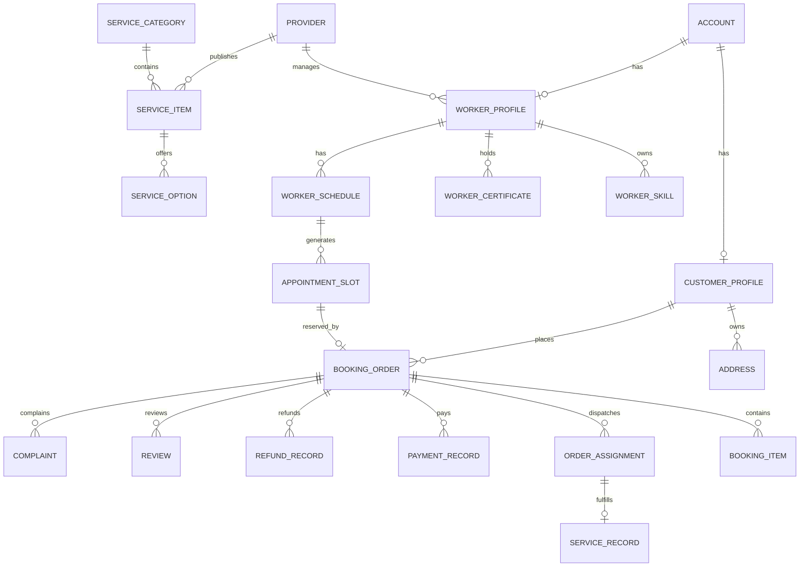

# 家政服务预约平台产品需求与领域模型

> 业务口径说明：项目已收敛为“单公司自营”模式。涉及商家入驻、`MERCHANT_ADMIN`、多商家抽佣和抢单的部分仅作为历史方案或后续扩展，不作为当前实施范围。最新模块边界见 [modules/README.md](./modules/README.md)。

## 1. 产品定位

### 1.1 一句话定位

面向单一城市或若干城区的家政服务预约平台，连接消费者、家政服务人员和家政服务组织，支持服务展示、可用时段预约、人员派单、上门履约、完成确认、评价和售后。

### 1.2 产品边界

平台属于本地生活 O2O 的垂直家政领域，不包含餐饮、酒店、团购等综合业务。

首版聚焦标准单次服务，同时为周期预约保留数据结构和扩展能力。

### 1.3 核心价值

- 对消费者：价格透明、人员可信、时段可选、过程可追踪、售后有记录。
- 对服务人员：档期清晰、订单可接、服务记录可沉淀、收入可查询。
- 对商家或平台：供给可管理、人员可调度、订单风险可控、经营数据可统计。

## 2. 角色与权限

### 2.1 推荐角色

| 角色 | 说明 | 数据边界 |
| --- | --- | --- |
| 消费者 `CUSTOMER` | 购买并接受家政服务 | 只能访问自己的地址、订单、支付、评价和投诉 |
| 家政服务人员 `WORKER` | 实际提供上门服务 | 只能访问自己的技能、证书、排班、被分配订单和必要用户信息 |
| 家政公司管理员 `MERCHANT_ADMIN` | 管理公司、服务项目、人员、订单和售后 | 只能访问所属公司的数据 |
| 平台管理员 `PLATFORM_ADMIN` | 审核、调度、运营和监管 | 可访问全局数据，但敏感操作必须审计 |

如果首版采用单公司自营模式，可以不对外开放 `MERCHANT_ADMIN` 注册，但建议保留 `provider` 或 `merchant` 概念，以免后续无法扩展。

### 2.2 权限原则

- 认证与业务身份分离。一个账号可以绑定消费者或服务人员身份，但首版建议一个账号只对应一个主要角色。
- 所有列表查询必须带数据范围条件，不能仅依赖前端隐藏按钮。
- 商家管理员访问订单、服务人员、客户地址时，必须校验 `merchant_id`。
- 服务人员访问订单时，必须校验当前分配关系。
- 管理员查看敏感字段、导出数据和修改订单状态时记录审计日志。

## 3. MVP 范围

### 3.1 必做模块

| 模块 | 首版能力 |
| --- | --- |
| 账号与认证 | 注册、登录、JWT、角色校验、密码加密、账号状态 |
| 用户档案 | 昵称、手机号、头像、常用地址、默认地址 |
| 服务目录 | 服务分类、服务项目、价格、时长、服务范围、上下架 |
| 家政人员 | 人员档案、技能、证书、健康信息审核状态、可服务区域 |
| 排班与时段 | 人员可服务时段、时段状态、时段锁定与释放 |
| 预约订单 | 价格计算、提交订单、支付模拟、取消、改期、状态流转 |
| 派单接单 | 平台派单或商家派单、接单、拒单、超时、改派 |
| 履约 | 签到、开始服务、服务项记录、照片、完成申请、用户确认 |
| 评价投诉 | 服务评价、投诉工单、处理结果、人员信用影响 |
| 支付记录 | 模拟支付、支付流水、退款申请、退款记录 |
| 通知 | 站内消息、订单状态通知、派单通知 |
| 管理后台 | 用户、商家、人员、服务、订单、售后、统计和审计 |

### 3.2 可选模块

- 优惠券。
- 收藏和历史服务快捷复购。
- 在线聊天。
- 地图选点和距离估算。
- 周期预约规则。
- 智能推荐或匹配。

### 3.3 明确不做或只做模拟

- 真实微信支付或支付宝清算。
- 真实短信验证码服务。
- 实时 GPS 轨迹。
- 保险购买和理赔。
- 工资代发和税务。
- 跨城市加盟商分账。
- 长住保姆合同全生命周期。

## 4. 功能需求

### 4.1 消费者端

| 编号 | 功能 | 关键要求 |
| --- | --- | --- |
| C-01 | 注册登录 | 手机号或账号登录，密码使用 BCrypt 或 Argon2 哈希 |
| C-02 | 地址管理 | 地址、联系人、电话、区域、门牌、经纬度、默认地址 |
| C-03 | 服务浏览 | 一级分类、二级分类、列表、详情、价格、时长、评分、销量 |
| C-04 | 服务搜索 | 关键词、分类、价格、服务区域、可预约日期 |
| C-05 | 服务规格 | 面积、数量、时长、加项、耗材等选项 |
| C-06 | 可用时段 | 按日期展示可预约时段，下单前再次校验 |
| C-07 | 价格预览 | 基础价、加项、上门费、优惠和应付金额分项展示 |
| C-08 | 提交订单 | 保存服务价格快照、地址快照和规则快照 |
| C-09 | 模拟支付 | 支付成功后进入待派单，禁止重复支付 |
| C-10 | 订单列表 | 按状态筛选，支持分页，禁止全量内存分页 |
| C-11 | 订单详情 | 服务、人员、时间、地址、价格、状态时间线和履约记录 |
| C-12 | 取消订单 | 按状态和取消规则计算违约金或退款金额 |
| C-13 | 改期 | 选择新时段并通过事务完成新锁旧放 |
| C-14 | 确认完成 | 查看服务记录后确认，或按配置超时自动确认 |
| C-15 | 评价 | 综合分、态度、质量、准时、文字和图片 |
| C-16 | 投诉 | 选择问题类型、填写说明、上传证据、查看处理进度 |

### 4.2 家政服务人员端

| 编号 | 功能 | 关键要求 |
| --- | --- | --- |
| W-01 | 人员注册 | 实名信息、联系方式、服务区域、工作类型 |
| W-02 | 人员档案 | 头像、简介、从业年限、评分、接单状态 |
| W-03 | 技能管理 | 技能标签、熟练等级、可执行的服务分类 |
| W-04 | 证书与健康 | 证件类型、编号、有效期、审核状态、附件受控访问 |
| W-05 | 排班 | 按日或周维护可服务时段，支持休息和请假 |
| W-06 | 可接订单 | 只展示服务区域、技能和时段匹配的订单 |
| W-07 | 接单拒单 | 接单前检查人员是否仍可用，拒绝需填写原因 |
| W-08 | 履约 | 签到、开始服务、勾选服务项、上传前后照片、申请完成 |
| W-09 | 异常上报 | 用户不在家、地址错误、服务无法完成、现场加项 |
| W-10 | 收入记录 | 订单金额、平台服务费、预计收入、结算状态 |

### 4.3 家政公司或平台运营端

| 编号 | 功能 | 关键要求 |
| --- | --- | --- |
| O-01 | 商家入驻 | 企业信息、证照、审核状态、经营区域 |
| O-02 | 服务管理 | 创建分类和项目、价格规则、服务标准、上下架、审核 |
| O-03 | 人员管理 | 新增人员、绑定商家、审核技能证书、启用停用 |
| O-04 | 排班管理 | 批量生成周排班、查看占用、代人员调整 |
| O-05 | 订单派单 | 手工派单、推荐人员、批量改派、查看接单超时 |
| O-06 | 订单监控 | 待支付、待派单、待接单、服务中、异常订单 |
| O-07 | 售后处理 | 退款审核、投诉工单、补偿、人员责任认定 |
| O-08 | 评价管理 | 查看评价、审核违规内容、商家回复 |
| O-09 | 数据统计 | 订单量、成交额、完成率、取消率、人员利用率、评分 |
| O-10 | 审计日志 | 订单改派、退款、敏感字段查看和数据导出 |

## 5. 核心用例和验收标准

### 5.1 预约下单

前置条件：

- 用户已登录。
- 地址在服务范围内。
- 所选服务已上架。
- 所选时段仍可用。

主流程：

1. 用户选择服务、规格、地址和时段。
2. 系统计算价格并返回明细。
3. 用户提交订单。
4. 系统在同一事务内校验时段并锁定。
5. 系统创建订单、订单明细和状态日志。
6. 用户完成模拟支付。
7. 系统将订单转入待派单。

验收标准：

- 同一人员同一时段不能生成两个有效预约。
- 服务项目在下单后改价不影响本订单。
- 重复提交相同幂等键不会产生两个订单。
- 支付失败或超时后，订单可取消且时段释放。

### 5.2 派单与接单

验收标准：

- 订单只能从待派单进入已派单。
- 一个订单可存在多条派单记录，但同一时刻只有一个当前派单。
- 服务人员不能接不属于自己的派单。
- 接单必须再次校验时段，避免管理员派单后人员被停用或时段被占用。
- 超时未接单后，当前派单失效并重新进入待派单。

### 5.3 改期

验收标准：

- 新时段可用时，先锁定新时段，再释放旧时段。
- 新时段不可用时，原订单和原时段保持不变。
- 改期保存历史记录，不修改原预约时间的审计信息。
- 已开始服务的订单不能改期。

### 5.4 完成确认

验收标准：

- 只有服务中的订单可以申请完成。
- 申请完成必须存在必要的服务记录。
- 用户确认后订单进入已完成。
- 自动确认时间必须可配置，并记录系统操作来源。
- 完成后可进入评价或售后流程。

## 6. 订单状态机

### 6.1 主状态

```text
PENDING_PAYMENT       待支付
PENDING_DISPATCH      待派单
PENDING_ACCEPT        待接单
ACCEPTED              已接单
EN_ROUTE              前往中，可选
IN_SERVICE            服务中
PENDING_CONFIRM       待用户确认
COMPLETED             已完成
CANCELED              已取消
CLOSED                已关闭
```

评价状态独立维护：

```text
NOT_REVIEWED
REVIEWED
```

### 6.2 售后状态

售后状态和评价状态都不建议直接混入主订单状态，可以使用独立字段或独立工单：

```text
NONE
REFUND_REQUESTED
REFUND_APPROVED
REFUND_REJECTED
REFUNDED
COMPLAINT_PROCESSING
COMPLAINT_RESOLVED
```

### 6.3 合法转换

| 当前状态 | 可转换状态 | 触发角色 |
| --- | --- | --- |
| 待支付 | 待派单、已取消 | 用户、系统 |
| 待派单 | 待接单、已取消 | 平台、商家、用户 |
| 待接单 | 已接单、待派单、已取消 | 服务人员、平台、商家 |
| 已接单 | 服务中、待派单 | 服务人员、平台、商家 |
| 服务中 | 待确认 | 服务人员、平台 |
| 待确认 | 已完成 | 用户、系统 |
| 已完成 | 无主状态变更，可评价或进入售后 | 用户 |

所有转换必须通过领域服务统一校验，不能在各 Controller 中直接修改状态字段。

## 7. 领域模型

### 7.1 核心聚合

| 聚合 | 说明 | 核心实体 |
| --- | --- | --- |
| 账号与身份 | 统一认证，业务身份分表 | `account`、`customer_profile`、`worker_profile` |
| 服务组织 | 商家和门店 | `provider`、`store`、`provider_staff` |
| 服务目录 | 分类、SPU、SKU、规格和价格规则 | `service_category`、`service_item`、`service_option` |
| 人员能力 | 人员技能、证书、健康和服务区域 | `worker_skill`、`worker_certificate`、`worker_service_area` |
| 排班时段 | 人员可用时间和时段库存 | `worker_schedule`、`appointment_slot` |
| 预约订单 | 交易和预约的主聚合 | `booking_order`、`booking_item`、`booking_status_log` |
| 派单履约 | 候选人员、派单、接单、签到和服务记录 | `order_candidate`、`order_assignment`、`service_record`、`service_evidence` |
| 支付售后 | 支付、退款、投诉和评价 | `payment_record`、`refund_record`、`complaint`、`review` |
| 消息审计 | 通知和敏感操作日志 | `notification`、`audit_log` |

### 7.2 关系概览



### 7.3 关键表建议

#### 账号与用户

`account`

- `id`
- `username`
- `phone`
- `password_hash`
- `role`
- `status`
- `last_login_at`
- `created_at`
- `updated_at`
- `deleted`

`customer_profile`

- `id`
- `account_id`
- `nickname`
- `avatar_url`
- `default_address_id`

`address`

- `id`
- `customer_id`
- `contact_name`
- `contact_phone`
- `city_code`
- `district_code`
- `service_area_id`
- `detail`
- `door_no`
- `longitude`
- `latitude`
- `is_default`
- `deleted`

#### 商家与人员

`provider`

- `id`
- `name`
- `license_no`
- `contact_phone`
- `audit_status`
- `service_status`

`worker_profile`

- `id`
- `account_id`
- `provider_id`
- `real_name`
- `gender`
- `avatar_url`
- `experience_years`
- `service_status`
- `audit_status`
- `rating`
- `completed_order_count`

`worker_skill`

- `id`
- `worker_id`
- `service_category_id`
- `skill_level`
- `verified`

`worker_certificate`

- `id`
- `worker_id`
- `certificate_type`
- `certificate_no`
- `file_id`
- `issued_at`
- `expires_at`
- `audit_status`

`worker_service_area`

- `id`
- `worker_id`
- `service_area_id`

#### 服务目录

`service_category`

- `id`
- `parent_id`
- `name`
- `icon_url`
- `sort_order`
- `status`

`service_item`

- `id`
- `provider_id`
- `category_id`
- `name`
- `service_type`
- `base_price`
- `duration_minutes`
- `min_area`
- `max_area`
- `pricing_mode`
- `service_scope`
- `service_standard`
- `review_status`
- `sale_status`

`service_option`

- `id`
- `service_item_id`
- `option_name`
- `option_type`
- `option_values_json`
- `price_rule_json`
- `required`

#### 排班与时段

`worker_schedule`

- `id`
- `worker_id`
- `service_date`
- `start_time`
- `end_time`
- `schedule_type`
- `status`

`appointment_slot`

- `id`
- `worker_id`
- `service_date`
- `start_time`
- `end_time`
- `buffer_minutes`
- `status`
- `version`

`status` 建议值：

- `AVAILABLE`
- `LOCKED`
- `BOOKED`
- `DISABLED`

#### 预约订单

`booking_order`

- `id`
- `order_no`
- `customer_id`
- `provider_id`
- `service_item_id`
- `worker_id`
- `slot_id`
- `dispatch_mode`
- `service_address_snapshot`
- `contact_name_snapshot`
- `contact_phone_snapshot`
- `appointment_start`
- `appointment_end`
- `service_amount`
- `addon_amount`
- `travel_fee`
- `discount_amount`
- `payable_amount`
- `paid_amount`
- `order_status`
- `review_status`
- `after_sale_status`
- `cancel_reason`
- `version`
- `created_at`
- `paid_at`
- `accepted_at`
- `started_at`
- `completed_at`

`booking_item`

- `id`
- `booking_id`
- `item_type`
- `name_snapshot`
- `unit_price_snapshot`
- `quantity`
- `amount`

`booking_status_log`

- `id`
- `booking_id`
- `from_status`
- `to_status`
- `operator_id`
- `operator_role`
- `reason`
- `created_at`

#### 派单与履约

`order_candidate`

- `id`
- `booking_id`
- `worker_id`
- `distance_meters`
- `match_score`
- `match_reason_json`
- `status`
- `notified_at`
- `expired_at`
- `created_at`

`order_assignment`

- `id`
- `booking_id`
- `worker_id`
- `assign_type`
- `status`
- `assigned_by`
- `assigned_at`
- `accepted_at`
- `rejected_at`
- `reject_reason`

`service_record`

- `id`
- `booking_id`
- `worker_id`
- `check_in_at`
- `check_in_location`
- `started_at`
- `finished_at`
- `checkout_location`
- `service_result`
- `customer_signature_url`
- `confirm_code`

`service_evidence`

- `id`
- `service_record_id`
- `evidence_type`
- `file_id`
- `description`

#### 资金与售后

`payment_record`

- `id`
- `payment_no`
- `booking_id`
- `pay_channel`
- `amount`
- `status`
- `third_party_trade_no`
- `paid_at`

`refund_record`

- `id`
- `refund_no`
- `booking_id`
- `payment_id`
- `amount`
- `reason`
- `status`
- `requested_by`
- `reviewed_by`
- `refunded_at`

`complaint`

- `id`
- `complaint_no`
- `booking_id`
- `customer_id`
- `provider_id`
- `worker_id`
- `category`
- `description`
- `status`
- `priority`
- `handler_id`
- `resolution`
- `created_at`
- `resolved_at`

`review`

- `id`
- `booking_id`
- `customer_id`
- `worker_id`
- `service_score`
- `attitude_score`
- `quality_score`
- `punctuality_score`
- `content`
- `status`

## 8. 数据库与并发设计

### 8.1 必须有的约束

- `account.phone` 唯一。
- `booking_order.order_no` 唯一。
- `payment_record.payment_no` 唯一。
- `refund_record.refund_no` 唯一。
- `worker_schedule` 同一人员、同一日期的有效班次不能重叠。
- `appointment_slot` 同一人员、同一开始时间唯一。
- `review.booking_id` 唯一，避免重复评价。
- 所有业务表带逻辑删除字段时，唯一索引必须考虑逻辑删除后的唯一性策略。

### 8.2 时段锁定

推荐使用条件更新：

```sql
UPDATE appointment_slot
SET status = 'LOCKED', version = version + 1
WHERE id = ?
  AND status = 'AVAILABLE'
  AND version = ?;
```

影响行数为 1 才表示锁定成功。订单创建失败时必须释放时段。

### 8.3 支付幂等

- 客户端提交 `Idempotency-Key`。
- `payment_record` 保存请求幂等键或唯一业务号。
- 重复回调根据第三方交易号和支付单号幂等处理。
- 支付状态只能从 `UNPAID` 转 `PAID`，不能反向直接覆盖。

### 8.4 事务边界

- 下单和锁时段在同一事务。
- 支付成功、更新订单、写支付流水和写状态日志在同一事务。
- 退款申请和退款记录分开，外部退款成功后再更新状态。
- 订单状态变更和状态日志必须同时成功或同时回滚。

## 9. API 边界建议

### 9.1 消费者端

```text
POST   /api/customer/auth/register
POST   /api/customer/auth/login
GET    /api/customer/services
GET    /api/customer/services/{id}
GET    /api/customer/services/{id}/availability
POST   /api/customer/bookings/preview
POST   /api/customer/bookings
POST   /api/customer/bookings/{id}/pay
GET    /api/customer/bookings
GET    /api/customer/bookings/{id}
PUT    /api/customer/bookings/{id}/cancel
PUT    /api/customer/bookings/{id}/reschedule
PUT    /api/customer/bookings/{id}/confirm
POST   /api/customer/bookings/{id}/review
POST   /api/customer/bookings/{id}/complaints
```

### 9.2 服务人员端

```text
GET    /api/worker/profile
PUT    /api/worker/profile
GET    /api/worker/assignments
PUT    /api/worker/assignments/{id}/accept
PUT    /api/worker/assignments/{id}/reject
POST   /api/worker/bookings/{id}/check-in
POST   /api/worker/bookings/{id}/start
POST   /api/worker/bookings/{id}/complete
GET    /api/worker/schedules
POST   /api/worker/schedules
```

### 9.3 商家和管理端

```text
GET    /api/merchant/workers
POST   /api/merchant/workers
POST   /api/merchant/services
PUT    /api/merchant/services/{id}
GET    /api/merchant/bookings
POST   /api/merchant/bookings/{id}/assign
POST   /api/merchant/bookings/{id}/reassign
GET    /api/admin/audit/workers
GET    /api/admin/audit/services
GET    /api/admin/orders
GET    /api/admin/complaints
PUT    /api/admin/refunds/{id}/review
```

## 10. 后端模块划分

推荐单体 Spring Boot，按业务模块分包：

```text
common         通用返回、异常、分页、枚举、工具
auth           登录、JWT、密码、角色和数据权限
customer       用户档案、地址
provider       商家、门店和商家成员
worker         家政人员、技能、证书、服务区域
catalog        分类、服务项目、规格、价格规则
scheduling     排班、时段、可用性查询
booking        订单、价格快照、状态机、取消和改期
dispatch       派单、接单、拒单和改派
fulfillment    签到、服务记录、证据和确认
payment        支付记录、退款
review         评价
aftersale      投诉和售后工单
notification   站内消息
admin          审核、运营和统计
audit          操作日志和敏感访问记录
```

模块之间通过 Service 接口协作，不直接跨模块修改表。首版保持一个 Maven 工程和一个数据库，不引入微服务、注册中心和分布式事务。

## 11. 对 `housekeeping-o2o` 候选仓库的改造映射

### 11.1 可以直接借鉴

- 用户、商家、服务项目、订单、支付记录、评价和优惠券模型。
- Spring Boot 3.2.5、MyBatis-Plus、JWT、Redis 和 Swagger 基础设施。
- 用户、商家、管理员三组 Controller 的路径组织方式。
- 订单状态、支付模拟和商家订单流程。

### 11.2 必须新增

- `worker_profile` 家政人员档案。
- `worker_skill` 技能标签。
- `worker_certificate` 证书和健康证明。
- `worker_service_area` 服务区域。
- `worker_schedule` 和 `appointment_slot` 排班与时段。
- `order_assignment` 派单记录。
- `service_record` 和 `service_evidence` 履约记录。
- `complaint` 投诉工单。
- `audit_log` 敏感操作审计。

### 11.3 必须重构

- 去掉用户端演示接单、演示完成等测试接口。
- 订单分页改成数据库分页。
- 支付和优惠券扣减增加幂等、锁和事务校验。
- JWT 密钥、数据库密码和地图密钥改为环境变量。
- 所有状态修改集中到领域服务，写状态日志。
- 增加 `src/test`，覆盖下单、并发锁时段、重复支付、改期和取消。

## 12. 阶段计划

### 阶段一：可运行闭环

- 账号、地址、服务目录。
- 人员档案、排班和可预约时段。
- 下单、模拟支付、派单、接单、完成、评价。
- 基础管理后台和订单状态日志。

### 阶段二：可信与售后

- 技能、证书、健康审核。
- 服务记录和照片证据。
- 取消、改期、退款和投诉。
- 审计日志和敏感字段脱敏。

### 阶段三：论文增量

- 基于服务区域、技能、评分和利用率的派单策略。
- 时段冲突检测和并发控制。
- 人员信用分与投诉影响机制。
- 周期预约和智能复购提醒。

## 13. 答辩时需要讲清楚的创新点

不建议把“使用 Spring Boot 和 MySQL”包装成创新。更有说服力的增量是：

1. 面向家政场景的“服务项目 + 人员技能 + 可用时段”三阶段匹配。
2. 基于事务条件更新的时段占用和改期一致性。
3. 订单主状态与售后状态分离的状态机。
4. 服务履约证据链和人员信用反馈。
5. 按角色最小化的隐私访问和审计。

这些能力与家政业务强相关，也能在代码和测试中明确展示。
