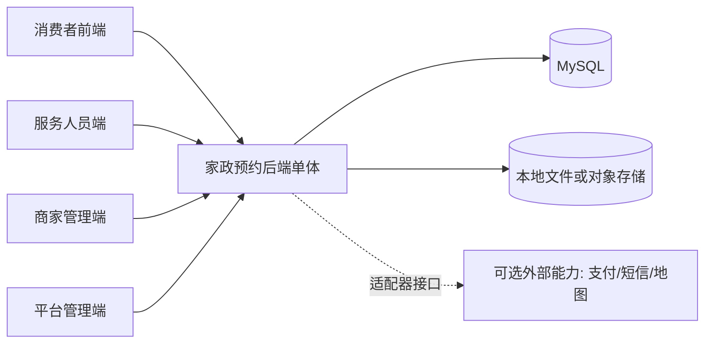
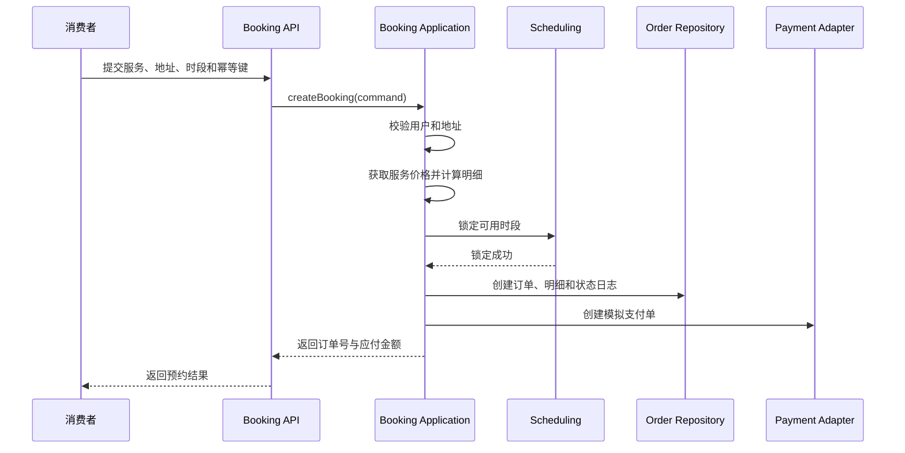
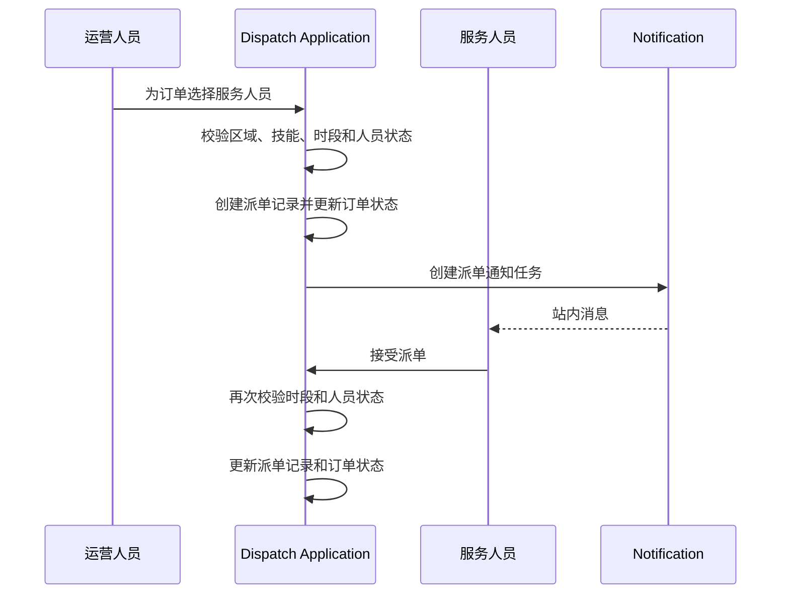

# 家政服务预约平台系统架构设计

> 本文描述可运行的基础架构。Redis、MinIO、高德地图、WebSocket 和附近人员调度等企业级增强方案，见 [04-企业级增强技术方案.md](./04-企业级增强技术方案.md)。

> 业务口径说明：当前项目采用单公司自营模式。文档中的商家入驻和开放抢单内容仅作为后续扩展参考，当前业务模块以 [modules/README.md](./modules/README.md) 为准。

## 1. 文档目的

本文用于确定项目骨架、技术选型、模块边界、数据访问方式、部署方式和开发规范。本文只描述架构设计，不包含代码实现。

架构设计基于以下前提：

- 项目是本科毕业设计，需要可运行、可演示、可讲清楚。
- 后端采用 Java 和 Spring Boot。
- 不使用微服务、注册中心、网关集群和分布式事务。
- 首版只要求一个 Spring Boot 进程和 MySQL，其他中间件可选。
- 前端由用户自行开发，后端提供 REST API。
- 项目需要保留后续扩展空间，但不能为了“看起来高级”引入无效复杂度。

## 2. 架构结论

### 2.1 总体形态

采用**模块化单体**：

```text
一个 Maven 工程
一个 Spring Boot 进程
一个 MySQL 数据库
按业务能力分包
模块内部轻量分层
模块之间通过应用服务接口协作
```

不采用微服务的原因：

- 本地开发需要启动多个进程和多个中间件，调试成本高。
- 预约下单需要跨订单、排班和支付保持一致，微服务会引入分布式事务。
- 当前规模没有独立扩容需求。
- 模块边界通过包结构和依赖规则约束即可。

### 2.2 核心原则

1. 业务优先。先保证预约、派单、履约、评价和售后闭环，再考虑推荐、聊天和复杂营销。
2. 简单部署。默认只需要 JDK、Maven 和 MySQL。
3. 明确边界。每个业务模块拥有自己的数据和服务，不跨模块直接操作 Mapper。
4. 显式状态。订单、支付、派单和售后状态使用枚举与状态机，不直接修改字符串。
5. 数据可追溯。关键业务操作写状态日志，敏感操作写审计日志。
6. 外部能力可替换。支付、短信、对象存储和地图通过接口隔离，默认使用本地实现。
7. 不过度抽象。不引入完整 DDD 的复杂分层，不做多层 DTO 转换轰炸。

### 2.3 架构风格

采用“模块化单体 + 模块内轻量分层”：

```text
API 层
  -> Application 层
  -> Domain Policy / Domain Service
  -> Infrastructure 或 Mapper
```

解释：

- API 层负责 HTTP 协议、参数校验、权限入口和响应转换。
- Application 层负责用例编排、事务边界、幂等和数据权限。
- Domain 层负责状态机、计价规则、时段规则和履约规则。
- Infrastructure 层负责 MyBatis Mapper、文件、短信和支付适配。

首版允许业务实体直接使用 MyBatis-Plus 注解，但状态转换和关键业务规则不能分散在 Controller 中。

## 3. 技术选型

### 3.1 推荐技术栈

| 类别 | 选择 | 建议版本 | 选择原因 |
| --- | --- | --- | --- |
| JDK | OpenJDK | 17 LTS | Spring Boot 3 兼容、学校环境普遍、升级成本低于 Java 21 |
| Web 框架 | Spring Boot | 3.5.x | 单体开发效率高、生态稳定、支持 Java 17 |
| 构建工具 | Maven | 3.9.x | Java 毕设使用广泛、配置直观、依赖管理明确 |
| 持久层 | MyBatis-Plus | 3.5.x | CRUD 简单，复杂查询仍可使用 XML，便于论文展示 SQL |
| 数据库 | MySQL | 8.0.x | 本地部署简单、Navicat 和命令行工具普及 |
| 数据库迁移 | Flyway + flyway-mysql | 使用 Spring Boot BOM 管理版本 | 版本化建表和数据初始化，避免启动时随意改表 |
| 安全框架 | Spring Security 6 | 使用 Spring Boot BOM | 标准认证授权方案，支持过滤器链和方法权限 |
| JWT | JJWT | 0.12.x | 轻量、配置直观、适合单体 REST API |
| 参数校验 | Jakarta Validation | 使用 Spring Boot BOM | Controller 和 DTO 统一校验 |
| API 文档 | Springdoc OpenAPI | 与 Spring Boot 3.5 兼容的 2.x 版本 | 自动生成 Swagger，方便前端联调 |
| 本地缓存 | Caffeine | 3.x | 缓存分类和配置，不引入 Redis 依赖 |
| 日志 | SLF4J + Logback | 使用 Spring Boot BOM | 标准日志方案，支持 traceId |
| 测试 | JUnit 5、AssertJ、Mockito、MockMvc、ArchUnit | 使用 Spring Boot BOM，ArchUnit 单独管理 | 单元、接口、架构边界和集成测试完整 |
| 集成测试数据库 | Testcontainers MySQL | 可选 | 避免 H2 与 MySQL 方言不一致 |
| 容器 | Docker Compose | 可选 | 只用于本地启动 MySQL，不要求部署微服务 |

### 3.2 可选技术

| 技术 | 何时使用 | 首版是否必须 |
| --- | --- | --- |
| Redis 7 | 登录限流、验证码、分布式锁、热点缓存 | 否 |
| MinIO 或 S3 | 需要集中管理服务记录照片和证件附件 | 否，先使用本地文件适配器 |
| AMap 或百度地图 | 服务区域选点、距离计算 | 否，先使用行政区与服务区域表 |
| Testcontainers | 自动化集成测试 | 否，可作为第二阶段质量提升 |
| ShedLock | 单机定时任务扩展到多实例 | 否 |
| Prometheus + Grafana | 运行监控 | 否 |

### 3.3 明确不选

| 技术或方案 | 不选原因 |
| --- | --- |
| Spring Cloud、Nacos、Gateway | 本项目是单体，引入后只会增加启动和调试成本 |
| Seata、Kafka | 没有跨服务事务和流式数据平台需求 |
| Elasticsearch | 服务数量有限，MySQL 全文或普通索引足够 |
| ShardingSphere | 没有分库分表需求 |
| XXL-Job | 单机 Spring Scheduler 足够 |
| 代码生成器直接生成全系统 | 容易产生大量重复 CRUD，领域规则不清晰 |
| Hibernate `ddl-auto=update` | 数据库结构不可审计，容易误改生产数据 |
| H2 作为主测试数据库 | 与 MySQL 的 SQL、索引和锁行为不完全一致 |
| Sa-Token 或 Shiro | 可以使用，但 Spring Security 更适合作为标准技术栈 |
| 微前端 | 前端由用户自行开发，后端不限制前端组织方式 |

### 3.4 版本策略

- 项目开始实现时锁定具体版本，避免依赖自动漂移。
- Spring Boot 管理的依赖优先使用 BOM，不随意指定冲突版本。
- MyBatis-Plus、JJWT 和 springdoc 需要单独核对与 Spring Boot 的兼容性。
- 不使用未经测试的最新大版本。
- 升级依赖后必须执行完整测试，并记录在变更日志。

## 4. 系统上下文

### 4.1 系统上下文图



### 4.2 运行时组成

本地开发和答辩环境：

```text
后端 Spring Boot 进程
MySQL 8
本地文件目录
前端开发服务器或静态文件
```

生产化演示环境：

```text
Nginx
  -> Spring Boot 可执行 JAR
  -> MySQL 8
  -> 文件存储目录或对象存储
```

### 4.3 部署原则

- 后端打包为一个可执行 JAR。
- 数据库账号通过环境变量注入。
- 上传文件不放进 Git 仓库。
- 开发、测试和生产使用不同配置文件。
- 不在代码中写死数据库密码、JWT 密钥和地图 Key。
- Redis、MinIO、短信和真实支付均为可选依赖。

## 5. 后端模块设计

### 5.1 模块列表

| 模块 | 职责 | 主要对象 |
| --- | --- | --- |
| `identity` | 账号、认证、JWT、角色、登录安全 | `account`、`role`、`token_version` |
| `customer` | 消费者档案、地址、常用地址 | `customer_profile`、`address` |
| `organization` | 家政公司、门店、服务人员、技能、证书 | `provider`、`store`、`worker_profile`、`worker_certificate` |
| `catalog` | 服务分类、服务项目、规格、价格规则、上下架 | `service_category`、`service_item`、`service_option` |
| `scheduling` | 排班、可预约时段、时段锁定和释放 | `worker_schedule`、`appointment_slot` |
| `ordering` | 预约订单、派单、接单、履约、支付记录和退款 | `booking_order`、`order_assignment`、`service_record`、`payment_record` |
| `servicequality` | 评价、投诉、售后工单和服务质量反馈 | `review`、`complaint` |
| `notification` | 站内消息、订单通知、发送任务 | `notification` |
| `admin` | 平台审核、运营查询、统计和配置 | 组合其他模块的公开查询能力 |
| `audit` | 敏感操作审计、访问日志和数据导出记录 | `audit_log` |
| `file` | 文件元数据、受控上传和访问 | `file_object` |
| `common` | 通用返回、异常、分页、枚举、工具和基础配置 | 不包含具体业务 |

### 5.2 `ordering` 模块的子域

订单是项目的核心聚合。为了避免模块之间循环依赖，将强相关能力放在同一个 `ordering` 模块内：

```text
ordering
  booking       预约订单和状态机
  dispatch      派单、接单、拒单和改派
  fulfillment   签到、服务项、证据和完成确认
  payment       模拟支付、支付记录和退款记录
```

这四个子域共享一个应用服务边界和数据库事务，但仍保持独立包结构。后续接入真实支付时，只替换 `PaymentGateway` 适配器，不重写订单领域。

### 5.3 模块依赖规则

推荐的依赖方向如下，箭头表示“调用方 -> 被调用方”：

```text
所有业务模块 -> common
customer -> identity
organization -> identity
catalog -> organization
scheduling -> organization, catalog
ordering -> identity, customer, organization, catalog, scheduling, notification, audit
servicequality -> ordering, customer, organization, notification, audit
admin -> identity, customer, organization, catalog, scheduling, ordering, servicequality, audit
notification -> common
audit -> common
```

约束：

- 业务模块不能依赖 `admin`。
- `common` 不能依赖任何业务模块。
- 模块之间不能直接调用其他模块的 Mapper。
- 跨模块只调用公开的 Application Service 或 Port 接口。
- 业务模块不能直接读取其他模块的数据库表。
- `ordering` 不依赖 `servicequality`，评价和投诉通过订单公开查询接口获取数据。
- 通知和审计失败不能回滚核心业务，除非该通知是业务主链路的一部分。

### 5.4 跨模块协作方式

基础版不引入消息队列，使用以下方式：

- 同步查询：通过公开 Query Service 获取服务、人员、时段和订单快照。
- 同步命令：涉及一致性的事务在同一个应用服务内编排。
- 进程内事件：订单状态变化后发布 Spring 事件，用于站内通知和非关键副作用。
- 数据库任务表：需要重试的通知和外部调用写入发送任务，由定时任务处理。

不把进程内事件当作强一致事务机制。关键数据仍需在同一事务内完成。

企业级增强版使用 RocketMQ 承载事务提交后的异步事件，详见 [04-企业级增强技术方案.md](./04-企业级增强技术方案.md)。

## 6. 项目目录骨架

### 6.1 仓库根目录

```text
housekeeping-platform/
├─ pom.xml
├─ mvnw
├─ mvnw.cmd
├─ .mvn/
│  └─ wrapper/
├─ src/
│  ├─ main/
│  │  ├─ java/
│  │  ├─ resources/
│  │  └─ webapp/                  # 默认不创建，前端独立开发
│  └─ test/
│     └─ java/
├─ scripts/
│  ├─ dev/
│  └─ db/
├─ docker/
│  └─ docker-compose.yml          # 可选，只启动 MySQL
├─ docs/
├─ .env.example
├─ .gitignore
└─ README.md
```

### 6.2 Java 包结构

该布局属于 **Package by Feature / Package by Module（按功能或业务模块分包）**，同时每个业务模块内部保留轻量 MVC 和分层结构，即 **Vertical Slicing + Layered Architecture**。

业务模块是顶层结构，不允许把所有模块的 Controller、Service 和 Mapper 分别放在全局 `controller`、`service`、`mapper` 目录中。

```text
com.example.housekeeping
├─ HousekeepingApplication.java
├─ bootstrap/
│  ├─ config/
│  └─ web/
├─ common/
│  ├─ api/
│  ├─ exception/
│  ├─ pagination/
│  ├─ security/
│  ├─ persistence/
│  ├─ enums/
│  └─ util/
├─ identity/
├─ customer/
├─ organization/
├─ catalog/
├─ scheduling/
├─ ordering/
├─ servicequality/
├─ notification/
├─ admin/
├─ audit/
└─ file/
```

### 6.3 单模块内部结构

以 `ordering` 为例：

```text
ordering/
├─ api/
│  ├─ customer/
│  ├─ worker/
│  ├─ merchant/
│  └─ admin/
├─ application/
│  ├─ booking/
│  ├─ dispatch/
│  ├─ fulfillment/
│  ├─ payment/
│  └─ query/
├─ domain/
│  ├─ order/
│  ├─ assignment/
│  ├─ fulfillment/
│  ├─ payment/
│  └─ policy/
├─ dto/
├─ vo/
└─ infrastructure/
   ├─ persistence/
   ├─ payment/
   └─ notification/
```

说明：

- `api` 只放 Controller、请求对象和响应转换。
- `application` 放用例、事务、幂等和数据权限。
- `domain` 放枚举、状态机、计价规则和领域服务。
- `infrastructure` 放 Mapper、外部适配器和持久化实现。
- `dto` 用于请求和内部用例入参。
- `vo` 用于接口返回，不直接返回数据库实体。
- 每个模块的 Controller、Service、Entity、Mapper 和 VO 必须位于该模块内部，形成垂直切片。

## 7. 数据架构

### 7.1 数据库设计原则

- 所有表使用 `utf8mb4`。
- 表名和字段名使用 `snake_case`。
- 主键使用 `BIGINT` 自增，当前不需要分布式 ID。
- 业务单号单独生成，例如 `BK202610220001`。
- 金额使用 `DECIMAL(12,2)`，Java 使用 `BigDecimal`。
- 时间统一使用服务端 `Asia/Shanghai` 时区，数据库使用 `DATETIME(3)`。
- 状态字段使用 `VARCHAR(32)` 保存英文枚举值，不直接写中文。
- 重要记录保留 `created_at`、`updated_at`。
- 用户可删除的业务数据使用 `deleted` 逻辑删除。
- 订单、支付、退款、审计和状态日志不使用逻辑删除。
- 核心关系表使用外键和联合索引，不允许级联删除业务数据。

### 7.2 事务边界

| 用例 | 事务范围 |
| --- | --- |
| 创建订单 | 校验服务、校验地址、锁定时段、写订单、写明细、写状态日志 |
| 模拟支付 | 更新订单、写支付记录、写状态日志、写资金记录 |
| 取消订单 | 更新订单、写状态日志、释放时段、写退款申请 |
| 改期 | 锁定新时段、更新订单时间、释放旧时段、写改期记录 |
| 派单 | 写派单记录、更新订单状态、写状态日志 |
| 接单 | 更新派单记录、更新订单、写状态日志 |
| 完成申请 | 更新履约记录、更新订单、写状态日志 |
| 用户确认 | 更新订单、写状态日志、发布通知事件 |
| 评价 | 写评价、更新评价状态、计算人员评分 |

### 7.3 时段并发

时段是预约系统的核心并发资源。

实现规则：

- `appointment_slot` 保存人员、日期、开始时间、结束时间和状态。
- 同一人员同一开始时间使用唯一索引。
- 下单时使用带状态条件的原子更新，例如 `AVAILABLE -> LOCKED`。
- 更新影响行数不是 1 时立即失败，不进入订单创建。
- 订单创建失败回滚时段更新。
- 支付超时由定时任务释放时段。
- 改期先锁新时段，成功后再释放旧时段。

### 7.4 幂等设计

需要幂等的接口：

- 创建订单。
- 模拟支付。
- 支付回调。
- 取消订单。
- 申请退款。
- 提交评价。

首版实现方式：

- 请求头使用 `Idempotency-Key`。
- 创建 `idempotency_record` 表，保存 key、用户、接口、请求摘要、响应摘要和状态。
- 同一用户、同一接口、同一 key 只允许成功一次。
- 第三方支付回调以支付单号或第三方交易号作为唯一键。

### 7.5 数据库迁移

使用 Flyway：

```text
src/main/resources/db/migration/
├─ V1__create_identity_and_customer.sql
├─ V2__create_organization_and_catalog.sql
├─ V3__create_scheduling.sql
├─ V4__create_ordering.sql
├─ V5__create_servicequality.sql
├─ V6__create_notification_audit_file.sql
└─ V7__create_indexes_and_constraints.sql

src/main/resources/db/demo/
├─ demo_categories.sql
├─ demo_services.sql
├─ demo_workers.sql
└─ demo_accounts.sql
```

规则：

- 开发、测试和生产都通过 Flyway 建表。
- 不在生产环境启用 `spring.sql.init` 自动执行任意 SQL。
- 样例数据只在 `demo` profile 加载。
- 已执行迁移文件不能修改，只能新增版本。

## 8. 核心业务流程架构

### 8.1 创建预约订单



异常处理：

- 时段锁定失败返回业务冲突，不创建订单。
- 计价失败返回明确错误，不生成半成品订单。
- 重复幂等键返回第一次成功的结果。
- 数据库异常整体回滚。

### 8.2 派单和接单



规则：

- 一个订单允许多次派单，但同一时刻只能有一个有效派单。
- 接单前再次校验，不信任派单时的旧快照。
- 拒单、超时和人工改派都有独立原因和审计记录。

### 8.3 支付流程

首版使用模拟支付网关：

```text
PaymentGateway 接口
├─ MockPaymentGateway       默认开发实现
├─ WechatPaymentGateway     后续扩展
└─ AlipayPaymentGateway     后续扩展
```

订单服务只依赖 `PaymentGateway` 和支付记录，不直接依赖微信或支付宝 SDK。

支付状态：

```text
UNPAID
PAYING
PAID
PAY_FAILED
REFUNDING
REFUNDED
```

约束：

- 未支付订单不能进入派单。
- 重复支付回调不重复写支付成功记录。
- 支付金额必须与服务端订单应付金额一致。
- 外部回调不能信任客户端传入的金额和状态。

### 8.4 定时任务

首版使用 Spring Scheduler：

| 任务 | 频率 | 作用 |
| --- | --- | --- |
| 关闭超时未支付订单 | 每分钟 | 取消订单并释放时段 |
| 处理接单超时 | 每分钟 | 过期派单并重新进入待派单 |
| 自动确认完成 | 每 10 分钟 | 对满足规则的待确认订单自动完成 |
| 发送通知重试 | 每分钟 | 处理通知任务 |

所有任务必须幂等，并通过数据库状态条件更新避免重复处理。

## 9. API 架构

### 9.1 路径分组

```text
/api/v1/public/**       无需登录的公开查询
/api/v1/customer/**     消费者接口
/api/v1/worker/**       服务人员接口
/api/v1/merchant/**     家政公司管理员接口
/api/v1/admin/**        平台管理员接口
/api/v1/files/**        受控文件访问
```

### 9.2 统一响应

```json
{
  "code": "OK",
  "message": "success",
  "data": {},
  "traceId": "01J..."
}
```

分页响应：

```json
{
  "code": "OK",
  "message": "success",
  "data": {
    "records": [],
    "page": 1,
    "size": 10,
    "total": 0
  },
  "traceId": "01J..."
}
```

### 9.3 错误码

错误码使用可读字符串或稳定整数，建议：

```text
AUTH_REQUIRED
AUTH_INVALID_TOKEN
AUTH_FORBIDDEN
RESOURCE_NOT_FOUND
VALIDATION_FAILED
SLOT_NOT_AVAILABLE
ORDER_STATUS_CONFLICT
PAYMENT_AMOUNT_MISMATCH
PAYMENT_DUPLICATE
IDEMPOTENCY_CONFLICT
FILE_UPLOAD_INVALID
RATE_LIMITED
INTERNAL_ERROR
```

HTTP 状态码与业务错误码同时使用：

- 400：请求格式或参数错误。
- 401：未认证。
- 403：已认证但无权限。
- 404：资源不存在。
- 409：状态冲突、时段冲突或幂等冲突。
- 422：业务规则不满足。
- 500：未预期异常。

### 9.4 分页和排序

- 默认 `page=1`，`size=10`。
- `size` 最大 100。
- 排序字段使用白名单。
- 数据库分页，不允许查询全量后再内存分页。
- 大列表禁止返回敏感字段和无限制导出。

## 10. 认证与授权架构

### 10.1 登录

- 支持账号或手机号加密码登录。
- 密码使用 BCrypt，强度参数至少 10。
- 登录失败返回统一提示，不区分账号不存在和密码错误。
- 登录接口进行 IP 和账号双维度限流。
- 管理员账号建议增加更严格的登录策略。

### 10.2 JWT

JWT 只保存必要信息：

- `sub`：账号 ID。
- `role`：主要角色。
- `jti`：令牌唯一标识。
- `iat`、`exp`：签发和过期时间。

不在 JWT 中放完整手机号、地址、身份证或服务人员证书。

建议参数：

- Access Token 有效期 30 至 120 分钟。
- Refresh Token 作为第二阶段能力，首版可采用重新登录。
- JWT 密钥从环境变量读取，长度不少于 32 字节。

### 10.3 请求处理

```text
请求
  -> CORS
  -> TraceId Filter
  -> RateLimit Filter
  -> JWT Authentication Filter
  -> Authorization Rules
  -> Controller
  -> Application Service
  -> Data Scope Check
```

### 10.4 数据权限

角色权限只解决“能不能访问某类接口”，数据权限解决“能访问哪些数据”。

必须实现：

- 消费者只能查询自己的地址、订单、支付和评价。
- 服务人员只能查询自己的派单和履约订单。
- 商家管理员只能查询所属商家的服务、人员和订单。
- 平台管理员可以访问全局数据，但敏感操作必须审计。
- 任何接口都不能仅依赖前端传入的 `userId`、`workerId` 或 `providerId`。

### 10.5 敏感数据

- 默认不保存完整身份证号，只保存脱敏值或必要哈希。
- 证件和健康证明通过受控文件访问，不返回公开永久 URL。
- 地址和电话按业务阶段展示，服务人员只在订单履约需要时查看。
- 日志不得输出密码、Token、完整手机号、完整地址和证件信息。
- 管理员导出数据必须记录操作人、条件、时间和导出数量。

## 11. 文件架构

### 11.1 存储接口

```text
FileStoragePort
├─ LocalFileStorage        默认开发实现
├─ MinioFileStorage        可选
└─ S3FileStorage           可选
```

### 11.2 文件分类

| 类型 | 示例 | 访问范围 |
| --- | --- | --- |
| 公开图片 | 服务分类图标、服务封面 | 公开只读 |
| 用户证据 | 投诉照片 | 用户本人、处理人员 |
| 履约证据 | 服务前后照片 | 订单相关方、管理员 |
| 人员证件 | 健康证明、技能证书 | 本人、审核人员、管理员 |

### 11.3 安全规则

- 使用 UUID 文件名，不使用原始文件名作为存储路径。
- 限制扩展名和 MIME 类型。
- 首版限制单文件 10 MB。
- 上传文件放在运行目录，不提交到 Git。
- 访问文件前校验登录身份和业务关系。
- 后续可增加病毒扫描和内容安全检测。

## 12. 外部服务适配

### 12.1 支付

- 首版：`MockPaymentGateway`。
- 接口：创建支付、查询状态、处理回调、退款。
- 不在业务代码中直接引用支付厂商 SDK。

### 12.2 短信

- 首版：日志或固定验证码模式，仅限 `dev` 和 `demo` profile。
- 生产环境必须替换为真实短信适配器。
- 验证码过期、错误次数和发送频率写入数据库或可选 Redis。

### 12.3 地图

- 首版：行政区、服务区域和经纬度字段。
- 距离和上门费可以使用配置表或人工规则。
- 后续可接 AMap 距离计算，但必须设置超时、重试和降级。

### 12.4 通知

- 首版只做站内消息。
- 通知写入 `notification` 表。
- 外部短信、微信模板消息作为后续适配器。
- 通知失败不阻断主订单事务。

## 13. 缓存与中间件策略

### 13.1 默认策略

首版核心流程不使用 Redis：

- 时段状态以 MySQL 为唯一事实来源。
- 幂等记录写入 MySQL。
- 验证码和限流可以使用 Caffeine 或数据库。
- 服务分类和配置可使用 Caffeine 本地缓存。

这样可以减少本地环境依赖。

### 13.2 引入 Redis 的条件

只有出现以下需求时再引入：

- 登录限流需要跨实例共享。
- 验证码需要高并发和自动过期。
- 秒杀或优惠券抢购。
- 热点服务查询压力明显。
- 需要分布式锁。

Redis 只能作为加速和协调设施，不能成为订单和时段状态的唯一存储。

## 14. 可观测性与审计

### 14.1 日志

- 使用结构化日志。
- 每个请求生成 `traceId`，在响应头返回。
- 记录请求路径、用户 ID、角色、耗时和结果。
- 不记录密码、Token、完整手机号、地址和证件内容。

### 14.2 健康检查

Spring Boot Actuator 只开放必要端点：

```text
/actuator/health
/actuator/info
```

不公开环境变量、配置内容和数据库连接明细。

### 14.3 审计

必须审计：

- 管理员登录。
- 人员证书审核。
- 商家审核。
- 订单人工改派。
- 订单状态强制修改。
- 退款审批。
- 投诉处理。
- 敏感字段访问和导出。

审计记录包含：

- 操作人。
- 角色。
- 操作类型。
- 业务对象。
- 操作前后摘要。
- 请求 ID。
- 时间和 IP。

## 15. 测试架构

### 15.1 测试分层

| 层级 | 工具 | 重点 |
| --- | --- | --- |
| 单元测试 | JUnit 5、AssertJ | 计价、状态机、时段规则、信用计算 |
| 应用服务测试 | Mockito、Spring Context | 事务、幂等、数据权限和异常分支 |
| Web 测试 | MockMvc | 参数校验、认证、错误码和 JSON 结构 |
| 集成测试 | Testcontainers MySQL | Flyway、SQL、唯一索引和并发 |
| 并发测试 | JUnit + ExecutorService | 同一时段并发下单只有一个成功 |

### 15.2 必测场景

- 同一时段并发下单。
- 重复下单幂等。
- 重复支付和重复回调。
- 取消后释放时段。
- 改期成功和失败回滚。
- 跨用户查询订单被拒绝。
- 服务人员查询非本人订单被拒绝。
- 商家管理员跨商家访问被拒绝。
- 过期派单自动失效。
- 评价唯一性。
- 文件越权访问。

### 15.3 测试环境

- 纯单元测试不依赖 MySQL。
- 集成测试优先使用 Testcontainers MySQL。
- 没有 Docker 时，允许通过专用测试数据库执行集成测试。
- 不使用 H2 替代核心预约与 SQL 测试。

## 16. 配置与部署

### 16.1 Profile

```text
local     本地开发，允许模拟支付和固定验证码
test      自动测试
demo      答辩演示，加载样例数据
prod      生产或公网演示，关闭调试能力
```

### 16.2 环境变量

```text
DB_URL
DB_USERNAME
DB_PASSWORD
JWT_SECRET
JWT_EXPIRE_MINUTES
FILE_STORAGE_PATH
MAX_UPLOAD_SIZE
PAYMENT_PROVIDER
SMS_PROVIDER
MAP_PROVIDER
CORS_ALLOWED_ORIGINS
```

### 16.3 本地启动

最低环境：

```text
JDK 17
Maven 3.9
MySQL 8
```

可选环境：

```text
Docker Desktop
Redis
MinIO
```

### 16.4 Docker Compose

只建议包含：

```text
mysql
adminer 或 phpMyAdmin
```

不把整个后端、Nacos、RocketMQ 和 Elasticsearch 放入基础版 Compose。

## 17. 开发规范

### 17.1 Controller

- 只负责接收请求、参数校验、调用应用服务和返回结果。
- 不直接调用 Mapper。
- 不在 Controller 中计算价格或修改订单状态。

### 17.2 Application Service

- 一个公开方法对应一个清晰用例。
- 在应用层声明事务。
- 负责权限、数据范围和幂等检查。
- 调用领域规则和基础设施接口。
- 返回专用结果对象，不返回持久化实体。

### 17.3 Domain

- 状态机、价格规则、时段规则和评价规则集中管理。
- 领域枚举不能依赖 Web 层。
- 业务异常使用领域异常，不抛裸 `RuntimeException`。

### 17.4 Persistence

- MyBatis-Plus 只负责基础 CRUD。
- 复杂统计和列表查询使用 Mapper XML。
- SQL 必须参数化，不允许拼接用户输入。
- 不在 XML 中实现业务状态转换。
- 所有查询必须考虑逻辑删除和数据范围。

### 17.5 DTO 和 VO

- Controller 不直接暴露 `entity`。
- 请求对象和响应对象分开。
- 敏感字段在 VO 转换阶段脱敏。
- 不在实体中放展示字段和前端文案。

### 17.6 时间与金额

- 时间使用 `LocalDate`、`LocalTime` 和 `LocalDateTime`，统一按 `Asia/Shanghai`。
- 金额使用 `BigDecimal`，不使用 `Double`。
- 金额字段禁止在 Controller 中临时计算。
- 订单保存价格快照，不能依赖当前服务价格回算。

## 18. 实施顺序

### 第 1 阶段：基础设施

- Maven 工程和统一响应。
- Flyway。
- Spring Security、JWT。
- 全局异常、参数校验、traceId。
- MySQL 和本地文件适配器。

### 第 2 阶段：基础业务

- 账号和消费者档案。
- 地址。
- 家政公司和门店。
- 服务分类和服务项目。
- 家政人员、技能、证书和服务区域。

### 第 3 阶段：预约核心

- 排班和时段。
- 下单和价格快照。
- 模拟支付。
- 派单、接单和订单状态机。

### 第 4 阶段：履约闭环

- 签到、开始服务和完成申请。
- 服务证据上传。
- 用户确认。
- 评价和投诉。
- 定时关闭和自动确认。

### 第 5 阶段：管理与质量

- 管理后台查询和审核。
- 审计日志。
- 数据统计。
- 并发测试和集成测试。

## 19. 架构风险与控制

| 风险 | 影响 | 控制措施 |
| --- | --- | --- |
| 模块包结构变成大泥球 | 代码难维护 | 先画依赖规则，增加 ArchUnit 测试 |
| 时段并发重复预约 | 业务事故 | 唯一索引、条件更新和并发测试 |
| 订单状态被随意修改 | 流程不可追踪 | 状态机、状态日志和统一应用服务 |
| JWT 角色与用户数据变化不一致 | 权限错误 | 短期 Token、敏感操作重新校验账号状态 |
| 本地文件越权访问 | 隐私泄露 | 文件元数据、业务关系校验和受控下载接口 |
| 服务图片和证件文件过大 | 磁盘和性能问题 | 文件大小限制、类型校验和可选对象存储 |
| 外部支付和短信依赖阻塞启动 | 环境不可用 | 适配器接口和默认 Mock 实现 |
| 自动任务重复执行 | 重复退款或状态错乱 | 条件更新、状态检查、任务幂等 |
| 统计查询拖慢数据库 | 页面变慢 | 只读查询、索引、时间范围和分页 |
| 直接照搬开源项目 | 架构不可控 | 只参考业务模型，按本文模块边界重新组织 |

## 20. 架构验收清单

### 20.1 结构验收

- 项目是一个 Maven 单体工程。
- 业务模块按领域分包，而不是全项目平铺 Controller 和 Mapper。
- `common` 不依赖业务模块。
- 业务模块之间没有 Mapper 交叉调用。
- Controller 不直接访问数据库。

### 20.2 业务验收

- 同一时段并发下单只有一个成功。
- 订单状态全部通过状态机转换。
- 订单保存价格、地址和服务快照。
- 评价状态和售后状态与订单主状态分离。
- 服务人员只能查看自己的订单。
- 商家管理员只能查看本商家的数据。

### 20.3 安全验收

- 密码使用 BCrypt。
- JWT 密钥来自环境变量。
- 生产 profile 关闭固定验证码和模拟管理员入口。
- 文件下载校验业务权限。
- 敏感操作写审计日志。

### 20.4 部署验收

- 只启动 Spring Boot 和 MySQL 即可跑通核心流程。
- Flyway 能从空数据库完成建表和演示数据初始化。
- 环境变量配置完整，不依赖 IDE 私有机密。
- 健康检查接口可用。

## 21. 最终架构决策

| 决策 | 结果 |
| --- | --- |
| 系统形态 | 模块化单体 |
| 主要语言 | Java 17 |
| Web 框架 | Spring Boot 3.5.x |
| 持久层 | MyBatis-Plus + Mapper XML |
| 数据库 | MySQL 8 |
| 数据迁移 | Flyway |
| 认证授权 | Spring Security + JWT |
| 核心缓存 | 无，使用 Caffeine |
| 消息队列 | 基础版不使用，企业级增强版使用 RocketMQ |
| 定时任务 | Spring Scheduler |
| 文件存储 | 本地适配器，后续可换 MinIO/S3 |
| 支付 | Mock 适配器，保留真实支付接口 |
| API 风格 | REST + 统一错误码和分页 |
| 部署 | 单体 JAR + MySQL |
| 前端 | 独立开发，通过 REST API 对接 |

该架构适合毕业设计首版落地，同时保留了向周期预约、真实支付、对象存储和多实例部署扩展的空间。
