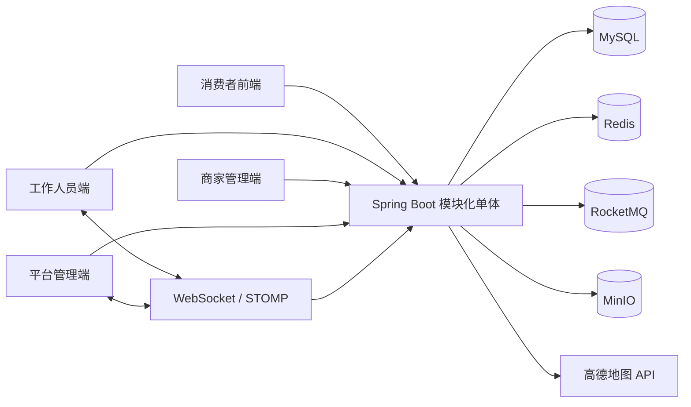

# 企业级增强技术方案

> 业务口径说明：当前项目采用单公司自营模式。本文中的个人服务者、家政公司入驻、开放抢单和多供给方结算属于增强或扩展方案，首版实施范围以 [modules/README.md](./modules/README.md) 为准。

## 1. 目标与边界

本文在 [03-系统架构设计.md](./03-系统架构设计.md) 的模块化单体基础上，增加 Redis、MinIO、地图服务、实时通知和附近人员匹配能力，使项目具备更完整的企业级特征。

增强后的目标：

- 用户可以选择地址、服务时间和服务项目并发布预约单。
- 系统根据服务区域、人员技能、档期、在线状态和距离筛选候选人。
- 支持平台派单和工作人员抢单两种模式。
- 工作人员可以实时收到新订单通知，并在订单大厅接单。
- 多个工作人员同时抢同一订单时，只能有一个接单成功。
- 用户和工作人员可以上传服务前后照片、证书和投诉证据。
- 管理员可以查看调度过程、文件证据、操作日志和基础监控指标。

仍然遵守以下边界：

- 保持一个 Spring Boot 可执行进程。
- 保持一个 MySQL 作为业务事实来源。
- 不引入 Nacos、Spring Cloud Gateway、Seata、Kafka 和微服务拆分。
- RocketMQ 只承载事务提交后的异步副作用，不参与订单、时段和支付的强一致事务。
- Redis、MinIO 和地图是基础设施，不是独立业务服务。
- 首版不做真实资金清算、实时配送级 GPS 跟踪和复杂智能调度平台。

## 2. 最终推荐技术栈

### 2.1 必选技术

| 类别 | 推荐技术 | 建议版本 | 用途 |
| --- | --- | --- | --- |
| JDK | OpenJDK | 17 LTS | 后端运行时 |
| 框架 | Spring Boot | 3.5.x | 单体 Web 应用 |
| 构建 | Maven | 3.9.x | 依赖和打包 |
| 数据库 | MySQL | 8.0.x | 订单、人员、排班、支付和审计的权威数据 |
| 持久层 | MyBatis-Plus + Mapper XML | 3.5.x | CRUD、复杂查询和统计 |
| 数据迁移 | Flyway + flyway-mysql | Boot BOM 管理 | 版本化建表和演示数据 |
| 安全 | Spring Security + JJWT | Security 6.x、JJWT 0.12.x | 登录、JWT、角色和数据权限 |
| 缓存与协调 | Redis | 7.2.x | 缓存、限流、刷新令牌、在线状态和 GEO |
| Redis 客户端 | Spring Data Redis + Redisson | Boot BOM、Redisson 3.x | 缓存和 GEO、分布式锁和限流器 |
| 消息队列 | RocketMQ | 5.x | 订单、派单、支付和通知的异步事件 |
| RocketMQ 客户端 | rocketmq-client-java | 5.x | gRPC 方式生产与消费消息 |
| 对象存储 | MinIO | 稳定版本，Docker 镜像固定 tag | 证件、服务证据、投诉图片和服务封面 |
| MinIO SDK | MinIO Java SDK | 8.x | 上传、下载、签名 URL 和桶管理 |
| 地图 | 高德开放平台 Web 服务 API | 当前稳定 API | 地理编码、逆地理编码和距离计算 |
| 地理围栏 | JTS Topology Suite | 1.20.x | 服务区域多边形和点在区域内判断 |
| 实时通知 | Spring WebSocket + STOMP | Spring Boot 管理版本 | 订单提醒和接单状态推送 |
| HTTP 客户端 | Spring RestClient | Spring Framework 管理版本 | 调用高德等 HTTP 服务 |
| API 文档 | Springdoc OpenAPI | 与 Boot 3.5 兼容的 2.x | Swagger 联调 |
| 参数校验 | Jakarta Validation | Boot BOM 管理 | 请求参数校验 |
| 本地缓存 | Caffeine | 3.x | 服务分类、配置和静态字典 L1 缓存 |
| 日志 | SLF4J + Logback | Boot BOM 管理 | 结构化日志和 traceId |
| 监控 | Spring Boot Actuator + Micrometer | Boot BOM 管理 | 健康检查和基础指标 |

### 2.2 可选技术

| 技术 | 适用条件 | 是否首版必须 |
| --- | --- | --- |
| Prometheus + Grafana | 需要展示企业级监控大屏 | 否 |
| Testcontainers | 需要自动化测试 MySQL、Redis、MinIO | 建议第二阶段启用 |
| ShedLock | 应用从单实例扩展到多实例 | 否 |
| Elasticsearch | 服务数量很大且需要复杂全文检索 | 否 |
| Sentry 或 OpenTelemetry | 需要统一错误追踪和链路观测 | 否 |

### 2.3 明确不选

- 不使用 Redisson 替代数据库事务。数据库仍是订单状态的最终依据。
- 不使用 RocketMQ 消息代替订单主事务。消息只处理事务提交后的异步副作用。
- 不使用 Redis GEO 保存唯一位置数据。MySQL 保存服务区域，Redis 只保存在线人员临时位置。
- 不允许 MinIO 私有桶文件永久公开访问。
- 不直接在 Controller 中调用高德 API。
- 不用 WebSocket 传递完整敏感地址。
- 不因增加 Redis 和 MinIO 就拆分微服务。

## 3. 增强版系统架构



### 3.1 数据职责

| 系统 | 保存内容 | 不保存内容 |
| --- | --- | --- |
| MySQL | 订单、支付、人员、技能、排班、时段、服务区域、文件和审计 | 高频实时位置和临时缓存 |
| Redis | 缓存、限流、刷新令牌、在线状态、近实时位置和分布式锁 | 唯一订单状态和唯一资金记录 |
| RocketMQ | 异步领域事件、通知消费、实时推送和统计事件 | 唯一订单状态和核心事务 |
| MinIO | 图片、证件、投诉证据和服务记录文件 | 业务状态和权限关系 |
| 高德 | 地理编码和距离计算结果 | 订单和人员业务数据 |

MySQL 是权威数据源。Redis、MinIO 和高德不可用时，系统要有明确的降级策略。

## 4. 新增模块与职责

在原有模块基础上新增或增强：

| 模块 | 新增职责 |
| --- | --- |
| `location` | 地址解析、服务区域、地理围栏、距离计算和位置隐私 |
| `dispatch` | 发单、候选人员筛选、派单、抢单、接单和改派 |
| `realtime` | WebSocket 连接、在线人员、消息推送和心跳 |
| `file` | MinIO 上传、私有文件签名、文件元数据和访问校验 |
| `identity` | 刷新令牌、Token 撤销、登录限流 |
| `scheduling` | 结合在线状态、技能和距离生成可接订单视图 |
| `notification` | 站内消息、WebSocket 推送和发送任务重试 |
| `admin` | 调度监控、在线人员和文件审计 |

模块依赖仍保持单体内部调用，不引入跨进程服务调用。

## 5. Redis 设计

### 5.1 Redis 的定位

Redis 用于提升性能和协调并发，但不是业务事实来源。

核心原则：

- 订单、支付、人员和时段真实状态必须落 MySQL。
- Redis 锁只做前置互斥，最终一致性由数据库条件更新和唯一索引保证。
- 缓存必须设置 TTL 和主动失效。
- Redis 不可用时，核心查询可以降级到 MySQL。
- 不在 Redis key 中写入完整地址、身份证号和手机号。

### 5.2 Redis 使用场景

| 场景 | Key 示例 | 数据结构 | TTL |
| --- | --- | --- | --- |
| 服务分类缓存 | `cache:catalog:category:v1` | String JSON | 30 分钟 |
| 服务项目缓存 | `cache:catalog:item:{id}:v1` | String JSON | 10 分钟 |
| 登录限流 | `rate:login:ip:{ip}` | String 或 Lua 计数 | 5 分钟 |
| 验证码限流 | `rate:sms:{phone}` | String 或 Lua 计数 | 10 分钟 |
| 刷新令牌 | `auth:refresh:{jti}` | String Hash | 7 天 |
| Token 撤销 | `auth:revoked:{jti}` | String | 与 Token 剩余时间一致 |
| 抢单锁 | `lock:order:accept:{orderId}` | Redisson RLock | 3 至 5 秒 |
| 工作人员在线 | `presence:worker:{workerId}` | String | 60 至 120 秒 |
| 工作人员位置 | `geo:worker:{cityCode}` | GEO | 心跳更新 |
| WebSocket 会话 | `ws:online:{accountId}` | String | 连接过期 |
| 热点配置 | `cache:config:{key}:v1` | String | 按配置 |

### 5.3 缓存策略

采用 Cache Aside：

```text
读：
  查 Redis
  -> 命中返回
  -> 未命中查 MySQL
  -> 回填 Redis

写：
  更新 MySQL
  -> 删除相关 Redis key
  -> 等待下次读取重建
```

不使用“先删缓存再写数据库”的简单方案。订单和时段不使用缓存作为状态判断依据。

### 5.4 分布式锁

使用 Redisson：

- 抢单：`lock:order:accept:{orderId}`
- 人工改派：`lock:order:dispatch:{orderId}`
- 支付回调：业务唯一键加数据库约束，不强依赖锁
- 定时任务：单实例直接执行，多实例再启用 ShedLock

锁的执行顺序：

```text
获取 Redis 锁
  -> 查询订单和人员状态
  -> 数据库条件更新
  -> 写订单日志
  -> 提交事务
  -> 释放 Redis 锁
```

数据库条件更新是最终兜底。即使 Redis 锁失效，也只能有一个接单请求成功。

### 5.5 刷新令牌

企业级登录建议：

- Access Token 有效期 15 至 30 分钟。
- Refresh Token 有效期 7 天。
- Refresh Token 的 `jti` 存入 Redis。
- 刷新时执行令牌轮换，旧 refresh token 立即失效。
- 退出登录删除 refresh token，并把 access token 的 `jti` 写入撤销列表。

这样不需要把完整用户会话放进 Redis，也避免长期 Access Token 泄露。

## 6. MinIO 对象存储设计

### 6.1 桶设计

```text
housekeeping-public       服务分类图标、服务封面、公开介绍图片
housekeeping-private      证件、健康证明、履约照片、投诉证据
```

环境隔离：

```text
housekeeping-dev-public
housekeeping-dev-private
housekeeping-prod-public
housekeeping-prod-private
```

不建议通过不同目录路径承载不同权限，权限由桶策略和业务访问控制共同决定。

### 6.2 文件元数据

MySQL 表 `file_object` 建议字段：

- `id`
- `bucket_name`
- `object_key`
- `original_name`
- `content_type`
- `size_bytes`
- `sha256`
- `visibility`
- `owner_account_id`
- `business_type`
- `business_id`
- `status`
- `created_at`
- `deleted`

### 6.3 上传流程

推荐使用后端签名、浏览器直传：

```text
前端请求上传凭证
  -> 后端校验登录、文件类型和业务权限
  -> 后端生成短期预签名 URL 和 objectKey
  -> 前端直传 MinIO
  -> 前端回调后端确认上传
  -> 后端检查文件元数据并写 file_object
```

如果首版为了简单，也可以让文件经过后端中转上传，但生产环境优先预签名直传。

### 6.4 下载和展示

- 公开图片可以使用公开桶或 CDN URL。
- 私有文件必须通过受控下载接口或短期预签名 URL。
- 预签名 URL 有效期建议 5 至 15 分钟。
- 服务人员只能访问自己上传的证明和分配给自己的履约订单附件。
- 用户只能访问自己订单、投诉和评价相关附件。
- 管理员审核时可访问待审核证件，但必须记录审计日志。

### 6.5 安全规则

- 文件类型白名单：JPEG、PNG、PDF。
- 单文件限制 10 至 20 MB。
- objectKey 使用 UUID，不使用原始文件名。
- 校验 MIME 和文件头，不只信任扩展名。
- 私有桶禁止匿名读写。
- MinIO 的 Access Key 和 Secret Key 只能由环境变量或密钥管理注入。

## 7. 地图与服务区域设计

### 7.1 地图平台选择

推荐高德开放平台，原因：

- 国内地址、行政区、POI 和路线数据适配较好。
- 提供地理编码、逆地理编码、距离矩阵和行政区域接口。
- Web 服务 API 适合后端，JS API 适合用户自行开发的前端。

备选：

- 腾讯地图：微信生态和位置展示较好。
- 百度地图：地址和 POI 覆盖较好。

最终通过 `MapProvider` 接口隔离，不让订单业务直接依赖某一家 SDK。

### 7.2 地图适配接口

```text
MapProvider
├─ geocode(address)
├─ reverseGeocode(longitude, latitude)
├─ distance(origin, destination)
├─ district(cityCode, keywords)
└─ health()
```

实现：

- `AmapMapProvider`：生产或演示环境。
- `MockMapProvider`：本地开发和无外网环境。

### 7.3 服务区域

`service_area` 保存：

- `id`
- `city_code`
- `district_code`
- `name`
- `polygon_geojson`
- `center_longitude`
- `center_latitude`
- `status`

判断规则：

- 用户地址先经过地理编码得到坐标。
- 使用 JTS 判断坐标是否在服务区域多边形内。
- Redis GEO 只用于“找附近工作人员”，不用于最终判断服务范围。
- 超出服务区域在提交订单前拦截。

### 7.4 地址快照

创建订单时保存：

- 地址文本快照。
- 联系人快照。
- 电话快照。
- 经度和纬度。
- 服务区域 ID。

之后用户修改地址簿不能影响历史订单。

### 7.5 距离计算

候选工作人员距离可以使用：

1. Redis GEO 半径查询得到候选集。
2. 高德距离矩阵计算预计路程。
3. 高德不可用时使用 Haversine 直线距离降级。

订单列表只展示预计距离区间，不展示用户精确门牌。

## 8. 发单、候选人筛选与接单

### 8.1 发单模式

订单增加 `dispatch_mode`：

| 模式 | 含义 |
| --- | --- |
| `ASSIGNED` | 平台或商家指定工作人员，等待确认 |
| `GRAB` | 订单进入可接单大厅，符合条件的工作人员抢单 |
| `HYBRID` | 先指定，超时后进入抢单池 |

首版建议先做 `ASSIGNED` 和 `GRAB`，`HYBRID` 作为后续配置。

### 8.2 候选人员筛选

硬性条件：

- 工作人员状态正常。
- 已通过审核。
- 具备对应服务技能。
- 在服务区域内。
- 预约时段可用。
- 当前未超过最大接单量。

排序参考：

```text
score =
  distance_score * 35
  + rating_score * 25
  + availability_score * 20
  + completion_score * 10
  + workload_score * 10
```

权重放到配置表，不在代码中写死。答辩时可以将排序结果解释为“基于距离、评分、档期、完成率和当前负载的可解释调度策略”。

候选结果写入 `order_candidate`。即使后续 Redis 缓存失效，也可以追溯当时为什么向某位工作人员展示了订单。`match_reason_json` 保存距离、评分、技能和负载等评分快照，但不得包含用户完整地址。

### 8.3 抢单并发

推荐流程：

```text
工作人员点击接单
  -> 获取 Redis 订单锁
  -> 校验工作人员在线、技能和时段
  -> 数据库执行条件更新
  -> 锁定工作人员时段
  -> 写接单记录和订单状态日志
  -> 释放 Redis 锁
  -> WebSocket 推送接单成功
  -> 通知其他候选人订单已失效
```

数据库条件更新示例：

```sql
UPDATE booking_order
SET worker_id = ?,
    order_status = 'ACCEPTED',
    version = version + 1
WHERE id = ?
  AND worker_id IS NULL
  AND order_status = 'PENDING_ACCEPT';
```

影响行数为 1 才表示接单成功。

### 8.4 接单后数据可见性

接单前：

- 展示服务分类、时间、大致区域、价格和特殊要求。
- 隐藏完整门牌、联系人全名和完整电话。

接单后：

- 展示履约所需的完整地址和联系人。
- 展示服务项目、备注和服务标准。
- 记录工作人员访问该敏感信息的时间。

服务完成后：

- 按配置回收工作人员对地址和电话的访问权限。

## 9. WebSocket 实时通知

### 9.1 技术选择

使用 Spring WebSocket + STOMP：

- 工作人员端连接 `/ws`。
- 使用 JWT 在 CONNECT 阶段认证。
- 工作人员订阅个人队列 `/user/queue/dispatch`。
- 管理端订阅 `/topic/dispatch/monitor`。
- 订单状态变化推送到相关用户和工作人员。

### 9.2 消息类型

```text
NEW_ASSIGNMENT
NEW_GRAB_ORDER
ORDER_ACCEPTED
ORDER_REASSIGNED
ORDER_CANCELLED
ORDER_STARTED
ORDER_COMPLETED
REFUND_UPDATED
COMPLAINT_UPDATED
```

### 9.3 在线状态

- WebSocket 连接成功后写入 `presence:worker:{workerId}`。
- 客户端每 30 秒发送心跳。
- 心跳超时 60 至 120 秒后视为离线。
- 离线工作人员从 `GRAB` 订单大厅候选池中排除。
- 在线状态不是 MySQL 业务数据，不需要永久保存。

### 9.4 多实例扩展

首版单实例直接使用 Simple Broker。

如果后续部署两个以上实例：

- 使用 Redis Pub/Sub 进行 WebSocket 消息广播。
- 或引入 STOMP Broker Relay。
- 不因此拆分业务微服务。

## 10. 调度与异步任务

### 10.1 定时任务

| 任务 | 作用 |
| --- | --- |
| 超时取消未支付订单 | 释放时段 |
| 派单超时回收 | 重新进入待派单或抢单池 |
| 接单超时处理 | 改派下一候选人 |
| 自动确认完成 | 处理到期待确认订单 |
| 通知重试 | 重发失败消息 |
| 在线状态清理 | 清理过期在线和位置数据 |
| MinIO 孤立文件清理 | 删除长期未绑定业务的临时文件 |

### 10.2 RocketMQ 的定位

RocketMQ 用于事务提交后的异步副作用，适合：

- 订单创建、支付、取消和完成后的通知。
- 发单后生成候选人员并推送实时消息。
- 抢单成功后的实时广播。
- 订单统计和运营指标更新。
- 外部短信或消息发送任务。

不适合：

- 锁定预约时段。
- 判断订单状态是否合法。
- 扣减优惠券库存。
- 确认支付是否成功。
- 替代 MySQL 事务和唯一约束。

核心链路仍然先在 MySQL 完成事务，再通过 Transactional Outbox 可靠发布事件。

### 10.3 Topic 与消费者

| Topic | Tag | 主要事件 | 消费者组 |
| --- | --- | --- | --- |
| `HK_ORDER_EVENT` | `CREATED` | 订单创建 | `GID_STATISTICS` |
| `HK_ORDER_EVENT` | `PAID` | 支付成功 | `GID_DISPATCH_CANDIDATE`、`GID_REALTIME_NOTIFY` |
| `HK_ORDER_EVENT` | `CANCELED` | 订单取消 | `GID_STATISTICS` |
| `HK_ORDER_EVENT` | `COMPLETED` | 订单完成 | `GID_STATISTICS` |
| `HK_DISPATCH_EVENT` | `PUBLISHED` | 发单或进入抢单池 | `GID_REALTIME_NOTIFY` |
| `HK_DISPATCH_EVENT` | `ACCEPTED` | 工作人员接单 | `GID_REALTIME_NOTIFY` |
| `HK_DISPATCH_EVENT` | `REASSIGNED` | 改派 | `GID_REALTIME_NOTIFY` |
| `HK_PAYMENT_EVENT` | `PAID` | 支付记录确认 | `GID_REALTIME_NOTIFY` |
| `HK_PAYMENT_EVENT` | `REFUNDED` | 退款完成 | `GID_REALTIME_NOTIFY` |

消费者组：

- `GID_DISPATCH_CANDIDATE`：根据订单、技能、区域、档期和在线状态生成候选人员。
- `GID_REALTIME_NOTIFY`：写站内消息并通过 WebSocket 推送。
- `GID_STATISTICS`：更新订单统计和人员接单指标。

### 10.4 领域事件格式

所有领域事件使用统一信封：

```json
{
  "eventId": "01J...",
  "eventType": "BOOKING_PAID",
  "aggregateType": "BOOKING_ORDER",
  "aggregateId": "10001",
  "occurredAt": "2026-10-22T12:00:00+08:00",
  "traceId": "01J...",
  "version": 1,
  "payload": {}
}
```

要求：

- `eventId` 全局唯一，作为消费幂等键。
- `aggregateId` 使用订单号或业务主键。
- `payload` 只放消费所需快照，不放完整地址、证件号和支付密钥。
- `version` 用于后续事件结构演进。

### 10.5 Transactional Outbox

```text
开始数据库事务
  -> 更新订单、时段或支付记录
  -> 写 booking_status_log
  -> 写 event_outbox
  -> 提交事务

Outbox Relay
  -> 读取 PENDING 事件
  -> 发送 RocketMQ
  -> 发送成功标记 SENT
  -> 发送失败增加 retry_count
  -> 超过阈值进入人工处理或死信记录
```

建议表 `event_outbox`：

- `id`
- `event_id`
- `event_type`
- `aggregate_type`
- `aggregate_id`
- `topic`
- `tag`
- `message_key`
- `payload_json`
- `status`
- `retry_count`
- `next_retry_at`
- `created_at`
- `sent_at`
- `last_error`

Relay 使用 Spring Scheduler 和 `SELECT ... FOR UPDATE SKIP LOCKED`，每次批量读取有限事件。即使 RocketMQ 暂时不可用，业务事务仍然成功，事件会在后续重试。

### 10.6 消费幂等

建立 `consumer_message` 表：

- `id`
- `consumer_group`
- `message_id`
- `event_type`
- `aggregate_id`
- `status`
- `consumed_at`
- `error_message`

唯一键：

```text
uk_consumer_message(consumer_group, message_id)
```

消费者先插入幂等记录，再执行业务逻辑。重复消息直接返回成功，避免重复通知和重复统计。

### 10.7 重试和死信

- RocketMQ 消费失败抛出异常，触发框架重试。
- 消费者必须保证相同消息重复执行结果一致。
- 超过重试次数的消息进入 RocketMQ 死信队列。
- 管理端提供消费失败记录查询和人工重放接口。
- 通知类消息可以重放，资金类消息不得通过人工随意重放。

## 11. 安全与隐私增强

### 11.1 地图位置

- 工作人员实时位置只保存在 Redis，TTL 为 2 至 5 分钟。
- 不在 MySQL 保存持续轨迹。
- 用户端只展示“附近有人员”或预计到达时间。
- 不向用户暴露工作人员实时精确位置，除非产品明确需要。

### 11.2 抢单隐私

- 抢单大厅隐藏完整地址和电话。
- 接单成功后才返回履约地址。
- 每次查看完整联系方式写审计记录。
- 客服和管理员查看也走同一审计链路。

### 11.3 MinIO 权限

- 私有桶只允许后端临时签名访问。
- 上传凭证带业务类型、用户和过期时间。
- 不允许直接用对象名拼接永久 URL。
- 前端上传完成后，后端必须校验对象确实存在和大小符合限制。

### 11.4 Redis 安全

- Redis 不暴露公网端口。
- 设置密码或 ACL。
- 使用独立数据库编号或 key 前缀。
- 禁止通过 Redis 保存完整身份证、完整地址和支付密钥。
- 所有 key 设置 TTL 或明确的生命周期。

## 12. 监控与可观测性

建议加入：

- Micrometer 指标。
- Actuator health、info、metrics。
- Prometheus 指标端点，只在受保护环境开放。
- Grafana 面板显示 QPS、响应时间、错误率、Redis 命中率、抢单冲突数、WebSocket 在线数和定时任务耗时。

关键业务指标：

```text
booking_created_total
booking_paid_total
booking_cancelled_total
dispatch_accepted_total
dispatch_conflict_total
slot_lock_failed_total
notification_send_failed_total
worker_online_gauge
file_upload_failed_total
map_api_failed_total
```

日志和指标不能包含敏感业务内容。

## 13. 本地与部署环境

### 13.1 本地增强版

推荐 Docker Compose 启动：

```text
mysql:8.0
redis:7.2
minio
rocketmq-nameserver
rocketmq-broker
rocketmq-proxy
adminer 或 redisinsight，可选
rocketmq-dashboard，可选
```

Spring Boot 在本机 IDE 中运行：

```text
后端 -> localhost:8080
MySQL -> localhost:3306
Redis -> localhost:6379
MinIO API -> localhost:9000
MinIO Console -> localhost:9001
RocketMQ NameServer -> localhost:9876
RocketMQ Proxy -> localhost:8081
```

### 13.2 演示环境

```text
Nginx
  -> Spring Boot JAR
  -> MySQL
  -> Redis
  -> RocketMQ
  -> MinIO
  -> 高德 Web 服务 API
```

仍然只有一个业务应用进程，便于答辩和排错。

### 13.3 环境变量

```text
DB_URL
DB_USERNAME
DB_PASSWORD

REDIS_HOST
REDIS_PORT
REDIS_PASSWORD
REDIS_DATABASE

ROCKETMQ_ENDPOINT
ROCKETMQ_ACCESS_KEY
ROCKETMQ_SECRET_KEY
ROCKETMQ_ORDER_TOPIC
ROCKETMQ_DISPATCH_TOPIC
ROCKETMQ_PAYMENT_TOPIC

MINIO_ENDPOINT
MINIO_ACCESS_KEY
MINIO_SECRET_KEY
MINIO_PUBLIC_BUCKET
MINIO_PRIVATE_BUCKET

AMAP_WEB_SERVICE_KEY
AMAP_SECURITY_CODE

JWT_SECRET
JWT_ACCESS_EXPIRE_MINUTES
JWT_REFRESH_EXPIRE_DAYS

FILE_MAX_SIZE
CORS_ALLOWED_ORIGINS
```

## 14. 实施顺序

### 阶段一：基础单体

- Spring Boot、MySQL、Flyway。
- 认证授权和统一异常。
- 服务目录、用户、人员和订单基础模型。

### 阶段二：Redis

- Redis 缓存服务分类和配置。
- Refresh Token 和登录限流。
- 抢单分布式锁。

### 阶段三：MinIO

- 私有桶和公开桶。
- 证件、履约证据和投诉附件。
- 受控签名 URL。

### 阶段四：RocketMQ

- `event_outbox` 和 Relay。
- 订单、派单和支付 Topic。
- 通知、实时推送和统计消费者。
- 消费幂等、重试和死信处理。

### 阶段五：地图与调度

- 地址地理编码。
- 服务区域和 JTS 判断。
- Redis GEO 在线人员查询。
- 发单、抢单、派单和改派。

### 阶段六：实时通知

- WebSocket 在线状态。
- 新订单和接单结果推送。
- RocketMQ 通知消费和失败重试。

### 阶段七：企业级完善

- Actuator 和 Micrometer。
- 并发测试和安全测试。
- Prometheus/Grafana 可选。
- 多实例 WebSocket 和 ShedLock 可选。

## 15. 技术选型结论

最终推荐组合：

```text
Java 17
Spring Boot 3.5.x
MyBatis-Plus 3.5.x
MySQL 8
Flyway
Spring Security + JWT
Spring Data Redis + Redisson
RocketMQ 5.x
MinIO
高德地图 Web 服务 API
JTS
Spring WebSocket + STOMP
Springdoc OpenAPI
Actuator + Micrometer
Docker Compose 运行基础设施
```

这套组合能够体现以下项目亮点：

1. 模块化单体架构和业务模块边界。
2. Redis GEO 附近人员检索和在线状态。
3. 抢单并发控制与 Redis 锁加数据库条件更新。
4. 地图服务区域、地址解析和距离排序。
5. MinIO 私有文件存储和短期签名 URL。
6. WebSocket 实时发单和接单通知。
7. RocketMQ 异步事件、消费幂等、重试和死信处理。
8. 事务 outbox、状态日志和敏感操作审计。
9. Actuator 和 Micrometer 的运行监控。

这些亮点不需要微服务即可实现，且能在一台普通开发电脑上通过 Docker Compose 启动完整环境。
