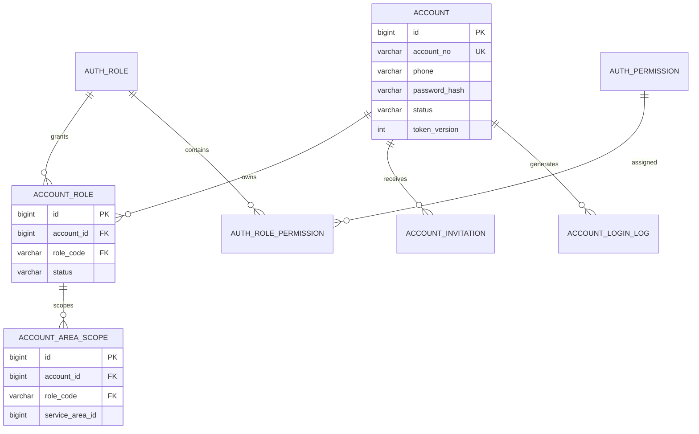

# 账号与权限模块详细设计

## 1. 模块定位

账号与权限模块是整个系统的认证和授权入口，负责回答三个问题：

```text
请求者是谁
请求者当前以什么角色操作
请求者是否有权访问该数据并执行该操作
```

核心原则：

> 账号负责认证，角色负责授权，业务档案负责业务身份。

消费者、服务人员和运营人员的业务信息分别由客户、人员和运营模块维护，不直接塞入账号表。

## 2. 已确定的业务决策

1. 采用单公司自营模式，不引入商家账号、商家角色和商家数据隔离。
2. 角色固定为消费者、服务人员、运营人员和系统管理员。
3. 同一个账号可以同时拥有 `CUSTOMER` 和 `WORKER` 角色。
4. `OPERATOR` 和 `ADMIN` 必须使用内部账号，不允许与外部消费者或服务人员身份混用。
5. 消费者允许自行注册，服务人员由公司邀请开户。
6. 运营人员可以按服务区域控制数据权限。
7. 首版只签发 Access Token，Refresh Token 放到后续版本。
8. 账号不做逻辑删除，停用、锁定和离职统一通过状态控制。

## 3. 模块边界

### 3.1 本模块负责

- 账号创建、手机号登录、退出和密码修改。
- 账号状态、登录失败次数和锁定。
- 角色分配、暂停和撤销。
- JWT 签发、活动角色和 Token 失效。
- 运营区域数据范围。
- 服务人员邀请和账号激活。
- 登录日志和权限变更日志。

### 3.2 本模块不负责

- 客户昵称、头像和地址。
- 服务人员真实姓名、技能、证书、健康证明和排班。
- 订单、支付、退款和售后状态。
- 业务数据权限的具体查询条件，例如订单归谁所有。

业务模块可以通过本模块获得当前账号、当前角色和操作区域，但必须自己校验业务对象关系。

## 4. 角色设计

### 4.1 角色定义

| 角色编码 | 名称 | 数据范围 | 说明 |
| --- | --- | --- | --- |
| `CUSTOMER` | 消费者 | `SELF` | 只能访问自己的客户数据 |
| `WORKER` | 服务人员 | `SELF` | 只能访问自己的档案和分配的订单 |
| `OPERATOR` | 运营人员 | `AREA` | 按服务区域访问运营数据 |
| `ADMIN` | 系统管理员 | `ALL` | 可访问全部后台数据 |

### 4.2 角色组合规则

允许：

```text
CUSTOMER
WORKER
CUSTOMER + WORKER
OPERATOR
ADMIN
```

不允许：

```text
CUSTOMER + OPERATOR
CUSTOMER + ADMIN
WORKER + OPERATOR
WORKER + ADMIN
```

外部账号和内部账号混用会增加敏感数据越权风险，因此内部账号必须独立创建。

### 4.3 活动角色

一个账号拥有多个角色时，每次登录或角色切换只选择一个活动角色：

```text
account_id = 1001
roles = [CUSTOMER, WORKER]
active_role = WORKER
```

活动角色写入 JWT。切换角色必须校验：

- 目标角色已分配给账号。
- 目标角色状态为 `ACTIVE`。
- 目标角色的业务档案满足进入条件。
- 账号状态为 `ACTIVE`。

角色切换成功后重新签发 Token，旧 Token 不会获得新角色权限。

## 5. 账号状态

### 5.1 账号状态

```text
PENDING_ACTIVATION
ACTIVE
LOCKED
DISABLED
```

| 状态 | 说明 |
| --- | --- |
| `PENDING_ACTIVATION` | 已创建，等待设置密码或完成激活 |
| `ACTIVE` | 正常使用 |
| `LOCKED` | 因连续登录失败或风险临时锁定 |
| `DISABLED` | 被管理员停用 |

规则：

- 只有 `ACTIVE` 账号可以登录。
- `LOCKED` 账号在锁定时间到达后可自动恢复。
- `DISABLED` 只能由管理员或具备权限的运营流程解除。
- 账号不提供物理删除和逻辑删除。

### 5.2 角色状态

```text
ACTIVE
SUSPENDED
REVOKED
```

| 状态 | 说明 |
| --- | --- |
| `ACTIVE` | 当前角色可用 |
| `SUSPENDED` | 临时停用，例如服务人员被暂停接单 |
| `REVOKED` | 正式撤销，例如人员离职 |

角色暂停或撤销时增加 `account.token_version`，使旧 Token 失效。

## 6. 核心业务流程

### 6.1 消费者注册

```text
提交手机号、密码和显示名称
-> 校验手机号格式和唯一性
-> 创建 account
-> 绑定 CUSTOMER 角色
-> 创建 customer_profile
-> 返回登录结果
```

账号、角色和客户档案在同一个事务中完成。身份模块负责账号和角色，客户模块负责客户档案。

### 6.2 服务人员开户

```text
运营人员创建服务人员档案
-> 若手机号没有账号，则创建 PENDING_ACTIVATION 账号
-> 绑定 WORKER 角色
-> 创建邀请记录
-> 发送一次性激活凭证
-> 服务人员设置密码并激活
```

如果手机号已经属于消费者账号，则在该账号上增加 `WORKER` 角色，不创建重复账号。

人员档案审核状态由人员模块维护。账号激活不等于具备派单资格，人员仍必须满足技能、证书、服务区域和人员状态要求。

### 6.3 登录

```text
手机号 + 密码
-> 查询账号
-> 检查账号状态和锁定时间
-> 使用 BCrypt 校验密码
-> 查询活动角色
-> 生成 JWT
-> 更新最后登录时间和登录日志
```

登录失败统一返回：

```text
账号或密码错误
```

不区分账号不存在、密码错误和角色不可用。

### 6.4 退出

支持两种退出方式：

```text
退出当前设备：将当前 jti 写入 Redis 撤销列表
退出全部设备：增加 token_version
```

Redis 不可用时，当前设备 Token 仍需等待自然过期，账号级停用和全部退出仍通过 `token_version` 生效。

### 6.5 修改密码

```text
校验原密码
-> 校验新密码规则
-> 更新 password_hash
-> token_version + 1
-> 要求重新登录
```

管理员重置密码时不得生成和保存明文密码，只生成一次性激活或重置凭证。

### 6.6 停用账号

```text
校验操作者权限
-> account.status = DISABLED
-> token_version + 1
-> 写审计日志
```

如果只是暂停服务人员接单，但该人员仍可作为消费者使用，则不应停用整个账号，只暂停 `WORKER` 角色和人员档案状态。

## 7. 认证设计

### 7.1 登录凭证

首版登录方式：

```text
手机号 + 密码
```

规范：

- 手机号使用国家区号加号码保存，默认 `+86`。
- 号码只保存数字，不保存空格和横线。
- 唯一索引建立在 `(phone_country_code, phone)` 上。
- 密码使用 BCrypt，强度参数至少 10，建议 12。
- 密码长度 8 至 64 位，不允许与手机号相同。
- 密码哈希不返回给前端，不写入日志。

### 7.2 JWT

JWT 建议包含：

```json
{
  "sub": "1001",
  "role": "CUSTOMER",
  "tv": 3,
  "jti": "01J...",
  "iat": 1760000000,
  "exp": 1760003600
}
```

| 字段 | 含义 |
| --- | --- |
| `sub` | 账号 ID |
| `role` | 当前活动角色 |
| `tv` | Token 版本，与账号 `token_version` 比较 |
| `jti` | 当前 Token 唯一标识 |
| `iat` | 签发时间 |
| `exp` | 过期时间 |

JWT 不保存：

- 手机号。
- 真实姓名。
- 地址。
- 证件信息。
- 技能和排班。
- 订单权限明细。

Access Token 建议有效期 60 至 120 分钟。每个需要认证的请求都校验账号状态和 `token_version`。

### 7.3 登录保护

- 连续失败 5 次锁定 15 分钟，参数写入系统配置。
- 登录接口按账号和 IP 双维度限流。
- 登录成功清零 `failed_login_count` 和 `locked_until`。
- 锁定和解锁不改变密码。
- 登录日志不保存密码、完整 Token 和明文手机号。

## 8. 授权设计

### 8.1 三层权限

```text
接口权限：角色或权限点是否允许调用接口
数据权限：账号能访问哪些服务区域或自己的数据
状态权限：业务对象当前状态是否允许该操作
```

示例：

```text
服务人员拥有签到接口权限
但只有被分配到该订单时才能签到
订单只有处于允许状态时才能提交对应操作
```

### 8.2 接口权限

首版使用角色和权限点结合：

- 接口入口使用 Spring Security 校验角色或权限点。
- 具体数据范围在应用服务层校验。
- Controller 不能接收前端传入的 `accountId` 作为当前身份。
- 当前账号和活动角色只从安全上下文读取。

权限点建议按模块命名：

```text
auth:account:read
auth:account:disable
auth:role:manage
workforce:worker:manage
scheduling:schedule:manage
booking:booking:read
dispatch:assignment:manage
payment:refund:approve
aftersale:ticket:manage
```

### 8.3 数据范围

| 范围 | 规则 |
| --- | --- |
| `SELF` | 只允许访问当前账号绑定的客户档案或人员档案 |
| `AREA` | 只允许访问 `account_area_scope` 配置的服务区域 |
| `ALL` | 允许访问全部业务数据 |

`OPERATOR` 没有任何区域配置时默认没有业务数据权限，不能解释为全部区域。

### 8.4 业务模块校验

身份模块只提供范围和角色，不替代业务校验。

例如订单查询：

```text
消费者：booking.customer_id = current_customer_id
服务人员：booking.worker_id = current_worker_id
运营人员：booking.service_area_id in current_operator_areas
管理员：不限制区域
```

## 9. 领域模型



业务档案关系：

```text
customer_profile.account_id  -> account.id
worker_profile.account_id    -> account.id
```

跨模块只保存账号 ID 和唯一约束，不建议使用级联删除。

## 10. 数据库规范

### 10.1 通用规范

- 数据库使用 MySQL 8.0，存储引擎 InnoDB，字符集 `utf8mb4`。
- 表名和字段名使用 `snake_case`。
- 主键使用 `BIGINT` 自增，不使用手机号或身份证作为主键。
- 对外展示使用 `account_no` 等业务编号，不直接暴露连续数据库 ID。
- 时间使用 `DATETIME(3)`，统一按 `Asia/Shanghai` 处理。
- 状态使用稳定的英文枚举字符串，不使用中文字符串。
- 账号、角色、权限和日志不做级联删除。
- 密码、Token、激活凭证只保存哈希或密文。
- 关键唯一性和状态约束必须落到数据库，不只依赖 Java 校验。
- 高频登录日志单独存储，不混入通用业务审计日志。

### 10.2 表清单

| 表名 | 用途 | 是否 MVP |
| --- | --- | --- |
| `auth_role` | 角色字典 | 是 |
| `auth_permission` | 权限点字典 | 是 |
| `auth_role_permission` | 角色与权限关联 | 是 |
| `account` | 登录账号 | 是 |
| `account_role` | 账号角色和角色状态 | 是 |
| `account_area_scope` | 运营人员区域范围 | 是 |
| `account_invitation` | 人员邀请和激活凭证 | 是 |
| `account_login_log` | 登录成功和失败日志 | 是 |

## 11. MySQL 表结构

### 11.1 角色表

```sql
CREATE TABLE auth_role (
    role_code VARCHAR(32) NOT NULL COMMENT '角色编码',
    role_name VARCHAR(64) NOT NULL COMMENT '角色名称',
    role_type VARCHAR(16) NOT NULL COMMENT 'EXTERNAL/INTERNAL',
    data_scope_type VARCHAR(16) NOT NULL COMMENT 'SELF/AREA/ALL',
    status VARCHAR(16) NOT NULL DEFAULT 'ACTIVE',
    sort_order INT NOT NULL DEFAULT 0,
    created_by_account_id BIGINT UNSIGNED NULL,
    updated_by_account_id BIGINT UNSIGNED NULL,
    version BIGINT UNSIGNED NOT NULL DEFAULT 0,
    created_at DATETIME(3) NOT NULL DEFAULT CURRENT_TIMESTAMP(3),
    updated_at DATETIME(3) NOT NULL DEFAULT CURRENT_TIMESTAMP(3)
        ON UPDATE CURRENT_TIMESTAMP(3),
    PRIMARY KEY (role_code),
    CONSTRAINT chk_auth_role_type
        CHECK (role_type IN ('EXTERNAL', 'INTERNAL')),
    CONSTRAINT chk_auth_role_scope
        CHECK (data_scope_type IN ('SELF', 'AREA', 'ALL')),
    CONSTRAINT chk_auth_role_status
        CHECK (status IN ('ACTIVE', 'DISABLED'))
) ENGINE=InnoDB DEFAULT CHARSET=utf8mb4 COLLATE=utf8mb4_0900_ai_ci
  COMMENT='角色字典';
```

初始化数据：

```sql
INSERT INTO auth_role
    (role_code, role_name, role_type, data_scope_type, status, sort_order)
VALUES
    ('CUSTOMER', '消费者', 'EXTERNAL', 'SELF', 'ACTIVE', 10),
    ('WORKER', '服务人员', 'EXTERNAL', 'SELF', 'ACTIVE', 20),
    ('OPERATOR', '运营人员', 'INTERNAL', 'AREA', 'ACTIVE', 30),
    ('ADMIN', '系统管理员', 'INTERNAL', 'ALL', 'ACTIVE', 40);
```

### 11.2 权限表

```sql
CREATE TABLE auth_permission (
    permission_code VARCHAR(64) NOT NULL COMMENT '权限点编码',
    permission_name VARCHAR(64) NOT NULL COMMENT '权限点名称',
    module_code VARCHAR(32) NOT NULL COMMENT '所属模块',
    description VARCHAR(255) NULL,
    status VARCHAR(16) NOT NULL DEFAULT 'ACTIVE',
    created_by_account_id BIGINT UNSIGNED NULL,
    updated_by_account_id BIGINT UNSIGNED NULL,
    version BIGINT UNSIGNED NOT NULL DEFAULT 0,
    created_at DATETIME(3) NOT NULL DEFAULT CURRENT_TIMESTAMP(3),
    updated_at DATETIME(3) NOT NULL DEFAULT CURRENT_TIMESTAMP(3)
        ON UPDATE CURRENT_TIMESTAMP(3),
    PRIMARY KEY (permission_code),
    KEY idx_auth_permission_module (module_code, status),
    CONSTRAINT chk_auth_permission_status
        CHECK (status IN ('ACTIVE', 'DISABLED'))
) ENGINE=InnoDB DEFAULT CHARSET=utf8mb4 COLLATE=utf8mb4_0900_ai_ci
  COMMENT='权限点字典';
```

### 11.3 角色权限关联表

```sql
CREATE TABLE auth_role_permission (
    role_code VARCHAR(32) NOT NULL,
    permission_code VARCHAR(64) NOT NULL,
    created_by_account_id BIGINT UNSIGNED NULL,
    created_at DATETIME(3) NOT NULL DEFAULT CURRENT_TIMESTAMP(3),
    PRIMARY KEY (role_code, permission_code),
    KEY idx_auth_role_permission_permission (permission_code),
    CONSTRAINT fk_auth_role_permission_role
        FOREIGN KEY (role_code) REFERENCES auth_role (role_code)
        ON UPDATE RESTRICT ON DELETE RESTRICT,
    CONSTRAINT fk_auth_role_permission_permission
        FOREIGN KEY (permission_code) REFERENCES auth_permission (permission_code)
        ON UPDATE RESTRICT ON DELETE RESTRICT
) ENGINE=InnoDB DEFAULT CHARSET=utf8mb4 COLLATE=utf8mb4_0900_ai_ci
  COMMENT='角色权限关联';
```

### 11.4 账号表

```sql
CREATE TABLE account (
    id BIGINT UNSIGNED NOT NULL AUTO_INCREMENT COMMENT '内部主键',
    account_no VARCHAR(32) NOT NULL COMMENT '对外账号编号',
    phone_country_code VARCHAR(8) NOT NULL DEFAULT '+86',
    phone VARCHAR(20) NOT NULL COMMENT '归一化后的手机号',
    password_hash VARCHAR(100) NULL COMMENT '待激活账号允许为空',
    display_name VARCHAR(64) NOT NULL COMMENT '通用显示名称',
    avatar_url VARCHAR(512) NULL,
    status VARCHAR(32) NOT NULL DEFAULT 'PENDING_ACTIVATION',
    token_version BIGINT UNSIGNED NOT NULL DEFAULT 0,
    failed_login_count SMALLINT UNSIGNED NOT NULL DEFAULT 0,
    locked_until DATETIME(3) NULL,
    last_login_at DATETIME(3) NULL,
    created_by_account_id BIGINT UNSIGNED NULL,
    updated_by_account_id BIGINT UNSIGNED NULL,
    version BIGINT UNSIGNED NOT NULL DEFAULT 0,
    created_at DATETIME(3) NOT NULL DEFAULT CURRENT_TIMESTAMP(3),
    updated_at DATETIME(3) NOT NULL DEFAULT CURRENT_TIMESTAMP(3)
        ON UPDATE CURRENT_TIMESTAMP(3),
    PRIMARY KEY (id),
    UNIQUE KEY uk_account_no (account_no),
    UNIQUE KEY uk_account_phone (phone_country_code, phone),
    KEY idx_account_status (status),
    KEY idx_account_last_login (last_login_at),
    CONSTRAINT chk_account_status
        CHECK (status IN (
            'PENDING_ACTIVATION',
            'ACTIVE',
            'LOCKED',
            'DISABLED'
        )),
    CONSTRAINT chk_account_password_presence
        CHECK (status = 'PENDING_ACTIVATION' OR password_hash IS NOT NULL)
) ENGINE=InnoDB DEFAULT CHARSET=utf8mb4 COLLATE=utf8mb4_0900_ai_ci
  COMMENT='登录账号';
```

说明：

- `account_no` 可使用 `ACC` 加日期和序列生成。
- `password_hash` 只保存 BCrypt 结果。
- 账号不设置 `deleted` 字段。
- 手机号变更后增加 `token_version`，强制重新登录。

### 11.5 账号角色表

```sql
CREATE TABLE account_role (
    id BIGINT UNSIGNED NOT NULL AUTO_INCREMENT,
    account_id BIGINT UNSIGNED NOT NULL,
    role_code VARCHAR(32) NOT NULL,
    status VARCHAR(16) NOT NULL DEFAULT 'ACTIVE',
    granted_by_account_id BIGINT UNSIGNED NULL,
    created_by_account_id BIGINT UNSIGNED NULL,
    updated_by_account_id BIGINT UNSIGNED NULL,
    granted_at DATETIME(3) NOT NULL DEFAULT CURRENT_TIMESTAMP(3),
    revoked_at DATETIME(3) NULL,
    created_at DATETIME(3) NOT NULL DEFAULT CURRENT_TIMESTAMP(3),
    updated_at DATETIME(3) NOT NULL DEFAULT CURRENT_TIMESTAMP(3)
        ON UPDATE CURRENT_TIMESTAMP(3),
    version BIGINT UNSIGNED NOT NULL DEFAULT 0,
    PRIMARY KEY (id),
    UNIQUE KEY uk_account_role (account_id, role_code),
    KEY idx_account_role_role (role_code, status),
    KEY idx_account_role_granted_by (granted_by_account_id),
    CONSTRAINT fk_account_role_account
        FOREIGN KEY (account_id) REFERENCES account (id)
        ON UPDATE RESTRICT ON DELETE RESTRICT,
    CONSTRAINT fk_account_role_role
        FOREIGN KEY (role_code) REFERENCES auth_role (role_code)
        ON UPDATE RESTRICT ON DELETE RESTRICT,
    CONSTRAINT fk_account_role_granted_by
        FOREIGN KEY (granted_by_account_id) REFERENCES account (id)
        ON UPDATE RESTRICT ON DELETE RESTRICT,
    CONSTRAINT chk_account_role_status
        CHECK (status IN ('ACTIVE', 'SUSPENDED', 'REVOKED'))
) ENGINE=InnoDB DEFAULT CHARSET=utf8mb4 COLLATE=utf8mb4_0900_ai_ci
  COMMENT='账号角色';
```

同一账号和角色只保留一行。角色重新授予时更新状态，不重复插入。

### 11.6 运营区域范围表

```sql
CREATE TABLE account_area_scope (
    id BIGINT UNSIGNED NOT NULL AUTO_INCREMENT,
    account_id BIGINT UNSIGNED NOT NULL,
    role_code VARCHAR(32) NOT NULL,
    service_area_id BIGINT UNSIGNED NOT NULL,
    created_by_account_id BIGINT UNSIGNED NULL,
    updated_by_account_id BIGINT UNSIGNED NULL,
    created_at DATETIME(3) NOT NULL DEFAULT CURRENT_TIMESTAMP(3),
    updated_at DATETIME(3) NOT NULL DEFAULT CURRENT_TIMESTAMP(3)
        ON UPDATE CURRENT_TIMESTAMP(3),
    version BIGINT UNSIGNED NOT NULL DEFAULT 0,
    PRIMARY KEY (id),
    UNIQUE KEY uk_account_area_scope
        (account_id, role_code, service_area_id),
    KEY idx_account_area_scope_role (role_code),
    KEY idx_account_area_scope_area (service_area_id),
    CONSTRAINT fk_account_area_scope_role
        FOREIGN KEY (account_id, role_code)
        REFERENCES account_role (account_id, role_code)
        ON UPDATE RESTRICT ON DELETE RESTRICT,
    CONSTRAINT fk_account_area_scope_created_by
        FOREIGN KEY (created_by_account_id) REFERENCES account (id)
        ON UPDATE RESTRICT ON DELETE RESTRICT
) ENGINE=InnoDB DEFAULT CHARSET=utf8mb4 COLLATE=utf8mb4_0900_ai_ci
  COMMENT='账号区域数据范围';
```

`service_area_id` 是位置模块的业务编号。为保持模块边界，这里不建立跨模块级联外键，但必须建立索引，并由位置模块校验有效性。

### 11.7 邀请激活表

```sql
CREATE TABLE account_invitation (
    id BIGINT UNSIGNED NOT NULL AUTO_INCREMENT,
    account_id BIGINT UNSIGNED NOT NULL,
    role_code VARCHAR(32) NOT NULL,
    purpose VARCHAR(32) NOT NULL COMMENT 'WORKER_ACTIVATION/PASSWORD_RESET',
    token_hash CHAR(64) CHARACTER SET ascii COLLATE ascii_bin NOT NULL,
    status VARCHAR(16) NOT NULL DEFAULT 'PENDING',
    expires_at DATETIME(3) NOT NULL,
    used_at DATETIME(3) NULL,
    invited_by_account_id BIGINT UNSIGNED NULL,
    created_by_account_id BIGINT UNSIGNED NULL,
    updated_by_account_id BIGINT UNSIGNED NULL,
    created_at DATETIME(3) NOT NULL DEFAULT CURRENT_TIMESTAMP(3),
    updated_at DATETIME(3) NOT NULL DEFAULT CURRENT_TIMESTAMP(3)
        ON UPDATE CURRENT_TIMESTAMP(3),
    version BIGINT UNSIGNED NOT NULL DEFAULT 0,
    PRIMARY KEY (id),
    UNIQUE KEY uk_account_invitation_token (token_hash),
    KEY idx_account_invitation_account (account_id, status, expires_at),
    KEY idx_account_invitation_expire (status, expires_at),
    CONSTRAINT fk_account_invitation_account
        FOREIGN KEY (account_id) REFERENCES account (id)
        ON UPDATE RESTRICT ON DELETE RESTRICT,
    CONSTRAINT fk_account_invitation_role
        FOREIGN KEY (role_code) REFERENCES auth_role (role_code)
        ON UPDATE RESTRICT ON DELETE RESTRICT,
    CONSTRAINT fk_account_invitation_inviter
        FOREIGN KEY (invited_by_account_id) REFERENCES account (id)
        ON UPDATE RESTRICT ON DELETE RESTRICT,
    CONSTRAINT chk_account_invitation_purpose
        CHECK (purpose IN ('WORKER_ACTIVATION', 'PASSWORD_RESET')),
    CONSTRAINT chk_account_invitation_status
        CHECK (status IN ('PENDING', 'USED', 'EXPIRED', 'REVOKED'))
) ENGINE=InnoDB DEFAULT CHARSET=utf8mb4 COLLATE=utf8mb4_0900_ai_ci
  COMMENT='邀请和一次性激活凭证';
```

凭证只向用户发送一次，数据库只保存哈希。激活时使用条件更新：

```sql
UPDATE account_invitation
SET status = 'USED', used_at = CURRENT_TIMESTAMP(3)
WHERE id = ?
  AND status = 'PENDING'
  AND expires_at > CURRENT_TIMESTAMP(3);
```

影响行数为 1 才允许继续设置密码。

### 11.8 登录日志表

```sql
CREATE TABLE account_login_log (
    id BIGINT UNSIGNED NOT NULL AUTO_INCREMENT,
    account_id BIGINT UNSIGNED NULL COMMENT '账号不存在时为空',
    login_key_hash CHAR(64) CHARACTER SET ascii COLLATE ascii_bin NOT NULL,
    result VARCHAR(16) NOT NULL,
    reason_code VARCHAR(32) NULL,
    ip_address VARCHAR(45) NULL,
    user_agent VARCHAR(512) NULL,
    trace_id VARCHAR(64) NULL,
    created_at DATETIME(3) NOT NULL DEFAULT CURRENT_TIMESTAMP(3),
    PRIMARY KEY (id),
    KEY idx_login_log_account_time (account_id, created_at),
    KEY idx_login_log_key_time (login_key_hash, created_at),
    KEY idx_login_log_result_time (result, created_at),
    CONSTRAINT fk_login_log_account
        FOREIGN KEY (account_id) REFERENCES account (id)
        ON UPDATE RESTRICT ON DELETE RESTRICT,
    CONSTRAINT chk_login_log_result
        CHECK (result IN ('SUCCESS', 'FAILED', 'LOCKED', 'DISABLED'))
) ENGINE=InnoDB DEFAULT CHARSET=utf8mb4 COLLATE=utf8mb4_0900_ai_ci
  COMMENT='账号登录日志';
```

`login_key_hash` 使用服务端密钥对归一化手机号做 HMAC-SHA256，不使用明文手机号或普通 SHA256。

## 12. 约束和索引说明

### 12.1 关键唯一约束

```text
account.account_no
account(phone_country_code, phone)
account_role(account_id, role_code)
account_area_scope(account_id, role_code, service_area_id)
account_invitation.token_hash
auth_role_permission(role_code, permission_code)
```

### 12.2 状态约束

状态值必须在数据库 `CHECK` 约束和 Java 枚举中保持一致。新增状态时必须编写 Flyway 迁移，不能直接修改已执行迁移。

### 12.3 索引原则

- 账号状态用于登录筛查和后台列表。
- 登录日志按账号和时间查询。
- 失败登录日志按手机号哈希和时间查询，支持限流统计。
- 区域权限按账号和区域查询。
- 邀请记录按账号、状态和过期时间查询。
- 所有高频列表必须数据库分页，禁止全量加载后内存分页。

## 13. 事务和并发

| 用例 | 事务范围 |
| --- | --- |
| 消费者注册 | 创建账号、角色和客户档案 |
| 服务人员开户 | 创建或绑定账号、创建角色、生成邀请 |
| 激活账号 | 条件更新邀请状态、设置密码、激活账号和角色 |
| 角色变更 | 更新角色、增加 Token 版本、写审计日志 |
| 修改密码 | 更新密码、增加 Token 版本、写审计日志 |
| 停用账号 | 更新状态、增加 Token 版本、写审计日志 |

并发要求：

- 手机号唯一性由唯一索引兜底。
- 邀请凭证只能成功使用一次。
- 角色变更和 Token 版本更新必须在同一事务。
- 修改密码时使用乐观锁或版本字段，避免并发覆盖。

## 14. 对外接口设计

### 14.1 公共接口

```text
POST /api/v1/auth/customer/register
POST /api/v1/auth/login
POST /api/v1/auth/worker/activate
```

### 14.2 已登录接口

```text
POST /api/v1/auth/logout
GET  /api/v1/auth/me
POST /api/v1/auth/switch-role
PUT  /api/v1/auth/password
```

### 14.3 运营和管理接口

```text
POST /api/v1/operator/workers/invitations
GET  /api/v1/admin/accounts
GET  /api/v1/admin/accounts/{accountNo}
POST /api/v1/admin/accounts/{accountNo}/disable
POST /api/v1/admin/accounts/{accountNo}/enable
PUT  /api/v1/admin/accounts/{accountNo}/roles
PUT  /api/v1/admin/accounts/{accountNo}/area-scopes
```

接口使用 `accountNo` 或内部 ID 均可，对外 API 优先使用 `accountNo`，内部应用服务使用 `accountId`。

### 14.4 登录响应

```json
{
  "accessToken": "jwt",
  "expiresIn": 3600,
  "account": {
    "accountNo": "ACC202610230001",
    "displayName": "张三",
    "activeRole": "CUSTOMER"
  }
}
```

响应中不返回密码哈希、完整角色权限列表和区域内部列表。

## 15. 错误码

```text
AUTH_INVALID_CREDENTIALS
AUTH_ACCOUNT_DISABLED
AUTH_ACCOUNT_LOCKED
AUTH_PENDING_ACTIVATION
AUTH_ROLE_NOT_GRANTED
AUTH_ROLE_SUSPENDED
AUTH_TOKEN_INVALID
AUTH_TOKEN_EXPIRED
AUTH_PASSWORD_POLICY_VIOLATION
AUTH_INVITATION_INVALID
AUTH_INVITATION_EXPIRED
AUTH_PHONE_ALREADY_EXISTS
```

对外错误信息不得泄露账号是否存在、密码是否正确或内部角色配置。

## 16. 与其他模块协作

### 16.1 客户模块

- 消费者注册时创建 `customer_profile`。
- 客户模块保存 `account_id`。
- 当前客户由活动角色 `CUSTOMER` 和账号 ID 解析。

### 16.2 人员模块

- 服务人员开户时创建 `worker_profile`。
- 人员停用、离职或资质失效时暂停 `WORKER` 角色。
- 角色激活不代表可派单，人员模块仍需校验技能、证书和服务区域。

### 16.3 运营模块

- 运营人员通过 `account_area_scope` 获取区域权限。
- 订单、派单和报表查询必须带区域条件。
- 手工改派、退款审批等操作校验权限点。

### 16.4 审计模块

本模块写两类日志：

```text
account_login_log：高频登录尝试
audit_log：角色、权限、停用和敏感操作
```

登录日志用于安全分析，业务审计用于责任追踪，两者不能混用。

## 17. 安全要求

- 密码、Token、邀请凭证和手机号不得写入普通日志。
- 账号查询接口默认脱敏手机号。
- 角色和区域权限变更必须写审计日志。
- 前端隐藏按钮不能代替后端鉴权。
- 管理员不能查看用户密码。
- 管理员重置密码只能生成一次性凭证。
- 所有 SQL 使用参数化查询。
- JWT 密钥从环境变量读取，长度至少 32 字节。
- 生产环境关闭演示账号和固定验证码。

## 18. 测试清单

### 18.1 单元测试

- 手机号格式和归一化。
- 密码哈希和校验。
- 账号状态转换。
- 角色允许组合。
- 区域范围判断。
- JWT 版本校验。
- 邀请凭证过期和重复使用。

### 18.2 集成测试

- 手机号唯一约束。
- 注册、登录和退出完整流程。
- 禁用账号后旧 Token 失效。
- 服务人员邀请只成功激活一次。
- `CUSTOMER + WORKER` 账号切换活动角色。
- 运营人员没有区域时无法访问订单。
- 运营人员只能访问配置区域。
- 内部账号与外部账号混合创建被拒绝。
- 登录日志不包含敏感字段。

### 18.3 安全测试

- 伪造 `accountId` 请求头无效。
- 低权限角色访问管理接口返回 403。
- 过期 Token 返回 401。
- 重复登录失败触发临时锁定。
- 角色撤销后旧 Token 失效。

## 19. MVP 与后续扩展

### 19.1 MVP 范围

- 消费者注册。
- 手机号和密码登录。
- 服务人员邀请激活。
- 多角色和活动角色切换。
- JWT Access Token。
- BCrypt 密码。
- 角色、权限点和区域数据范围。
- 账号锁定和停用。
- 登录日志和权限变更审计。

### 19.2 后续扩展

- Refresh Token 和会话管理。
- 短信验证码登录和密码找回。
- 微信登录。
- 多因素认证。
- 登录设备管理。
- 更细粒度的数据权限。
- 组织、门店和团队层级。
- 外部单点登录。

后续增加邮箱、微信或 OAuth 时，建议新增 `account_identity` 表保存多种登录标识，不修改业务档案表。

## 20. 实现顺序

```text
角色和权限字典
-> account 和 account_role
-> 消费者注册和登录
-> JWT 与安全过滤器
-> 账号停用和 Token 失效
-> 运营区域数据权限
-> 服务人员邀请激活
-> 登录日志和审计
-> 自动化测试
```

## 21. 仍需确认的问题

1. 消费者首次注册是否需要短信验证码，还是首版只校验手机号格式。
2. 服务人员邀请是否通过短信发送，还是演示环境只显示激活链接。
3. 登录失败 5 次锁定 15 分钟是否采用。
4. 运营人员的区域数据权限按行政区还是按业务服务区域配置。
