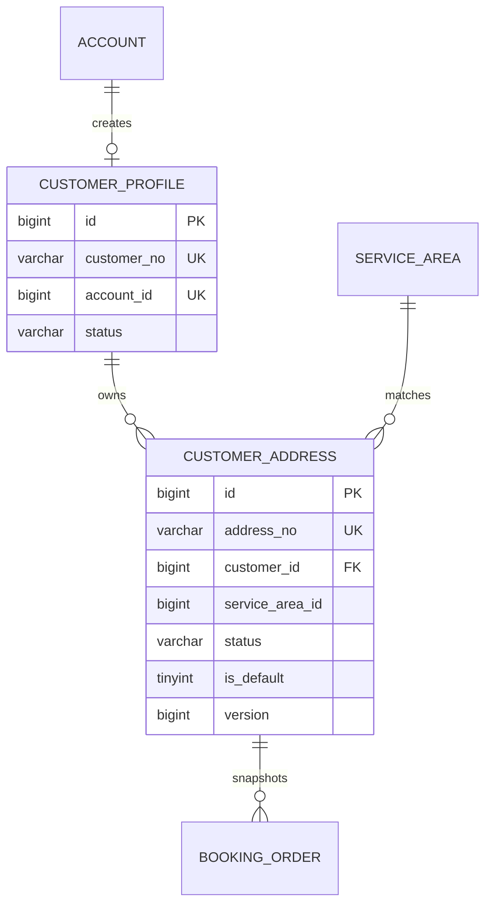

# 客户与地址模块详细设计

## 1. 模块定位

客户与地址模块负责维护消费者的业务身份、常用服务地址和地址业务快照，为预约、派单、履约和售后提供客户与地址事实。

核心原则：

> 账号属于认证域，客户属于业务域，订单保存地址快照。

账号负责登录和角色，客户档案负责消费者业务身份，地址属于客户档案而不是账号。订单创建后不能再依赖客户当前地址簿回算历史地址。

## 2. 已确定的业务决策

1. 一个消费者账号最多对应一个客户档案。
2. 客户档案通过 `account_id` 与账号一对一关联。
3. 一个客户可以维护多个服务地址。
4. 同一客户最多存在一个有效默认地址。
5. 地址采用软删除，不物理删除。
6. 地址是否在服务范围内由位置模块判断。
7. 首次创建地址时自动设为默认地址。
8. 删除默认地址时，自动选择最近使用的有效地址作为新默认地址。
9. 订单创建时必须保存独立地址快照。
10. 服务人员接单前不能查看完整地址和联系电话。

## 3. 模块边界

### 3.1 本模块负责

- 客户档案创建、查询和关闭。
- 地址新增、修改、删除和默认地址设置。
- 地址联系人信息。
- 地址行政区、小区、楼栋、单元、楼层和门牌。
- 地址对应的服务区域匹配结果缓存。
- 地址可用性检查。
- 为客户模块外部调用方提供地址快照。
- 客户和地址数据脱敏。

### 3.2 本模块不负责

- 账号、密码、JWT 和角色权限。
- 服务区域的创建和维护。
- 排班、人员匹配和派单。
- 订单价格、订单状态和支付。
- 服务履约记录和售后责任。

## 4. 角色与数据权限

### 4.1 消费者

- 只能查看和修改自己的客户档案。
- 只能管理自己的地址。
- 可以查看自己的完整联系人、电话和门牌。
- 可以设置默认地址。
- 可以删除自己的地址。

### 4.2 服务人员

- 不能访问客户地址簿。
- 接单前只能查看订单的脱敏区域信息。
- 接单后才能查看订单地址快照中的完整履约信息。
- 服务完成后按订单访问规则限制历史地址访问。

### 4.3 运营人员

- 可以查看客户和地址的脱敏信息。
- 因客服、改派或售后需要查看完整地址时，必须具备敏感数据权限。
- 查看完整联系人、电话和门牌必须写入审计日志。
- 只能访问自己区域范围内的客户业务数据。

### 4.4 系统管理员

- 可以执行账号和系统级管理。
- 默认不直接参与客户地址查看。
- 敏感数据查看仍应走审计和最小权限原则。

## 5. 客户档案

### 5.1 客户档案定位

客户档案只保存客户业务状态和业务编号，不重复保存账号手机号、密码和角色。

### 5.2 客户状态

```text
ACTIVE
CLOSED
```

| 状态 | 说明 |
| --- | --- |
| `ACTIVE` | 客户正常使用 |
| `CLOSED` | 客户注销或业务关闭 |

关闭客户档案不等于禁用账号。若消费者同时是服务人员，关闭客户身份不应影响其服务人员身份。

### 5.3 客户编号

`customer_no` 是对外业务编号，建议格式：

```text
CUS + yyyyMMdd + 6位序列
```

例如：

```text
CUS202610230001
```

内部关联使用 `customer_id`，对外接口使用 `customer_no`。

## 6. 地址模型

### 6.1 地址分层

地址由行政区、社区和门牌信息组成：

```text
省份
-> 城市
-> 区县
-> 街道
-> 小区或社区
-> 楼栋
-> 单元
-> 楼层
-> 门牌
-> 补充说明
```

### 6.2 地址标签

地址标签用于区分家庭、父母家、公司等：

```text
HOME
PARENTS
OFFICE
RENTAL
OTHER
```

标签不是权限依据，只是展示辅助。

### 6.3 地址状态

```text
ACTIVE
DELETED
```

- `ACTIVE` 地址可以展示、选择和下单。
- `DELETED` 地址不参与默认地址和地址列表查询。
- 软删除后仍保留主键和历史关系，但订单必须使用自己的快照。

### 6.4 服务区域匹配状态

```text
UNMATCHED
MATCHED
OUT_OF_RANGE
STALE
```

| 状态 | 说明 |
| --- | --- |
| `UNMATCHED` | 尚未执行服务区域判断 |
| `MATCHED` | 已匹配到可服务区域 |
| `OUT_OF_RANGE` | 地址不在公司服务范围内 |
| `STALE` | 区域配置或地址信息变化，需要重新判断 |

只有 `MATCHED` 地址可以进入订单提交阶段。下单时仍必须再次校验服务范围，不能只信任地址簿中的缓存结果。

## 7. 核心业务流程

### 7.1 消费者注册后创建客户档案

```text
身份模块创建 account 和 CUSTOMER 角色
-> 客户模块创建 customer_profile
-> 生成 customer_no
-> 返回客户档案
```

该过程与账号注册处于同一个事务，不允许出现有账号没有客户档案的半成品数据。

### 7.2 新增地址

```text
校验当前客户
-> 校验地址数量上限
-> 校验联系人、电话和地址必填字段
-> 归一化手机号和行政区编码
-> 调用位置模块判断服务区域
-> 写入 customer_address
-> 如果这是首个有效地址，则设为默认
-> 返回地址信息
```

约束：

- 每个客户默认最多保存 20 个有效地址，最大值由系统配置。
- 地址联系人电话可以与账号手机号不同。
- 地址创建成功不代表一定可下单，必须结合服务区域状态和时间窗可用性判断。
- 地址是否可服务记录在地址匹配状态和 `service_area_id` 中。

### 7.3 修改地址

```text
校验地址归属
-> 校验版本号
-> 判断行政区、小区或详细地址是否变化
-> 发生变化则重新匹配服务区域
-> 更新地址和版本号
-> 写操作日志
```

并发更新使用乐观锁：

```sql
UPDATE customer_address
SET ..., version = version + 1
WHERE id = ?
  AND customer_id = ?
  AND version = ?;
```

影响行数为 1 才表示修改成功。

### 7.4 设置默认地址

```text
校验地址归属和 ACTIVE 状态
-> 锁定当前客户地址集合
-> 清除原默认地址
-> 设置新默认地址
-> 提交事务
```

数据库使用生成列唯一索引保证同一客户最多一个有效默认地址。

### 7.5 删除地址

```text
校验地址归属
-> 如果地址被删除前是默认地址，查询最近使用的有效地址
-> 设置新的默认地址
-> 原地址状态改为 DELETED 并记录 deleted_at
-> 提交事务
```

如果客户没有其他有效地址，则删除后可以不存在默认地址。

历史订单继续使用自己的地址快照，不因地址删除而变化。

### 7.6 地址可用性检查

```text
读取地址行政区、详细地址和坐标
-> 调用位置模块匹配服务区域
-> 返回 MATCHED、OUT_OF_RANGE 或 STALE
-> 更新地址匹配状态和匹配时间
```

地址可用性检查不是锁单操作。真正的时段和人员可用性由排班、订单和派单模块校验。

### 7.7 订单地址快照

订单创建时调用客户模块获取地址快照：

```text
addressId
addressNo
addressVersion
contactName
contactPhone
provinceCode
provinceName
cityCode
cityName
districtCode
districtName
streetCode
streetName
serviceAreaId
communityName
buildingNo
unitNo
floorNo
roomNo
detailAddress
longitude
latitude
accessNote
snapshotAt
```

规则：

- 快照必须由服务端读取并生成，不能信任客户端上传的地址文本。
- 快照保存地址名称、行政区名称和服务区域，而不只是编码。
- 后续修改地址簿、行政区名称或服务区域配置，不影响历史订单。
- 快照中的完整电话和地址只允许订单相关方按状态访问。
- 服务人员接单前只能查看脱敏版本。

## 8. 默认地址约束

首版使用 MySQL 生成列：

```text
active_default_customer_id =
  customer_id
  当 is_default = 1 且 status = 'ACTIVE'
  否则为 NULL
```

再对 `active_default_customer_id` 建立唯一索引。

这样可以保证：

- 同一客户最多一个有效默认地址。
- 软删除的地址不会被误认为默认地址。
- 数据库约束比仅靠应用层更新可靠。

切换默认地址时先清除旧值，再设置新值。

## 9. 领域模型



说明：

- `ACCOUNT` 和 `CUSTOMER_PROFILE` 为一对一。
- `CUSTOMER_ADDRESS` 与 `CUSTOMER_PROFILE` 为一对多。
- `SERVICE_AREA` 属于位置模块，这里只保存业务编号和匹配结果。
- `BOOKING_ORDER` 使用订单模块自己的 JSON 快照，不保留对地址簿的运行时依赖。

## 10. 数据库规范

### 10.1 通用规范

- 数据库使用 MySQL 8.0，InnoDB，`utf8mb4`。
- 表名和字段名使用 `snake_case`。
- 主键使用 `BIGINT UNSIGNED` 自增。
- 业务编号单独存储，不直接暴露自增主键。
- 时间使用 `DATETIME(3)`，统一按 `Asia/Shanghai`。
- 地址状态和匹配状态使用英文枚举字符串。
- 客户档案和地址不使用物理删除。
- 地址删除使用 `status` 和 `deleted_at`。
- 默认地址唯一性由数据库生成列和唯一索引保证。
- 所有列表查询带 `customer_id` 和 `status` 条件。
- 跨模块引用使用业务 ID 和索引，不使用级联删除。

### 10.2 表清单

| 表名 | 用途 | 是否 MVP |
| --- | --- | --- |
| `customer_profile` | 消费者业务档案 | 是 |
| `customer_address` | 消费者服务地址 | 是 |

首版不单独拆联系人表。一个地址对应一个联系人和联系电话，订单保存联系人快照。后续需要多联系人时再增加 `customer_contact`。

## 11. MySQL 表结构

### 11.1 客户档案表

```sql
CREATE TABLE customer_profile (
    id BIGINT UNSIGNED NOT NULL AUTO_INCREMENT,
    customer_no VARCHAR(32) NOT NULL COMMENT '对外客户编号',
    account_id BIGINT UNSIGNED NOT NULL COMMENT '关联登录账号',
    status VARCHAR(16) NOT NULL DEFAULT 'ACTIVE',
    created_by_account_id BIGINT UNSIGNED NULL,
    updated_by_account_id BIGINT UNSIGNED NULL,
    version BIGINT UNSIGNED NOT NULL DEFAULT 0,
    created_at DATETIME(3) NOT NULL DEFAULT CURRENT_TIMESTAMP(3),
    updated_at DATETIME(3) NOT NULL DEFAULT CURRENT_TIMESTAMP(3)
        ON UPDATE CURRENT_TIMESTAMP(3),
    PRIMARY KEY (id),
    UNIQUE KEY uk_customer_profile_no (customer_no),
    UNIQUE KEY uk_customer_profile_account (account_id),
    KEY idx_customer_profile_status (status),
    CONSTRAINT fk_customer_profile_account
        FOREIGN KEY (account_id) REFERENCES account (id)
        ON UPDATE RESTRICT ON DELETE RESTRICT,
    CONSTRAINT chk_customer_profile_status
        CHECK (status IN ('ACTIVE', 'CLOSED'))
) ENGINE=InnoDB DEFAULT CHARSET=utf8mb4 COLLATE=utf8mb4_0900_ai_ci
  COMMENT='消费者业务档案';
```

说明：

- 不在客户表重复保存手机号和密码。
- `account_id` 唯一，保证一个账号最多一个客户档案。
- 客户关闭时保留档案和地址数据用于历史查询。

### 11.2 客户地址表

```sql
CREATE TABLE customer_address (
    id BIGINT UNSIGNED NOT NULL AUTO_INCREMENT,
    address_no VARCHAR(32) NOT NULL COMMENT '对外地址编号',
    customer_id BIGINT UNSIGNED NOT NULL,
    label VARCHAR(32) NOT NULL DEFAULT 'HOME',

    contact_name VARCHAR(64) NOT NULL,
    contact_country_code VARCHAR(8) NOT NULL DEFAULT '+86',
    contact_phone VARCHAR(20) NOT NULL,

    province_code VARCHAR(12) NULL,
    province_name VARCHAR(64) NULL,
    city_code VARCHAR(12) NULL,
    city_name VARCHAR(64) NULL,
    district_code VARCHAR(12) NOT NULL,
    district_name VARCHAR(64) NOT NULL,
    street_code VARCHAR(12) NULL,
    street_name VARCHAR(64) NULL,

    service_area_id BIGINT UNSIGNED NULL,
    area_match_status VARCHAR(16) NOT NULL DEFAULT 'UNMATCHED',
    area_matched_at DATETIME(3) NULL,

    community_name VARCHAR(128) NULL,
    building_no VARCHAR(64) NULL,
    unit_no VARCHAR(32) NULL,
    floor_no VARCHAR(16) NULL,
    room_no VARCHAR(32) NULL,
    detail_address VARCHAR(255) NOT NULL,

    longitude DECIMAL(10, 7) NULL,
    latitude DECIMAL(10, 7) NULL,
    access_note VARCHAR(500) NULL COMMENT '门禁、电梯、宠物等履约说明',

    is_default TINYINT(1) NOT NULL DEFAULT 0,
    status VARCHAR(16) NOT NULL DEFAULT 'ACTIVE',
    created_by_account_id BIGINT UNSIGNED NULL,
    updated_by_account_id BIGINT UNSIGNED NULL,
    version BIGINT UNSIGNED NOT NULL DEFAULT 0,
    last_used_at DATETIME(3) NULL,

    active_default_customer_id BIGINT UNSIGNED
        GENERATED ALWAYS AS (
            CASE
                WHEN is_default = 1 AND status = 'ACTIVE'
                THEN customer_id
                ELSE NULL
            END
        ) STORED COMMENT '默认地址唯一约束辅助列',

    created_at DATETIME(3) NOT NULL DEFAULT CURRENT_TIMESTAMP(3),
    updated_at DATETIME(3) NOT NULL DEFAULT CURRENT_TIMESTAMP(3)
        ON UPDATE CURRENT_TIMESTAMP(3),
    deleted_at DATETIME(3) NULL,

    PRIMARY KEY (id),
    UNIQUE KEY uk_customer_address_no (address_no),
    UNIQUE KEY uk_customer_active_default (active_default_customer_id),
    KEY idx_customer_address_list
        (customer_id, status, is_default, last_used_at),
    KEY idx_customer_address_service_area
        (service_area_id, area_match_status),
    KEY idx_customer_address_district (district_code),
    CONSTRAINT fk_customer_address_customer
        FOREIGN KEY (customer_id) REFERENCES customer_profile (id)
        ON UPDATE RESTRICT ON DELETE RESTRICT,
    CONSTRAINT chk_customer_address_status
        CHECK (status IN ('ACTIVE', 'DELETED')),
    CONSTRAINT chk_customer_address_area_status
        CHECK (area_match_status IN (
            'UNMATCHED',
            'MATCHED',
            'OUT_OF_RANGE',
            'STALE'
        )),
    CONSTRAINT chk_customer_address_matched_area
        CHECK (
            area_match_status <> 'MATCHED'
            OR service_area_id IS NOT NULL
        ),
    CONSTRAINT chk_customer_address_default
        CHECK (is_default IN (0, 1)),
    CONSTRAINT chk_customer_address_deleted_not_default
        CHECK (status = 'ACTIVE' OR is_default = 0),
    CONSTRAINT chk_customer_address_longitude
        CHECK (longitude IS NULL OR longitude BETWEEN -180 AND 180),
    CONSTRAINT chk_customer_address_latitude
        CHECK (latitude IS NULL OR latitude BETWEEN -90 AND 90)
) ENGINE=InnoDB DEFAULT CHARSET=utf8mb4 COLLATE=utf8mb4_0900_ai_ci
  COMMENT='客户服务地址';
```

说明：

- `district_code` 和 `district_name` 首版必填。
- `detail_address` 保存无法结构化的补充地址。
- `access_note` 可能包含门禁、宠物和家庭注意事项，必须按敏感字段管理。
- `active_default_customer_id` 为生成列，由数据库自动计算。
- `is_default` 和 `status` 不能由客户端直接决定，必须通过业务命令修改。

## 12. 索引与约束说明

### 12.1 关键唯一约束

```text
customer_profile.customer_no
customer_profile.account_id
customer_address.address_no
customer_address.active_default_customer_id
```

### 12.2 地址列表索引

常用查询：

```sql
SELECT *
FROM customer_address
WHERE customer_id = ?
  AND status = 'ACTIVE'
ORDER BY is_default DESC, last_used_at DESC, id DESC;
```

对应索引：

```text
(customer_id, status, is_default, last_used_at)
```

### 12.3 区域匹配索引

常用查询：

```sql
SELECT *
FROM customer_address
WHERE service_area_id = ?
  AND area_match_status = 'MATCHED';
```

### 12.4 默认地址并发

即使两个请求同时设置不同地址为默认，数据库唯一索引也只允许一个请求成功。业务层捕获唯一键冲突后：

```text
重新读取当前默认地址
-> 返回默认地址冲突
-> 客户端重新加载
```

不能静默覆盖用户刚设置的默认地址。

## 13. 事务和并发

| 用例 | 事务范围 |
| --- | --- |
| 创建客户档案 | 创建客户档案并确认账号存在 |
| 新增地址 | 校验数量、匹配区域、插入地址、处理首个默认地址 |
| 修改地址 | 校验版本、匹配区域、更新地址和版本 |
| 设置默认地址 | 清除旧默认、设置新默认 |
| 删除地址 | 软删除、必要时提升新默认地址 |
| 下单获取快照 | 读取地址、校验归属、返回不可变快照 |

并发要求：

- 修改地址使用 `version` 乐观锁。
- 默认地址依靠唯一索引兜底。
- 删除默认地址和提升新默认地址必须在同一事务。
- 地址数量上限校验和插入需要加客户级锁或使用计数校验，避免并发突破上限。
- 订单快照读取和订单创建需要在同一业务事务中完成。

## 14. 对外接口设计

### 14.1 客户档案

```text
GET /api/v1/customer/profile
PUT /api/v1/customer/profile
```

客户档案修改只允许修改业务展示信息，不允许修改 `account_id`。

### 14.2 地址管理

```text
GET    /api/v1/customer/addresses
POST   /api/v1/customer/addresses
GET    /api/v1/customer/addresses/{addressNo}
PUT    /api/v1/customer/addresses/{addressNo}
DELETE /api/v1/customer/addresses/{addressNo}
PUT    /api/v1/customer/addresses/{addressNo}/default
POST   /api/v1/customer/addresses/{addressNo}/availability-check
```

### 14.3 内部接口

```text
GET /internal/customers/{customerId}/addresses/{addressId}/snapshot
GET /internal/customers/{customerId}/addresses/{addressId}/masked
```

内部接口只允许订单、派单和履约模块调用，不能暴露给公网。

### 14.4 新增地址请求示例

```json
{
  "label": "HOME",
  "contactName": "李女士",
  "contactCountryCode": "+86",
  "contactPhone": "13800138000",
  "provinceCode": "440000",
  "cityCode": "440100",
  "districtCode": "440106",
  "communityName": "示例花园",
  "buildingNo": "3栋",
  "unitNo": "2单元",
  "floorNo": "8层",
  "roomNo": "801",
  "detailAddress": "东门进入后直行100米",
  "accessNote": "门禁请联系联系人",
  "isDefault": true
}
```

服务端必须重新校验和归一化，不能直接把请求对象写库。

### 14.5 地址列表响应

消费者查看自己的地址时允许返回完整地址。运营列表和服务人员未接单场景返回脱敏结果：

```json
{
  "addressNo": "ADDR202610230001",
  "label": "HOME",
  "contactName": "李*",
  "contactPhone": "138****8000",
  "region": {
    "cityName": "广州市",
    "districtName": "天河区"
  },
  "communityName": "示例花园",
  "detailAddress": "3栋2单元8层",
  "isDefault": true,
  "areaMatchStatus": "MATCHED"
}
```

## 15. 地址快照接口契约

订单模块不应直接读取 `customer_address` 表，必须调用客户模块公开的查询接口。

### 15.1 快照数据

```json
{
  "addressId": 301,
  "addressNo": "ADDR202610230001",
  "addressVersion": 4,
  "contactName": "李女士",
  "contactCountryCode": "+86",
  "contactPhone": "13800138000",
  "provinceCode": "440000",
  "provinceName": "广东省",
  "cityCode": "440100",
  "cityName": "广州市",
  "districtCode": "440106",
  "districtName": "天河区",
  "streetCode": "440106010",
  "streetName": "示例街道",
  "serviceAreaId": 12,
  "communityName": "示例花园",
  "buildingNo": "3栋",
  "unitNo": "2单元",
  "floorNo": "8层",
  "roomNo": "801",
  "detailAddress": "东门进入后直行100米",
  "longitude": 113.324520,
  "latitude": 23.126140,
  "accessNote": "门禁请联系联系人",
  "snapshotAt": "2026-10-23T10:30:00+08:00"
}
```

### 15.2 快照规则

- 只允许 `ACTIVE` 且 `area_match_status = MATCHED` 的地址生成下单快照。
- 快照必须在同一个事务内读取并返回。
- 订单保存快照后，地址簿修改不影响订单。
- 快照中的完整敏感字段只能在授权状态返回。
- 派单前向服务人员展示的地址摘要不能包含完整电话和门牌。

## 16. 隐私与脱敏

### 16.1 展示级别

| 场景 | 联系人 | 电话 | 地址 |
| --- | --- | --- | --- |
| 客户本人 | 完整 | 完整 | 完整 |
| 运营列表 | 脱敏 | 脱敏 | 小区级别 |
| 服务人员接单前 | 脱敏 | 脱敏 | 区县或小区级别 |
| 服务人员接单后 | 完整 | 完整 | 完整履约地址 |
| 售后处理人员 | 按权限 | 按权限 | 按权限 |

### 16.2 隐私要求

- 日志不得打印完整电话、门牌和 `access_note`。
- 通知只显示“服务地址已确认”，不显示完整地址。
- 完整地址访问必须经过业务关系校验。
- 运营人员查看完整地址必须写审计日志。
- 文件、截图和导出功能不得默认包含完整客户地址。
- 地址删除不能删除历史订单快照。

## 17. 与其他模块协作

### 17.1 账号与权限模块

- 提供当前账号和活动角色。
- 消费者注册时保证 `account_id` 有效。
- 客户模块不维护密码和 Token。

### 17.2 位置模块

- 提供地址行政区校验。
- 提供服务区域匹配。
- 返回 `service_area_id` 和匹配状态。
- 位置配置变化后将相关地址标记为 `STALE`。

### 17.3 订单模块

- 下单前调用客户模块获取地址快照。
- 订单保存 JSON 和联系人快照。
- 订单不直接读取地址表。
- 下单时再次检查地址是否在服务范围内。

### 17.4 派单和履约模块

- 派单前只读取脱敏区域和地址摘要。
- 接单成功后读取完整履约地址。
- 服务结束后按订单生命周期控制访问。

## 18. 错误码

```text
CUSTOMER_PROFILE_NOT_FOUND
CUSTOMER_PROFILE_CLOSED
ADDRESS_NOT_FOUND
ADDRESS_NOT_OWNED
ADDRESS_DELETED
ADDRESS_LIMIT_EXCEEDED
ADDRESS_DEFAULT_CONFLICT
ADDRESS_VERSION_CONFLICT
ADDRESS_AREA_NOT_MATCHED
ADDRESS_AREA_OUT_OF_RANGE
ADDRESS_REQUIRED_FIELD_MISSING
ADDRESS_CONTACT_PHONE_INVALID
```

不同角色不能通过错误码判断他人地址是否存在。越权访问统一返回不可见或资源不存在。

## 19. 测试清单

### 19.1 单元测试

- 客户编号生成和唯一性。
- 手机号归一化。
- 地址行政区必填校验。
- 经纬度范围校验。
- 默认地址状态计算。
- 地址脱敏规则。
- 服务区域匹配状态转换。

### 19.2 集成测试

- 一个账号只能创建一个客户档案。
- 首个地址自动成为默认地址。
- 同一客户不能存在两个有效默认地址。
- 删除默认地址后自动提升最近使用地址。
- 删除地址后历史订单快照不变。
- 修改地址不会影响已创建订单。
- 跨客户查询地址被拒绝。
- 地址超出服务区域时不能生成下单快照。
- 服务区域匹配结果过期时可以重新检查。
- 地址上限不能通过并发请求突破。

### 19.3 安全测试

- 消费者不能通过修改请求中的 `customerId` 访问他人地址。
- 服务人员未接单时看不到完整门牌和电话。
- 运营人员查看完整地址会写审计日志。
- 日志和通知不包含完整手机号和门牌。

## 20. MVP 与后续扩展

### 20.1 MVP 范围

- 客户档案创建和查询。
- 地址增删改查。
- 默认地址。
- 地址行政区和服务区域匹配状态。
- 地址可用性检查。
- 地址快照。
- 角色级脱敏。
- 地址软删除。

### 20.2 后续扩展

- 多联系人。
- 客户家庭画像，例如面积、房型、宠物、老人和儿童信息。
- 地图选点和逆地理编码。
- 地址智能联想。
- 地址变更历史。
- 字段级加密。
- 小区和社区服务点。

多联系人出现时，建议增加 `customer_contact` 表，地址只保存联系人 ID，不在地址表上堆叠多个电话字段。

## 21. 实现顺序

```text
customer_profile
-> customer_address 基础字段
-> 地址归属和默认地址
-> 地址快照
-> 服务区域匹配
-> 脱敏和审计
-> 并发与唯一约束测试
```

## 22. 仍需确认的问题

1. 首版是否保存经纬度，还是只保存行政区和文本地址。
2. 服务范围外地址是否允许保存到地址簿，但禁止下单。
3. 地址联系人电话是否需要字段级加密。
4. 默认地址删除后是否采用最近使用地址自动提升。
