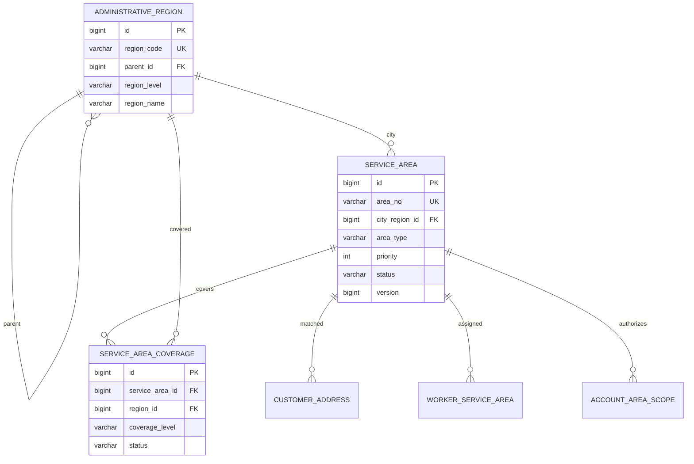

# 服务区域与位置模块详细设计

## 1. 模块定位

服务区域与位置模块维护公司可提供服务的城市、区县、街道和业务服务区域，为责任地址判断、客户地址匹配、人员服务范围、运营数据权限和派单筛选提供统一空间基础。

核心原则：

> 行政区是基础字典，服务区域是公司实际经营边界。

一个行政区可以被多个服务区域覆盖。订单最终只关联一个服务区域，人员、运营人员和客户地址都引用同一套服务区域编号。

## 2. 已确定的业务决策

1. 首版采用单城市或少量城市的自营服务模式。
2. 行政区划字典存储在本地数据库，不要求实时调用地图服务。
3. 服务区域按区县和街道覆盖，首版不按小区多边形匹配。
4. 街道级覆盖率优先于区县级覆盖。
5. 同一级别存在多个候选区域时按优先级选择。
6. 优先级相同且无法区分时判定为区域冲突，交给运营人员处理。
7. 服务区域停用或归档不做物理删除。
8. 服务区域变化不回写历史订单地址快照。
9. 服务区域变化后，受影响客户地址标记为需要重新匹配。
10. 本模块不保存实时 GPS 轨迹，也不负责导航。

## 3. 模块边界

### 3.1 本模块负责

- 省、市、区县、街道行政区字典。
- 服务区域定义和覆盖范围。
- 服务区域优先级、状态和生效时间。
- 地址到服务区域的匹配。
- 城市可用服务区域查询。
- 服务区域变化通知。
- 为其他模块提供统一的服务区域编号。

### 3.2 本模块不负责

- 客户地址的增删改查。
- 服务人员档案和服务区域分配。
- 运营账号的区域权限分配。
- 服务人员排班。
- 订单派单评分。
- 跨区附加费计算。
- 实时定位和路线规划。

## 4. 角色与权限

### 4.1 消费者

- 可以查询城市公开服务区域。
- 可以对准备保存的地址执行服务范围检查。
- 不能查看内部覆盖明细、优先级和运营备注。

### 4.2 服务人员

- 可以查看自己的服务区域。
- 不能修改区域覆盖。
- 人员服务区域的分配由人员模块管理。

### 4.3 运营人员

- 可以查看自己权限范围内的服务区域。
- 具备权限时可以维护覆盖范围、优先级和状态。
- 区域冲突需要人工处理。
- 区域变更必须记录审计日志。

### 4.4 系统管理员

- 可以导入和维护行政区字典。
- 可以管理全部服务区域。
- 可以查看区域变更记录。

## 5. 核心概念

### 5.1 行政区

行政区用于描述地址结构，不直接表示公司是否提供上门服务。

首版支持层级：

```text
PROVINCE
CITY
DISTRICT
STREET
```

例如：

```text
广东省
└─ 广州市
   └─ 天河区
      └─ 示例街道
```

### 5.2 服务区域

服务区域是公司经营范围内可被订单、人员、运营人员和客户地址共同引用的业务单位。

例如：

```text
服务区域 A：天河区核心片区
覆盖：示例街道、另一示例街道

服务区域 B：天河区北部片区
覆盖：第三个示例街道
```

### 5.3 覆盖范围

覆盖范围将服务区域绑定到行政区：

```text
服务区域 A -> 天河区（DISTRICT）
服务区域 A -> 示例街道（STREET）
```

同一服务区域可以包含多个区县或街道。

## 6. 状态设计

### 6.1 行政区状态

```text
ACTIVE
DISABLED
```

- `DISABLED` 行政区不能再被新地址和新覆盖配置选择。
- 历史地址和服务区域关系保留。

### 6.2 服务区域状态

```text
DRAFT
ACTIVE
INACTIVE
ARCHIVED
```

| 状态 | 说明 |
| --- | --- |
| `DRAFT` | 配置中，不参与匹配 |
| `ACTIVE` | 可以参与地址匹配和新订单 |
| `INACTIVE` | 暂停新增业务，但保留历史关系 |
| `ARCHIVED` | 归档，不再允许恢复为普通经营区域 |

### 6.3 覆盖状态

```text
ACTIVE
DISABLED
```

覆盖范围不物理删除。停用后不再参与匹配，但保留配置历史。

### 6.4 地址匹配结果

位置模块返回：

```text
MATCHED
OUT_OF_RANGE
AMBIGUOUS
REGION_INVALID
```

- `MATCHED` 返回唯一 `serviceAreaId`。
- `OUT_OF_RANGE` 表示没有服务区域覆盖。
- `AMBIGUOUS` 表示存在同级同优先级冲突。
- `REGION_INVALID` 表示行政区编码无效或层级错误。

## 7. 匹配策略

### 7.1 输入信息

首版匹配输入：

```text
cityCode
districtCode
streetCode
longitude
latitude
```

其中 `cityCode`、`districtCode` 必填，`streetCode` 和坐标可选。

### 7.2 匹配步骤

```text
校验行政区层级和状态
-> 查询街道覆盖
-> 查询区县覆盖
-> 过滤非 ACTIVE 或未生效的服务区域
-> 按覆盖级别和优先级排序
-> 返回唯一服务区域
```

### 7.3 排序规则

```text
第一优先级：街道覆盖 > 区县覆盖
第二优先级：服务区域 priority 数值大者优先
第三优先级：生效时间晚者优先
```

如果排序后仍无法得到唯一候选，则返回 `AMBIGUOUS`，不能随机选择。

完整地看，排序键依次为：

```text
覆盖级别（街道优先于区县）
-> service_area.priority 降序
-> effective_from 降序
```

三个排序键都相同时才返回 `AMBIGUOUS`。

### 7.4 匹配示例

```text
地址：广州市天河区示例街道

候选：
A 区域覆盖天河区，priority = 100
B 区域覆盖示例街道，priority = 50
```

结果选择 B 区域，因为街道覆盖比区县覆盖更精确。

另一个例子：

```text
A 区域覆盖示例街道，priority = 100
B 区域覆盖示例街道，priority = 100
```

结果为 `AMBIGUOUS`，进入运营处理。

## 8. 首版不接地图的实现

首版使用行政区编码匹配，不依赖高德或其他地图服务。

优点：

- 本地开发和测试不依赖外部网络。
- 区域规则可解释。
- 运营人员容易维护。
- 不产生地图调用成本。

限制：

- 无法表达不规则多边形。
- 同一街道内不能进一步按小区区分。
- 不能计算真实路程和通勤时间。

后续接入地图时可以增加：

```text
boundary_geojson
MapProvider
JTS 点面判断
距离矩阵
```

但地图结果仍必须映射回本模块的服务区域编号。

## 9. 服务区域变更传播

服务区域覆盖、状态、优先级或生效时间发生变化时：

```text
更新 service_area.version
-> 写服务区域变更审计
-> 找出受影响的客户地址
-> 将 customer_address.area_match_status 标记为 STALE
-> 清除区域缓存
-> 可选发送运营提醒
```

规则：

- 历史订单快照不变。
- 服务人员服务区域关系不变，但归档区域不能再用于新派单。
- 运营账号区域权限不变，但查询业务数据时应排除归档区域。
- 客户地址下次下单或下次主动刷新时重新匹配。

## 10. 领域模型



跨模块说明：

- `customer_address.service_area_id` 由客户模块保存。
- `worker_service_area.service_area_id` 由人员模块保存。
- `account_area_scope.service_area_id` 由账号模块保存。
- 这些跨模块关系不使用级联删除，只保存服务区域编号和索引。

## 11. 数据库规范

### 11.1 通用规范

- 数据库使用 MySQL 8.0，InnoDB，`utf8mb4`。
- 表名和字段名使用 `snake_case`。
- 内部主键使用 `BIGINT UNSIGNED` 自增。
- 业务编号单独保存，便于对外使用和审计。
- 时间使用 `DATETIME(3)`，统一按 `Asia/Shanghai`。
- 状态使用英文枚举字符串。
- 行政区和服务区域不做物理删除。
- 服务区域覆盖使用状态停用，不删除历史行。
- 服务区域修改使用 `version` 乐观锁。
- 所有匹配查询必须走状态、生效时间和区域索引。

### 11.2 表清单

| 表名 | 用途 | 是否 MVP |
| --- | --- | --- |
| `administrative_region` | 省、市、区县、街道行政区字典 | 是 |
| `service_area` | 公司服务区域 | 是 |
| `service_area_coverage` | 服务区域与行政区覆盖关系 | 是 |

首版不增加独立社区表。后续需要小区级匹配时，再增加 `community` 或扩展覆盖类型。

## 12. MySQL 表结构

### 12.1 行政区字典表

```sql
CREATE TABLE administrative_region (
    id BIGINT UNSIGNED NOT NULL AUTO_INCREMENT,
    region_code VARCHAR(12) NOT NULL COMMENT '国家行政区编码',
    parent_id BIGINT UNSIGNED NULL,
    region_level VARCHAR(16) NOT NULL,
    region_name VARCHAR(128) NOT NULL,
    short_name VARCHAR(64) NULL,
    full_name VARCHAR(255) NULL,
    longitude DECIMAL(10, 7) NULL,
    latitude DECIMAL(10, 7) NULL,
    status VARCHAR(16) NOT NULL DEFAULT 'ACTIVE',
    sort_order INT NOT NULL DEFAULT 0,
    created_by_account_id BIGINT UNSIGNED NULL,
    updated_by_account_id BIGINT UNSIGNED NULL,
    version BIGINT UNSIGNED NOT NULL DEFAULT 0,
    created_at DATETIME(3) NOT NULL DEFAULT CURRENT_TIMESTAMP(3),
    updated_at DATETIME(3) NOT NULL DEFAULT CURRENT_TIMESTAMP(3)
        ON UPDATE CURRENT_TIMESTAMP(3),
    PRIMARY KEY (id),
    UNIQUE KEY uk_administrative_region_code (region_code),
    KEY idx_administrative_region_parent
        (parent_id, region_level, status),
    KEY idx_administrative_region_name (region_name),
    CONSTRAINT fk_administrative_region_parent
        FOREIGN KEY (parent_id) REFERENCES administrative_region (id)
        ON UPDATE RESTRICT ON DELETE RESTRICT,
    CONSTRAINT chk_administrative_region_level
        CHECK (region_level IN ('PROVINCE', 'CITY', 'DISTRICT', 'STREET')),
    CONSTRAINT chk_administrative_region_status
        CHECK (status IN ('ACTIVE', 'DISABLED')),
    CONSTRAINT chk_administrative_region_longitude
        CHECK (longitude IS NULL OR longitude BETWEEN -180 AND 180),
    CONSTRAINT chk_administrative_region_latitude
        CHECK (latitude IS NULL OR latitude BETWEEN -90 AND 90)
) ENGINE=InnoDB DEFAULT CHARSET=utf8mb4 COLLATE=utf8mb4_0900_ai_ci
  COMMENT='行政区划字典';
```

行政区字典由管理员统一导入，普通运营人员不允许直接修改国家行政区编码。

### 12.2 服务区域表

```sql
CREATE TABLE service_area (
    id BIGINT UNSIGNED NOT NULL AUTO_INCREMENT,
    area_no VARCHAR(32) NOT NULL COMMENT '对外服务区域编号',
    area_name VARCHAR(128) NOT NULL,
    description VARCHAR(500) NULL,
    city_region_id BIGINT UNSIGNED NOT NULL COMMENT '城市行政区ID',
    area_type VARCHAR(32) NOT NULL DEFAULT 'DISTRICT_GROUP',
    priority INT NOT NULL DEFAULT 0,
    status VARCHAR(16) NOT NULL DEFAULT 'DRAFT',
    center_longitude DECIMAL(10, 7) NULL,
    center_latitude DECIMAL(10, 7) NULL,
    boundary_geojson JSON NULL COMMENT '预留地图边界',
    effective_from DATETIME(3) NULL,
    effective_to DATETIME(3) NULL,
    version BIGINT UNSIGNED NOT NULL DEFAULT 0,
    created_by_account_id BIGINT UNSIGNED NULL,
    updated_by_account_id BIGINT UNSIGNED NULL,
    created_at DATETIME(3) NOT NULL DEFAULT CURRENT_TIMESTAMP(3),
    updated_at DATETIME(3) NOT NULL DEFAULT CURRENT_TIMESTAMP(3)
        ON UPDATE CURRENT_TIMESTAMP(3),
    PRIMARY KEY (id),
    UNIQUE KEY uk_service_area_no (area_no),
    KEY idx_service_area_city_status
        (city_region_id, status, priority),
    KEY idx_service_area_effective
        (status, effective_from, effective_to),
    CONSTRAINT fk_service_area_city
        FOREIGN KEY (city_region_id) REFERENCES administrative_region (id)
        ON UPDATE RESTRICT ON DELETE RESTRICT,
    CONSTRAINT fk_service_area_created_by
        FOREIGN KEY (created_by_account_id) REFERENCES account (id)
        ON UPDATE RESTRICT ON DELETE RESTRICT,
    CONSTRAINT fk_service_area_updated_by
        FOREIGN KEY (updated_by_account_id) REFERENCES account (id)
        ON UPDATE RESTRICT ON DELETE RESTRICT,
    CONSTRAINT chk_service_area_type
        CHECK (area_type IN ('DISTRICT_GROUP', 'STREET_GROUP', 'CUSTOM')),
    CONSTRAINT chk_service_area_priority
        CHECK (priority BETWEEN 0 AND 999),
    CONSTRAINT chk_service_area_status
        CHECK (status IN ('DRAFT', 'ACTIVE', 'INACTIVE', 'ARCHIVED')),
    CONSTRAINT chk_service_area_effective_range
        CHECK (
            effective_to IS NULL
            OR effective_from IS NULL
            OR effective_to > effective_from
        ),
    CONSTRAINT chk_service_area_center_longitude
        CHECK (center_longitude IS NULL OR center_longitude BETWEEN -180 AND 180),
    CONSTRAINT chk_service_area_center_latitude
        CHECK (center_latitude IS NULL OR center_latitude BETWEEN -90 AND 90)
) ENGINE=InnoDB DEFAULT CHARSET=utf8mb4 COLLATE=utf8mb4_0900_ai_ci
  COMMENT='公司服务区域';
```

说明：

- `area_no` 建议使用 `SA` 加日期和序列，例如 `SA202610230001`。
- `priority` 数值越大，同级覆盖冲突时优先级越高。
- `boundary_geojson` 首版可以为空，不能作为唯一匹配依据。
- 服务区域通过状态归档，不物理删除。
- `city_region_id` 对应行政区层级 `CITY`。

### 12.3 服务区域覆盖表

```sql
CREATE TABLE service_area_coverage (
    id BIGINT UNSIGNED NOT NULL AUTO_INCREMENT,
    service_area_id BIGINT UNSIGNED NOT NULL,
    region_id BIGINT UNSIGNED NOT NULL COMMENT '区县或街道行政区ID',
    coverage_level VARCHAR(16) NOT NULL COMMENT 'DISTRICT/STREET',
    status VARCHAR(16) NOT NULL DEFAULT 'ACTIVE',
    created_by_account_id BIGINT UNSIGNED NULL,
    updated_by_account_id BIGINT UNSIGNED NULL,
    created_at DATETIME(3) NOT NULL DEFAULT CURRENT_TIMESTAMP(3),
    updated_at DATETIME(3) NOT NULL DEFAULT CURRENT_TIMESTAMP(3)
        ON UPDATE CURRENT_TIMESTAMP(3),
    version BIGINT UNSIGNED NOT NULL DEFAULT 0,
    PRIMARY KEY (id),
    UNIQUE KEY uk_service_area_coverage
        (service_area_id, region_id),
    KEY idx_service_area_coverage_region
        (region_id, status, coverage_level),
    KEY idx_service_area_coverage_area
        (service_area_id, status),
    CONSTRAINT fk_service_area_coverage_area
        FOREIGN KEY (service_area_id) REFERENCES service_area (id)
        ON UPDATE RESTRICT ON DELETE RESTRICT,
    CONSTRAINT fk_service_area_coverage_region
        FOREIGN KEY (region_id) REFERENCES administrative_region (id)
        ON UPDATE RESTRICT ON DELETE RESTRICT,
    CONSTRAINT fk_service_area_coverage_created_by
        FOREIGN KEY (created_by_account_id) REFERENCES account (id)
        ON UPDATE RESTRICT ON DELETE RESTRICT,
    CONSTRAINT fk_service_area_coverage_updated_by
        FOREIGN KEY (updated_by_account_id) REFERENCES account (id)
        ON UPDATE RESTRICT ON DELETE RESTRICT,
    CONSTRAINT chk_service_area_coverage_level
        CHECK (coverage_level IN ('DISTRICT', 'STREET')),
    CONSTRAINT chk_service_area_coverage_status
        CHECK (status IN ('ACTIVE', 'DISABLED'))
) ENGINE=InnoDB DEFAULT CHARSET=utf8mb4 COLLATE=utf8mb4_0900_ai_ci
  COMMENT='服务区域覆盖范围';
```

应用层必须校验：

```text
coverage_level = DISTRICT 时，region.region_level 必须为 DISTRICT
coverage_level = STREET 时，region.region_level 必须为 STREET
region 必须属于 service_area.city_region_id 所在城市
```

## 13. 索引与约束说明

### 13.1 关键唯一约束

```text
administrative_region.region_code
service_area.area_no
service_area_coverage(service_area_id, region_id)
```

同一行政区不能在同一服务区域中重复配置两次。

### 13.2 匹配查询索引

候选区域查询依赖：

```text
administrative_region.region_code
service_area_coverage(region_id, status, coverage_level)
service_area(city_region_id, status, priority)
```

### 13.3 生效时间

服务区域只有在以下条件同时满足时参与匹配：

```text
service_area.status = 'ACTIVE'
coverage.status = 'ACTIVE'
effective_from 为空或已到时间
effective_to 为空或尚未过期
```

## 14. 匹配接口设计

### 14.1 内部匹配请求

```json
{
  "cityCode": "440100",
  "districtCode": "440106",
  "streetCode": "440106010",
  "longitude": 113.32452,
  "latitude": 23.12614
}
```

坐标首版可以为空。

### 14.2 匹配成功响应

```json
{
  "matchStatus": "MATCHED",
  "serviceAreaId": 12,
  "areaNo": "SA202610230001",
  "areaName": "天河区核心片区",
  "matchLevel": "STREET",
  "matchedRegionCode": "440106010",
  "matchedAt": "2026-10-23T10:30:00+08:00"
}
```

### 14.3 匹配失败响应

```json
{
  "matchStatus": "OUT_OF_RANGE",
  "message": "当前地址暂不在服务范围内"
}
```

区域冲突使用：

```json
{
  "matchStatus": "AMBIGUOUS",
  "message": "当前地址匹配到多个同优先级服务区域"
}
```

公共接口不返回所有候选区域和内部优先级。

## 15. 事务与并发

| 用例 | 事务范围 |
| --- | --- |
| 创建服务区域 | 写服务区域、初始化版本、写审计 |
| 修改覆盖范围 | 锁定服务区域、写入覆盖、增加版本、标记相关地址 STALE |
| 启用服务区域 | 校验至少一个有效覆盖、更新状态、清理缓存 |
| 停用服务区域 | 更新状态、清理缓存、保留历史关系 |
| 归档服务区域 | 校验无未完成新业务、更新状态、写审计 |

并发规则：

- 修改覆盖范围使用服务区域 `version` 乐观锁。
- 同一服务区域和行政区唯一约束兜底。
- 服务区域状态变化后主动清理缓存。
- 标记客户地址 `STALE` 可以由事务内同步处理或事务提交后的领域事件处理。
- 批量更新必须分批执行，避免长时间锁表。

## 16. 接口设计

### 16.1 公共接口

```text
GET  /api/v1/public/service-areas?cityCode=440100
POST /api/v1/public/service-area-match
```

公共匹配接口需要限流，且不记录完整地址明文。

### 16.2 客户地址接口

客户模块调用位置模块内部接口：

```text
POST /internal/location/service-area-match
```

客户地址保存后，由客户模块写回：

```text
service_area_id
area_match_status
area_matched_at
```

客户地址状态映射：

| 位置模块结果 | 客户地址状态 |
| --- | --- |
| `MATCHED` | `MATCHED` |
| `OUT_OF_RANGE` | `OUT_OF_RANGE` |
| `AMBIGUOUS` | `UNMATCHED` |
| `REGION_INVALID` | `UNMATCHED` |

`AMBIGUOUS` 和 `REGION_INVALID` 需要向调用方返回明确错误，不能伪装成普通“不在服务范围”。

### 16.3 运营接口

```text
GET  /api/v1/operator/service-areas
GET  /api/v1/operator/service-areas/{areaNo}
POST /api/v1/operator/service-areas
PUT  /api/v1/operator/service-areas/{areaNo}
POST /api/v1/operator/service-areas/{areaNo}/activate
POST /api/v1/operator/service-areas/{areaNo}/deactivate
POST /api/v1/operator/service-areas/{areaNo}/archive
GET  /api/v1/operator/service-areas/{areaNo}/coverages
POST /api/v1/operator/service-areas/{areaNo}/coverages
PUT  /api/v1/operator/service-areas/{areaNo}/coverages/{coverageId}
POST /api/v1/operator/service-areas/{areaNo}/coverages/{coverageId}/disable
```

### 16.4 管理员接口

```text
POST /api/v1/admin/administrative-regions/import
GET  /api/v1/admin/administrative-regions
PUT  /api/v1/admin/administrative-regions/{regionCode}
```

行政区导入应为幂等操作，重复导入同一编码时更新名称和状态，不重复插入。

## 17. 与其他模块协作

### 17.1 客户与地址

- 客户地址保存时调用匹配接口。
- 匹配成功后保存 `service_area_id`。
- 服务区域变化后客户地址标记为 `STALE`。
- 下单前再次匹配，不能只信任地址簿缓存。

### 17.2 账号与权限

- 运营账号的 `account_area_scope` 使用服务区域 ID。
- 运营人员没有任何区域时不能访问业务数据。
- 归档区域不能继续授权给新运营人员。

### 17.3 服务人员与资质

- 人员可以关联多个有效服务区域。
- 派单前人员必须覆盖订单服务区域。
- 归档区域不能用于新的人员分配。

### 17.4 派单与人员分配

区域匹配是人工派单的硬性条件，不是评分项。

```text
服务人员区域不覆盖订单区域 -> 直接排除
服务人员区域覆盖订单区域 -> 进入后续技能、时段、负载评分
```

### 17.5 运营统计

- 订单、人员、投诉和收入可以按服务区域聚合。
- 服务区域改名不改变历史订单快照。
- 归档区域仍保留历史统计。

## 18. 错误码

```text
REGION_NOT_FOUND
REGION_DISABLED
REGION_LEVEL_MISMATCH
REGION_PARENT_INVALID
SERVICE_AREA_NOT_FOUND
SERVICE_AREA_NOT_ACTIVE
SERVICE_AREA_EFFECTIVE_RANGE_INVALID
SERVICE_AREA_COVERAGE_REQUIRED
SERVICE_AREA_COVERAGE_OUTSIDE_CITY
SERVICE_AREA_COVERAGE_LEVEL_MISMATCH
SERVICE_AREA_COVERAGE_CONFLICT
SERVICE_AREA_AMBIGUOUS
SERVICE_AREA_VERSION_CONFLICT
SERVICE_AREA_ARCHIVED
```

公共接口对 `OUT_OF_RANGE` 使用普通业务提示，不暴露内部区域配置。

## 19. 测试清单

### 19.1 单元测试

- 行政区层级和父级关系。
- 行政区编码唯一性。
- 服务区域编号生成。
- 覆盖级别与行政区级别一致。
- 服务区域同城市校验。
- 生效时间判断。
- 匹配排序和冲突判断。

### 19.2 集成测试

- 街道覆盖优先于区县覆盖。
- 高优先级服务区域优先。
- 同优先级冲突返回 `AMBIGUOUS`。
- `DRAFT`、`INACTIVE`、`ARCHIVED` 服务区域不参与匹配。
- 覆盖停用后地址匹配变为 `OUT_OF_RANGE`。
- 服务区域修改后版本号增加。
- 客户地址被标记为 `STALE`。
- 历史订单地址快照不变。
- 无人区、错误行政区编码返回明确错误。
- 运营人员只能查看授权区域。
- 服务人员区域不覆盖时不能进入派单候选。

### 19.3 安全测试

- 公共匹配接口不返回内部优先级和完整覆盖列表。
- 日志不打印完整地址。
- 运营修改覆盖范围写审计。
- 普通运营不能修改行政区字典。

## 20. MVP 与后续扩展

### 20.1 MVP 范围

- 省、市、区县、街道字典。
- 服务区域创建、修改、启用、停用和归档。
- 区县和街道覆盖。
- 城市公开服务区域查询。
- 地址服务区域匹配。
- 覆盖冲突处理。
- 服务区域变化标记客户地址 `STALE`。
- 区域权限和人员派单引用。

### 20.2 后续扩展

- 社区和小区级覆盖。
- 地图多边形边界。
- JTS 点面判断。
- 地图地理编码和逆地理编码。
- 服务半径。
- 距离和通勤时间。
- 区域容量和人员需求预测。
- 跨区附加费。
- 多城市运营。

地图接入后仍然遵守：

```text
地图只提供地址解析和几何判断
服务区域业务编号仍由本模块管理
其他模块不能直接依赖地图 SDK
```

## 21. 实现顺序

```text
administrative_region
-> service_area
-> service_area_coverage
-> 区县匹配
-> 街道优先级
-> 冲突和生效时间
-> 客户地址回写
-> 区域变更事件
-> 权限和派单集成
```

## 22. 仍需确认的问题

1. 首版是否只在广州市运营，还是支持多个城市。
2. 服务区域默认按街道配置，还是允许直接按区县整区配置。
3. 同一地址匹配到多个同优先级区域时，是否全部进入人工处理。
4. 跨区订单是否在首版计算额外上门费。
