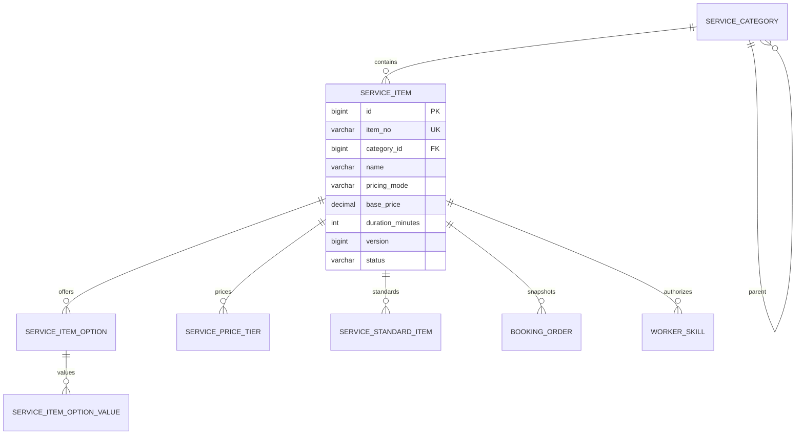

# 服务目录与计价模块详细设计

## 1. 模块定位

服务目录与计价模块由公司统一维护可销售的家政服务，提供分类、服务项目、服务规格、加项、价格规则和服务标准。

核心原则：

> 服务项目属于公司统一目录，不属于任何入驻商家。

消费者下单时购买一个主服务项目，附加服务、耗材和上门费作为订单明细。订单创建后必须保存服务名称、价格规则和服务标准快照。

## 2. 已确定的业务决策

1. 服务分类和服务项目全部由公司统一维护。
2. 首版一个订单只有一个主服务项目。
3. 加项、耗材和附加费用作为订单明细。
4. 价格计算必须在服务端完成。
5. 服务项目发布后修改价格或标准时增加版本号。
6. 已创建订单只使用自己的快照，不回算当前目录价格。
7. 首版不做优惠券、会员折扣和复杂营销规则。
8. 首版不支持通用脚本规则引擎。
9. 服务标准是履约检查项模板，履约模块必须复制快照。
10. 默认全公司共享服务项目，区域差异价格放到后续扩展。

## 3. 模块边界

### 3.1 本模块负责

- 服务分类。
- 服务项目。
- 服务规格和加项。
- 基础价格和结构化价格阶梯。
- 服务标准检查项。
- 上架、下架和版本管理。
- 价格预览。
- 服务与价格快照。

### 3.2 本模块不负责

- 客户和地址。
- 服务区域匹配。
- 服务人员技能审核。
- 排班和人员分配。
- 订单状态和支付。
- 服务过程记录。

## 4. 角色与权限

### 4.1 消费者

- 浏览已发布的服务分类和服务项目。
- 查看服务价格规则、预计时长和服务标准。
- 获取价格预览。
- 不能修改服务目录。

### 4.2 服务人员

- 查看与自身技能相关的服务标准。
- 不能修改服务项目和价格。

### 4.3 运营人员

- 创建、编辑、发布和下架服务项目。
- 配置服务规格、加项和检查项。
- 具有对应权限点后才能修改价格。
- 修改已发布服务必须增加版本号。

### 4.4 系统管理员

- 管理服务分类和系统级计价配置。
- 不直接绕过领域服务改价。

## 5. 服务分类

### 5.1 分类层级

首版采用两层：

```text
一级分类：居家保洁
二级分类：日常保洁、深度保洁、开荒保洁
```

数据库支持多级树状结构，但企业首版限制最多三层。

### 5.2 分类状态

```text
ACTIVE
DISABLED
```

停用分类不影响历史服务项目和历史订单，但不能再新增服务项目或在前台展示。

## 6. 服务项目

### 6.1 服务项目状态

```text
DRAFT
PUBLISHED
OFFLINE
```

| 状态 | 说明 |
| --- | --- |
| `DRAFT` | 草稿，不可销售 |
| `PUBLISHED` | 已发布，可查询和下单 |
| `OFFLINE` | 已下架，不可创建新订单 |

状态转换：

```text
DRAFT -> PUBLISHED
PUBLISHED -> OFFLINE
OFFLINE -> PUBLISHED
```

已发布服务不能直接删除。下架不影响历史订单。

### 6.2 服务项目版本

- `version` 从 0 开始。
- 修改价格、服务时长、规格或标准后 `version + 1`。
- 订单保存 `service_item_version`。
- 服务项目发布时记录 `published_at`。
- 下架时记录 `offline_at`。

### 6.3 计量方式

服务项目支持以下基础销售单位：

```text
ORDER
HOUR
SQUARE_METER
ITEM
```

计价模式支持：

```text
FIXED
AREA_TIER
DURATION_TIER
QUANTITY_TIER
```

首版实现 `FIXED` 和 `AREA_TIER`，其余模式保留结构，不强制全部做 UI。

## 7. 服务规格与加项

### 7.1 规格组

例如：

```text
房屋面积
清洁类型
是否需要玻璃清洁
是否需要冰箱清洁
耗材由谁提供
```

规格组分：

```text
SINGLE
MULTIPLE
```

规则：

- 每个规格组可以设置必选。
- `SINGLE` 只能选择一个值。
- `MULTIPLE` 可以设置最少和最多选择数量。
- 加项可以增加价格和预计时长。

### 7.2 加项值

每个加项值保存：

- 展示名称。
- 稳定编码。
- 附加金额。
- 时长增量。
- 状态。

价格不能放在前端计算。

## 8. 计价规则

### 8.1 固定价格

```text
amount = base_price * quantity
```

### 8.2 面积阶梯

```text
选择面积所在阶梯
-> 使用该阶梯固定价格或面积单价
-> 加上加项金额
-> 得到服务金额
```

### 8.3 时长计价

```text
amount = 单价 * 小时数
```

### 8.4 数量计价

```text
amount = 单价 * 数量
```

### 8.5 金额字段

统一使用 `DECIMAL(12,2)`，Java 使用 `BigDecimal`。

四舍五入方式：

```text
HALF_UP
```

### 8.6 价格明细

价格预览必须返回：

```text
服务项目版本
基础服务费
加项费用
耗材费用
上门费
优惠金额
应付金额
预计服务时长
计价说明
```

首版没有优惠券时 `discount_amount = 0`。

### 8.7 价格校验

- 下单时必须重新计算价格。
- 客户端传入的金额只用于展示，不能作为最终金额。
- 价格与服务端计算不一致时返回冲突。
- 价格规则变更不影响已经创建的订单。

## 9. 服务标准

服务标准由检查项组成：

```text
服务前拍照
厨房台面清洁
卫生间洁具清洁
地面清洁
垃圾清理
服务后拍照
```

检查项字段：

- 分组。
- 名称。
- 说明。
- 是否必填。
- 是否需要照片证据。
- 排序。

履约模块创建订单时复制标准快照，不直接读取当前模板。

## 10. 领域模型



跨模块只使用服务项目 ID 和版本号，订单模块不直接读取服务目录表。

## 11. 数据库规范

### 11.1 通用规范

- 数据库使用 MySQL 8.0，InnoDB，`utf8mb4`。
- 主键使用 `BIGINT UNSIGNED` 自增。
- 服务项目、规格和分类使用独立业务编号。
- 金额使用 `DECIMAL(12,2)`。
- 时间使用 `DATETIME(3)`，统一按 `Asia/Shanghai`。
- 状态使用英文枚举字符串。
- 不下发数据库实体给前端。
- 已发布服务修改需要增加 `version`。
- 分类和服务项目不物理删除。

### 11.2 表清单

| 表名 | 用途 | 是否 MVP |
| --- | --- | --- |
| `service_category` | 服务分类树 | 是 |
| `service_item` | 服务项目主表 | 是 |
| `service_item_option` | 服务规格组 | 是 |
| `service_item_option_value` | 规格值和加项价格 | 是 |
| `service_price_tier` | 面积、时长或数量阶梯价格 | 是 |
| `service_standard_item` | 履约检查项模板 | 是 |

## 12. MySQL 表结构

### 12.1 服务分类表

```sql
CREATE TABLE service_category (
    id BIGINT UNSIGNED NOT NULL AUTO_INCREMENT,
    category_no VARCHAR(32) NOT NULL,
    parent_id BIGINT UNSIGNED NULL,
    category_name VARCHAR(64) NOT NULL,
    icon_url VARCHAR(512) NULL,
    description VARCHAR(255) NULL,
    sort_order INT NOT NULL DEFAULT 0,
    status VARCHAR(16) NOT NULL DEFAULT 'ACTIVE',
    created_by_account_id BIGINT UNSIGNED NULL,
    updated_by_account_id BIGINT UNSIGNED NULL,
    version BIGINT UNSIGNED NOT NULL DEFAULT 0,
    created_at DATETIME(3) NOT NULL DEFAULT CURRENT_TIMESTAMP(3),
    updated_at DATETIME(3) NOT NULL DEFAULT CURRENT_TIMESTAMP(3)
        ON UPDATE CURRENT_TIMESTAMP(3),
    PRIMARY KEY (id),
    UNIQUE KEY uk_service_category_no (category_no),
    KEY idx_service_category_parent (parent_id, sort_order, status),
    CONSTRAINT fk_service_category_parent
        FOREIGN KEY (parent_id) REFERENCES service_category (id)
        ON UPDATE RESTRICT ON DELETE RESTRICT,
    CONSTRAINT chk_service_category_status
        CHECK (status IN ('ACTIVE', 'DISABLED'))
) ENGINE=InnoDB DEFAULT CHARSET=utf8mb4 COLLATE=utf8mb4_0900_ai_ci
  COMMENT='服务分类';
```

### 12.2 服务项目表

```sql
CREATE TABLE service_item (
    id BIGINT UNSIGNED NOT NULL AUTO_INCREMENT,
    item_no VARCHAR(32) NOT NULL,
    category_id BIGINT UNSIGNED NOT NULL,
    item_name VARCHAR(128) NOT NULL,
    short_description VARCHAR(255) NULL,
    detail_description TEXT NULL,
    cover_url VARCHAR(512) NULL,
    service_unit VARCHAR(24) NOT NULL DEFAULT 'ORDER',
    pricing_mode VARCHAR(24) NOT NULL DEFAULT 'FIXED',
    base_price DECIMAL(12,2) NOT NULL DEFAULT 0.00,
    duration_minutes INT NOT NULL DEFAULT 240,
    min_quantity DECIMAL(10,2) NOT NULL DEFAULT 1.00,
    max_quantity DECIMAL(10,2) NULL,
    service_scope TEXT NULL,
    service_standard_summary TEXT NULL,
    version BIGINT UNSIGNED NOT NULL DEFAULT 0,
    status VARCHAR(16) NOT NULL DEFAULT 'DRAFT',
    published_at DATETIME(3) NULL,
    offline_at DATETIME(3) NULL,
    created_by_account_id BIGINT UNSIGNED NULL,
    updated_by_account_id BIGINT UNSIGNED NULL,
    created_at DATETIME(3) NOT NULL DEFAULT CURRENT_TIMESTAMP(3),
    updated_at DATETIME(3) NOT NULL DEFAULT CURRENT_TIMESTAMP(3)
        ON UPDATE CURRENT_TIMESTAMP(3),
    PRIMARY KEY (id),
    UNIQUE KEY uk_service_item_no (item_no),
    KEY idx_service_item_category (category_id, status),
    KEY idx_service_item_status (status, published_at),
    CONSTRAINT fk_service_item_category
        FOREIGN KEY (category_id) REFERENCES service_category (id)
        ON UPDATE RESTRICT ON DELETE RESTRICT,
    CONSTRAINT fk_service_item_created_by
        FOREIGN KEY (created_by_account_id) REFERENCES account (id)
        ON UPDATE RESTRICT ON DELETE RESTRICT,
    CONSTRAINT fk_service_item_updated_by
        FOREIGN KEY (updated_by_account_id) REFERENCES account (id)
        ON UPDATE RESTRICT ON DELETE RESTRICT,
    CONSTRAINT chk_service_item_unit
        CHECK (service_unit IN ('ORDER', 'HOUR', 'SQUARE_METER', 'ITEM')),
    CONSTRAINT chk_service_item_pricing
        CHECK (pricing_mode IN (
            'FIXED',
            'AREA_TIER',
            'DURATION_TIER',
            'QUANTITY_TIER'
        )),
    CONSTRAINT chk_service_item_quantity
        CHECK (
            min_quantity > 0
            AND (max_quantity IS NULL OR max_quantity >= min_quantity)
        ),
    CONSTRAINT chk_service_item_price
        CHECK (base_price >= 0),
    CONSTRAINT chk_service_item_duration
        CHECK (duration_minutes > 0),
    CONSTRAINT chk_service_item_status
        CHECK (status IN ('DRAFT', 'PUBLISHED', 'OFFLINE'))
) ENGINE=InnoDB DEFAULT CHARSET=utf8mb4 COLLATE=utf8mb4_0900_ai_ci
  COMMENT='服务项目';
```

### 12.3 服务规格组表

```sql
CREATE TABLE service_item_option (
    id BIGINT UNSIGNED NOT NULL AUTO_INCREMENT,
    service_item_id BIGINT UNSIGNED NOT NULL,
    option_code VARCHAR(32) NOT NULL,
    option_name VARCHAR(64) NOT NULL,
    selection_type VARCHAR(16) NOT NULL DEFAULT 'SINGLE',
    required TINYINT(1) NOT NULL DEFAULT 0,
    min_select INT NOT NULL DEFAULT 0,
    max_select INT NOT NULL DEFAULT 1,
    sort_order INT NOT NULL DEFAULT 0,
    status VARCHAR(16) NOT NULL DEFAULT 'ACTIVE',
    created_by_account_id BIGINT UNSIGNED NULL,
    updated_by_account_id BIGINT UNSIGNED NULL,
    version BIGINT UNSIGNED NOT NULL DEFAULT 0,
    created_at DATETIME(3) NOT NULL DEFAULT CURRENT_TIMESTAMP(3),
    updated_at DATETIME(3) NOT NULL DEFAULT CURRENT_TIMESTAMP(3)
        ON UPDATE CURRENT_TIMESTAMP(3),
    PRIMARY KEY (id),
    UNIQUE KEY uk_service_item_option_code
        (service_item_id, option_code),
    KEY idx_service_item_option_order
        (service_item_id, sort_order, status),
    CONSTRAINT fk_service_item_option_item
        FOREIGN KEY (service_item_id) REFERENCES service_item (id)
        ON UPDATE RESTRICT ON DELETE RESTRICT,
    CONSTRAINT chk_service_item_option_type
        CHECK (selection_type IN ('SINGLE', 'MULTIPLE')),
    CONSTRAINT chk_service_item_option_required
        CHECK (required IN (0, 1)),
    CONSTRAINT chk_service_item_option_select
        CHECK (
            min_select >= 0
            AND max_select >= 1
            AND max_select >= min_select
        ),
    CONSTRAINT chk_service_item_option_status
        CHECK (status IN ('ACTIVE', 'DISABLED'))
) ENGINE=InnoDB DEFAULT CHARSET=utf8mb4 COLLATE=utf8mb4_0900_ai_ci
  COMMENT='服务规格组';
```

### 12.4 服务规格值表

```sql
CREATE TABLE service_item_option_value (
    id BIGINT UNSIGNED NOT NULL AUTO_INCREMENT,
    option_id BIGINT UNSIGNED NOT NULL,
    value_code VARCHAR(32) NOT NULL,
    value_name VARCHAR(64) NOT NULL,
    numeric_value DECIMAL(10,2) NULL,
    extra_price DECIMAL(12,2) NOT NULL DEFAULT 0.00,
    duration_delta INT NOT NULL DEFAULT 0,
    sort_order INT NOT NULL DEFAULT 0,
    status VARCHAR(16) NOT NULL DEFAULT 'ACTIVE',
    created_by_account_id BIGINT UNSIGNED NULL,
    updated_by_account_id BIGINT UNSIGNED NULL,
    version BIGINT UNSIGNED NOT NULL DEFAULT 0,
    created_at DATETIME(3) NOT NULL DEFAULT CURRENT_TIMESTAMP(3),
    updated_at DATETIME(3) NOT NULL DEFAULT CURRENT_TIMESTAMP(3)
        ON UPDATE CURRENT_TIMESTAMP(3),
    PRIMARY KEY (id),
    UNIQUE KEY uk_service_item_option_value_code
        (option_id, value_code),
    KEY idx_service_item_option_value_order
        (option_id, sort_order, status),
    CONSTRAINT fk_service_item_option_value_option
        FOREIGN KEY (option_id) REFERENCES service_item_option (id)
        ON UPDATE RESTRICT ON DELETE RESTRICT,
    CONSTRAINT chk_service_item_option_value_price
        CHECK (extra_price >= 0),
    CONSTRAINT chk_service_item_option_value_status
        CHECK (status IN ('ACTIVE', 'DISABLED'))
) ENGINE=InnoDB DEFAULT CHARSET=utf8mb4 COLLATE=utf8mb4_0900_ai_ci
  COMMENT='服务规格值和加项价格';
```

### 12.5 价格阶梯表

```sql
CREATE TABLE service_price_tier (
    id BIGINT UNSIGNED NOT NULL AUTO_INCREMENT,
    service_item_id BIGINT UNSIGNED NOT NULL,
    tier_type VARCHAR(24) NOT NULL,
    min_value DECIMAL(10,2) NOT NULL,
    max_value DECIMAL(10,2) NULL,
    fixed_price DECIMAL(12,2) NULL,
    unit_price DECIMAL(12,2) NULL,
    sort_order INT NOT NULL DEFAULT 0,
    status VARCHAR(16) NOT NULL DEFAULT 'ACTIVE',
    created_by_account_id BIGINT UNSIGNED NULL,
    updated_by_account_id BIGINT UNSIGNED NULL,
    version BIGINT UNSIGNED NOT NULL DEFAULT 0,
    created_at DATETIME(3) NOT NULL DEFAULT CURRENT_TIMESTAMP(3),
    updated_at DATETIME(3) NOT NULL DEFAULT CURRENT_TIMESTAMP(3)
        ON UPDATE CURRENT_TIMESTAMP(3),
    PRIMARY KEY (id),
    KEY idx_service_price_tier_item
        (service_item_id, tier_type, status, sort_order),
    CONSTRAINT fk_service_price_tier_item
        FOREIGN KEY (service_item_id) REFERENCES service_item (id)
        ON UPDATE RESTRICT ON DELETE RESTRICT,
    CONSTRAINT chk_service_price_tier_type
        CHECK (tier_type IN ('AREA_TIER', 'DURATION_TIER', 'QUANTITY_TIER')),
    CONSTRAINT chk_service_price_tier_range
        CHECK (
            min_value >= 0
            AND (max_value IS NULL OR max_value > min_value)
        ),
    CONSTRAINT chk_service_price_tier_price
        CHECK (
            (fixed_price IS NOT NULL AND fixed_price >= 0)
            OR (unit_price IS NOT NULL AND unit_price >= 0)
        ),
    CONSTRAINT chk_service_price_tier_status
        CHECK (status IN ('ACTIVE', 'DISABLED'))
) ENGINE=InnoDB DEFAULT CHARSET=utf8mb4 COLLATE=utf8mb4_0900_ai_ci
  COMMENT='服务阶梯价格';
```

服务项目同一 `tier_type` 下的区间不能重叠，业务层在发布时校验。

### 12.6 服务标准检查项表

```sql
CREATE TABLE service_standard_item (
    id BIGINT UNSIGNED NOT NULL AUTO_INCREMENT,
    service_item_id BIGINT UNSIGNED NOT NULL,
    standard_group VARCHAR(64) NULL,
    item_name VARCHAR(128) NOT NULL,
    description VARCHAR(500) NULL,
    required TINYINT(1) NOT NULL DEFAULT 1,
    evidence_required TINYINT(1) NOT NULL DEFAULT 0,
    sort_order INT NOT NULL DEFAULT 0,
    status VARCHAR(16) NOT NULL DEFAULT 'ACTIVE',
    created_by_account_id BIGINT UNSIGNED NULL,
    updated_by_account_id BIGINT UNSIGNED NULL,
    version BIGINT UNSIGNED NOT NULL DEFAULT 0,
    created_at DATETIME(3) NOT NULL DEFAULT CURRENT_TIMESTAMP(3),
    updated_at DATETIME(3) NOT NULL DEFAULT CURRENT_TIMESTAMP(3)
        ON UPDATE CURRENT_TIMESTAMP(3),
    PRIMARY KEY (id),
    KEY idx_service_standard_item
        (service_item_id, status, sort_order),
    CONSTRAINT fk_service_standard_item_item
        FOREIGN KEY (service_item_id) REFERENCES service_item (id)
        ON UPDATE RESTRICT ON DELETE RESTRICT,
    CONSTRAINT chk_service_standard_item_required
        CHECK (required IN (0, 1)),
    CONSTRAINT chk_service_standard_item_evidence
        CHECK (evidence_required IN (0, 1)),
    CONSTRAINT chk_service_standard_item_status
        CHECK (status IN ('ACTIVE', 'DISABLED'))
) ENGINE=InnoDB DEFAULT CHARSET=utf8mb4 COLLATE=utf8mb4_0900_ai_ci
  COMMENT='服务标准检查项';
```

## 13. 计价快照

订单模块创建订单时需要保存：

```text
serviceItemId
serviceItemVersion
serviceItemNo
serviceItemName
serviceUnit
pricingMode
durationMinutes
basePrice
selectedOptions
priceTiersUsed
serviceStandardItems
computedAt
```

快照建议以 JSON 和订单明细共同保存：

- JSON 保存完整计算依据。
- `booking_item` 保存可查询和统计的金额明细。
- 服务标准检查项复制到履约模块。

## 14. 主要用例

1. 创建服务分类。
2. 创建草稿服务项目。
3. 配置规格、加项和阶梯价格。
4. 配置服务标准。
5. 发布服务项目。
6. 消费者浏览服务。
7. 消费者提交规格并获取价格预览。
8. 订单服务获取价格和服务标准快照。
9. 下架服务项目。

## 15. 事务与并发

| 用例 | 事务范围 |
| --- | --- |
| 创建服务项目 | 写服务项目、规格、价格阶梯和标准 |
| 修改已发布服务 | 校验版本、更新内容、增加版本、写审计 |
| 发布服务 | 校验分类、价格、规格和标准完整性 |
| 价格预览 | 只读计算，不写数据库 |
| 下单价格快照 | 与订单创建同一事务读取并保存 |

服务项目修改使用乐观锁：

```sql
UPDATE service_item
SET ..., version = version + 1
WHERE id = ?
  AND version = ?;
```

## 16. 接口设计

### 16.1 公共接口

```text
GET  /api/v1/public/service-categories
GET  /api/v1/public/service-items
GET  /api/v1/public/service-items/{itemNo}
POST /api/v1/public/service-items/{itemNo}/price-preview
```

### 16.2 运营接口

```text
GET  /api/v1/operator/service-categories
POST /api/v1/operator/service-categories
PUT  /api/v1/operator/service-categories/{categoryNo}
GET  /api/v1/operator/service-items
POST /api/v1/operator/service-items
PUT  /api/v1/operator/service-items/{itemNo}
POST /api/v1/operator/service-items/{itemNo}/publish
POST /api/v1/operator/service-items/{itemNo}/offline
GET  /api/v1/operator/service-items/{itemNo}/standards
PUT  /api/v1/operator/service-items/{itemNo}/standards
```

### 16.3 内部接口

```text
GET /internal/catalog/service-items/{itemId}/snapshot
GET /internal/catalog/service-items/{itemId}/standards
```

### 16.4 价格预览请求

```json
{
  "serviceItemNo": "SVC202610230001",
  "quantity": 1,
  "selectedOptions": [
    {
      "optionCode": "AREA",
      "valueCode": "AREA_90_120"
    },
    {
      "optionCode": "ADDON",
      "valueCode": "FRIDGE"
    }
  ]
}
```

### 16.5 价格预览响应

```json
{
  "serviceItemVersion": 3,
  "baseAmount": 299.00,
  "addonAmount": 80.00,
  "materialAmount": 0.00,
  "travelFee": 0.00,
  "discountAmount": 0.00,
  "payableAmount": 379.00,
  "durationMinutes": 270,
  "pricingExplanation": [
    "基础服务：299元",
    "冰箱清洗加项：80元"
  ]
}
```

## 17. 与其他模块协作

### 17.1 人员与资质

- `worker_skill.service_item_id` 引用服务项目。
- 人员技能审核后才能参与对应项目派单。

### 17.2 排班与订单

- 服务项目提供预计服务时长。
- 订单保存服务项目和价格版本。
- 订单创建后不使用当前价格回算。

### 17.3 履约与售后

- 下单时复制服务标准检查项。
- 履约过程中的照片和检查记录关联订单快照。
- 服务项目后续修改不影响历史履约。

## 18. 错误码

```text
SERVICE_CATEGORY_NOT_FOUND
SERVICE_CATEGORY_DISABLED
SERVICE_ITEM_NOT_FOUND
SERVICE_ITEM_NOT_PUBLISHED
SERVICE_ITEM_OFFLINE
SERVICE_ITEM_VERSION_CONFLICT
SERVICE_OPTION_REQUIRED
SERVICE_OPTION_INVALID
SERVICE_OPTION_SELECTION_LIMIT
SERVICE_PRICE_TIER_NOT_FOUND
SERVICE_PRICE_TIER_CONFLICT
SERVICE_PRICE_CHANGED
SERVICE_STANDARD_REQUIRED
```

价格变化不应直接使用旧报价支付，订单必须重新确认。

## 19. 测试清单

### 19.1 单元测试

- 分类树层级限制。
- 固定价格计算。
- 面积阶梯边界。
- 加项价格和时长累加。
- 数量上下限。
- 金额四舍五入。
- 服务标准必填项校验。
- 服务项目版本递增。

### 19.2 集成测试

- 只有 `PUBLISHED` 服务可以下单。
- 下架后历史订单仍可查询。
- 修改价格后旧订单金额不变。
- 重复发布不会重复创建数据。
- 价格阶梯区间重叠被拒绝。
- 规格组必选项缺失被拒绝。
- 订单快照包含服务标准。

### 19.3 安全测试

- 客户端传入的金额无法覆盖服务端价格。
- 普通消费者不能调用运营目录接口。
- 日志不输出服务价格规则中的敏感配置。

## 20. MVP 与后续扩展

### 20.1 MVP 范围

- 两层服务分类。
- 服务项目。
- 单规格组和多规格组。
- 固定价和面积阶梯价。
- 加项和耗材费。
- 服务标准检查项。
- 服务发布、下架和版本。
- 服务端价格预览和快照。

### 20.2 后续扩展

- 服务套餐。
- 周期服务价格。
- 区域差异价格。
- 时段附加费。
- 优惠券。
- 服务项目区域限制。
- 动态定价。

## 21. 实现顺序

```text
service_category
-> service_item
-> service_item_option 和 option_value
-> service_price_tier
-> price preview
-> service_standard_item
-> publish/offline
-> order snapshot
```

## 22. 仍需确认的问题

1. 首版动态计价优先做面积阶梯还是时长阶梯。
2. 服务项目是否允许同一人员只匹配到一级分类。
3. 服务标准是否需要单独审核后才允许发布。
4. 首版是否保留耗材费字段但默认由客户提供。
