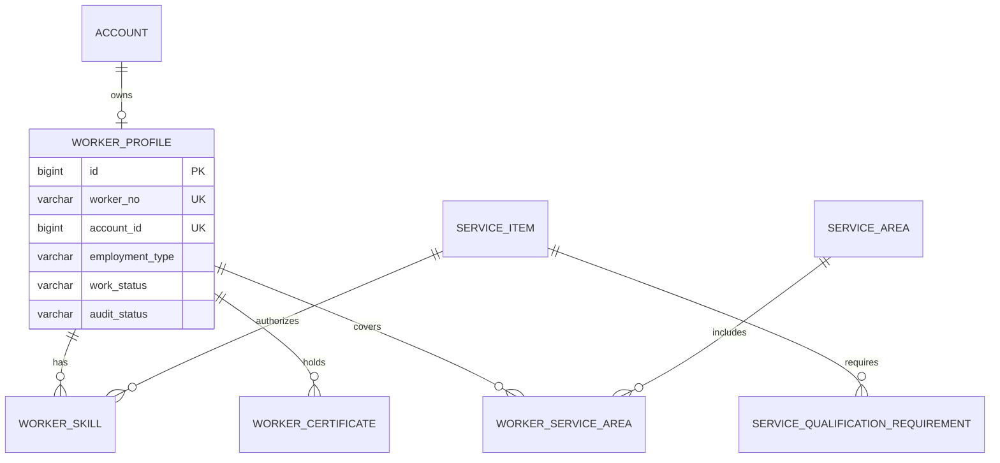

# 服务人员与资质模块详细设计

## 1. 模块定位

服务人员与资质模块管理公司全职、兼职服务人员的业务档案、技能、证书、健康证明、服务区域和可派单资格。

核心原则：

> 账号激活不等于可派单，人员资格必须由业务条件独立校验。

人员可以正常登录但暂时不能被派单，例如健康证过期、技能未审核、区域未配置或处于暂停状态。

## 2. 已确定的业务决策

1. 采用单公司自营模式，不保存 `provider_id` 或商家归属。
2. 人员只区分全职和兼职，共用同一套档案、技能、排班和派单模型。
3. 服务人员账号由运营邀请开户。
4. 一个账号最多对应一个人员档案。
5. 每个人员必须有明确的服务区域。
6. 技能授权到具体服务项目，不只授权到一级分类。
7. 健康证明、身份核验和必要证书可以阻断派单。
8. 人员暂停接单时优先暂停 `WORKER` 角色，不影响其消费者身份。
9. 人员离职使用 `LEFT` 状态，不物理删除档案。
10. 人员评分和完成订单数由服务质量模块汇总，人员模块只保存展示摘要。

## 3. 模块边界

### 3.1 本模块负责

- 服务人员档案。
- 全职和兼职用工类型。
- 技能等级和审核状态。
- 证书、健康证明和有效期。
- 人员服务区域。
- 人员审核、暂停、恢复和离职。
- 可派单资格校验。
- 人员展示信息和质量摘要。

### 3.2 本模块不负责

- 登录、密码和 Token。
- 排班和具体时段占用。
- 订单分配算法。
- 服务履约过程。
- 工资、结算和劳动合同。

## 4. 角色与权限

### 4.1 服务人员

- 查看和修改自己的非审核基础信息。
- 上传证书、健康证明和头像。
- 查看自己的技能、区域、审核状态和排班。
- 不能自行审核技能或证书。
- 不能修改派单资格结论。

### 4.2 运营人员

- 创建人员档案和邀请开户。
- 审核技能、证书和健康证明。
- 分配服务区域。
- 暂停、恢复和办理离职。
- 查看人员可派单资格和拒单记录。

### 4.3 系统管理员

- 管理全部人员数据。
- 查看审计日志。
- 不直接查看证书明文，除非具备敏感数据权限。

## 5. 人员状态

### 5.1 工作状态

```text
ONBOARDING
ACTIVE
SUSPENDED
LEFT
```

| 状态 | 说明 |
| --- | --- |
| `ONBOARDING` | 入职或资料审核中 |
| `ACTIVE` | 可正常参与排班和派单 |
| `SUSPENDED` | 临时暂停接单 |
| `LEFT` | 已离职，不可恢复 |

状态转换：

```text
ONBOARDING -> ACTIVE
ACTIVE -> SUSPENDED
SUSPENDED -> ACTIVE
ACTIVE -> LEFT
SUSPENDED -> LEFT
```

`LEFT` 为终态。

### 5.2 审核状态

```text
PENDING
APPROVED
REJECTED
```

只有审核通过的人员才能进入 `ACTIVE`。

### 5.3 证书状态

```text
PENDING
APPROVED
REJECTED
EXPIRED
REVOKED
```

`EXPIRED` 和 `REVOKED` 证书不能用于派单资格。

## 6. 用工类型

```text
FULL_TIME
PART_TIME
```

两者共用：

- 人员档案。
- 技能。
- 证书。
- 服务区域。
- 可派单资格。

差异由排班和容量规则表达：

- 全职人员按固定班次生成时段。
- 兼职人员提交或由运营维护可工作时段。
- 人员可以设置每日最大接单数量。

## 7. 技能与资质

### 7.1 技能

技能绑定具体服务项目：

```text
worker_skill.service_item_id
```

不再只保存“保洁”这种模糊标签。服务项目可以共享同一分类，但派单时必须校验具体项目。

技能字段：

```text
skill_level
verified
verified_by
verified_at
```

技能等级：

```text
JUNIOR
INTERMEDIATE
SENIOR
```

### 7.2 证书类型

首版建议：

```text
IDENTITY
HEALTH
BACKGROUND_CHECK
SKILL_CERTIFICATE
SPECIAL_EQUIPMENT
OTHER
```

证书关联私有文件存储中的附件。

### 7.3 服务项目资质要求

某些服务项目要求特定证书，例如：

```text
空调清洗 -> SPECIAL_EQUIPMENT
母婴护理 -> HEALTH + SKILL_CERTIFICATE
```

通过 `service_qualification_requirement` 配置。

## 8. 服务区域

- 人员可以关联多个服务区域。
- 每个关系有启用和停用状态。
- 归档服务区域不能被重新分配。
- 派单时人员服务区域必须覆盖订单服务区域。
- 人员没有任何有效服务区域时不能进入候选池。

## 9. 可派单资格

派单前必须同时满足：

```text
账号 ACTIVE
WORKER 角色 ACTIVE
人员 work_status = ACTIVE
人员 audit_status = APPROVED
技能已审核且覆盖服务项目
所有必需证书有效
至少一个有效服务区域
人员服务区域覆盖订单区域
指定时间窗有可用时段
未超过每日最大接单量
```

任何一项失败都直接排除，不进入评分排序。

资格校验接口建议返回结构化原因：

```json
{
  "eligible": false,
  "reasons": [
    "HEALTH_CERTIFICATE_EXPIRED",
    "SERVICE_AREA_NOT_COVERED"
  ]
}
```

## 10. 证书到期

定时任务每天：

```text
扫描即将到期证书
-> 生成提醒任务
-> 到期后将 valid_status 更新为 EXPIRED
-> 重新计算人员可派单资格
-> 如影响已有订单，触发改派评估
```

规则：

- 证书到期不允许静默忽略。
- 人员历史证书不删除。
- 新证书审核通过后可以恢复资格。
- 证书到期不自动删除人员档案。

## 11. 人员暂停和离职

### 11.1 暂停接单

```text
work_status = SUSPENDED
-> 暂停 WORKER 角色
-> 增加账号 Token 版本
-> 禁止进入新候选池
-> 评估已分配但未开始的订单
```

人员如果同时是消费者，消费者角色不受影响。

### 11.2 离职

```text
检查未完成订单
-> 存在未完成订单则先改派或关闭
-> work_status = LEFT
-> 撤销 WORKER 角色
-> left_at 记录时间
-> 写审计日志
```

已离职人员不能恢复为 `ACTIVE`，如重新入职需新建劳动关系记录或将状态由管理员走特批流程。

## 12. 领域模型



## 13. 数据库规范

### 13.1 通用规范

- MySQL 8.0，InnoDB，`utf8mb4`。
- 主键使用 `BIGINT UNSIGNED` 自增。
- 人员编号单独保存。
- 时间使用 `DATETIME(3)`。
- 状态使用英文枚举字符串。
- 人员档案不物理删除。
- 证书附件只保存文件 ID，不保存公开 URL。
- 证书编号加密保存，并保存哈希用于重复校验。
- 服务区域、文件和服务项目使用跨模块业务 ID。
- 人员暂停和离职必须同步身份模块。

### 13.2 表清单

| 表名 | 用途 | 是否 MVP |
| --- | --- | --- |
| `worker_profile` | 人员业务档案 | 是 |
| `worker_skill` | 人员技能和服务项目授权 | 是 |
| `worker_certificate` | 证书和健康证明 | 是 |
| `worker_service_area` | 人员服务区域 | 是 |
| `service_qualification_requirement` | 服务项目资质要求 | 是 |

## 14. MySQL 表结构

### 14.1 人员档案表

```sql
CREATE TABLE worker_profile (
    id BIGINT UNSIGNED NOT NULL AUTO_INCREMENT,
    worker_no VARCHAR(32) NOT NULL,
    account_id BIGINT UNSIGNED NOT NULL,
    real_name VARCHAR(64) NOT NULL,
    gender VARCHAR(16) NULL,
    employment_type VARCHAR(16) NOT NULL,
    work_status VARCHAR(16) NOT NULL DEFAULT 'ONBOARDING',
    audit_status VARCHAR(16) NOT NULL DEFAULT 'PENDING',
    experience_years DECIMAL(4,1) NOT NULL DEFAULT 0.0,
    introduction VARCHAR(1000) NULL,
    max_daily_orders INT NOT NULL DEFAULT 4,
    rating DECIMAL(3,2) NOT NULL DEFAULT 5.00,
    completed_order_count INT UNSIGNED NOT NULL DEFAULT 0,
    joined_at DATETIME(3) NULL,
    left_at DATETIME(3) NULL,
    created_by_account_id BIGINT UNSIGNED NULL,
    updated_by_account_id BIGINT UNSIGNED NULL,
    version BIGINT UNSIGNED NOT NULL DEFAULT 0,
    created_at DATETIME(3) NOT NULL DEFAULT CURRENT_TIMESTAMP(3),
    updated_at DATETIME(3) NOT NULL DEFAULT CURRENT_TIMESTAMP(3)
        ON UPDATE CURRENT_TIMESTAMP(3),
    PRIMARY KEY (id),
    UNIQUE KEY uk_worker_profile_no (worker_no),
    UNIQUE KEY uk_worker_profile_account (account_id),
    KEY idx_worker_profile_status (work_status, audit_status),
    KEY idx_worker_profile_employment (employment_type, work_status),
    CONSTRAINT fk_worker_profile_account
        FOREIGN KEY (account_id) REFERENCES account (id)
        ON UPDATE RESTRICT ON DELETE RESTRICT,
    CONSTRAINT chk_worker_profile_gender
        CHECK (gender IS NULL OR gender IN ('MALE', 'FEMALE', 'OTHER')),
    CONSTRAINT chk_worker_profile_employment
        CHECK (employment_type IN ('FULL_TIME', 'PART_TIME')),
    CONSTRAINT chk_worker_profile_work_status
        CHECK (work_status IN ('ONBOARDING', 'ACTIVE', 'SUSPENDED', 'LEFT')),
    CONSTRAINT chk_worker_profile_audit
        CHECK (audit_status IN ('PENDING', 'APPROVED', 'REJECTED')),
    CONSTRAINT chk_worker_profile_experience
        CHECK (experience_years >= 0),
    CONSTRAINT chk_worker_profile_max_daily
        CHECK (max_daily_orders BETWEEN 1 AND 20),
    CONSTRAINT chk_worker_profile_rating
        CHECK (rating BETWEEN 0 AND 5)
) ENGINE=InnoDB DEFAULT CHARSET=utf8mb4 COLLATE=utf8mb4_0900_ai_ci
  COMMENT='服务人员业务档案';
```

`rating` 和 `completed_order_count` 是质量模块的展示摘要，事实来源是评价和完成订单事件。

### 14.2 人员技能表

```sql
CREATE TABLE worker_skill (
    id BIGINT UNSIGNED NOT NULL AUTO_INCREMENT,
    worker_id BIGINT UNSIGNED NOT NULL,
    service_item_id BIGINT UNSIGNED NOT NULL,
    skill_level VARCHAR(16) NOT NULL DEFAULT 'JUNIOR',
    verified TINYINT(1) NOT NULL DEFAULT 0,
    verified_by_account_id BIGINT UNSIGNED NULL,
    verified_at DATETIME(3) NULL,
    status VARCHAR(16) NOT NULL DEFAULT 'ACTIVE',
    created_by_account_id BIGINT UNSIGNED NULL,
    updated_by_account_id BIGINT UNSIGNED NULL,
    version BIGINT UNSIGNED NOT NULL DEFAULT 0,
    created_at DATETIME(3) NOT NULL DEFAULT CURRENT_TIMESTAMP(3),
    updated_at DATETIME(3) NOT NULL DEFAULT CURRENT_TIMESTAMP(3)
        ON UPDATE CURRENT_TIMESTAMP(3),
    PRIMARY KEY (id),
    UNIQUE KEY uk_worker_skill (worker_id, service_item_id),
    KEY idx_worker_skill_item (service_item_id, status, verified),
    CONSTRAINT fk_worker_skill_worker
        FOREIGN KEY (worker_id) REFERENCES worker_profile (id)
        ON UPDATE RESTRICT ON DELETE RESTRICT,
    CONSTRAINT fk_worker_skill_verifier
        FOREIGN KEY (verified_by_account_id) REFERENCES account (id)
        ON UPDATE RESTRICT ON DELETE RESTRICT,
    CONSTRAINT chk_worker_skill_level
        CHECK (skill_level IN ('JUNIOR', 'INTERMEDIATE', 'SENIOR')),
    CONSTRAINT chk_worker_skill_verified
        CHECK (verified IN (0, 1)),
    CONSTRAINT chk_worker_skill_status
        CHECK (status IN ('ACTIVE', 'DISABLED'))
) ENGINE=InnoDB DEFAULT CHARSET=utf8mb4 COLLATE=utf8mb4_0900_ai_ci
  COMMENT='人员技能和服务项目授权';
```

`service_item_id` 是目录模块业务编号，不建立跨模块级联外键。

### 14.3 人员证书表

```sql
CREATE TABLE worker_certificate (
    id BIGINT UNSIGNED NOT NULL AUTO_INCREMENT,
    worker_id BIGINT UNSIGNED NOT NULL,
    certificate_type VARCHAR(32) NOT NULL,
    certificate_no_cipher VARBINARY(512) NULL,
    certificate_no_hash CHAR(64) CHARACTER SET ascii COLLATE ascii_bin NULL,
    file_id BIGINT UNSIGNED NULL,
    issued_at DATE NULL,
    expires_at DATE NULL,
    audit_status VARCHAR(16) NOT NULL DEFAULT 'PENDING',
    valid_status VARCHAR(16) NOT NULL DEFAULT 'VALID',
    verified_by_account_id BIGINT UNSIGNED NULL,
    verified_at DATETIME(3) NULL,
    remark VARCHAR(500) NULL,
    created_by_account_id BIGINT UNSIGNED NULL,
    updated_by_account_id BIGINT UNSIGNED NULL,
    version BIGINT UNSIGNED NOT NULL DEFAULT 0,
    created_at DATETIME(3) NOT NULL DEFAULT CURRENT_TIMESTAMP(3),
    updated_at DATETIME(3) NOT NULL DEFAULT CURRENT_TIMESTAMP(3)
        ON UPDATE CURRENT_TIMESTAMP(3),
    PRIMARY KEY (id),
    UNIQUE KEY uk_worker_certificate_no
        (worker_id, certificate_type, certificate_no_hash),
    KEY idx_worker_certificate_expiry
        (valid_status, expires_at),
    KEY idx_worker_certificate_worker
        (worker_id, audit_status, valid_status),
    CONSTRAINT fk_worker_certificate_worker
        FOREIGN KEY (worker_id) REFERENCES worker_profile (id)
        ON UPDATE RESTRICT ON DELETE RESTRICT,
    CONSTRAINT fk_worker_certificate_verifier
        FOREIGN KEY (verified_by_account_id) REFERENCES account (id)
        ON UPDATE RESTRICT ON DELETE RESTRICT,
    CONSTRAINT chk_worker_certificate_type
        CHECK (certificate_type IN (
            'IDENTITY',
            'HEALTH',
            'BACKGROUND_CHECK',
            'SKILL_CERTIFICATE',
            'SPECIAL_EQUIPMENT',
            'OTHER'
        )),
    CONSTRAINT chk_worker_certificate_audit
        CHECK (audit_status IN ('PENDING', 'APPROVED', 'REJECTED')),
    CONSTRAINT chk_worker_certificate_valid
        CHECK (valid_status IN ('VALID', 'EXPIRED', 'REVOKED')),
    CONSTRAINT chk_worker_certificate_date
        CHECK (expires_at IS NULL OR issued_at IS NULL OR expires_at >= issued_at)
) ENGINE=InnoDB DEFAULT CHARSET=utf8mb4 COLLATE=utf8mb4_0900_ai_ci
  COMMENT='人员证书和健康证明';
```

证书编号加密保存，`certificate_no_hash` 使用服务端密钥做 HMAC-SHA256，用于重复校验。

### 14.4 人员服务区域表

```sql
CREATE TABLE worker_service_area (
    id BIGINT UNSIGNED NOT NULL AUTO_INCREMENT,
    worker_id BIGINT UNSIGNED NOT NULL,
    service_area_id BIGINT UNSIGNED NOT NULL,
    status VARCHAR(16) NOT NULL DEFAULT 'ACTIVE',
    created_by_account_id BIGINT UNSIGNED NULL,
    updated_by_account_id BIGINT UNSIGNED NULL,
    created_at DATETIME(3) NOT NULL DEFAULT CURRENT_TIMESTAMP(3),
    updated_at DATETIME(3) NOT NULL DEFAULT CURRENT_TIMESTAMP(3)
        ON UPDATE CURRENT_TIMESTAMP(3),
    version BIGINT UNSIGNED NOT NULL DEFAULT 0,
    PRIMARY KEY (id),
    UNIQUE KEY uk_worker_service_area (worker_id, service_area_id),
    KEY idx_worker_service_area_area (service_area_id, status),
    CONSTRAINT fk_worker_service_area_worker
        FOREIGN KEY (worker_id) REFERENCES worker_profile (id)
        ON UPDATE RESTRICT ON DELETE RESTRICT,
    CONSTRAINT fk_worker_service_area_created_by
        FOREIGN KEY (created_by_account_id) REFERENCES account (id)
        ON UPDATE RESTRICT ON DELETE RESTRICT,
    CONSTRAINT chk_worker_service_area_status
        CHECK (status IN ('ACTIVE', 'DISABLED'))
) ENGINE=InnoDB DEFAULT CHARSET=utf8mb4 COLLATE=utf8mb4_0900_ai_ci
  COMMENT='人员服务区域';
```

### 14.5 服务项目资质要求表

```sql
CREATE TABLE service_qualification_requirement (
    id BIGINT UNSIGNED NOT NULL AUTO_INCREMENT,
    service_item_id BIGINT UNSIGNED NOT NULL,
    certificate_type VARCHAR(32) NOT NULL,
    required TINYINT(1) NOT NULL DEFAULT 1,
    status VARCHAR(16) NOT NULL DEFAULT 'ACTIVE',
    created_by_account_id BIGINT UNSIGNED NULL,
    updated_by_account_id BIGINT UNSIGNED NULL,
    version BIGINT UNSIGNED NOT NULL DEFAULT 0,
    created_at DATETIME(3) NOT NULL DEFAULT CURRENT_TIMESTAMP(3),
    updated_at DATETIME(3) NOT NULL DEFAULT CURRENT_TIMESTAMP(3)
        ON UPDATE CURRENT_TIMESTAMP(3),
    PRIMARY KEY (id),
    UNIQUE KEY uk_service_qualification_requirement
        (service_item_id, certificate_type),
    KEY idx_service_qualification_service
        (service_item_id, status),
    CONSTRAINT chk_service_qualification_certificate
        CHECK (certificate_type IN (
            'IDENTITY',
            'HEALTH',
            'BACKGROUND_CHECK',
            'SKILL_CERTIFICATE',
            'SPECIAL_EQUIPMENT',
            'OTHER'
        )),
    CONSTRAINT chk_service_qualification_required
        CHECK (required IN (0, 1)),
    CONSTRAINT chk_service_qualification_status
        CHECK (status IN ('ACTIVE', 'DISABLED'))
) ENGINE=InnoDB DEFAULT CHARSET=utf8mb4 COLLATE=utf8mb4_0900_ai_ci
  COMMENT='服务项目证书要求';
```

## 15. 索引与约束

关键唯一约束：

```text
worker_profile.worker_no
worker_profile.account_id
worker_skill(worker_id, service_item_id)
worker_certificate(worker_id, certificate_type, certificate_no_hash)
worker_service_area(worker_id, service_area_id)
service_qualification_requirement(service_item_id, certificate_type)
```

重要查询：

- 人员状态和审核状态。
- 服务项目下可派单人员。
- 证书到期扫描。
- 指定服务区域人员。
- 指定人员技能列表。

## 16. 事务与并发

| 用例 | 事务范围 |
| --- | --- |
| 创建人员档案 | 创建人员档案、邀请账号、分配初始角色 |
| 技能审核 | 更新技能、审核人、审核时间、写审计 |
| 证书审核 | 更新证书状态、文件关系、写审计 |
| 人员暂停 | 更新人员状态、暂停角色、增加 Token 版本 |
| 人员恢复 | 校验资质、恢复人员状态和角色 |
| 人员离职 | 校验未完成订单、更新状态、撤销角色 |

修改人员档案使用 `version` 乐观锁。

## 17. 接口设计

### 17.1 服务人员端

```text
GET  /api/v1/worker/profile
PUT  /api/v1/worker/profile
GET  /api/v1/worker/skills
GET  /api/v1/worker/service-areas
POST /api/v1/worker/certificates
POST /api/v1/worker/certificates/{id}/replace
GET  /api/v1/worker/certificates
```

### 17.2 运营端

```text
GET  /api/v1/operator/workers
POST /api/v1/operator/workers
GET  /api/v1/operator/workers/{workerNo}
PUT  /api/v1/operator/workers/{workerNo}
POST /api/v1/operator/workers/{workerNo}/approve
POST /api/v1/operator/workers/{workerNo}/suspend
POST /api/v1/operator/workers/{workerNo}/reactivate
POST /api/v1/operator/workers/{workerNo}/leave
PUT  /api/v1/operator/workers/{workerNo}/skills
PUT  /api/v1/operator/workers/{workerNo}/service-areas
POST /api/v1/operator/workers/{workerNo}/certificates/review
```

### 17.3 内部接口

```text
GET /internal/workforce/workers/{workerId}/eligibility
POST /internal/workforce/workers/{workerId}/assignment-eligibility
GET /internal/workforce/services/{serviceItemId}/qualified-workers
```

### 17.4 资格响应

```json
{
  "workerId": 1001,
  "eligible": true,
  "workStatus": "ACTIVE",
  "auditStatus": "APPROVED",
  "matchedSkills": ["SVC202610230001"],
  "serviceAreas": [12, 13],
  "validCertificates": ["HEALTH", "SKILL_CERTIFICATE"]
}
```

## 18. 与其他模块协作

### 18.1 账号与权限

- 创建人员时绑定账号和 `WORKER` 角色。
- 暂停人员时暂停角色。
- 离职时撤销角色并增加 Token 版本。

### 18.2 服务目录

- 技能引用具体服务项目。
- 服务项目资质要求决定证书条件。

### 18.3 排班

- 人员 `ACTIVE` 后才能生成或修改班次。
- 暂停人员的历史已占时段必须触发改派处理。

### 18.4 派单

- 派单首轮过滤人员资格。
- 资格不通过不参与评分。

### 18.5 服务质量

- 评价和完成订单事件更新人员评分摘要。
- 质量模块不直接修改人员资格。

## 19. 错误码

```text
WORKER_PROFILE_NOT_FOUND
WORKER_NOT_ACTIVE
WORKER_ALREADY_EXISTS
WORKER_ACCOUNT_ALREADY_BOUND
WORKER_AUDIT_NOT_APPROVED
WORKER_SKILL_NOT_VERIFIED
WORKER_CERTIFICATE_EXPIRED
WORKER_CERTIFICATE_REQUIRED
WORKER_SERVICE_AREA_NOT_CONFIGURED
WORKER_SERVICE_AREA_NOT_COVERED
WORKER_DAILY_LIMIT_REACHED
WORKER_HAS_ACTIVE_ASSIGNMENT
WORKER_CERTIFICATE_VERSION_CONFLICT
```

## 20. 测试清单

### 20.1 单元测试

- 人员状态转换。
- 全职和兼职共用资格逻辑。
- 技能与服务项目匹配。
- 证书有效期判断。
- 必选证书要求判断。
- 区域覆盖判断。
- 每日最大接单量。

### 20.2 集成测试

- 人员账号唯一绑定。
- 未审核技能不能参与派单。
- 健康证过期后资格自动失效。
- 证书更新后恢复资格。
- 暂停人员不进入候选池。
- 离职人员不能恢复接单。
- 归档服务区域不能被分配人员。
- 人员资料更新不会影响历史订单。
- 跨运营区域不能查看或修改人员。

### 20.3 安全测试

- 服务人员不能查看他人证书。
- 证书附件只能通过受控文件接口访问。
- 日志不输出证书编号和附件地址。

## 21. MVP 与后续扩展

### 21.1 MVP 范围

- 全职和兼职档案。
- 邀请开户。
- 服务项目技能。
- 证书和健康证明。
- 服务区域。
- 服务项目资质要求。
- 审核、暂停、恢复和离职。
- 可派单资格校验。
- 证书到期提醒。

### 21.2 后续扩展

- 培训课程和考试。
- 技能等级晋升。
- 劳动合同和保险。
- 工资和结算。
- 接单偏好。
- 服务半径。
- 背景核验供应商集成。
- 人员信用分。

## 22. 实现顺序

```text
worker_profile
-> worker_skill
-> worker_service_area
-> worker_certificate
-> service_qualification_requirement
-> 资格校验
-> 邀请和账号联动
-> 证书到期任务
-> 派单接口集成
```

## 23. 仍需确认的问题

1. 服务人员是否展示头像和自我介绍给消费者。
2. 消费者能否指定服务人员或偏好某位人员。
3. 健康证到期前提前多少天提醒。
4. 全职和兼职是否需要不同的每日最大接单量。
