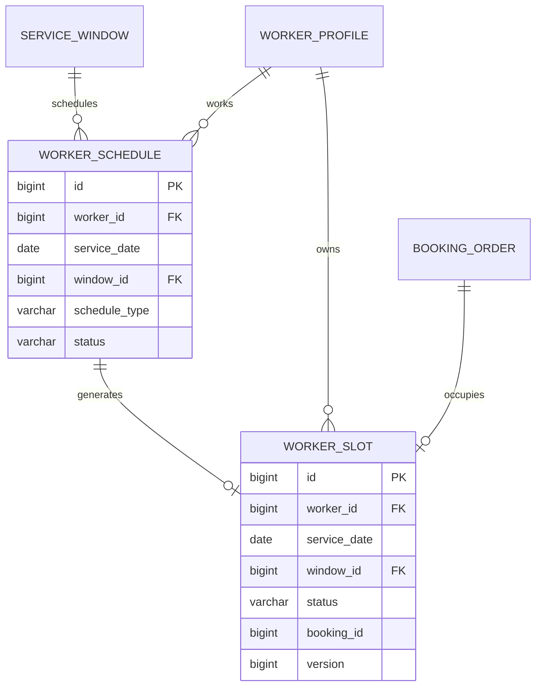

# 排班与可用时段模块详细设计

## 1. 模块定位

排班与可用时段模块把服务人员的可工作时间和订单预约统一成可查询、可锁定、可释放的时间窗资源。

核心原则：

> 用户购买的是标准服务时间窗，系统分配并锁定具体服务人员的时间窗。

消费者不直接选择某个服务人员的时段。系统先展示日期和时间窗的聚合可用性，下单时再匹配具体人员并锁定其内部时段。

## 2. 已确定的业务决策

1. 首版采用标准时间窗，不支持任意分钟级预约。
2. 时间窗由公司统一配置，例如上午、下午和晚上。
3. 一个人员在同一日期同一时间窗最多占用一次。
4. `worker_slot` 是内部时段库存，不直接暴露人员 ID 给消费者。
5. 下单时锁定具体人员时段，状态从 `AVAILABLE` 变为 `HELD`。
6. 支付成功后从 `HELD` 变为 `BOOKED`。
7. 支付超时或待支付取消时从 `HELD` 恢复为 `AVAILABLE`。
8. 取消已支付订单后，如果日期未过且排班仍有效，从 `BOOKED` 恢复为 `AVAILABLE`。
9. 改期必须先锁定新时段，再释放旧时段。
10. 人员请假或停排时，已占用时段不能被静默删除，必须进入改派或协商处理。

## 3. 模块边界

### 3.1 本模块负责

- 标准服务时间窗。
- 全职和兼职人员排班。
- 请假、培训和停排。
- 人员时段生成。
- 可预约性聚合查询。
- 时段锁定、确认、释放和关闭。
- 时段占用冲突控制。
- 排班利用率基础数据。

### 3.2 本模块不负责

- 订单主状态。
- 支付状态。
- 人员接单和拒单。
- 人员匹配评分。
- 服务价格。
- 履约签到和服务记录。

## 4. 角色与权限

### 4.1 消费者

- 查询服务日期和时间窗可用性。
- 不能查看具体人员时段。
- 不能直接锁定或释放时段。

### 4.2 服务人员

- 查看自己的排班。
- 在允许时间内维护可工作时间。
- 提交请假。
- 不能直接释放已支付订单占用的时段。

### 4.3 运营人员

- 批量生成和调整排班。
- 处理请假和人员停排。
- 在订单需要改派时协调时段释放。
- 可以查看区域范围内的人员时段。

### 4.4 系统任务

- 到期释放未支付订单的 `HELD` 时段。
- 将历史日期时段标记为 `CLOSED`。
- 清理过期锁定。

## 5. 标准时间窗

示例：

```text
MORNING    08:00-12:00
AFTERNOON  13:00-17:00
EVENING    18:00-21:00
```

规则：

- 同一服务日的时间窗不能重叠。
- 时间窗状态由 `ACTIVE` 和 `DISABLED` 控制。
- 服务项目预计时长必须能放入目标时间窗。
- 首版每条订单占用一个完整时间窗。
- 不单独计算服务结束后的路程缓冲，后续可通过缩小可用窗口或增加缓冲字段扩展。

## 6. 排班模型

### 6.1 排班记录

一个排班记录表示：

```text
某人员
某日期
某时间窗
某种排班类型
```

排班类型：

```text
WORK
LEAVE
TRAINING
REST
```

状态：

```text
ACTIVE
CANCELED
```

- `WORK + ACTIVE` 生成可预约时段。
- `LEAVE`、`TRAINING`、`REST` 生成不可预约时段。
- `CANCELED` 表示排班计划撤销。

### 6.2 人员时间窗

`worker_slot` 是排班对应的时段库存。

状态：

```text
AVAILABLE
HELD
BOOKED
BLOCKED
CLOSED
```

| 状态 | 说明 |
| --- | --- |
| `AVAILABLE` | 可被新订单占用 |
| `HELD` | 已选人员并等待支付 |
| `BOOKED` | 已支付，正式占用 |
| `BLOCKED` | 请假、培训或人工停用 |
| `CLOSED` | 日期已过或排班关闭 |

取消订单时优先恢复为 `AVAILABLE`，只有排班失效或日期已过时才转为 `CLOSED`。

## 7. 时段状态机

```text
AVAILABLE -> HELD -> BOOKED
HELD -> AVAILABLE
HELD -> CLOSED
BOOKED -> AVAILABLE
BOOKED -> CLOSED
AVAILABLE -> BLOCKED
BLOCKED -> AVAILABLE
```

约束：

- `BOOKED` 状态必须关联订单。
- `HELD` 状态必须关联订单和锁定到期时间。
- `AVAILABLE` 状态不能关联有效订单。
- 同一人员、日期和时间窗唯一。
- 同一订单同一时刻只能占用一个有效时段。

## 8. 可预约性查询

### 8.1 聚合结果

消费者看到的是：

```text
某天某时间窗是否至少存在一个合格人员
```

查询输入：

```text
serviceItemId
serviceAreaId
serviceDate
serviceWindowId
```

过滤条件：

```text
服务项目已发布
人员技能匹配
人员资格有效
人员覆盖服务区域
人员时段 AVAILABLE
人员当日有效订单未超过上限
服务项目时长可放入时间窗
```

### 8.2 返回结果

```json
{
  "serviceDate": "2026-10-25",
  "windows": [
    {
      "windowCode": "MORNING",
      "windowName": "上午",
      "startTime": "08:00",
      "endTime": "12:00",
      "available": true
    },
    {
      "windowCode": "AFTERNOON",
      "windowName": "下午",
      "startTime": "13:00",
      "endTime": "17:00",
      "available": false
    }
  ]
}
```

首版不返回剩余人数，避免暴露内部供给情况。

## 9. 创建订单时的时段锁定

```text
订单候选人员已选定
-> 条件更新 worker_slot
-> AVAILABLE 变为 HELD
-> 写入 booking_id 和 hold_expires_at
-> 创建订单
```

条件更新：

```sql
UPDATE worker_slot
SET status = 'HELD',
    booking_id = ?,
    hold_expires_at = ?,
    version = version + 1
WHERE id = ?
  AND status = 'AVAILABLE'
  AND version = ?;
```

影响行数必须为 1。失败时订单不能创建，由订单模块重新选择时段或人员。

## 10. 支付成功和超时

支付成功：

```sql
UPDATE worker_slot
SET status = 'BOOKED',
    hold_expires_at = NULL,
    version = version + 1
WHERE id = ?
  AND booking_id = ?
  AND status = 'HELD';
```

支付超时：

```sql
UPDATE worker_slot
SET status = 'AVAILABLE',
    booking_id = NULL,
    hold_expires_at = NULL,
    version = version + 1
WHERE id = ?
  AND booking_id = ?
  AND status = 'HELD'
  AND hold_expires_at <= CURRENT_TIMESTAMP(3);
```

## 11. 改期

改期流程：

```text
校验订单可改期
-> 锁定新候选人员时段
-> 创建新订单预约信息或临时占用
-> 订单模块确认更新
-> 释放旧时段
```

规则：

- 新时段锁定失败时不改变旧订单。
- 新时段锁定成功后，旧时段释放失败必须补偿或进入异常处理。
- 改期可以保留原服务人员，也可以重新派单。
- 改期需要记录旧日期、旧时间窗、新日期、新时间窗和操作原因。

## 12. 请假和排班调整

### 12.1 无订单占用

```text
人员请假
-> 将对应时段改为 BLOCKED
-> 更新排班类型为 LEAVE
```

### 12.2 存在 HELD 或 BOOKED 时段

不能直接释放或覆盖：

```text
检测到已占用时段
-> 提交改派任务
-> 保持时段占用，等待新人员分配或客户改期
-> 处理成功后释放原时段
```

### 12.3 排班取消

排班取消不直接删除时段。未占用时段转 `BLOCKED` 或 `CLOSED`，已占用时段进入改派流程。

## 13. 领域模型



`booking_id` 是订单模块业务编号，不建立跨模块级联外键，避免时段和订单互相依赖。

## 14. 数据库规范

### 14.1 通用规范

- MySQL 8.0，InnoDB，`utf8mb4`。
- 主键使用 `BIGINT UNSIGNED` 自增。
- 日期使用 `DATE`，时间窗使用 `TIME`，时间点使用 `DATETIME(3)`。
- 统一按 `Asia/Shanghai` 处理。
- 时段不使用逻辑删除，使用状态关闭或阻塞。
- `AVAILABLE` 和 `HELD` 状态必须能够被定时任务安全处理。
- 所有锁定时段操作必须使用条件更新。

### 14.2 表清单

| 表名 | 用途 | 是否 MVP |
| --- | --- | --- |
| `service_window` | 标准服务时间窗 | 是 |
| `worker_schedule` | 人员排班和请假 | 是 |
| `worker_slot` | 可锁定的人员时段库存 | 是 |

## 15. MySQL 表结构

### 15.1 标准时间窗表

```sql
CREATE TABLE service_window (
    id BIGINT UNSIGNED NOT NULL AUTO_INCREMENT,
    window_code VARCHAR(32) NOT NULL,
    window_name VARCHAR(64) NOT NULL,
    start_time TIME NOT NULL,
    end_time TIME NOT NULL,
    sort_order INT NOT NULL DEFAULT 0,
    status VARCHAR(16) NOT NULL DEFAULT 'ACTIVE',
    created_by_account_id BIGINT UNSIGNED NULL,
    updated_by_account_id BIGINT UNSIGNED NULL,
    version BIGINT UNSIGNED NOT NULL DEFAULT 0,
    created_at DATETIME(3) NOT NULL DEFAULT CURRENT_TIMESTAMP(3),
    updated_at DATETIME(3) NOT NULL DEFAULT CURRENT_TIMESTAMP(3)
        ON UPDATE CURRENT_TIMESTAMP(3),
    PRIMARY KEY (id),
    UNIQUE KEY uk_service_window_code (window_code),
    KEY idx_service_window_order (status, sort_order),
    CONSTRAINT chk_service_window_time
        CHECK (end_time > start_time),
    CONSTRAINT chk_service_window_status
        CHECK (status IN ('ACTIVE', 'DISABLED'))
) ENGINE=InnoDB DEFAULT CHARSET=utf8mb4 COLLATE=utf8mb4_0900_ai_ci
  COMMENT='标准服务时间窗';
```

### 15.2 人员排班表

```sql
CREATE TABLE worker_schedule (
    id BIGINT UNSIGNED NOT NULL AUTO_INCREMENT,
    worker_id BIGINT UNSIGNED NOT NULL,
    service_date DATE NOT NULL,
    window_id BIGINT UNSIGNED NOT NULL,
    schedule_type VARCHAR(16) NOT NULL DEFAULT 'WORK',
    status VARCHAR(16) NOT NULL DEFAULT 'ACTIVE',
    source VARCHAR(16) NOT NULL DEFAULT 'OPERATOR',
    note VARCHAR(500) NULL,
    created_by_account_id BIGINT UNSIGNED NULL,
    updated_by_account_id BIGINT UNSIGNED NULL,
    created_at DATETIME(3) NOT NULL DEFAULT CURRENT_TIMESTAMP(3),
    updated_at DATETIME(3) NOT NULL DEFAULT CURRENT_TIMESTAMP(3)
        ON UPDATE CURRENT_TIMESTAMP(3),
    version BIGINT UNSIGNED NOT NULL DEFAULT 0,
    PRIMARY KEY (id),
    UNIQUE KEY uk_worker_schedule
        (worker_id, service_date, window_id),
    KEY idx_worker_schedule_date
        (service_date, window_id, status),
    KEY idx_worker_schedule_worker
        (worker_id, service_date, status),
    CONSTRAINT fk_worker_schedule_worker
        FOREIGN KEY (worker_id) REFERENCES worker_profile (id)
        ON UPDATE RESTRICT ON DELETE RESTRICT,
    CONSTRAINT fk_worker_schedule_window
        FOREIGN KEY (window_id) REFERENCES service_window (id)
        ON UPDATE RESTRICT ON DELETE RESTRICT,
    CONSTRAINT fk_worker_schedule_creator
        FOREIGN KEY (created_by_account_id) REFERENCES account (id)
        ON UPDATE RESTRICT ON DELETE RESTRICT,
    CONSTRAINT chk_worker_schedule_type
        CHECK (schedule_type IN ('WORK', 'LEAVE', 'TRAINING', 'REST')),
    CONSTRAINT chk_worker_schedule_status
        CHECK (status IN ('ACTIVE', 'CANCELED')),
    CONSTRAINT chk_worker_schedule_source
        CHECK (source IN ('WORKER', 'OPERATOR', 'SYSTEM'))
) ENGINE=InnoDB DEFAULT CHARSET=utf8mb4 COLLATE=utf8mb4_0900_ai_ci
  COMMENT='人员排班';
```

### 15.3 人员时段表

```sql
CREATE TABLE worker_slot (
    id BIGINT UNSIGNED NOT NULL AUTO_INCREMENT,
    worker_id BIGINT UNSIGNED NOT NULL,
    schedule_id BIGINT UNSIGNED NOT NULL,
    service_date DATE NOT NULL,
    window_id BIGINT UNSIGNED NOT NULL,
    status VARCHAR(16) NOT NULL DEFAULT 'AVAILABLE',
    booking_id BIGINT UNSIGNED NULL,
    hold_expires_at DATETIME(3) NULL,
    created_by_account_id BIGINT UNSIGNED NULL,
    updated_by_account_id BIGINT UNSIGNED NULL,
    version BIGINT UNSIGNED NOT NULL DEFAULT 0,
    created_at DATETIME(3) NOT NULL DEFAULT CURRENT_TIMESTAMP(3),
    updated_at DATETIME(3) NOT NULL DEFAULT CURRENT_TIMESTAMP(3)
        ON UPDATE CURRENT_TIMESTAMP(3),
    PRIMARY KEY (id),
    UNIQUE KEY uk_worker_slot_time
        (worker_id, service_date, window_id),
    KEY idx_worker_slot_availability
        (service_date, window_id, status),
    KEY idx_worker_slot_worker_date
        (worker_id, service_date, status),
    KEY idx_worker_slot_booking (booking_id),
    CONSTRAINT fk_worker_slot_worker
        FOREIGN KEY (worker_id) REFERENCES worker_profile (id)
        ON UPDATE RESTRICT ON DELETE RESTRICT,
    CONSTRAINT fk_worker_slot_schedule
        FOREIGN KEY (schedule_id) REFERENCES worker_schedule (id)
        ON UPDATE RESTRICT ON DELETE RESTRICT,
    CONSTRAINT fk_worker_slot_window
        FOREIGN KEY (window_id) REFERENCES service_window (id)
        ON UPDATE RESTRICT ON DELETE RESTRICT,
    CONSTRAINT chk_worker_slot_status
        CHECK (status IN ('AVAILABLE', 'HELD', 'BOOKED', 'BLOCKED', 'CLOSED')),
    CONSTRAINT chk_worker_slot_order_binding
        CHECK (
            (status = 'AVAILABLE' AND booking_id IS NULL)
            OR (status = 'HELD' AND booking_id IS NOT NULL AND hold_expires_at IS NOT NULL)
            OR (status = 'BOOKED' AND booking_id IS NOT NULL AND hold_expires_at IS NULL)
            OR (status IN ('BLOCKED', 'CLOSED'))
        )
) ENGINE=InnoDB DEFAULT CHARSET=utf8mb4 COLLATE=utf8mb4_0900_ai_ci
  COMMENT='人员时段库存';
```

## 16. 索引与约束

关键唯一约束：

```text
service_window.window_code
worker_schedule(worker_id, service_date, window_id)
worker_slot(worker_id, service_date, window_id)
```

状态约束业务层必须补充：

```text
status = AVAILABLE -> booking_id IS NULL AND hold_expires_at IS NULL
status = HELD -> booking_id IS NOT NULL AND hold_expires_at IS NOT NULL
status = BOOKED -> booking_id IS NOT NULL AND hold_expires_at IS NULL
```

可用 MySQL 检查约束表达：

```sql
CHECK (
    (status = 'AVAILABLE' AND booking_id IS NULL)
    OR (status = 'HELD' AND booking_id IS NOT NULL)
    OR (status = 'BOOKED' AND booking_id IS NOT NULL)
    OR (status IN ('BLOCKED', 'CLOSED'))
)
```

## 17. 事务与并发

| 用例 | 事务范围 |
| --- | --- |
| 生成排班 | 写排班和时段 |
| 修改排班 | 更新排班、同步时段、处理已占用冲突 |
| 锁定下单时段 | 条件更新 `AVAILABLE -> HELD` |
| 支付成功 | 更新 `HELD -> BOOKED` |
| 支付超时 | 更新 `HELD -> AVAILABLE` 或 `CLOSED` |
| 取消订单 | 更新 `BOOKED -> AVAILABLE` |
| 改期 | 锁新时段、更新订单、释放旧时段 |

并发要求：

- 两个订单竞争同一时段只能有一个成功。
- 定时释放必须使用状态和到期时间条件。
- 释放操作重复执行不能影响已支付或已重新占用的时段。
- 排班修改和时段锁定需要按人员日期加锁或依赖唯一约束。

## 18. 接口设计

### 18.1 公共接口

```text
GET /api/v1/public/availability
```

参数：

```text
serviceItemId
serviceAreaId
dateFrom
dateTo
```

### 18.2 服务人员端

```text
GET  /api/v1/worker/schedules
POST /api/v1/worker/schedules
POST /api/v1/worker/schedules/{id}/cancel
POST /api/v1/worker/leaves
```

人员只能在允许截止时间前修改自己的排班。

### 18.3 运营端

```text
GET  /api/v1/operator/schedules
POST /api/v1/operator/schedules/batch
PUT  /api/v1/operator/schedules/{id}
POST /api/v1/operator/schedules/{id}/leave
POST /api/v1/operator/schedules/{id}/disable
```

### 18.4 内部接口

```text
POST /internal/scheduling/slots/{slotId}/hold
POST /internal/scheduling/slots/{slotId}/confirm
POST /internal/scheduling/slots/{slotId}/release
GET  /internal/scheduling/availability/eligible-workers
```

## 19. 与其他模块协作

### 19.1 服务人员

- 只有有效人员可以生成排班。
- 人员暂停或离职时，排班和已占用时段进入异常处理。

### 19.2 服务目录

- 服务项目时长决定时间窗是否足够。
- 服务项目变更不自动改变已生成时段。

### 19.3 订单和派单

- 下单锁定时段。
- 派单选择候选人员时段。
- 改期和取消通过订单命令协调时段释放。

### 19.4 运营统计

- 人员时段总数。
- 已占用时段数。
- 时段利用率。
- 请假和停排数量。

## 20. 错误码

```text
SERVICE_WINDOW_NOT_FOUND
SERVICE_WINDOW_DISABLED
SERVICE_WINDOW_OVERLAP
SERVICE_DURATION_EXCEEDS_WINDOW
WORKER_SCHEDULE_NOT_FOUND
WORKER_SCHEDULE_CONFLICT
WORKER_SLOT_NOT_FOUND
WORKER_SLOT_NOT_AVAILABLE
WORKER_SLOT_ALREADY_HELD
WORKER_SLOT_ALREADY_BOOKED
WORKER_SLOT_HOLD_EXPIRED
WORKER_SLOT_RELEASE_CONFLICT
SCHEDULE_CHANGE_HAS_BOOKED_ORDER
```

## 21. 测试清单

### 21.1 单元测试

- 服务时间窗起止时间校验。
- 排班类型和状态。
- 服务项目时长与时间窗匹配。
- 时段状态转换。
- 锁定过期时间。
- 人员每日最大接单量。

### 21.2 集成测试

- 同一人员同一时间窗只能锁一次。
- 100 个并发请求抢同一时段只有一个成功。
- 支付超时后时段释放。
- 取消订单后时段释放。
- 已支付订单不能重复释放。
- 改期失败时旧时段不释放。
- 改期成功时新时段锁定、旧时段释放。
- 人员请假存在已占用时段时返回冲突。
- 过期时段自动关闭。
- 可用性查询不暴露人员名单。

### 21.3 安全测试

- 服务人员只能查看自己的排班。
- 运营人员只能查看区域范围内排班。
- 消费者不能直接调用时段锁定接口。

## 22. MVP 与后续扩展

### 22.1 MVP 范围

- 固定时间窗。
- 全职和兼职排班。
- 请假和停排。
- 人员时段生成。
- 聚合可用性查询。
- 条件锁定时段。
- 支付超时、取消和改期释放。
- 时段利用率基础统计。

### 22.2 后续扩展

- 任意时间点预约。
- 路程缓冲。
- 多人员同时上门。
- 跨日服务。
- 周期排班。
- 自动排班。
- 区域容量预估。

## 23. 实现顺序

```text
service_window
-> worker_schedule
-> worker_slot
-> 排班生成时段
-> 聚合可用性查询
-> 条件锁定
-> 支付确认和超时释放
-> 取消和改期
-> 并发测试
```

## 24. 仍需确认的问题

1. 首版标准时间窗采用上午、下午、晚上，还是允许晚上不排班。
2. 人员每天最多可以承接几个时间窗。
3. 人员可以在服务开始前多少小时修改排班。
4. 时间窗之间是否需要固定通勤缓冲。
