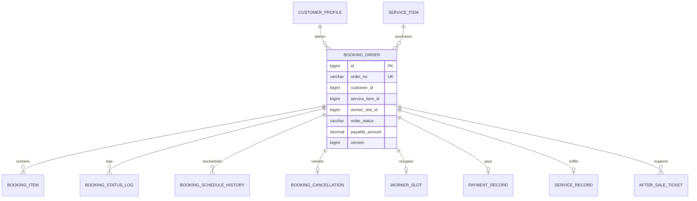

# 预约订单模块详细设计

## 1. 模块定位

预约订单模块负责从价格预览、创建订单、支付前时段占用、支付确认、改期、取消到服务完成的交易主链路，维护订单主状态、金额、地址快照和状态日志。

核心原则：

> 订单是交易主聚合，但人员分配、支付、履约和售后分别拥有独立状态。

订单主状态只表示消费者预约交易的阶段，不直接承载支付、人员分配、履约或售后状态。

## 2. 已确定的业务决策

1. 一个订单对应一个主服务项目，加项、耗材和上门费作为订单明细。
2. 下单时系统选择服务人员并锁定具体 `worker_slot`。
3. 订单创建后的初始状态为 `PENDING_PAYMENT`。
4. 支付成功后订单进入 `CONFIRMED`，并通知服务人员确认接单。
5. 服务人员拒单或超时只触发改派，订单主状态仍为 `CONFIRMED`。
6. 支付超时由系统取消订单并释放时段。
7. 订单创建时保存地址、价格、服务标准、取消规则和服务项目版本快照。
8. 改期需要锁定新时段后再释放旧时段。
9. 已开始服务的订单不直接取消，转入售后。
10. 售后、评价和支付状态独立维护。

## 3. 模块边界

### 3.1 本模块负责

- 价格预览编排。
- 创建订单。
- 订单主状态机。
- 订单明细和金额。
- 地址、价格和服务标准快照。
- 取消和改期记录。
- 订单状态日志。
- 订单查询权限。
- 创建、取消、改期和确认完成的幂等。

### 3.2 本模块不负责

- 服务目录维护。
- 人员资格审核。
- 派单评分算法。
- 时段库存维护。
- 支付和退款事实。
- 履约过程记录。
- 评价和售后处理。

## 4. 角色与权限

### 4.1 消费者

- 价格预览。
- 创建、查看、取消和改期自己的订单。
- 支付待支付订单。
- 确认完成。
- 提交评价和售后。

### 4.2 服务人员

- 查看分配给自己的订单。
- 接单或拒单。
- 按履约状态推进服务。
- 查看履约所需地址快照。

### 4.3 运营人员

- 查看区域范围内订单。
- 手工改派。
- 强制取消异常订单。
- 处理改期、退款和售后。
- 敏感操作写审计。

### 4.4 系统任务

- 关闭支付超时订单。
- 处理接单超时。
- 自动确认完成。
- 触发通知和后续状态处理。

## 5. 订单结构

### 5.1 一个主服务

首版规则：

```text
一个 booking_order
-> 一个主 service_item
-> 多个 booking_item 明细
```

`booking_item` 类型：

```text
BASE
ADDON
MATERIAL
TRAVEL
DISCOUNT
ADJUSTMENT
```

### 5.2 订单快照

创建订单时必须保存：

- 服务项目编号和版本。
- 服务名称、时长和标准。
- 选中规格和加项。
- 基础金额和应付金额。
- 地址快照。
- 联系人快照。
- 服务区域快照。
- 取消规则快照。
- 创建时间。

订单不依赖当前服务价格或当前地址簿回算。

## 6. 状态设计

### 6.1 订单主状态

```text
PENDING_PAYMENT
CONFIRMED
EN_ROUTE
IN_SERVICE
PENDING_CONFIRM
COMPLETED
CANCELED
```

| 状态 | 说明 |
| --- | --- |
| `PENDING_PAYMENT` | 已创建并占用时段，等待支付 |
| `CONFIRMED` | 已支付，订单有效 |
| `EN_ROUTE` | 服务人员已出发 |
| `IN_SERVICE` | 服务进行中 |
| `PENDING_CONFIRM` | 服务人员已申请完成 |
| `COMPLETED` | 客户确认或系统自动确认 |
| `CANCELED` | 订单取消 |

### 6.2 摘要状态

订单表保存以下摘要字段，用于列表和详情快速展示：

```text
payment_status
assignment_status
fulfillment_status
after_sale_status
review_status
```

事实来源：

| 摘要字段 | 事实来源 |
| --- | --- |
| `payment_status` | 支付退款模块 |
| `assignment_status` | 派单模块 |
| `fulfillment_status` | 履约模块 |
| `after_sale_status` | 售后模块 |
| `review_status` | 评价模块 |

摘要字段只能通过公开应用服务更新，不能被其他模块直接写表。

### 6.3 主状态转换

| 当前状态 | 目标状态 | 触发方 |
| --- | --- | --- |
| `PENDING_PAYMENT` | `CONFIRMED` | 支付成功 |
| `PENDING_PAYMENT` | `CANCELED` | 用户、系统 |
| `CONFIRMED` | `EN_ROUTE` | 服务人员 |
| `CONFIRMED` | `CANCELED` | 用户、运营 |
| `EN_ROUTE` | `IN_SERVICE` | 服务人员 |
| `EN_ROUTE` | `CANCELED` | 运营异常处理 |
| `IN_SERVICE` | `PENDING_CONFIRM` | 服务人员申请完成 |
| `PENDING_CONFIRM` | `COMPLETED` | 用户、系统 |
| `COMPLETED` | 无主状态变化 | 评价和售后独立处理 |

`IN_SERVICE` 订单不能直接取消，只能进入售后。

## 7. 创建订单流程

```text
校验幂等键
-> 验证客户和地址归属
-> 校验地址服务区域
-> 读取服务项目并计算价格
-> 查询目标日期和时间窗可用人员
-> 匹配并选择候选人员
-> 条件锁定 worker_slot: AVAILABLE -> HELD
-> 保存服务、价格、地址和标准快照
-> 根据配置计算并保存 payment_deadline
-> 创建 booking_order 和 booking_item
-> 创建派单任务 WAITING_PAYMENT
-> 写订单状态日志
-> 提交事务
```

失败处理：

- 时段锁定失败时不能创建订单。
- 价格重算失败时不能创建订单。
- 订单创建失败时事务回滚，时段锁定同时回滚。
- 重复幂等键返回第一次创建结果。

## 8. 支付成功流程

```text
校验支付记录和金额
-> 支付记录 SUCCESS
-> worker_slot HELD -> BOOKED
-> booking_order PENDING_PAYMENT -> CONFIRMED
-> booking_order.payment_status -> PAID
-> dispatch_job WAITING_PAYMENT -> PENDING_ACCEPT
-> 创建派单通知任务
-> 写状态日志
```

支付回调和订单更新必须在同一事务中完成。重复回调直接返回已处理结果。

## 9. 人员分配与订单

### 9.1 人员接单前

```text
订单：CONFIRMED
分配：PENDING_ACCEPT
```

消费者可以看到“正在确认服务人员”。

### 9.2 人员拒单或超时

```text
订单：CONFIRMED
分配：REASSIGNING 或 MANUAL_REQUIRED
```

订单不取消，支付不退，平台继续选择下一候选人。

### 9.3 人员接单成功

```text
订单：CONFIRMED
分配：ACCEPTED
```

此时消费者可以查看服务人员基础信息和履约地址摘要。

## 10. 取消订单

### 10.1 待支付取消

```text
PENDING_PAYMENT -> CANCELED
-> 释放 HELD 时段
-> 取消派单任务
-> 写状态日志
```

不产生退款记录。

### 10.2 已支付取消

```text
CONFIRMED 或 EN_ROUTE -> CANCELED
-> 释放 BOOKED 时段
-> 取消派单任务
-> 按规则创建退款申请
-> 写状态日志
```

规则：

- 服务开始前可以取消，费用按取消规则快照计算。
- 服务开始后不能取消，进入售后。
- 已支付订单取消必须生成退款记录或明确无需退款原因。

### 10.3 取消规则

订单创建时保存：

```text
free_cancel_hours
late_cancel_fee_amount
late_cancel_fee_rate
policy_version
```

建议默认：

```text
服务开始前 24 小时以上免费取消
24 小时内取消进入运营审核
服务开始后转售后
```

最终规则以配置快照为准。

## 11. 改期

允许状态：

```text
CONFIRMED
EN_ROUTE 不可改期
```

流程：

```text
校验改期截止时间
-> 查询新日期和时间窗
-> 匹配新人员和时段
-> 锁定新时段
-> 更新订单预约信息和人员分配摘要
-> 释放旧时段
-> 写改期历史
```

规则：

- 新时段锁定失败时原订单不变。
- 改期后可能重新派单。
- 改期不自动退款。
- 改期需要写订单状态日志和改期历史。

## 12. 订单完成

```text
履约模块提交完成申请
-> 订单 CONFIRMED/EN_ROUTE/IN_SERVICE -> PENDING_CONFIRM
-> 客户确认
-> 订单 COMPLETED
```

自动确认：

- 由履约模块计算到期时间。
- 系统定时任务调用订单完成命令。
- 订单记录操作来源为 `SYSTEM`。
- 完成后开放评价和售后期。

## 13. 领域模型



## 14. 数据库规范

### 14.1 通用规范

- MySQL 8.0，InnoDB，`utf8mb4`。
- 主键使用 `BIGINT UNSIGNED` 自增。
- 订单号使用独立业务编号。
- 金额使用 `DECIMAL(12,2)`。
- 时间使用 `DATETIME(3)`，统一按 `Asia/Shanghai`。
- 订单、支付、退款、日志和快照不做逻辑删除。
- 订单状态和摘要状态使用英文枚举字符串。
- 订单状态修改必须写状态日志。
- 订单表禁止物理删除。
- 复杂快照使用 JSON 保存，但金额和状态必须结构化。

### 14.2 表清单

| 表名 | 用途 | 是否 MVP |
| --- | --- | --- |
| `booking_order` | 订单主表 | 是 |
| `booking_item` | 订单金额明细 | 是 |
| `booking_status_log` | 订单状态变化日志 | 是 |
| `booking_schedule_history` | 改期历史 | 是 |
| `booking_cancellation` | 取消规则和费用快照 | 是 |

## 15. MySQL 表结构

### 15.1 订单主表

```sql
CREATE TABLE booking_order (
    id BIGINT UNSIGNED NOT NULL AUTO_INCREMENT,
    order_no VARCHAR(32) NOT NULL,
    customer_id BIGINT UNSIGNED NOT NULL,
    customer_no_snapshot VARCHAR(32) NOT NULL,
    service_item_id BIGINT UNSIGNED NOT NULL,
    service_item_version BIGINT UNSIGNED NOT NULL,
    service_item_no_snapshot VARCHAR(32) NOT NULL,
    service_name_snapshot VARCHAR(128) NOT NULL,
    service_area_id BIGINT UNSIGNED NOT NULL,
    service_area_name_snapshot VARCHAR(128) NULL,
    address_id BIGINT UNSIGNED NOT NULL,
    address_version BIGINT UNSIGNED NOT NULL,
    address_snapshot_json JSON NOT NULL,
    contact_name_snapshot VARCHAR(64) NOT NULL,
    contact_phone_snapshot VARCHAR(32) NOT NULL,
    appointment_date DATE NOT NULL,
    service_window_id BIGINT UNSIGNED NOT NULL,
    service_window_name_snapshot VARCHAR(64) NOT NULL,
    appointment_start DATETIME(3) NOT NULL,
    appointment_end DATETIME(3) NOT NULL,
    worker_slot_id BIGINT UNSIGNED NOT NULL,
    current_worker_id BIGINT UNSIGNED NULL,
    order_status VARCHAR(24) NOT NULL DEFAULT 'PENDING_PAYMENT',
    payment_status VARCHAR(24) NOT NULL DEFAULT 'UNPAID',
    assignment_status VARCHAR(32) NOT NULL DEFAULT 'WAITING_PAYMENT',
    fulfillment_status VARCHAR(24) NOT NULL DEFAULT 'NOT_STARTED',
    after_sale_status VARCHAR(24) NOT NULL DEFAULT 'NONE',
    review_status VARCHAR(24) NOT NULL DEFAULT 'NOT_REVIEWED',
    service_amount DECIMAL(12,2) NOT NULL DEFAULT 0.00,
    addon_amount DECIMAL(12,2) NOT NULL DEFAULT 0.00,
    material_amount DECIMAL(12,2) NOT NULL DEFAULT 0.00,
    travel_fee DECIMAL(12,2) NOT NULL DEFAULT 0.00,
    discount_amount DECIMAL(12,2) NOT NULL DEFAULT 0.00,
    payable_amount DECIMAL(12,2) NOT NULL,
    paid_amount DECIMAL(12,2) NOT NULL DEFAULT 0.00,
    refunded_amount DECIMAL(12,2) NOT NULL DEFAULT 0.00,
    currency CHAR(3) NOT NULL DEFAULT 'CNY',
    price_snapshot_json JSON NOT NULL,
    service_standard_snapshot_json JSON NOT NULL,
    cancellation_policy_snapshot_json JSON NOT NULL,
    payment_deadline DATETIME(3) NOT NULL,
    source VARCHAR(16) NOT NULL DEFAULT 'CUSTOMER',
    cancel_reason_code VARCHAR(32) NULL,
    cancel_reason_text VARCHAR(500) NULL,
    created_by_account_id BIGINT UNSIGNED NULL,
    updated_by_account_id BIGINT UNSIGNED NULL,
    version BIGINT UNSIGNED NOT NULL DEFAULT 0,
    paid_at DATETIME(3) NULL,
    assignment_accepted_at DATETIME(3) NULL,
    started_at DATETIME(3) NULL,
    completed_at DATETIME(3) NULL,
    canceled_at DATETIME(3) NULL,
    created_at DATETIME(3) NOT NULL DEFAULT CURRENT_TIMESTAMP(3),
    updated_at DATETIME(3) NOT NULL DEFAULT CURRENT_TIMESTAMP(3)
        ON UPDATE CURRENT_TIMESTAMP(3),
    PRIMARY KEY (id),
    UNIQUE KEY uk_booking_order_no (order_no),
    KEY idx_booking_order_slot (worker_slot_id),
    KEY idx_booking_order_customer
        (customer_id, created_at),
    KEY idx_booking_order_worker
        (current_worker_id, appointment_start),
    KEY idx_booking_order_status
        (order_status, payment_deadline, appointment_start),
    KEY idx_booking_order_area
        (service_area_id, appointment_date, order_status),
    CONSTRAINT fk_booking_order_customer
        FOREIGN KEY (customer_id) REFERENCES customer_profile (id)
        ON UPDATE RESTRICT ON DELETE RESTRICT,
    CONSTRAINT fk_booking_order_creator
        FOREIGN KEY (created_by_account_id) REFERENCES account (id)
        ON UPDATE RESTRICT ON DELETE RESTRICT,
    CONSTRAINT chk_booking_order_status
        CHECK (order_status IN (
            'PENDING_PAYMENT',
            'CONFIRMED',
            'EN_ROUTE',
            'IN_SERVICE',
            'PENDING_CONFIRM',
            'COMPLETED',
            'CANCELED'
        )),
    CONSTRAINT chk_booking_order_payment
        CHECK (payment_status IN (
            'UNPAID',
            'PAID',
            'REFUNDING',
            'PARTIALLY_REFUNDED',
            'REFUNDED'
        )),
    CONSTRAINT chk_booking_order_assignment
        CHECK (assignment_status IN (
            'WAITING_PAYMENT',
            'PENDING_ACCEPT',
            'ACCEPTED',
            'REASSIGNING',
            'MANUAL_REQUIRED',
            'CANCELED'
        )),
    CONSTRAINT chk_booking_order_fulfillment
        CHECK (fulfillment_status IN (
            'NOT_STARTED',
            'EN_ROUTE',
            'CHECKED_IN',
            'IN_SERVICE',
            'PENDING_CONFIRM',
            'COMPLETED',
            'EXCEPTION'
        )),
    CONSTRAINT chk_booking_order_after_sale
        CHECK (after_sale_status IN (
            'NONE',
            'PROCESSING',
            'RESOLVED',
            'CLOSED'
        )),
    CONSTRAINT chk_booking_order_review
        CHECK (review_status IN ('NOT_REVIEWED', 'REVIEWED')),
    CONSTRAINT chk_booking_order_source
        CHECK (source IN ('CUSTOMER', 'OPERATOR', 'SYSTEM')),
    CONSTRAINT chk_booking_order_amount
        CHECK (
            service_amount >= 0
            AND addon_amount >= 0
            AND material_amount >= 0
            AND travel_fee >= 0
            AND discount_amount >= 0
            AND payable_amount >= 0
            AND paid_amount >= 0
            AND refunded_amount >= 0
            AND refunded_amount <= paid_amount
        ),
    CONSTRAINT chk_booking_order_time
        CHECK (appointment_end > appointment_start)
) ENGINE=InnoDB DEFAULT CHARSET=utf8mb4 COLLATE=utf8mb4_0900_ai_ci
  COMMENT='预约订单';
```

跨模块 ID：

- `service_item_id`、`service_area_id`、`worker_slot_id`、`current_worker_id` 使用逻辑外键。
- 不在数据库建立跨模块级联关系，避免迁移顺序和删除语义冲突。

### 15.2 订单明细表

```sql
CREATE TABLE booking_item (
    id BIGINT UNSIGNED NOT NULL AUTO_INCREMENT,
    booking_id BIGINT UNSIGNED NOT NULL,
    item_type VARCHAR(16) NOT NULL,
    item_code VARCHAR(32) NULL,
    item_name_snapshot VARCHAR(128) NOT NULL,
    unit_price_snapshot DECIMAL(12,2) NOT NULL,
    quantity DECIMAL(10,2) NOT NULL DEFAULT 1.00,
    amount DECIMAL(12,2) NOT NULL,
    sort_order INT NOT NULL DEFAULT 0,
    created_by_account_id BIGINT UNSIGNED NULL,
    created_at DATETIME(3) NOT NULL DEFAULT CURRENT_TIMESTAMP(3),
    PRIMARY KEY (id),
    KEY idx_booking_item_booking
        (booking_id, sort_order),
    CONSTRAINT fk_booking_item_order
        FOREIGN KEY (booking_id) REFERENCES booking_order (id)
        ON UPDATE RESTRICT ON DELETE RESTRICT,
    CONSTRAINT chk_booking_item_type
        CHECK (item_type IN (
            'BASE',
            'ADDON',
            'MATERIAL',
            'TRAVEL',
            'DISCOUNT',
            'ADJUSTMENT'
        )),
    CONSTRAINT chk_booking_item_amount
        CHECK (quantity > 0 AND unit_price_snapshot >= 0 AND amount >= 0)
) ENGINE=InnoDB DEFAULT CHARSET=utf8mb4 COLLATE=utf8mb4_0900_ai_ci
  COMMENT='订单金额明细';
```

### 15.3 订单状态日志表

```sql
CREATE TABLE booking_status_log (
    id BIGINT UNSIGNED NOT NULL AUTO_INCREMENT,
    booking_id BIGINT UNSIGNED NOT NULL,
    from_status VARCHAR(24) NULL,
    to_status VARCHAR(24) NOT NULL,
    operator_id BIGINT UNSIGNED NULL,
    operator_role VARCHAR(24) NULL,
    operation_source VARCHAR(24) NOT NULL DEFAULT 'USER',
    reason_code VARCHAR(32) NULL,
    reason_text VARCHAR(500) NULL,
    trace_id VARCHAR(64) NULL,
    created_at DATETIME(3) NOT NULL DEFAULT CURRENT_TIMESTAMP(3),
    PRIMARY KEY (id),
    KEY idx_booking_status_log_booking
        (booking_id, created_at),
    CONSTRAINT fk_booking_status_log_order
        FOREIGN KEY (booking_id) REFERENCES booking_order (id)
        ON UPDATE RESTRICT ON DELETE RESTRICT,
    CONSTRAINT fk_booking_status_log_operator
        FOREIGN KEY (operator_id) REFERENCES account (id)
        ON UPDATE RESTRICT ON DELETE RESTRICT,
    CONSTRAINT chk_booking_status_log_source
        CHECK (operation_source IN ('USER', 'WORKER', 'OPERATOR', 'SYSTEM'))
) ENGINE=InnoDB DEFAULT CHARSET=utf8mb4 COLLATE=utf8mb4_0900_ai_ci
  COMMENT='订单主状态日志';
```

### 15.4 改期历史表

```sql
CREATE TABLE booking_schedule_history (
    id BIGINT UNSIGNED NOT NULL AUTO_INCREMENT,
    booking_id BIGINT UNSIGNED NOT NULL,
    old_appointment_date DATE NOT NULL,
    old_service_window_id BIGINT UNSIGNED NOT NULL,
    old_worker_slot_id BIGINT UNSIGNED NOT NULL,
    old_worker_id BIGINT UNSIGNED NULL,
    new_appointment_date DATE NOT NULL,
    new_service_window_id BIGINT UNSIGNED NOT NULL,
    new_worker_slot_id BIGINT UNSIGNED NOT NULL,
    new_worker_id BIGINT UNSIGNED NULL,
    reason_code VARCHAR(32) NULL,
    reason_text VARCHAR(500) NULL,
    operator_id BIGINT UNSIGNED NULL,
    created_at DATETIME(3) NOT NULL DEFAULT CURRENT_TIMESTAMP(3),
    PRIMARY KEY (id),
    KEY idx_booking_schedule_history_order
        (booking_id, created_at),
    CONSTRAINT fk_booking_schedule_history_order
        FOREIGN KEY (booking_id) REFERENCES booking_order (id)
        ON UPDATE RESTRICT ON DELETE RESTRICT,
    CONSTRAINT fk_booking_schedule_history_operator
        FOREIGN KEY (operator_id) REFERENCES account (id)
        ON UPDATE RESTRICT ON DELETE RESTRICT
) ENGINE=InnoDB DEFAULT CHARSET=utf8mb4 COLLATE=utf8mb4_0900_ai_ci
  COMMENT='订单改期历史';
```

### 15.5 取消记录表

```sql
CREATE TABLE booking_cancellation (
    id BIGINT UNSIGNED NOT NULL AUTO_INCREMENT,
    booking_id BIGINT UNSIGNED NOT NULL,
    reason_code VARCHAR(32) NOT NULL,
    reason_text VARCHAR(500) NULL,
    canceled_by_account_id BIGINT UNSIGNED NULL,
    canceled_by_role VARCHAR(24) NULL,
    fee_amount DECIMAL(12,2) NOT NULL DEFAULT 0.00,
    refundable_amount DECIMAL(12,2) NOT NULL DEFAULT 0.00,
    policy_snapshot_json JSON NOT NULL,
    created_at DATETIME(3) NOT NULL DEFAULT CURRENT_TIMESTAMP(3),
    PRIMARY KEY (id),
    UNIQUE KEY uk_booking_cancellation_order (booking_id),
    CONSTRAINT fk_booking_cancellation_order
        FOREIGN KEY (booking_id) REFERENCES booking_order (id)
        ON UPDATE RESTRICT ON DELETE RESTRICT,
    CONSTRAINT fk_booking_cancellation_operator
        FOREIGN KEY (canceled_by_account_id) REFERENCES account (id)
        ON UPDATE RESTRICT ON DELETE RESTRICT,
    CONSTRAINT chk_booking_cancellation_amount
        CHECK (fee_amount >= 0 AND refundable_amount >= 0)
) ENGINE=InnoDB DEFAULT CHARSET=utf8mb4 COLLATE=utf8mb4_0900_ai_ci
  COMMENT='订单取消和费用快照';
```

## 16. 索引与约束

关键唯一约束：

```text
booking_order.order_no
booking_cancellation.booking_id
```

幂等记录使用技术基础表 `idempotency_record`，唯一键至少包含：

```text
account_id
operation_code
idempotency_key
```

高频索引：

```text
客户订单列表：customer_id + created_at
人员任务列表：current_worker_id + appointment_start
运营监控：order_status + appointment_start
区域统计：service_area_id + appointment_date + order_status
```

## 17. 事务与并发

| 用例 | 事务范围 |
| --- | --- |
| 创建订单 | 校验、报价、锁时段、写订单、写明细、写日志、建派单任务 |
| 支付成功 | 支付记录、时段确认、订单状态、派单任务、日志 |
| 取消待支付订单 | 订单取消、释放时段、取消派单任务、日志 |
| 取消已支付订单 | 订单取消、释放时段、退款申请、取消派单、日志 |
| 改期 | 锁新时段、更新订单、更新派单、释放旧时段、历史日志 |
| 申请完成 | 更新履约状态、订单主状态、日志 |
| 用户确认完成 | 更新订单、评价资格、售后资格、通知任务 |

并发要求：

- 订单修改使用 `version` 乐观锁。
- 取消、改期和支付回调必须幂等。
- 时段锁定必须条件更新。
- 状态日志与状态变化必须同一事务。
- 如果外部退款或支付接口不在数据库事务中，采用本地状态机和补偿任务。

## 18. 接口设计

### 18.1 消费者接口

```text
POST /api/v1/customer/bookings/preview
POST /api/v1/customer/bookings
GET  /api/v1/customer/bookings
GET  /api/v1/customer/bookings/{orderNo}
POST /api/v1/customer/bookings/{orderNo}/cancel
POST /api/v1/customer/bookings/{orderNo}/reschedule
POST /api/v1/customer/bookings/{orderNo}/confirm
```

### 18.2 服务人员接口

```text
GET /api/v1/worker/bookings
GET /api/v1/worker/bookings/{orderNo}
```

### 18.3 运营接口

```text
GET  /api/v1/operator/bookings
GET  /api/v1/operator/bookings/{orderNo}
POST /api/v1/operator/bookings/{orderNo}/cancel
POST /api/v1/operator/bookings/{orderNo}/reschedule
```

### 18.4 内部命令

```text
POST /internal/bookings/{bookingId}/mark-paid
POST /internal/bookings/{bookingId}/begin-route
POST /internal/bookings/{bookingId}/start-service
POST /internal/bookings/{bookingId}/request-complete
POST /internal/bookings/{bookingId}/complete
```

### 18.5 创建订单请求

```json
{
  "serviceItemNo": "SVC202610230001",
  "addressNo": "ADDR202610230001",
  "appointmentDate": "2026-10-25",
  "serviceWindowCode": "MORNING",
  "selectedOptions": [
    {
      "optionCode": "AREA",
      "valueCode": "AREA_90_120"
    }
  ],
  "customerRemark": "家里有宠物"
}
```

服务端不接受客户端传入的人员 ID、最终价格和时段库存结果。

## 19. 与其他模块协作

### 19.1 客户与地址

- 读取地址并保存快照。
- 下单前再次校验服务区域。

### 19.2 服务目录

- 读取服务、价格和标准快照。
- 价格重算以服务端结果为准。

### 19.3 排班与派单

- 订单创建时锁定人员时段。
- 支付成功后激活派单任务。
- 取消和改期触发时段释放。

### 19.4 支付和退款

- 支付成功回调订单状态。
- 取消订单触发退款申请。

### 19.5 履约

- 履约模块使用当前订单快照。
- 履约状态通过订单内部命令更新摘要和主状态。

### 19.6 售后和评价

- 订单完成后开放评价和售后。
- 售后不改变已完成订单主状态。

## 20. 错误码

```text
BOOKING_NOT_FOUND
BOOKING_NOT_OWNED
BOOKING_STATUS_CONFLICT
BOOKING_ADDRESS_INVALID
BOOKING_SERVICE_AREA_NOT_MATCHED
BOOKING_SERVICE_NOT_AVAILABLE
BOOKING_PRICE_CHANGED
BOOKING_SLOT_NOT_AVAILABLE
BOOKING_SLOT_HOLD_EXPIRED
BOOKING_PAYMENT_TIMEOUT
BOOKING_CANNOT_CANCEL
BOOKING_CANNOT_RESCHEDULE
BOOKING_VERSION_CONFLICT
BOOKING_IDEMPOTENCY_CONFLICT
BOOKING_ASSIGNMENT_PENDING
BOOKING_ALREADY_COMPLETED
```

## 21. 测试清单

### 21.1 单元测试

- 订单主状态转换。
- 取消规则金额计算。
- 改期状态限制。
- 一张订单只能有一个主服务。
- 状态日志完整性。
- 摘要状态和事实来源一致性。

### 21.2 集成测试

- 并发下单同一人员时段只有一个成功。
- 重复创建订单幂等。
- 支付成功只完成一次。
- 支付超时释放时段。
- 改期失败不影响原订单。
- 改期成功释放旧时段。
- 人员拒单后订单保持 `CONFIRMED`。
- 已开始服务不能取消。
- 取消后生成正确退款金额。
- 消费者不能查看他人订单。
- 服务人员不能操作非本人订单。

### 21.3 安全测试

- 不能通过请求参数替换 `customerId`。
- 不能伪造支付成功。
- 不能绕过状态机直接改表。
- 订单敏感地址按角色脱敏。

## 22. MVP 与后续扩展

### 22.1 MVP 范围

- 价格预览。
- 创建订单。
- 待支付时段占用。
- 支付成功确认。
- 自动分配和改派摘要。
- 取消和改期。
- 订单状态日志。
- 地址、价格和服务标准快照。
- 幂等和乐观锁。

### 22.2 后续扩展

- 周期订单。
- 多主服务订单。
- 预约金。
- 现场加项和差价支付。
- 优惠券。
- 企业客户。
- 自动补偿和复杂退款。

## 23. 实现顺序

```text
booking_order 和 booking_item
-> 订单状态机和状态日志
-> 创建订单编排
-> 时段锁定
-> 支付成功确认
-> 取消和退款申请
-> 改期
-> 履约状态命令
-> 幂等和并发测试
```

## 24. 仍需确认的问题

1. 首版支付全款还是支付预约金。
2. 支付超时固定为 15 分钟还是配置化。
3. 免费取消提前时间设为 24 小时还是 12 小时。
4. 服务人员拒单后是否允许客户直接改期而不继续改派。
