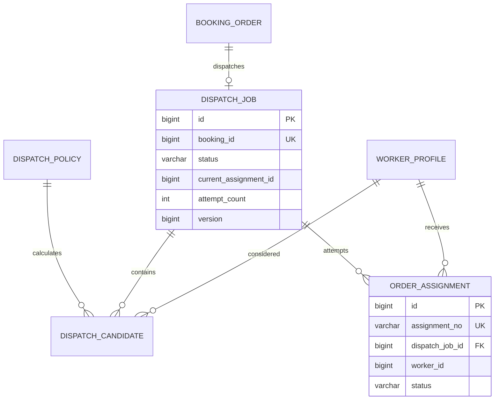

# 派单与人员分配模块详细设计

## 1. 模块定位

派单模块根据技能、服务区域、时间窗、工作负载和服务质量，为公司订单选择合适服务人员，并支持人员确认、拒绝、超时改派和运营人工处理。

核心原则：

> 公司算法选择人员，服务人员确认执行，运营人员处理异常。

系统不提供开放抢单池。服务人员只能看到平台定向分配给自己的订单。

## 2. 已确定的业务决策

1. 常规订单采用自动匹配和定向派单。
2. 人员需在限定时间内确认或拒绝。
3. 拒单必须填写原因。
4. 拒单或超时不会直接取消订单，而是进入下一候选人或人工处理。
5. 系统保存候选人、评分依据和分配历史。
6. 评分采用可解释规则。
7. 服务区域、技能、证书和时段是硬性条件。
8. 消费者不直接看到候选人员和评分过程。
9. 运营人员可以手工改派，但必须记录原因。
10. 历史候选人保存实际使用的策略和分数。

## 3. 模块边界

本模块负责：

- 派单策略。
- 候选人员筛选。
- 匹配评分和排序。
- 候选快照。
- 派单任务。
- 人员接单和拒单。
- 接单超时和自动改派。
- 运营手工派单和改派。

本模块不负责：

- 人员技能和证书维护。
- 排班和时段库存维护。
- 订单主状态。
- 支付和退款。
- 服务履约过程。

## 4. 角色与权限

### 4.1 消费者

- 不直接参与派单。
- 可以查看最终分配的人员摘要。
- 可以申请更换人员，是否接受由运营判断。

### 4.2 服务人员

- 查看定向分配给自己的派单。
- 接受或拒绝派单。
- 查看派单所需的脱敏订单信息。
- 不能查看其他候选人员或订单池。

### 4.3 运营人员

- 查看待派单、待接单、改派和人工处理队列。
- 查看候选人评分和原因。
- 手工派单和改派。
- 处理请假、拒单和超时。
- 所有手工操作写审计。

## 5. 派单任务模型

一个订单对应一个 `dispatch_job`。

状态：

```text
WAITING_PAYMENT
READY
PENDING_ACCEPT
ACCEPTED
REASSIGNING
MANUAL_REQUIRED
CANCELED
```

每次派给具体人员创建一条 `order_assignment`。

分配状态：

```text
WAITING_PAYMENT
PENDING_ACCEPT
ACCEPTED
REJECTED
EXPIRED
REASSIGNED
CANCELED
```

同一派单任务同一时刻最多一条有效分配记录。

## 6. 候选人筛选

硬性条件：

```text
WORKER 账号角色 ACTIVE
人员 work_status = ACTIVE
人员 audit_status = APPROVED
技能覆盖具体服务项目且已审核
服务项目要求的证书全部有效
人员服务区域覆盖订单区域
目标日期和时间窗存在 AVAILABLE 时段
未超过每日最大接单量
未在当前订单中被拒绝过
```

任一项不满足，直接排除，不进入评分。

## 7. 评分设计

默认权重：

```text
area_score       25
workload_score   20
quality_score    20
skill_score      15
continuity_score 10
preference_score 10
```

总分：

```text
totalScore =
  area_score * 0.25
  + workload_score * 0.20
  + quality_score * 0.20
  + skill_score * 0.15
  + continuity_score * 0.10
  + preference_score * 0.10
```

| 分项 | 说明 |
| --- | --- |
| 区域匹配 | 首版使用服务区域和街道熟悉度 |
| 工作负载 | 当日已占用时段数和每日上限 |
| 服务质量 | 评分、投诉率、迟到率和返工率 |
| 技能熟练度 | 技能等级和历史完成量 |
| 客户连续性 | 是否服务过该客户 |
| 人员偏好 | 是否偏好该区域或时间 |

同分排序：

```text
总分降序
-> 当日负载升序
-> 最近一次被分配时间升序
-> worker_id 升序
```

候选人保存评分拆解和原因，不能包含客户完整地址或电话。

## 8. 派单时序

### 8.1 创建订单时

```text
生成候选人快照
-> 选择总分最高人员
-> 锁定该人员 worker_slot
-> 创建 dispatch_job WAITING_PAYMENT
-> 创建 assignment WAITING_PAYMENT
-> 订单创建为待支付
```

此时不通知服务人员。

### 8.2 支付成功后

```text
dispatch_job WAITING_PAYMENT -> PENDING_ACCEPT
assignment WAITING_PAYMENT -> PENDING_ACCEPT
-> 设置 accept_deadline
-> 创建服务人员通知
```

### 8.3 人员接受

```text
条件更新 assignment PENDING_ACCEPT -> ACCEPTED
-> dispatch_job PENDING_ACCEPT -> ACCEPTED
-> 订单 assignment_status = ACCEPTED
-> 写入 current_worker_id
-> 通知客户和运营
```

### 8.4 人员拒绝或超时

```text
assignment -> REJECTED 或 EXPIRED
-> 释放当前人员时段
-> dispatch_job -> REASSIGNING
-> 选择下一候选人员
-> 若无候选则 MANUAL_REQUIRED
```

## 9. 改派规则

自动改派触发：

- 候选人拒绝。
- 接单超时。
- 服务前请假。
- 人员资格失效。

人工改派触发：

- 自动候选人全部不可用。
- 客户要求更换人员。
- 特殊地址或服务能力要求。
- 运营认为当前人员不合适。

改派流程：

```text
锁定派单任务
-> 结束当前分配
-> 锁定新人员时段
-> 创建新 assignment
-> 更新 current_assignment_id
-> 更新订单分配摘要
-> 通知相关方
```

规则：

- 不取消原订单和支付。
- 分配历史不覆盖。
- 改派原因必填。
- 运营手工改派写审计。

## 10. 消费者指定人员

首版不支持直接指定任意人员。

后续可把客户偏好作为软性加分：

```text
固定人员偏好
-> 派单评分加分
-> 不可用时仍由平台改派
```

不能绕过技能、证书、区域和时段约束。

## 11. 领域模型



## 12. 数据库规范

- MySQL 8.0，InnoDB，`utf8mb4`。
- 主键使用 `BIGINT UNSIGNED` 自增。
- 派单任务和分配记录使用独立业务编号。
- 时间使用 `DATETIME(3)`，统一按 `Asia/Shanghai`。
- 评分使用 `DECIMAL(6,3)`。
- 评分依据使用 JSON 保存。
- 分配记录不覆盖，不物理删除。
- `booking_id` 和 `worker_id` 使用跨模块逻辑外键。

表清单：

| 表名 | 用途 |
| --- | --- |
| `dispatch_policy` | 派单评分策略 |
| `dispatch_job` | 订单派单任务 |
| `dispatch_candidate` | 候选人员评分快照 |
| `order_assignment` | 每次人员分配记录 |

## 13. MySQL 表结构

### 13.1 派单策略表

```sql
CREATE TABLE dispatch_policy (
    id BIGINT UNSIGNED NOT NULL AUTO_INCREMENT,
    policy_no VARCHAR(32) NOT NULL,
    policy_name VARCHAR(64) NOT NULL,
    weights_json JSON NOT NULL,
    max_candidates INT NOT NULL DEFAULT 5,
    accept_timeout_minutes INT NOT NULL DEFAULT 10,
    status VARCHAR(16) NOT NULL DEFAULT 'DRAFT',
    version BIGINT UNSIGNED NOT NULL DEFAULT 0,
    created_by_account_id BIGINT UNSIGNED NULL,
    updated_by_account_id BIGINT UNSIGNED NULL,
    created_at DATETIME(3) NOT NULL DEFAULT CURRENT_TIMESTAMP(3),
    updated_at DATETIME(3) NOT NULL DEFAULT CURRENT_TIMESTAMP(3)
        ON UPDATE CURRENT_TIMESTAMP(3),
    PRIMARY KEY (id),
    UNIQUE KEY uk_dispatch_policy_no (policy_no),
    KEY idx_dispatch_policy_status (status),
    CONSTRAINT fk_dispatch_policy_creator
        FOREIGN KEY (created_by_account_id) REFERENCES account (id)
        ON UPDATE RESTRICT ON DELETE RESTRICT,
    CONSTRAINT chk_dispatch_policy_candidates
        CHECK (max_candidates BETWEEN 1 AND 20),
    CONSTRAINT chk_dispatch_policy_timeout
        CHECK (accept_timeout_minutes BETWEEN 1 AND 120),
    CONSTRAINT chk_dispatch_policy_status
        CHECK (status IN ('DRAFT', 'ACTIVE', 'RETIRED'))
) ENGINE=InnoDB DEFAULT CHARSET=utf8mb4 COLLATE=utf8mb4_0900_ai_ci
  COMMENT='派单评分策略';
```

同一时刻最多一个 `ACTIVE` 策略，由应用层切换并记录审计。

### 13.2 派单任务表

```sql
CREATE TABLE dispatch_job (
    id BIGINT UNSIGNED NOT NULL AUTO_INCREMENT,
    job_no VARCHAR(32) NOT NULL,
    booking_id BIGINT UNSIGNED NOT NULL,
    policy_id BIGINT UNSIGNED NOT NULL,
    status VARCHAR(24) NOT NULL DEFAULT 'WAITING_PAYMENT',
    current_assignment_id BIGINT UNSIGNED NULL,
    candidate_count INT NOT NULL DEFAULT 0,
    attempt_count INT NOT NULL DEFAULT 0,
    manual_required_reason VARCHAR(500) NULL,
    version BIGINT UNSIGNED NOT NULL DEFAULT 0,
    last_assigned_at DATETIME(3) NULL,
    created_by_account_id BIGINT UNSIGNED NULL,
    updated_by_account_id BIGINT UNSIGNED NULL,
    created_at DATETIME(3) NOT NULL DEFAULT CURRENT_TIMESTAMP(3),
    updated_at DATETIME(3) NOT NULL DEFAULT CURRENT_TIMESTAMP(3)
        ON UPDATE CURRENT_TIMESTAMP(3),
    PRIMARY KEY (id),
    UNIQUE KEY uk_dispatch_job_no (job_no),
    UNIQUE KEY uk_dispatch_job_booking (booking_id),
    KEY idx_dispatch_job_status (status, updated_at),
    KEY idx_dispatch_job_policy (policy_id),
    CONSTRAINT fk_dispatch_job_policy
        FOREIGN KEY (policy_id) REFERENCES dispatch_policy (id)
        ON UPDATE RESTRICT ON DELETE RESTRICT,
    CONSTRAINT chk_dispatch_job_status
        CHECK (status IN (
            'WAITING_PAYMENT',
            'READY',
            'PENDING_ACCEPT',
            'ACCEPTED',
            'REASSIGNING',
            'MANUAL_REQUIRED',
            'CANCELED'
        )),
    CONSTRAINT chk_dispatch_job_count
        CHECK (candidate_count >= 0 AND attempt_count >= 0)
) ENGINE=InnoDB DEFAULT CHARSET=utf8mb4 COLLATE=utf8mb4_0900_ai_ci
  COMMENT='订单派单任务';
```

### 13.3 候选人员表

```sql
CREATE TABLE dispatch_candidate (
    id BIGINT UNSIGNED NOT NULL AUTO_INCREMENT,
    dispatch_job_id BIGINT UNSIGNED NOT NULL,
    policy_id BIGINT UNSIGNED NOT NULL,
    worker_id BIGINT UNSIGNED NOT NULL,
    rank_no INT NOT NULL,
    total_score DECIMAL(6,3) NOT NULL,
    score_json JSON NOT NULL,
    status VARCHAR(16) NOT NULL DEFAULT 'GENERATED',
    generated_at DATETIME(3) NOT NULL DEFAULT CURRENT_TIMESTAMP(3),
    PRIMARY KEY (id),
    UNIQUE KEY uk_dispatch_candidate
        (dispatch_job_id, worker_id),
    KEY idx_dispatch_candidate_rank
        (dispatch_job_id, status, rank_no),
    KEY idx_dispatch_candidate_worker
        (worker_id, generated_at),
    CONSTRAINT fk_dispatch_candidate_job
        FOREIGN KEY (dispatch_job_id) REFERENCES dispatch_job (id)
        ON UPDATE RESTRICT ON DELETE RESTRICT,
    CONSTRAINT fk_dispatch_candidate_policy
        FOREIGN KEY (policy_id) REFERENCES dispatch_policy (id)
        ON UPDATE RESTRICT ON DELETE RESTRICT,
    CONSTRAINT chk_dispatch_candidate_rank
        CHECK (rank_no > 0),
    CONSTRAINT chk_dispatch_candidate_score
        CHECK (total_score BETWEEN 0 AND 100),
    CONSTRAINT chk_dispatch_candidate_status
        CHECK (status IN ('GENERATED', 'SELECTED', 'SKIPPED', 'EXPIRED'))
) ENGINE=InnoDB DEFAULT CHARSET=utf8mb4 COLLATE=utf8mb4_0900_ai_ci
  COMMENT='派单候选人员快照';
```

### 13.4 人员分配表

```sql
CREATE TABLE order_assignment (
    id BIGINT UNSIGNED NOT NULL AUTO_INCREMENT,
    assignment_no VARCHAR(32) NOT NULL,
    dispatch_job_id BIGINT UNSIGNED NOT NULL,
    booking_id BIGINT UNSIGNED NOT NULL,
    worker_id BIGINT UNSIGNED NOT NULL,
    assign_type VARCHAR(16) NOT NULL DEFAULT 'AUTO',
    status VARCHAR(24) NOT NULL DEFAULT 'WAITING_PAYMENT',
    assigned_by_account_id BIGINT UNSIGNED NULL,
    created_by_account_id BIGINT UNSIGNED NULL,
    updated_by_account_id BIGINT UNSIGNED NULL,
    assigned_at DATETIME(3) NOT NULL DEFAULT CURRENT_TIMESTAMP(3),
    accept_deadline DATETIME(3) NULL,
    accepted_at DATETIME(3) NULL,
    rejected_at DATETIME(3) NULL,
    reject_reason_code VARCHAR(32) NULL,
    reject_reason_text VARCHAR(500) NULL,
    replaced_assignment_id BIGINT UNSIGNED NULL,
    version BIGINT UNSIGNED NOT NULL DEFAULT 0,
    created_at DATETIME(3) NOT NULL DEFAULT CURRENT_TIMESTAMP(3),
    updated_at DATETIME(3) NOT NULL DEFAULT CURRENT_TIMESTAMP(3)
        ON UPDATE CURRENT_TIMESTAMP(3),
    PRIMARY KEY (id),
    UNIQUE KEY uk_order_assignment_no (assignment_no),
    KEY idx_order_assignment_job
        (dispatch_job_id, status, assigned_at),
    KEY idx_order_assignment_worker
        (worker_id, status, accept_deadline),
    KEY idx_order_assignment_booking
        (booking_id, assigned_at),
    CONSTRAINT fk_order_assignment_job
        FOREIGN KEY (dispatch_job_id) REFERENCES dispatch_job (id)
        ON UPDATE RESTRICT ON DELETE RESTRICT,
    CONSTRAINT fk_order_assignment_assigner
        FOREIGN KEY (assigned_by_account_id) REFERENCES account (id)
        ON UPDATE RESTRICT ON DELETE RESTRICT,
    CONSTRAINT fk_order_assignment_replaced
        FOREIGN KEY (replaced_assignment_id) REFERENCES order_assignment (id)
        ON UPDATE RESTRICT ON DELETE RESTRICT,
    CONSTRAINT chk_order_assignment_type
        CHECK (assign_type IN ('AUTO', 'MANUAL', 'REASSIGN')),
    CONSTRAINT chk_order_assignment_status
        CHECK (status IN (
            'WAITING_PAYMENT',
            'PENDING_ACCEPT',
            'ACCEPTED',
            'REJECTED',
            'EXPIRED',
            'REASSIGNED',
            'CANCELED'
        ))
) ENGINE=InnoDB DEFAULT CHARSET=utf8mb4 COLLATE=utf8mb4_0900_ai_ci
  COMMENT='订单人员分配记录';
```

## 14. 索引与约束

关键唯一约束：

```text
dispatch_policy.policy_no
dispatch_job.job_no
dispatch_job.booking_id
dispatch_candidate(dispatch_job_id, worker_id)
order_assignment.assignment_no
```

应用层约束：

- 同一时刻最多一个激活派单策略。
- 同一派单任务最多一个当前分配。
- 同一派单任务同一人员最多出现一次候选。
- 同一订单不能同时存在两个有效分配。
- 接受和拒绝必须使用状态条件更新。

## 15. 事务与并发

| 用例 | 事务范围 |
| --- | --- |
| 生成候选 | 读取资格、评分、写候选快照、创建派单任务 |
| 初始分配 | 锁定人员时段、创建分配、关联任务 |
| 支付成功 | 更新派单任务和分配状态、创建通知任务 |
| 人员接受 | 更新分配、任务和订单摘要 |
| 人员拒绝 | 更新分配、释放时段、选择下一候选 |
| 超时改派 | 条件更新分配和任务、释放时段 |
| 人工改派 | 锁任务、创建新分配、锁新时段、释放旧时段、审计 |

并发要求：

- 支付成功和接单超时任务可能并发，必须使用状态条件更新。
- 自动改派和人工改派同时发生时，只有一个成功。
- 同一时段只能被一个分配占用。
- 重复接受或拒绝请求必须幂等。

## 16. 接口设计

### 16.1 服务人员接口

```text
GET  /api/v1/worker/assignments
GET  /api/v1/worker/assignments/{assignmentNo}
POST /api/v1/worker/assignments/{assignmentNo}/accept
POST /api/v1/worker/assignments/{assignmentNo}/reject
```

### 16.2 运营接口

```text
GET  /api/v1/operator/dispatch/jobs
GET  /api/v1/operator/dispatch/jobs/{jobNo}
GET  /api/v1/operator/dispatch/jobs/{jobNo}/candidates
POST /api/v1/operator/dispatch/jobs/{jobNo}/assign
POST /api/v1/operator/dispatch/jobs/{jobNo}/reassign
POST /api/v1/operator/dispatch/jobs/{jobNo}/manual-required
GET  /api/v1/operator/dispatch/policies
POST /api/v1/operator/dispatch/policies
POST /api/v1/operator/dispatch/policies/{policyNo}/activate
```

### 16.3 内部接口

```text
POST /internal/dispatch/jobs
POST /internal/dispatch/assignments/activate-after-payment
POST /internal/dispatch/jobs/{jobId}/reassign
POST /internal/dispatch/jobs/{jobId}/cancel
GET  /internal/dispatch/jobs/{jobId}/status
```

### 16.4 拒单请求

```json
{
  "assignmentNo": "ASN202610230001",
  "accept": false,
  "reasonCode": "TIME_CONFLICT",
  "reasonText": "临时有家庭安排"
}
```

## 17. 与其他模块协作

### 17.1 服务人员与资质

- 查询候选人员资格。
- 证书失效或人员暂停触发改派。

### 17.2 服务区域

- 人员区域必须覆盖订单区域。
- 归档区域不能参与新候选。

### 17.3 排班

- 候选人员必须有 `AVAILABLE` 时段。
- 接受、拒绝和改派协调时段锁定和释放。

### 17.4 订单

- 订单创建时调用派单模块生成任务。
- 支付成功激活派单。
- 拒单和超时只更新分配摘要。
- 订单取消或改期通过内部命令更新任务。

### 17.5 通知

- 派发、接受、拒绝、改派和人工待处理事件创建通知任务。

## 18. 错误码

```text
DISPATCH_POLICY_NOT_FOUND
DISPATCH_POLICY_NOT_ACTIVE
DISPATCH_JOB_NOT_FOUND
DISPATCH_JOB_STATUS_CONFLICT
DISPATCH_NO_CANDIDATE
DISPATCH_CANDIDATE_STALE
DISPATCH_SLOT_NOT_AVAILABLE
DISPATCH_ASSIGNMENT_NOT_FOUND
DISPATCH_ASSIGNMENT_NOT_OWNED
DISPATCH_ASSIGNMENT_ALREADY_ACCEPTED
DISPATCH_ASSIGNMENT_EXPIRED
DISPATCH_MANUAL_REQUIRED
DISPATCH_REJECT_REASON_REQUIRED
DISPATCH_CONCURRENT_CHANGE
```

## 19. 测试清单

### 19.1 单元测试

- 硬性条件过滤。
- 各评分项和权重。
- 同分排序稳定性。
- 派单任务和分配状态转换。
- 候选人员排除规则。

### 19.2 集成测试

- 支付后派单只激活一次。
- 人员接受只能成功一次。
- 拒单后有下一候选人时自动改派。
- 候选人全部失败时进入 `MANUAL_REQUIRED`。
- 接单超时后释放原时段。
- 人工改派保留完整历史。
- 自动改派和人工改派并发只有一个成功。
- 人员证书失效时触发改派。
- 订单取消后派单任务取消。
- 消费者不能查看候选人列表。

### 19.3 安全测试

- 服务人员只能操作自己的分配。
- 运营人员只能查看区域范围内任务。
- 评分原因不含完整客户地址。
- 手工改派写入审计。

## 20. MVP 与后续扩展

### 20.1 MVP 范围

- 一个激活派单策略。
- 资格过滤。
- 可解释评分。
- 自动定向派单。
- 人员接受和拒绝。
- 接单超时和自动改派。
- 人工改派。
- 派单历史和评分快照。

### 20.2 后续扩展

- 固定服务人员偏好。
- 真实距离和通勤时间。
- 路线优化。
- 区域容量预测。
- 多人员团队派单。
- 拒单对优先级的动态影响。

## 21. 实现顺序

```text
dispatch_policy
-> 候选资格过滤
-> 评分和候选快照
-> dispatch_job 和 assignment
-> 支付后激活
-> 人员接受和拒绝
-> 超时任务
-> 自动改派
-> 人工改派和审计
```

## 22. 仍需确认的问题

1. 接单超时默认 10 分钟还是 15 分钟。
2. 服务人员拒单是否影响后续派单优先级。
3. 客户能否指定固定服务人员。
4. 人工待处理队列超过多长时间升级给管理员。
