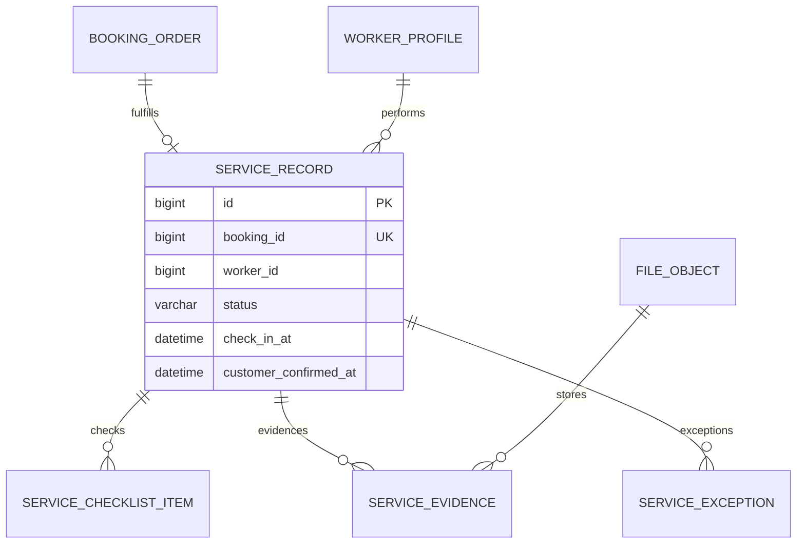

# 履约与证据模块详细设计

## 1. 模块定位

履约与证据模块记录服务人员从出发、签到、开始服务、执行检查项、上传证据、上报异常到申请完成的完整过程，形成可追溯的上门服务证据链。

核心原则：

> 服务人员可以申请完成，但最终完成必须由客户确认或系统按规则自动确认。

## 2. 已确定的业务决策

1. 只有当前分配服务人员可以推进履约。
2. 出发前订单必须已支付且人员已接单。
3. 开始服务前必须完成签到。
4. 必填检查项未完成不能申请完成。
5. 需要证据的检查项必须上传附件。
6. 服务照片只存放在私有文件存储中。
7. 服务人员不能代替客户确认完成。
8. 客户确认通过其本人登录账号执行。
9. 自动确认必须记录系统操作来源。
10. 现场加项由履约端提交异常或调整申请，不能直接改订单金额。
11. 模块只提交订单状态命令，不直接修改订单表。
12. 首版不保存实时 GPS 轨迹。

## 3. 模块边界

### 3.1 本模块负责

- 创建履约记录。
- 出发和签到。
- 开始服务和结束服务。
- 服务检查项执行。
- 服务前后照片和附件。
- 现场异常上报。
- 完成申请。
- 客户确认和自动确认。
- 履约状态和证据查询。

### 3.2 本模块不负责

- 人员匹配和派单。
- 人员技能证书审核。
- 订单价格调整。
- 支付和退款。
- 投诉责任认定。
- 评价内容管理。

## 4. 角色与权限

### 4.1 服务人员

- 查看自己的履约任务。
- 出发、签到、开始服务。
- 填写检查项和上传证据。
- 上报异常。
- 提交完成申请。
- 不能确认客户完成。

### 4.2 消费者

- 查看本人订单的履约进度和可见证据。
- 提交完成确认。
- 发起售后。
- 不能修改服务记录。

### 4.3 运营人员

- 查看区域范围内履约记录。
- 处理异常。
- 协调改派、取消或售后。
- 查看敏感照片需要业务关系和审计。

### 4.4 系统任务

- 自动确认到期的待确认订单。
- 提醒服务人员出发或客户确认。

## 5. 履约状态

```text
PENDING
EN_ROUTE
CHECKED_IN
IN_SERVICE
PENDING_CONFIRM
COMPLETED
EXCEPTION
CANCELED
```

| 状态 | 说明 |
| --- | --- |
| `PENDING` | 已分配并等待服务 |
| `EN_ROUTE` | 服务人员已出发 |
| `CHECKED_IN` | 已签到 |
| `IN_SERVICE` | 服务进行中 |
| `PENDING_CONFIRM` | 已申请完成，等待客户确认 |
| `COMPLETED` | 已完成 |
| `EXCEPTION` | 履约存在未解决异常 |
| `CANCELED` | 履约终止 |

### 5.1 正常状态转换

```text
PENDING -> EN_ROUTE -> CHECKED_IN -> IN_SERVICE -> PENDING_CONFIRM -> COMPLETED
```

### 5.2 异常转换

```text
EN_ROUTE -> EXCEPTION
CHECKED_IN -> EXCEPTION
IN_SERVICE -> EXCEPTION
EXCEPTION -> IN_SERVICE
EXCEPTION -> CANCELED
```

### 5.3 与订单主状态关系

| 履约状态 | 订单主状态 |
| --- | --- |
| `PENDING` | `CONFIRMED` |
| `EN_ROUTE` | `EN_ROUTE` |
| `CHECKED_IN` | `EN_ROUTE` |
| `IN_SERVICE` | `IN_SERVICE` |
| `PENDING_CONFIRM` | `PENDING_CONFIRM` |
| `COMPLETED` | `COMPLETED` |
| `EXCEPTION` | 根据异常决定是否保持当前状态 |

## 6. 履约记录创建

服务人员接受派单后创建履约记录：

```text
订单已支付
-> 人员已接受
-> 创建 service_record
-> 复制订单服务标准快照为 checklist
-> 状态 PENDING
```

每个订单最多一条有效履约记录。

## 7. 出发和签到

### 7.1 出发

```text
校验当前人员
-> 校验订单和履约状态
-> 记录 departed_at
-> 履约状态 EN_ROUTE
-> 订单主状态 EN_ROUTE
-> 通知客户
```

### 7.2 签到

字段：

```text
check_in_at
check_in_longitude
check_in_latitude
check_in_source
```

规则：

- 只有当前分配人员可以签到。
- 签到必须在允许时间范围内。
- 坐标采集为可选能力。
- 未接地图时允许签到，记录客户端时间和来源。
- 坐标与订单地址偏差较大时标记异常，不直接判定签到失败。
- 服务人员不能手工修改签到时间。

### 7.3 开始服务

```text
履约状态 CHECKED_IN -> IN_SERVICE
-> 记录 started_at
-> 订单状态 IN_SERVICE
```

存在未处理的高优先级安全异常时，不允许开始服务。

## 8. 检查项

检查项来自服务目录标准快照：

```text
standard_item_id
standard_group
item_name
required
evidence_required
sort_order
```

完成规则：

- 必填检查项必须完成。
- 需要证据的检查项必须存在至少一条关联证据。
- 检查项可以填写备注。
- 完成时间和完成人必须记录。
- 订单创建后不能通过修改目录模板改变检查项。

## 9. 服务证据

### 9.1 证据类型

```text
BEFORE_PHOTO
AFTER_PHOTO
CHECKLIST_PHOTO
DOCUMENT
OTHER
```

### 9.2 文件规则

- 文件上传到私有存储桶。
- 数据库只保存文件 ID 和业务元数据。
- 访问必须校验当前人员、客户或运营业务关系。
- 不允许永久公开 URL。
- 单文件大小和格式由文件模块统一控制。
- 证据不得出现在普通通知正文中。

### 9.3 证据完整性

申请完成前必须校验：

- 所有必填检查项。
- 所有要求证据的检查项。
- 每个订单至少一条服务前照片和一条服务后照片，若服务项目配置要求。

## 10. 异常上报

异常类型：

```text
CUSTOMER_ABSENT
ADDRESS_INCORRECT
ACCESS_DENIED
SAFETY_RISK
MATERIAL_MISSING
EXTRA_SERVICE
OTHER
```

异常状态：

```text
OPEN
ACKNOWLEDGED
RESOLVED
REJECTED
CLOSED
```

规则：

- 服务人员提交异常时填写类型、说明和可见证据。
- 异常不直接修改订单金额。
- 现场加项通过异常申请，由运营和订单模块处理。
- 异常未解决时可以暂停履约。
- 运营处理结果必须写处理人、结论和时间。

## 11. 完成申请和客户确认

### 11.1 服务人员申请完成

```text
校验当前人员
-> 校验 IN_SERVICE
-> 校验必填检查项和证据
-> 记录 finished_at 和 completion_requested_at
-> 履约状态 PENDING_CONFIRM
-> 订单 PENDING_CONFIRM
-> 创建客户确认提醒
```

### 11.2 客户确认

```text
客户提交确认
-> 校验客户订单归属
-> 校验 PENDING_CONFIRM
-> 记录 customer_confirmed_at 和 confirm_source
-> 履约 COMPLETED
-> 订单 COMPLETED
-> 开放评价和售后
```

服务人员不能调用客户确认接口。

### 11.3 自动确认

```text
到达 confirmation_deadline
-> 系统任务检查订单仍为 PENDING_CONFIRM
-> 记录 SYSTEM 来源
-> 履约 COMPLETED
-> 订单 COMPLETED
```

自动确认任务必须幂等。

## 12. 领域模型



## 13. 数据库规范

- MySQL 8.0，InnoDB，`utf8mb4`。
- 主键使用 `BIGINT UNSIGNED` 自增。
- 时间使用 `DATETIME(3)`，统一按 `Asia/Shanghai`。
- 订单、人员、文件 ID 使用跨模块逻辑外键。
- 履约记录和证据不物理删除。
- 证据文件使用私有文件模块管理。
- 检查项来自快照，不依赖服务目录当前模板。

表清单：

| 表名 | 用途 |
| --- | --- |
| `service_record` | 订单履约主记录 |
| `service_checklist_item` | 服务标准检查项快照和执行结果 |
| `service_evidence` | 服务照片和附件 |
| `service_exception` | 履约异常和现场问题 |

## 14. MySQL 表结构

### 14.1 履约记录表

```sql
CREATE TABLE service_record (
    id BIGINT UNSIGNED NOT NULL AUTO_INCREMENT,
    record_no VARCHAR(32) NOT NULL,
    booking_id BIGINT UNSIGNED NOT NULL,
    worker_id BIGINT UNSIGNED NOT NULL,
    status VARCHAR(24) NOT NULL DEFAULT 'PENDING',
    departed_at DATETIME(3) NULL,
    check_in_at DATETIME(3) NULL,
    check_in_longitude DECIMAL(10, 7) NULL,
    check_in_latitude DECIMAL(10, 7) NULL,
    check_in_source VARCHAR(16) NULL,
    started_at DATETIME(3) NULL,
    finished_at DATETIME(3) NULL,
    completion_requested_at DATETIME(3) NULL,
    confirmation_deadline DATETIME(3) NULL,
    customer_confirmed_at DATETIME(3) NULL,
    confirm_source VARCHAR(16) NULL,
    service_result VARCHAR(1000) NULL,
    created_by_account_id BIGINT UNSIGNED NULL,
    updated_by_account_id BIGINT UNSIGNED NULL,
    version BIGINT UNSIGNED NOT NULL DEFAULT 0,
    created_at DATETIME(3) NOT NULL DEFAULT CURRENT_TIMESTAMP(3),
    updated_at DATETIME(3) NOT NULL DEFAULT CURRENT_TIMESTAMP(3)
        ON UPDATE CURRENT_TIMESTAMP(3),
    PRIMARY KEY (id),
    UNIQUE KEY uk_service_record_no (record_no),
    UNIQUE KEY uk_service_record_booking (booking_id),
    KEY idx_service_record_worker
        (worker_id, status, created_at),
    KEY idx_service_record_confirm
        (status, confirmation_deadline),
    CONSTRAINT chk_service_record_status
        CHECK (status IN (
            'PENDING',
            'EN_ROUTE',
            'CHECKED_IN',
            'IN_SERVICE',
            'PENDING_CONFIRM',
            'COMPLETED',
            'EXCEPTION',
            'CANCELED'
        )),
    CONSTRAINT chk_service_record_checkin_source
        CHECK (check_in_source IS NULL OR check_in_source IN ('GPS', 'MANUAL', 'SYSTEM')),
    CONSTRAINT chk_service_record_confirm_source
        CHECK (confirm_source IS NULL OR confirm_source IN ('CUSTOMER', 'SYSTEM', 'OPERATOR')),
    CONSTRAINT chk_service_record_longitude
        CHECK (check_in_longitude IS NULL OR check_in_longitude BETWEEN -180 AND 180),
    CONSTRAINT chk_service_record_latitude
        CHECK (check_in_latitude IS NULL OR check_in_latitude BETWEEN -90 AND 90)
) ENGINE=InnoDB DEFAULT CHARSET=utf8mb4 COLLATE=utf8mb4_0900_ai_ci
  COMMENT='服务履约记录';
```

### 14.2 检查项表

```sql
CREATE TABLE service_checklist_item (
    id BIGINT UNSIGNED NOT NULL AUTO_INCREMENT,
    service_record_id BIGINT UNSIGNED NOT NULL,
    source_standard_item_id BIGINT UNSIGNED NULL,
    standard_group VARCHAR(64) NULL,
    item_name VARCHAR(128) NOT NULL,
    description VARCHAR(500) NULL,
    required TINYINT(1) NOT NULL DEFAULT 1,
    evidence_required TINYINT(1) NOT NULL DEFAULT 0,
    completed TINYINT(1) NOT NULL DEFAULT 0,
    completed_at DATETIME(3) NULL,
    completed_by_account_id BIGINT UNSIGNED NULL,
    remark VARCHAR(500) NULL,
    sort_order INT NOT NULL DEFAULT 0,
    created_by_account_id BIGINT UNSIGNED NULL,
    updated_by_account_id BIGINT UNSIGNED NULL,
    version BIGINT UNSIGNED NOT NULL DEFAULT 0,
    created_at DATETIME(3) NOT NULL DEFAULT CURRENT_TIMESTAMP(3),
    updated_at DATETIME(3) NOT NULL DEFAULT CURRENT_TIMESTAMP(3)
        ON UPDATE CURRENT_TIMESTAMP(3),
    PRIMARY KEY (id),
    UNIQUE KEY uk_service_checklist_item
        (service_record_id, sort_order),
    KEY idx_service_checklist_status
        (service_record_id, required, completed),
    CONSTRAINT fk_service_checklist_record
        FOREIGN KEY (service_record_id) REFERENCES service_record (id)
        ON UPDATE RESTRICT ON DELETE RESTRICT,
    CONSTRAINT fk_service_checklist_completed_by
        FOREIGN KEY (completed_by_account_id) REFERENCES account (id)
        ON UPDATE RESTRICT ON DELETE RESTRICT,
    CONSTRAINT chk_service_checklist_required
        CHECK (required IN (0, 1)),
    CONSTRAINT chk_service_checklist_evidence
        CHECK (evidence_required IN (0, 1)),
    CONSTRAINT chk_service_checklist_completed
        CHECK (completed IN (0, 1))
) ENGINE=InnoDB DEFAULT CHARSET=utf8mb4 COLLATE=utf8mb4_0900_ai_ci
  COMMENT='服务检查项快照';
```

### 14.3 服务证据表

```sql
CREATE TABLE service_evidence (
    id BIGINT UNSIGNED NOT NULL AUTO_INCREMENT,
    service_record_id BIGINT UNSIGNED NOT NULL,
    checklist_item_id BIGINT UNSIGNED NULL,
    evidence_type VARCHAR(24) NOT NULL,
    file_id BIGINT UNSIGNED NOT NULL,
    description VARCHAR(500) NULL,
    uploaded_by_account_id BIGINT UNSIGNED NOT NULL,
    created_at DATETIME(3) NOT NULL DEFAULT CURRENT_TIMESTAMP(3),
    PRIMARY KEY (id),
    UNIQUE KEY uk_service_evidence_file (file_id),
    KEY idx_service_evidence_record
        (service_record_id, evidence_type, created_at),
    KEY idx_service_evidence_checklist
        (checklist_item_id),
    CONSTRAINT fk_service_evidence_record
        FOREIGN KEY (service_record_id) REFERENCES service_record (id)
        ON UPDATE RESTRICT ON DELETE RESTRICT,
    CONSTRAINT fk_service_evidence_checklist
        FOREIGN KEY (checklist_item_id) REFERENCES service_checklist_item (id)
        ON UPDATE RESTRICT ON DELETE RESTRICT,
    CONSTRAINT fk_service_evidence_uploader
        FOREIGN KEY (uploaded_by_account_id) REFERENCES account (id)
        ON UPDATE RESTRICT ON DELETE RESTRICT,
    CONSTRAINT chk_service_evidence_type
        CHECK (evidence_type IN (
            'BEFORE_PHOTO',
            'AFTER_PHOTO',
            'CHECKLIST_PHOTO',
            'DOCUMENT',
            'OTHER'
        ))
) ENGINE=InnoDB DEFAULT CHARSET=utf8mb4 COLLATE=utf8mb4_0900_ai_ci
  COMMENT='服务履约证据';
```

### 14.4 履约异常表

```sql
CREATE TABLE service_exception (
    id BIGINT UNSIGNED NOT NULL AUTO_INCREMENT,
    exception_no VARCHAR(32) NOT NULL,
    service_record_id BIGINT UNSIGNED NOT NULL,
    exception_type VARCHAR(32) NOT NULL,
    description VARCHAR(1000) NOT NULL,
    status VARCHAR(24) NOT NULL DEFAULT 'OPEN',
    reported_by_account_id BIGINT UNSIGNED NOT NULL,
    handled_by_account_id BIGINT UNSIGNED NULL,
    resolution VARCHAR(1000) NULL,
    created_by_account_id BIGINT UNSIGNED NULL,
    updated_by_account_id BIGINT UNSIGNED NULL,
    version BIGINT UNSIGNED NOT NULL DEFAULT 0,
    reported_at DATETIME(3) NOT NULL DEFAULT CURRENT_TIMESTAMP(3),
    resolved_at DATETIME(3) NULL,
    created_at DATETIME(3) NOT NULL DEFAULT CURRENT_TIMESTAMP(3),
    updated_at DATETIME(3) NOT NULL DEFAULT CURRENT_TIMESTAMP(3)
        ON UPDATE CURRENT_TIMESTAMP(3),
    PRIMARY KEY (id),
    UNIQUE KEY uk_service_exception_no (exception_no),
    KEY idx_service_exception_record
        (service_record_id, status, reported_at),
    CONSTRAINT fk_service_exception_record
        FOREIGN KEY (service_record_id) REFERENCES service_record (id)
        ON UPDATE RESTRICT ON DELETE RESTRICT,
    CONSTRAINT fk_service_exception_reporter
        FOREIGN KEY (reported_by_account_id) REFERENCES account (id)
        ON UPDATE RESTRICT ON DELETE RESTRICT,
    CONSTRAINT fk_service_exception_handler
        FOREIGN KEY (handled_by_account_id) REFERENCES account (id)
        ON UPDATE RESTRICT ON DELETE RESTRICT,
    CONSTRAINT chk_service_exception_type
        CHECK (exception_type IN (
            'CUSTOMER_ABSENT',
            'ADDRESS_INCORRECT',
            'ACCESS_DENIED',
            'SAFETY_RISK',
            'MATERIAL_MISSING',
            'EXTRA_SERVICE',
            'OTHER'
        )),
    CONSTRAINT chk_service_exception_status
        CHECK (status IN ('OPEN', 'ACKNOWLEDGED', 'RESOLVED', 'REJECTED', 'CLOSED'))
) ENGINE=InnoDB DEFAULT CHARSET=utf8mb4 COLLATE=utf8mb4_0900_ai_ci
  COMMENT='履约异常';
```

## 15. 索引与约束

关键唯一约束：

```text
service_record.record_no
service_record.booking_id
service_checklist_item(service_record_id, sort_order)
service_evidence.file_id
service_exception.exception_no
```

业务约束：

- 一条订单最多一条履约记录。
- 一条证据只关联一个文件。
- 必填检查项完成后才能申请完成。
- 待确认订单必须有 `confirmation_deadline`。
- 客户确认只能由客户本人执行。

## 16. 事务与并发

| 用例 | 事务范围 |
| --- | --- |
| 创建履约记录 | 写履约记录、复制检查项 |
| 出发 | 更新履约状态、更新订单主状态、创建通知 |
| 签到 | 更新签到信息、记录异常标记 |
| 开始服务 | 更新履约和订单状态 |
| 上传证据 | 校验业务关系、写文件证据 |
| 申请完成 | 校验检查项、更新履约和订单状态、写通知 |
| 客户确认 | 更新履约和订单、写评价资格 |
| 自动确认 | 条件更新到期订单、写系统来源 |

并发要求：

- 履约状态更新使用 `version` 乐观锁。
- 客户确认和自动确认同时发生只能有一个成功。
- 重复上传同一文件需要幂等或去重。
- 订单取消、改派和履约开始并发时必须重新校验分配关系。

## 17. 接口设计

### 17.1 服务人员端

```text
GET  /api/v1/worker/bookings/{orderNo}/fulfillment
POST /api/v1/worker/bookings/{orderNo}/depart
POST /api/v1/worker/bookings/{orderNo}/check-in
POST /api/v1/worker/bookings/{orderNo}/start
PUT  /api/v1/worker/bookings/{orderNo}/checklist/{itemId}
POST /api/v1/worker/bookings/{orderNo}/evidence
POST /api/v1/worker/bookings/{orderNo}/exceptions
POST /api/v1/worker/bookings/{orderNo}/complete-request
```

### 17.2 消费者端

```text
GET  /api/v1/customer/bookings/{orderNo}/fulfillment
POST /api/v1/customer/bookings/{orderNo}/confirm
POST /api/v1/customer/bookings/{orderNo}/after-sales
```

### 17.3 运营端

```text
GET  /api/v1/operator/fulfillment
GET  /api/v1/operator/fulfillment/{orderNo}
POST /api/v1/operator/fulfillment/{orderNo}/exceptions/{exceptionNo}/handle
POST /api/v1/operator/fulfillment/{orderNo}/force-complete
```

### 17.4 内部接口

```text
POST /internal/fulfillment/records
POST /internal/fulfillment/{bookingId}/cancel
GET  /internal/fulfillment/{bookingId}/evidence-summary
```

## 18. 与其他模块协作

### 18.1 订单

- 读取订单和服务标准快照。
- 通过订单命令更新主状态。
- 不直接写订单表。

### 18.2 派单

- 校验当前人员和分配关系。
- 人员改派后旧履约记录不能继续推进。

### 18.3 服务目录

- 创建履约记录时复制标准检查项。

### 18.4 文件

- 证据文件使用私有对象存储。
- 文件访问校验订单和角色关系。

### 18.5 售后与通知

- 售后读取履约证据。
- 出发、完成申请和确认提醒创建通知任务。

## 19. 错误码

```text
FULFILLMENT_NOT_FOUND
FULFILLMENT_NOT_OWNED
FULFILLMENT_STATUS_CONFLICT
FULFILLMENT_ASSIGNMENT_INVALID
FULFILLMENT_CHECK_IN_OUT_OF_WINDOW
FULFILLMENT_CHECK_IN_BEFORE_ASSIGNMENT
FULFILLMENT_START_BEFORE_CHECK_IN
FULFILLMENT_CHECKLIST_REQUIRED
FULFILLMENT_EVIDENCE_REQUIRED
FULFILLMENT_COMPLETION_NOT_ALLOWED
FULFILLMENT_ALREADY_COMPLETED
FULFILLMENT_CONFIRMATION_EXPIRED
FULFILLMENT_OPEN_SAFETY_EXCEPTION
```

## 20. 测试清单

### 20.1 单元测试

- 履约状态转换。
- 必填检查项校验。
- 证据要求校验。
- 签到时间窗口。
- 自动确认截止时间。
- 异常类型和状态。

### 20.2 集成测试

- 非当前人员不能签到。
- 未签到不能开始服务。
- 必填检查项未完成不能申请完成。
- 客户确认只能由客户本人执行。
- 客户确认和自动确认只成功一次。
- 服务人员不能代替客户确认。
- 改派后旧人员不能继续推进履约。
- 服务证据访问按业务关系校验。
- 异常未解决时高优先级安全风险阻断服务。

### 20.3 安全测试

- 证据文件不能匿名访问。
- 运营查看证据写审计。
- 日志不输出完整地址和照片 URL。

## 21. MVP 与后续扩展

### 21.1 MVP 范围

- 履约记录。
- 出发和签到。
- 开始服务。
- 检查项。
- 前后照片。
- 异常上报。
- 完成申请。
- 客户确认和自动确认。

### 21.2 后续扩展

- GPS 轨迹。
- 地理围栏签到。
- 电子签名。
- 现场加项确认。
- 语音记录。
- 质检抽查。
- 返工履约。

## 22. 实现顺序

```text
service_record
-> 履约状态机
-> 出发和签到
-> checklist
-> evidence
-> exception
-> 完成申请
-> 客户确认和自动确认
-> 订单状态联动
```

## 23. 仍需确认的问题

1. 首版是否强制上传服务前后照片。
2. 签到是否必须开启定位。
3. 客户确认采用按钮还是确认码。
4. 自动确认时间设置为多少小时。
