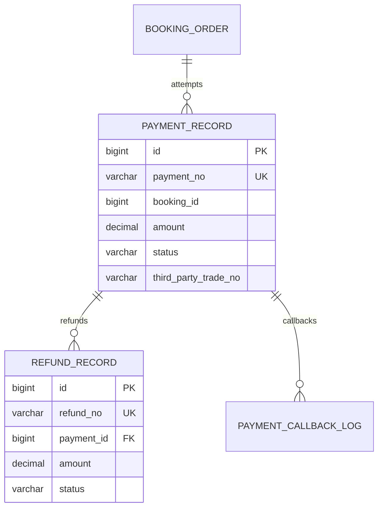

# 支付与退款模块详细设计

## 1. 模块定位

支付与退款模块记录订单支付、支付回调、退款申请、退款审批和退款执行事实，为订单提供可信的资金状态依据。

核心原则：

> 订单可以保存支付摘要，但支付和退款事实只能由本模块维护。

## 2. 已确定的业务决策

1. 首版使用模拟支付，不接真实资金清算。
2. 首版订单支付全款，不做预约金。
3. 支付金额必须与服务端订单应付金额一致。
4. 一个订单最终只能存在一条成功支付记录。
5. 支付回调必须幂等。
6. 待支付超时后订单取消，支付单关闭。
7. 已支付订单取消时创建退款记录。
8. 退款申请、审批和执行分开记录。
9. 首版优先支持全额退款。
10. 不实现服务人员工资和平台结算。
11. 支付渠道通过 `PaymentGateway` 适配器隔离。
12. 外部退款失败不能伪装成成功。

## 3. 模块边界

### 3.1 本模块负责

- 创建支付单。
- 模拟支付和支付回调。
- 支付状态。
- 支付流水号。
- 退款申请和审批。
- 退款执行记录。
- 支付回调幂等。
- 支付金额校验。

### 3.2 本模块不负责

- 订单价格计算。
- 订单状态机定义。
- 服务履约。
- 售后责任认定。
- 服务人员工资。
- 平台分账和商家结算。

## 4. 角色与权限

### 4.1 消费者

- 支付自己的待支付订单。
- 查看自己的支付和退款结果。
- 对已支付订单提交取消或退款申请。

### 4.2 运营人员

- 查看支付和退款列表。
- 审批符合权限的退款。
- 处理支付异常。
- 退款审批写审计。

### 4.3 系统

- 接收支付回调。
- 关闭超时支付单。
- 执行退款重试。
- 更新订单支付摘要。

## 5. 支付状态

### 5.1 支付记录状态

```text
CREATED
PAYING
SUCCESS
FAILED
CLOSED
```

| 状态 | 说明 |
| --- | --- |
| `CREATED` | 支付单已创建 |
| `PAYING` | 已向支付渠道发起支付 |
| `SUCCESS` | 支付成功 |
| `FAILED` | 支付失败 |
| `CLOSED` | 支付单关闭 |

支付状态转换：

```text
CREATED -> PAYING -> SUCCESS
CREATED -> PAYING -> FAILED
CREATED -> CLOSED
PAYING -> CLOSED
FAILED -> CLOSED
```

`SUCCESS` 为终态，不允许回滚为未支付。

### 5.2 订单支付摘要

订单模块可使用：

```text
UNPAID
PAID
REFUNDING
PARTIALLY_REFUNDED
REFUNDED
```

摘要只由支付模块调用订单内部命令更新。

## 6. 退款状态

```text
REQUESTED
APPROVED
PROCESSING
SUCCESS
REJECTED
FAILED
CANCELED
```

状态转换：

```text
REQUESTED -> APPROVED -> PROCESSING -> SUCCESS
REQUESTED -> REJECTED
APPROVED -> FAILED
PROCESSING -> FAILED
FAILED -> PROCESSING
REQUESTED -> CANCELED
```

`SUCCESS` 为终态。

## 7. 支付流程

### 7.1 创建支付

```text
校验订单属于当前客户
-> 校验订单为 PENDING_PAYMENT
-> 校验支付未超时
-> 读取服务端应付金额
-> 创建 payment_record
-> 调用 PaymentGateway
-> 返回支付结果或支付参数
```

客户端传入的金额只能用于展示，不能作为支付金额。

### 7.2 模拟支付成功

```text
支付回调或模拟回调
-> 查询 payment_record
-> 校验金额和商户订单号
-> 条件更新 CREATED/PAYING -> SUCCESS
-> 写 payment_callback_log
-> 调用订单 mark-paid
-> 订单更新支付摘要
```

### 7.3 支付成功事务

支付模块和订单、时段、派单模块协作：

```text
payment_record -> SUCCESS
-> worker_slot HELD -> BOOKED
-> booking_order PENDING_PAYMENT -> CONFIRMED
-> dispatch_job WAITING_PAYMENT -> PENDING_ACCEPT
-> 写通知任务
```

本地数据库操作尽量在一个事务中完成。如果外部支付回调无法与本地事务绑定，则使用回调日志、状态机和补偿任务。

### 7.4 支付超时

```text
查找 PENDING_PAYMENT 订单
-> 订单超过支付截止时间
-> 关闭 payment_record
-> 订单 CANCELED
-> 释放 HELD 时段
-> 取消派单任务
```

## 8. 退款流程

### 8.1 创建退款申请

来源：

- 用户取消已支付订单。
- 运营强制取消。
- 售后审批。

规则：

- 必须关联成功支付记录。
- 退款金额不能超过已支付未退款金额。
- 退款原因必填。
- 申请人与审核人分离更安全。
- 同一业务幂等键只能生成一条有效申请。

### 8.2 审核

```text
运营查看订单、取消规则、履约证据和售后结论
-> 批准或拒绝
-> 批准后调用支付网关执行退款
```

### 8.3 执行退款

```text
refund_record APPROVED -> PROCESSING
-> PaymentGateway.refund
-> 成功 SUCCESS
-> 订单支付摘要更新
-> 通知客户
```

失败时：

```text
refund_record -> FAILED
-> 保存失败原因
-> 允许重试或人工处理
```

## 9. 取消与退款规则

```text
未支付取消：无退款
已支付且免费取消期内：全额退款
已支付且超过免费取消期：按规则审批
服务开始后：转售后
改期：默认不退款
```

订单取消记录保存：

- 取消原因。
- 取消时间。
- 手续费。
- 应退金额。
- 规则版本。

支付模块只执行退款，不自行判断售后责任。

## 10. 领域模型



## 11. 数据库规范

- MySQL 8.0，InnoDB，`utf8mb4`。
- 主键使用 `BIGINT UNSIGNED` 自增。
- 金额使用 `DECIMAL(12,2)`，Java 使用 `BigDecimal`。
- 时间使用 `DATETIME(3)`，统一按 `Asia/Shanghai`。
- 支付、退款和回调日志不物理删除。
- `payment_no` 和 `refund_no` 全局唯一。
- 成功支付记录通过生成列唯一约束保证一单一成功支付。
- 外部渠道交易号建立唯一约束。
- 金额和状态不能只依赖客户端或回调参数。

表清单：

| 表名 | 用途 |
| --- | --- |
| `payment_record` | 支付尝试和成功支付事实 |
| `refund_record` | 退款申请和执行记录 |
| `payment_callback_log` | 支付回调幂等和审计日志 |

## 12. MySQL 表结构

### 12.1 支付记录表

```sql
CREATE TABLE payment_record (
    id BIGINT UNSIGNED NOT NULL AUTO_INCREMENT,
    payment_no VARCHAR(32) NOT NULL,
    booking_id BIGINT UNSIGNED NOT NULL,
    account_id BIGINT UNSIGNED NOT NULL,
    attempt_no INT NOT NULL,
    channel VARCHAR(16) NOT NULL DEFAULT 'MOCK',
    amount DECIMAL(12,2) NOT NULL,
    currency CHAR(3) NOT NULL DEFAULT 'CNY',
    status VARCHAR(16) NOT NULL DEFAULT 'CREATED',
    third_party_trade_no VARCHAR(128) NULL,
    idempotency_key VARCHAR(64) NOT NULL,
    paid_at DATETIME(3) NULL,
    closed_at DATETIME(3) NULL,
    created_by_account_id BIGINT UNSIGNED NULL,
    updated_by_account_id BIGINT UNSIGNED NULL,
    version BIGINT UNSIGNED NOT NULL DEFAULT 0,
    success_booking_id BIGINT UNSIGNED
        GENERATED ALWAYS AS (
            CASE WHEN status = 'SUCCESS' THEN booking_id ELSE NULL END
        ) STORED,
    created_at DATETIME(3) NOT NULL DEFAULT CURRENT_TIMESTAMP(3),
    updated_at DATETIME(3) NOT NULL DEFAULT CURRENT_TIMESTAMP(3)
        ON UPDATE CURRENT_TIMESTAMP(3),
    PRIMARY KEY (id),
    UNIQUE KEY uk_payment_record_no (payment_no),
    UNIQUE KEY uk_payment_record_attempt (booking_id, attempt_no),
    UNIQUE KEY uk_payment_record_idempotency (account_id, idempotency_key),
    UNIQUE KEY uk_payment_record_success_booking (success_booking_id),
    UNIQUE KEY uk_payment_record_trade_no (third_party_trade_no),
    KEY idx_payment_record_booking (booking_id, status),
    KEY idx_payment_record_account (account_id, created_at),
    CONSTRAINT fk_payment_record_account
        FOREIGN KEY (account_id) REFERENCES account (id)
        ON UPDATE RESTRICT ON DELETE RESTRICT,
    CONSTRAINT chk_payment_record_channel
        CHECK (channel IN ('MOCK', 'WECHAT', 'ALIPAY')),
    CONSTRAINT chk_payment_record_status
        CHECK (status IN ('CREATED', 'PAYING', 'SUCCESS', 'FAILED', 'CLOSED')),
    CONSTRAINT chk_payment_record_amount
        CHECK (amount > 0),
    CONSTRAINT chk_payment_record_attempt
        CHECK (attempt_no > 0)
) ENGINE=InnoDB DEFAULT CHARSET=utf8mb4 COLLATE=utf8mb4_0900_ai_ci
  COMMENT='支付记录';
```

`success_booking_id` 生成列唯一索引保证一个订单最多一条成功支付记录。

### 12.2 退款记录表

```sql
CREATE TABLE refund_record (
    id BIGINT UNSIGNED NOT NULL AUTO_INCREMENT,
    refund_no VARCHAR(32) NOT NULL,
    booking_id BIGINT UNSIGNED NOT NULL,
    payment_id BIGINT UNSIGNED NOT NULL,
    amount DECIMAL(12,2) NOT NULL,
    reason_code VARCHAR(32) NOT NULL,
    reason_text VARCHAR(1000) NULL,
    status VARCHAR(16) NOT NULL DEFAULT 'REQUESTED',
    requested_by_account_id BIGINT UNSIGNED NOT NULL,
    reviewed_by_account_id BIGINT UNSIGNED NULL,
    reviewed_at DATETIME(3) NULL,
    refunded_at DATETIME(3) NULL,
    failure_reason VARCHAR(500) NULL,
    idempotency_key VARCHAR(64) NOT NULL,
    created_by_account_id BIGINT UNSIGNED NULL,
    updated_by_account_id BIGINT UNSIGNED NULL,
    version BIGINT UNSIGNED NOT NULL DEFAULT 0,
    created_at DATETIME(3) NOT NULL DEFAULT CURRENT_TIMESTAMP(3),
    updated_at DATETIME(3) NOT NULL DEFAULT CURRENT_TIMESTAMP(3)
        ON UPDATE CURRENT_TIMESTAMP(3),
    PRIMARY KEY (id),
    UNIQUE KEY uk_refund_record_no (refund_no),
    UNIQUE KEY uk_refund_record_idempotency (payment_id, idempotency_key),
    KEY idx_refund_record_booking (booking_id, status, created_at),
    KEY idx_refund_record_payment (payment_id, status),
    CONSTRAINT fk_refund_record_payment
        FOREIGN KEY (payment_id) REFERENCES payment_record (id)
        ON UPDATE RESTRICT ON DELETE RESTRICT,
    CONSTRAINT fk_refund_record_requester
        FOREIGN KEY (requested_by_account_id) REFERENCES account (id)
        ON UPDATE RESTRICT ON DELETE RESTRICT,
    CONSTRAINT fk_refund_record_reviewer
        FOREIGN KEY (reviewed_by_account_id) REFERENCES account (id)
        ON UPDATE RESTRICT ON DELETE RESTRICT,
    CONSTRAINT chk_refund_record_status
        CHECK (status IN (
            'REQUESTED',
            'APPROVED',
            'PROCESSING',
            'SUCCESS',
            'REJECTED',
            'FAILED',
            'CANCELED'
        )),
    CONSTRAINT chk_refund_record_amount
        CHECK (amount > 0),
    CONSTRAINT chk_refund_record_review
        CHECK (
            status IN ('REQUESTED', 'CANCELED')
            OR reviewed_by_account_id IS NOT NULL
        )
) ENGINE=InnoDB DEFAULT CHARSET=utf8mb4 COLLATE=utf8mb4_0900_ai_ci
  COMMENT='退款记录';
```

退款金额上限还需要结合同一支付记录下所有成功退款金额进行事务校验。

### 12.3 支付回调日志表

```sql
CREATE TABLE payment_callback_log (
    id BIGINT UNSIGNED NOT NULL AUTO_INCREMENT,
    channel VARCHAR(16) NOT NULL,
    callback_id VARCHAR(128) NOT NULL,
    payment_no VARCHAR(32) NULL,
    payload_hash CHAR(64) CHARACTER SET ascii COLLATE ascii_bin NOT NULL,
    result VARCHAR(16) NOT NULL,
    error_message VARCHAR(500) NULL,
    received_at DATETIME(3) NOT NULL DEFAULT CURRENT_TIMESTAMP(3),
    processed_at DATETIME(3) NULL,
    PRIMARY KEY (id),
    UNIQUE KEY uk_payment_callback
        (channel, callback_id),
    KEY idx_payment_callback_payment
        (payment_no, received_at),
    CONSTRAINT chk_payment_callback_channel
        CHECK (channel IN ('MOCK', 'WECHAT', 'ALIPAY')),
    CONSTRAINT chk_payment_callback_result
        CHECK (result IN ('RECEIVED', 'SUCCESS', 'DUPLICATE', 'FAILED'))
) ENGINE=InnoDB DEFAULT CHARSET=utf8mb4 COLLATE=utf8mb4_0900_ai_ci
  COMMENT='支付回调日志';
```

回调日志不保存完整敏感报文，只保存哈希和必要业务号。

## 13. 索引与约束

关键唯一约束：

```text
payment_record.payment_no
payment_record(booking_id, attempt_no)
payment_record(account_id, idempotency_key)
payment_record.success_booking_id
payment_record.third_party_trade_no
refund_record.refund_no
refund_record(payment_id, idempotency_key)
payment_callback_log(channel, callback_id)
```

业务约束：

- 成功支付金额等于订单应付金额。
- 退款总额不超过成功支付金额。
- 已取消订单不能支付。
- 待支付超时订单不能支付。
- 支付成功不能回退为未支付。

## 14. 事务与并发

| 用例 | 事务范围 |
| --- | --- |
| 创建支付 | 校验订单、创建支付记录 |
| 支付成功 | 支付状态、订单状态、时段占用、派单激活、日志 |
| 支付超时 | 支付关闭、订单取消、时段释放、派单取消 |
| 创建退款 | 校验金额、写退款申请 |
| 审批退款 | 更新退款状态、写审计 |
| 执行退款 | 调用网关、更新退款状态、更新订单摘要 |

并发要求：

- 重复支付请求只允许一条成功记录。
- 重复回调只处理一次。
- 退款审批和执行使用条件更新。
- 外部退款接口超时不能直接判定成功。
- 需要提供失败查询和补偿任务。

## 15. 接口设计

### 15.1 消费者接口

```text
POST /api/v1/customer/bookings/{orderNo}/pay
GET  /api/v1/customer/payments/{paymentNo}
GET  /api/v1/customer/bookings/{orderNo}/payments
POST /api/v1/customer/bookings/{orderNo}/refund-requests
GET  /api/v1/customer/refunds/{refundNo}
```

### 15.2 回调接口

```text
POST /api/v1/payment/callback/mock
POST /api/v1/payment/callback/wechat
POST /api/v1/payment/callback/alipay
```

仅对应启用渠道开放。

### 15.3 运营接口

```text
GET  /api/v1/operator/payments
GET  /api/v1/operator/refunds
POST /api/v1/operator/refunds/{refundNo}/approve
POST /api/v1/operator/refunds/{refundNo}/reject
POST /api/v1/operator/refunds/{refundNo}/retry
```

### 15.4 创建支付请求

```json
{
  "orderNo": "BK202610230001",
  "channel": "MOCK",
  "idempotencyKey": "pay-20261023-0001"
}
```

### 15.5 退款请求

```json
{
  "orderNo": "BK202610230001",
  "amount": 379.00,
  "reasonCode": "CUSTOMER_CANCEL",
  "reasonText": "服务开始前取消",
  "idempotencyKey": "refund-20261023-0001"
}
```

## 16. 与其他模块协作

### 16.1 订单

- 读取订单金额和支付截止时间。
- 支付成功调用订单状态命令。
- 订单取消调用退款申请。

### 16.2 排班与派单

- 支付成功确认时段占用。
- 支付超时释放时段。
- 支付成功激活派单任务。

### 16.3 售后

- 售后审批通过后创建退款。
- 支付模块不判断售后责任。

### 16.4 通知

- 支付成功、支付失败、退款审批和退款完成发送通知。

### 16.5 运营审计

- 退款审批、人工重试和支付异常处理写审计。

## 17. 错误码

```text
PAYMENT_NOT_FOUND
PAYMENT_NOT_OWNED
PAYMENT_ORDER_NOT_PAYABLE
PAYMENT_AMOUNT_MISMATCH
PAYMENT_ALREADY_SUCCESS
PAYMENT_TIMEOUT
PAYMENT_CHANNEL_DISABLED
PAYMENT_CALLBACK_INVALID
PAYMENT_CALLBACK_DUPLICATE
PAYMENT_GATEWAY_ERROR
REFUND_NOT_FOUND
REFUND_NOT_ALLOWED
REFUND_AMOUNT_EXCEEDED
REFUND_STATUS_CONFLICT
REFUND_APPROVAL_REQUIRED
REFUND_GATEWAY_ERROR
REFUND_RETRY_LIMIT_REACHED
```

## 18. 测试清单

### 18.1 单元测试

- 支付状态转换。
- 支付金额校验。
- 退款状态转换。
- 退款上限计算。
- 取消规则金额映射。
- 生成列成功支付唯一性。

### 18.2 集成测试

- 重复支付只有一条成功支付记录。
- 重复回调不会重复更新订单。
- 支付超时后订单取消并释放时段。
- 已取消订单不能支付。
- 支付成功后派单任务激活。
- 退款成功后订单支付摘要更新。
- 同一支付退款金额不能超过支付金额。
- 外部退款失败保存失败原因。
- 退款审批权限校验。

### 18.3 安全测试

- 客户端不能修改支付金额。
- 回调签名和渠道合法性校验。
- 支付和退款接口不能跨客户访问。
- 日志不保存完整支付凭证。

## 19. MVP 与后续扩展

### 19.1 MVP 范围

- 模拟支付。
- 全额支付。
- 支付回调幂等。
- 成功支付唯一。
- 取消退款。
- 退款审批和全额退款。
- 支付超时释放时段。
- 回调日志。

### 19.2 后续扩展

- 微信和支付宝支付。
- 预约金。
- 部分退款。
- 原路退回。
- 退款 SLA。
- 服务人员工资和结算。
- 财税费集成。

## 20. 实现顺序

```text
payment_record
-> mock gateway
-> 支付成功回调
-> 订单支付摘要
-> 时段和派单联动
-> payment_callback_log
-> refund_record
-> 退款审批和执行
-> 安全与并发测试
```

## 21. 仍需确认的问题

1. 首版支付全款还是保留预约金能力。
2. 取消订单时是否收取违约金。
3. 退款是否必须由运营审批。
4. 模拟支付是否只允许本地和演示 profile。
