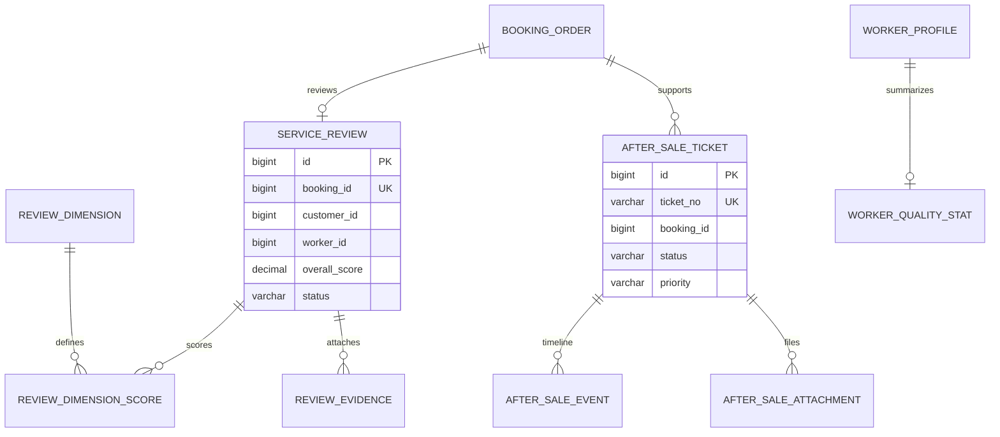

# 服务质量与售后模块详细设计

## 1. 模块定位

服务质量与售后模块管理服务评价、投诉、售后工单、服务事故、责任认定和人员质量统计，把客户反馈与服务人员、订单和履约证据关联起来。

核心原则：

> 售后工单负责形成结论，支付模块负责执行退款，订单模块负责订单事实。

任何一个模块都不能通过售后工单直接改写订单主状态或支付记录。

## 2. 已确定的业务决策

1. 只有已完成订单可以评价。
2. 每个订单最多一条有效评价。
3. 评价包含综合分和多个维度分。
4. 评价提交后不能无痕修改。
5. 售后工单和退款记录分开。
6. 售后工单可以关联履约异常和服务证据。
7. 退款审批通过后调用支付模块执行。
8. 返工不直接复用原订单，未来通过新订单或返工任务实现。
9. 人员质量指标采用汇总表，不实时全量扫描评价。
10. 首版不做复杂信用分和自动责任判定。
11. 运营隐藏违规评价必须保留原始记录和审计。
12. 服务事故和普通客户投诉都可以形成售后工单。

## 3. 模块边界

### 3.1 本模块负责

- 订单评价。
- 评价维度。
- 评价附件。
- 售后工单。
- 售后事件时间线。
- 售后附件。
- 服务事故和责任认定。
- 人员质量指标汇总。

### 3.2 本模块不负责

- 修改订单主状态。
- 修改支付和退款流水。
- 直接执行退款。
- 处理排班和改派。
- 管理服务履约过程。
- 计算人员工资。

## 4. 角色与权限

### 4.1 消费者

- 对已完成订单提交评价。
- 提交售后工单和附件。
- 查看自己的工单进度。
- 确认或拒绝售后处理方案。

### 4.2 服务人员

- 查看与本人相关的评价摘要。
- 查看需要本人说明的售后工单。
- 不能删除评价或关闭工单。

### 4.3 运营人员

- 受理和分配售后工单。
- 查看履约证据和客户附件。
- 记录处理过程。
- 判断退款、返工或补偿方案。
- 进行责任认定。
- 敏感操作写审计。

### 4.4 系统

- 生成人员质量指标。
- 发送售后状态提醒。
- 标记超时工单。

## 5. 评价模型

### 5.1 评价状态

```text
VISIBLE
HIDDEN
```

| 状态 | 说明 |
| --- | --- |
| `VISIBLE` | 正常展示 |
| `HIDDEN` | 违规或敏感内容被隐藏 |

隐藏不删除评价，保留原始内容和操作记录。

### 5.2 评价维度

首版维度：

```text
SERVICE
ATTITUDE
QUALITY
PUNCTUALITY
```

每个维度评分 1 至 5 分，支持一位小数。

综合分由各维度加权或简单平均计算。首版建议简单平均，规则可配置。

### 5.3 评价规则

- 订单状态必须为 `COMPLETED`。
- 每个订单最多一条有效评价。
- 评价人必须是订单客户。
- 不能评价未完成或取消订单。
- 可以上传图片附件。
- 评价提交后不能直接修改，可申请隐藏。
- 人员评分由汇总任务更新。

## 6. 售后工单

### 6.1 工单类型

```text
QUALITY_COMPLAINT
LATE_ARRIVAL
DAMAGE
REWORK
REFUND_REQUEST
SERVICE_ATTITUDE
OTHER
```

### 6.2 工单优先级

```text
LOW
NORMAL
HIGH
URGENT
```

### 6.3 工单状态

```text
SUBMITTED
PROCESSING
PENDING_CUSTOMER
PENDING_WORKER
PENDING_REVIEW
RESOLVED
REJECTED
CLOSED
```

状态转换示例：

```text
SUBMITTED -> PROCESSING
PROCESSING -> PENDING_CUSTOMER
PROCESSING -> PENDING_WORKER
PROCESSING -> PENDING_REVIEW
PENDING_* -> PROCESSING
PROCESSING -> RESOLVED
PROCESSING -> REJECTED
RESOLVED -> CLOSED
```

### 6.4 售后处理结果

```text
REFUND
PARTIAL_REFUND
REWORK
COMPENSATION
EXPLANATION
NO_ACTION
```

首版建议支持：

```text
REFUND
REWORK
EXPLANATION
NO_ACTION
```

### 6.5 责任认定

```text
UNDETERMINED
COMPANY
WORKER
CUSTOMER
SHARED
NONE
```

责任认定只是业务记录，不自动扣款、停职或修改工资。

## 7. 售后流程

```text
客户提交工单
-> 校验订单和客户归属
-> 关联履约记录及异常
-> 设置优先级和处理时限
-> 运营受理
-> 收集客户、人员和证据
-> 形成处理方案
-> 客户确认或运营审核
-> 调用退款、返工或订单服务
-> 关闭工单
```

规则：

- 工单必须关联订单。
- 若发生退款，工单保存退款记录 ID，但不直接改退款表。
- 返工需要新订单或返工任务，不复用原履约记录。
- 关闭工单必须写明处理结果。
- 未解决工单不能静默关闭。
- 客户和运营都有处理时限提醒。

## 8. 人员质量汇总

汇总字段：

```text
review_count
average_rating
completed_order_count
complaint_count
late_count
rework_count
last_calculated_at
```

更新方式：

- 评价提交后发送质量事件。
- 售后完成或责任认定后发送质量事件。
- 定时任务重算人员统计。
- 订单完成事件更新完成订单数。

人员质量汇总只供派单评分和运营查看，不作为自动处罚依据。

## 9. 领域模型



## 10. 数据库规范

- MySQL 8.0，InnoDB，`utf8mb4`。
- 主键使用 `BIGINT UNSIGNED` 自增。
- 时间使用 `DATETIME(3)`。
- 评分使用 `DECIMAL(3,2)`。
- 工单和评价不物理删除。
- 评价附件和售后附件使用私有文件模块。
- 订单、人员、履约和退款 ID 使用跨模块逻辑外键。
- 质量汇总表允许重算，不作为资金或订单事实来源。

表清单：

| 表名 | 用途 |
| --- | --- |
| `review_dimension` | 评价维度字典 |
| `service_review` | 订单评价 |
| `review_dimension_score` | 评价各维度分数 |
| `review_evidence` | 评价图片 |
| `after_sale_ticket` | 售后工单 |
| `after_sale_event` | 工单时间线 |
| `after_sale_attachment` | 售后附件 |
| `worker_quality_stat` | 人员质量汇总 |

## 11. MySQL 表结构

### 11.1 评价维度表

```sql
CREATE TABLE review_dimension (
    dimension_code VARCHAR(32) NOT NULL,
    dimension_name VARCHAR(64) NOT NULL,
    max_score DECIMAL(3,2) NOT NULL DEFAULT 5.00,
    weight DECIMAL(5,4) NOT NULL DEFAULT 0.2500,
    sort_order INT NOT NULL DEFAULT 0,
    status VARCHAR(16) NOT NULL DEFAULT 'ACTIVE',
    created_by_account_id BIGINT UNSIGNED NULL,
    updated_by_account_id BIGINT UNSIGNED NULL,
    version BIGINT UNSIGNED NOT NULL DEFAULT 0,
    created_at DATETIME(3) NOT NULL DEFAULT CURRENT_TIMESTAMP(3),
    updated_at DATETIME(3) NOT NULL DEFAULT CURRENT_TIMESTAMP(3)
        ON UPDATE CURRENT_TIMESTAMP(3),
    PRIMARY KEY (dimension_code),
    CONSTRAINT chk_review_dimension_score
        CHECK (max_score > 0),
    CONSTRAINT chk_review_dimension_weight
        CHECK (weight >= 0 AND weight <= 1),
    CONSTRAINT chk_review_dimension_status
        CHECK (status IN ('ACTIVE', 'DISABLED'))
) ENGINE=InnoDB DEFAULT CHARSET=utf8mb4 COLLATE=utf8mb4_0900_ai_ci
  COMMENT='评价维度';
```

初始化：

```sql
INSERT INTO review_dimension
    (dimension_code, dimension_name, max_score, weight, sort_order)
VALUES
    ('SERVICE', '服务效果', 5.00, 0.2500, 10),
    ('ATTITUDE', '服务态度', 5.00, 0.2500, 20),
    ('QUALITY', '服务质量', 5.00, 0.2500, 30),
    ('PUNCTUALITY', '准时上门', 5.00, 0.2500, 40);
```

### 11.2 订单评价表

```sql
CREATE TABLE service_review (
    id BIGINT UNSIGNED NOT NULL AUTO_INCREMENT,
    review_no VARCHAR(32) NOT NULL,
    booking_id BIGINT UNSIGNED NOT NULL,
    customer_id BIGINT UNSIGNED NOT NULL,
    worker_id BIGINT UNSIGNED NOT NULL,
    overall_score DECIMAL(3,2) NOT NULL,
    content VARCHAR(2000) NULL,
    status VARCHAR(16) NOT NULL DEFAULT 'VISIBLE',
    hidden_reason VARCHAR(500) NULL,
    hidden_by_account_id BIGINT UNSIGNED NULL,
    hidden_at DATETIME(3) NULL,
    created_by_account_id BIGINT UNSIGNED NULL,
    updated_by_account_id BIGINT UNSIGNED NULL,
    version BIGINT UNSIGNED NOT NULL DEFAULT 0,
    created_at DATETIME(3) NOT NULL DEFAULT CURRENT_TIMESTAMP(3),
    updated_at DATETIME(3) NOT NULL DEFAULT CURRENT_TIMESTAMP(3)
        ON UPDATE CURRENT_TIMESTAMP(3),
    PRIMARY KEY (id),
    UNIQUE KEY uk_service_review_no (review_no),
    UNIQUE KEY uk_service_review_booking (booking_id),
    KEY idx_service_review_worker
        (worker_id, status, created_at),
    KEY idx_service_review_score
        (worker_id, overall_score),
    CONSTRAINT fk_service_review_hidden_by
        FOREIGN KEY (hidden_by_account_id) REFERENCES account (id)
        ON UPDATE RESTRICT ON DELETE RESTRICT,
    CONSTRAINT chk_service_review_score
        CHECK (overall_score BETWEEN 0 AND 5),
    CONSTRAINT chk_service_review_status
        CHECK (status IN ('VISIBLE', 'HIDDEN')),
    CONSTRAINT chk_service_review_hidden
        CHECK (
            status = 'VISIBLE'
            OR hidden_reason IS NOT NULL
        )
) ENGINE=InnoDB DEFAULT CHARSET=utf8mb4 COLLATE=utf8mb4_0900_ai_ci
  COMMENT='订单评价';
```

### 11.3 评价维度分数表

```sql
CREATE TABLE review_dimension_score (
    id BIGINT UNSIGNED NOT NULL AUTO_INCREMENT,
    review_id BIGINT UNSIGNED NOT NULL,
    dimension_code VARCHAR(32) NOT NULL,
    score DECIMAL(3,2) NOT NULL,
    created_at DATETIME(3) NOT NULL DEFAULT CURRENT_TIMESTAMP(3),
    PRIMARY KEY (id),
    UNIQUE KEY uk_review_dimension_score
        (review_id, dimension_code),
    KEY idx_review_dimension_code
        (dimension_code, score),
    CONSTRAINT fk_review_dimension_score_review
        FOREIGN KEY (review_id) REFERENCES service_review (id)
        ON UPDATE RESTRICT ON DELETE RESTRICT,
    CONSTRAINT fk_review_dimension_score_dimension
        FOREIGN KEY (dimension_code) REFERENCES review_dimension (dimension_code)
        ON UPDATE RESTRICT ON DELETE RESTRICT,
    CONSTRAINT chk_review_dimension_score_value
        CHECK (score BETWEEN 0 AND 5)
) ENGINE=InnoDB DEFAULT CHARSET=utf8mb4 COLLATE=utf8mb4_0900_ai_ci
  COMMENT='评价维度分数';
```

### 11.4 评价附件表

```sql
CREATE TABLE review_evidence (
    id BIGINT UNSIGNED NOT NULL AUTO_INCREMENT,
    review_id BIGINT UNSIGNED NOT NULL,
    file_id BIGINT UNSIGNED NOT NULL,
    sort_order INT NOT NULL DEFAULT 0,
    created_at DATETIME(3) NOT NULL DEFAULT CURRENT_TIMESTAMP(3),
    PRIMARY KEY (id),
    UNIQUE KEY uk_review_evidence_file (file_id),
    KEY idx_review_evidence_review
        (review_id, sort_order),
    CONSTRAINT fk_review_evidence_review
        FOREIGN KEY (review_id) REFERENCES service_review (id)
        ON UPDATE RESTRICT ON DELETE RESTRICT
) ENGINE=InnoDB DEFAULT CHARSET=utf8mb4 COLLATE=utf8mb4_0900_ai_ci
  COMMENT='评价附件';
```

### 11.5 售后工单表

```sql
CREATE TABLE after_sale_ticket (
    id BIGINT UNSIGNED NOT NULL AUTO_INCREMENT,
    ticket_no VARCHAR(32) NOT NULL,
    booking_id BIGINT UNSIGNED NOT NULL,
    service_record_id BIGINT UNSIGNED NULL,
    customer_id BIGINT UNSIGNED NOT NULL,
    worker_id BIGINT UNSIGNED NULL,
    ticket_type VARCHAR(32) NOT NULL,
    description VARCHAR(2000) NOT NULL,
    priority VARCHAR(16) NOT NULL DEFAULT 'NORMAL',
    status VARCHAR(24) NOT NULL DEFAULT 'SUBMITTED',
    handler_id BIGINT UNSIGNED NULL,
    due_at DATETIME(3) NULL,
    resolution_type VARCHAR(24) NULL,
    resolution_text VARCHAR(2000) NULL,
    responsibility VARCHAR(24) NOT NULL DEFAULT 'UNDETERMINED',
    refund_id BIGINT UNSIGNED NULL,
    rework_booking_id BIGINT UNSIGNED NULL,
    created_by_account_id BIGINT UNSIGNED NULL,
    updated_by_account_id BIGINT UNSIGNED NULL,
    version BIGINT UNSIGNED NOT NULL DEFAULT 0,
    submitted_at DATETIME(3) NOT NULL DEFAULT CURRENT_TIMESTAMP(3),
    resolved_at DATETIME(3) NULL,
    closed_at DATETIME(3) NULL,
    created_at DATETIME(3) NOT NULL DEFAULT CURRENT_TIMESTAMP(3),
    updated_at DATETIME(3) NOT NULL DEFAULT CURRENT_TIMESTAMP(3)
        ON UPDATE CURRENT_TIMESTAMP(3),
    PRIMARY KEY (id),
    UNIQUE KEY uk_after_sale_ticket_no (ticket_no),
    KEY idx_after_sale_ticket_booking
        (booking_id, status),
    KEY idx_after_sale_ticket_handler
        (handler_id, status, due_at),
    KEY idx_after_sale_ticket_customer
        (customer_id, submitted_at),
    CONSTRAINT fk_after_sale_ticket_handler
        FOREIGN KEY (handler_id) REFERENCES account (id)
        ON UPDATE RESTRICT ON DELETE RESTRICT,
    CONSTRAINT chk_after_sale_ticket_type
        CHECK (ticket_type IN (
            'QUALITY_COMPLAINT',
            'LATE_ARRIVAL',
            'DAMAGE',
            'REWORK',
            'REFUND_REQUEST',
            'SERVICE_ATTITUDE',
            'OTHER'
        )),
    CONSTRAINT chk_after_sale_ticket_priority
        CHECK (priority IN ('LOW', 'NORMAL', 'HIGH', 'URGENT')),
    CONSTRAINT chk_after_sale_ticket_status
        CHECK (status IN (
            'SUBMITTED',
            'PROCESSING',
            'PENDING_CUSTOMER',
            'PENDING_WORKER',
            'PENDING_REVIEW',
            'RESOLVED',
            'REJECTED',
            'CLOSED'
        )),
    CONSTRAINT chk_after_sale_ticket_resolution
        CHECK (resolution_type IS NULL OR resolution_type IN (
            'REFUND',
            'PARTIAL_REFUND',
            'REWORK',
            'COMPENSATION',
            'EXPLANATION',
            'NO_ACTION'
        )),
    CONSTRAINT chk_after_sale_ticket_responsibility
        CHECK (responsibility IN (
            'UNDETERMINED',
            'COMPANY',
            'WORKER',
            'CUSTOMER',
            'SHARED',
            'NONE'
        )),
    CONSTRAINT chk_after_sale_ticket_resolved
        CHECK (
            status NOT IN ('RESOLVED', 'CLOSED')
            OR resolution_text IS NOT NULL
        )
) ENGINE=InnoDB DEFAULT CHARSET=utf8mb4 COLLATE=utf8mb4_0900_ai_ci
  COMMENT='售后工单';
```

### 11.6 售后事件表

```sql
CREATE TABLE after_sale_event (
    id BIGINT UNSIGNED NOT NULL AUTO_INCREMENT,
    ticket_id BIGINT UNSIGNED NOT NULL,
    event_type VARCHAR(32) NOT NULL,
    from_status VARCHAR(24) NULL,
    to_status VARCHAR(24) NULL,
    description VARCHAR(1000) NULL,
    operator_account_id BIGINT UNSIGNED NULL,
    operator_role VARCHAR(24) NULL,
    created_at DATETIME(3) NOT NULL DEFAULT CURRENT_TIMESTAMP(3),
    PRIMARY KEY (id),
    KEY idx_after_sale_event_ticket
        (ticket_id, created_at),
    CONSTRAINT fk_after_sale_event_ticket
        FOREIGN KEY (ticket_id) REFERENCES after_sale_ticket (id)
        ON UPDATE RESTRICT ON DELETE RESTRICT,
    CONSTRAINT fk_after_sale_event_operator
        FOREIGN KEY (operator_account_id) REFERENCES account (id)
        ON UPDATE RESTRICT ON DELETE RESTRICT
) ENGINE=InnoDB DEFAULT CHARSET=utf8mb4 COLLATE=utf8mb4_0900_ai_ci
  COMMENT='售后工单时间线';
```

### 11.7 售后附件表

```sql
CREATE TABLE after_sale_attachment (
    id BIGINT UNSIGNED NOT NULL AUTO_INCREMENT,
    ticket_id BIGINT UNSIGNED NOT NULL,
    file_id BIGINT UNSIGNED NOT NULL,
    attachment_type VARCHAR(24) NOT NULL DEFAULT 'CUSTOMER_EVIDENCE',
    uploaded_by_account_id BIGINT UNSIGNED NOT NULL,
    created_at DATETIME(3) NOT NULL DEFAULT CURRENT_TIMESTAMP(3),
    PRIMARY KEY (id),
    UNIQUE KEY uk_after_sale_attachment_file (file_id),
    KEY idx_after_sale_attachment_ticket
        (ticket_id, created_at),
    CONSTRAINT fk_after_sale_attachment_ticket
        FOREIGN KEY (ticket_id) REFERENCES after_sale_ticket (id)
        ON UPDATE RESTRICT ON DELETE RESTRICT,
    CONSTRAINT fk_after_sale_attachment_uploader
        FOREIGN KEY (uploaded_by_account_id) REFERENCES account (id)
        ON UPDATE RESTRICT ON DELETE RESTRICT,
    CONSTRAINT chk_after_sale_attachment_type
        CHECK (attachment_type IN (
            'CUSTOMER_EVIDENCE',
            'HANDLER_EVIDENCE',
            'RESOLUTION_DOCUMENT',
            'OTHER'
        ))
) ENGINE=InnoDB DEFAULT CHARSET=utf8mb4 COLLATE=utf8mb4_0900_ai_ci
  COMMENT='售后附件';
```

### 11.8 人员质量汇总表

```sql
CREATE TABLE worker_quality_stat (
    id BIGINT UNSIGNED NOT NULL AUTO_INCREMENT,
    worker_id BIGINT UNSIGNED NOT NULL,
    review_count INT UNSIGNED NOT NULL DEFAULT 0,
    average_rating DECIMAL(3,2) NOT NULL DEFAULT 5.00,
    completed_order_count INT UNSIGNED NOT NULL DEFAULT 0,
    complaint_count INT UNSIGNED NOT NULL DEFAULT 0,
    late_count INT UNSIGNED NOT NULL DEFAULT 0,
    rework_count INT UNSIGNED NOT NULL DEFAULT 0,
    last_calculated_at DATETIME(3) NOT NULL DEFAULT CURRENT_TIMESTAMP(3),
    created_by_account_id BIGINT UNSIGNED NULL,
    updated_by_account_id BIGINT UNSIGNED NULL,
    version BIGINT UNSIGNED NOT NULL DEFAULT 0,
    created_at DATETIME(3) NOT NULL DEFAULT CURRENT_TIMESTAMP(3),
    updated_at DATETIME(3) NOT NULL DEFAULT CURRENT_TIMESTAMP(3)
        ON UPDATE CURRENT_TIMESTAMP(3),
    PRIMARY KEY (id),
    UNIQUE KEY uk_worker_quality_stat_worker (worker_id),
    KEY idx_worker_quality_rating (average_rating),
    KEY idx_worker_quality_complaints (complaint_count),
    CONSTRAINT chk_worker_quality_rating
        CHECK (average_rating BETWEEN 0 AND 5),
    CONSTRAINT chk_worker_quality_counts
        CHECK (
            review_count >= 0
            AND completed_order_count >= 0
            AND complaint_count >= 0
            AND late_count >= 0
            AND rework_count >= 0
        )
) ENGINE=InnoDB DEFAULT CHARSET=utf8mb4 COLLATE=utf8mb4_0900_ai_ci
  COMMENT='人员质量统计';
```

## 12. 索引与约束

关键唯一约束：

```text
service_review.review_no
service_review.booking_id
review_dimension_score(review_id, dimension_code)
review_evidence.file_id
after_sale_ticket.ticket_no
after_sale_attachment.file_id
worker_quality_stat.worker_id
```

业务约束：

- 订单必须完成才能评价。
- 评价维度必须完整。
- 工单关闭前必须有处理结论。
- 退款结论必须关联退款记录。
- 返工必须关联新的履约订单或返工任务。
- 同一文件不能重复绑定到同一业务。

## 13. 事务与并发

| 用例 | 事务范围 |
| --- | --- |
| 提交评价 | 写评价、维度分、附件、更新订单评价摘要 |
| 隐藏评价 | 更新评价状态、写审计 |
| 创建售后 | 创建工单和首条时间线、创建附件关系 |
| 受理工单 | 更新处理人、状态、时间线 |
| 处理退款结论 | 更新工单、创建退款请求、关联退款 ID |
| 关闭工单 | 更新状态、写时间线、写审计 |
| 更新质量指标 | 汇总任务或事件消费，幂等更新 |

并发要求：

- 一个订单只能成功评价一次。
- 工单状态更新使用乐观锁或条件更新。
- 退款请求生成需要幂等键。
- 质量汇总任务可以重复执行，但结果幂等。

## 14. 接口设计

### 14.1 消费者接口

```text
POST /api/v1/customer/bookings/{orderNo}/reviews
GET  /api/v1/customer/reviews
POST /api/v1/customer/bookings/{orderNo}/after-sales
GET  /api/v1/customer/after-sales
GET  /api/v1/customer/after-sales/{ticketNo}
POST /api/v1/customer/after-sales/{ticketNo}/reply
POST /api/v1/customer/after-sales/{ticketNo}/accept-resolution
```

### 14.2 服务人员接口

```text
GET  /api/v1/worker/reviews/summary
GET  /api/v1/worker/after-sales
POST /api/v1/worker/after-sales/{ticketNo}/statement
```

### 14.3 运营接口

```text
GET  /api/v1/operator/after-sales
GET  /api/v1/operator/after-sales/{ticketNo}
POST /api/v1/operator/after-sales/{ticketNo}/assign
POST /api/v1/operator/after-sales/{ticketNo}/processing
POST /api/v1/operator/after-sales/{ticketNo}/resolve
POST /api/v1/operator/after-sales/{ticketNo}/reject
POST /api/v1/operator/after-sales/{ticketNo}/close
POST /api/v1/operator/reviews/{reviewNo}/hide
POST /api/v1/operator/quality/recalculate
```

### 14.4 评价请求

```json
{
  "scores": {
    "SERVICE": 5,
    "ATTITUDE": 4.5,
    "QUALITY": 5,
    "PUNCTUALITY": 4
  },
  "content": "服务细致，沟通顺畅"
}
```

## 15. 与其他模块协作

### 15.1 订单

- 订单完成事件开放评价和售后。
- 售后只更新订单 `after_sale_status` 摘要。

### 15.2 履约

- 售后可以读取检查项、照片和异常。
- 服务事故关联履约记录。

### 15.3 支付

- 售后结论为退款或部分退款时创建退款请求。
- 支付模块不判断售后责任。

### 15.4 人员

- 质量和评价汇总供派单评分和人员展示。
- 不自动改变人员资格，暂停需要运营单独执行。

### 15.5 通知

- 工单受理、待补充、处理完成和退款状态创建通知任务。

## 16. 错误码

```text
REVIEW_NOT_ALLOWED
REVIEW_ALREADY_EXISTS
REVIEW_DIMENSION_INVALID
REVIEW_SCORE_INVALID
REVIEW_NOT_FOUND
AFTER_SALE_NOT_ALLOWED
AFTER_SALE_NOT_FOUND
AFTER_SALE_NOT_OWNED
AFTER_SALE_STATUS_CONFLICT
AFTER_SALE_RESOLUTION_REQUIRED
AFTER_SALE_REFUND_LINK_REQUIRED
AFTER_SALE_ATTACHMENT_INVALID
AFTER_SALE_SLA_EXPIRED
QUALITY_STAT_RECALCULATION_FAILED
```

## 17. 测试清单

### 17.1 单元测试

- 评价维度权重和综合分。
- 评价状态。
- 售后状态转换。
- 责任认定和解决方式。
- 质量指标计算。
- 工单 SLA 超时判断。

### 17.2 集成测试

- 未完成订单不能评价。
- 同一订单不能重复评价。
- 隐藏评价不影响统计口径，按规则处理。
- 售后工单只能由客户本人发起。
- 退款解决方式生成退款请求。
- 工单关闭必须填写结论。
- 质量汇总任务重复执行结果一致。
- 服务人员只能查看自己的售后记录。
- 客户不能查看他人附件。

### 17.3 安全测试

- 评价内容防脚本注入。
- 附件访问受控。
- 运营隐藏评价写审计。
- 售后责任认定不直接泄露内部员工信息。

## 18. MVP 与后续扩展

### 18.1 MVP 范围

- 已完成订单评价。
- 多维度评分。
- 评价图片。
- 售后工单和附件。
- 工单时间线。
- 部分处理结果。
- 人员质量汇总。
- 运营隐藏评价。

### 18.2 后续扩展

- 自动责任判定。
- 信用分。
- 返工任务。
- 补偿金。
- 投诉 SLA 自动升级。
- 客服回复模板。
- 质检抽查。
- 申诉流程。

## 19. 实现顺序

```text
review_dimension
-> service_review 和维度分
-> review_evidence
-> after_sale_ticket
-> after_sale_event
-> after_sale_attachment
-> 退款联动
-> worker_quality_stat
-> 测试和权限
```

## 20. 仍需确认的问题

1. 首版是否支持部分退款。
2. 返工是否计入人员完成订单数。
3. 售后工单默认 SLA 是 24 小时还是 48 小时。
4. 评价是否需要运营审核后才展示。
