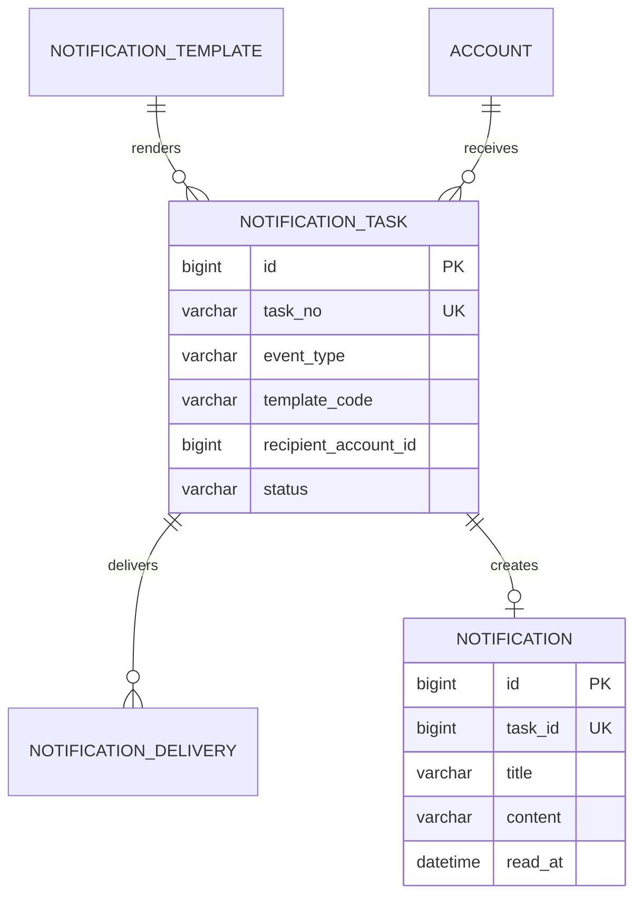

# 通知模块详细设计

## 1. 模块定位

通知模块在订单、派单、支付、履约和售后事件发生后，向消费者、服务人员和运营人员发送站内消息及后续可扩展的外部通知。

核心原则：

> 通知是业务副产物，通知失败不能回滚订单、支付和履约主事务。

## 2. 已确定的业务决策

1. 首版只实现站内消息。
2. 短信、微信和 WebSocket 作为后续渠道。
3. 业务模块提交事件，不直接写通知表。
4. 通知任务异步生成。
5. 同一事件、收件人和模板避免重复发送。
6. 通知正文不包含完整地址、手机号、证件号和支付凭证。
7. 模板内容需要版本化。
8. 任务失败可重试，超过阈值进入人工处理。
9. 用户支持已读和未读数量。
10. 首版不做营销推送。

## 3. 模块边界

### 3.1 本模块负责

- 通知模板。
- 通知任务。
- 站内消息。
- 渠道发送记录。
- 未读数量。
- 失败重试和去重。

### 3.2 本模块不负责

- 业务状态判断。
- 接收人权限判断之外的数据读取。
- 短信签名和模板报备。
- 营销活动。
- 聊天和客服会话。

## 4. 角色与收件人

### 4.1 消费者

- 接收订单、支付、改期、服务提醒、完成确认和售后消息。

### 4.2 服务人员

- 接收派单、改派、服务提醒和异常提醒。

### 4.3 运营人员

- 接收人工派单、支付异常、退款待审、售后升级和证书到期消息。

同一账号拥有多个角色时，通知任务必须指定收件角色。

## 5. 通知类型

```text
BOOKING_CREATED
BOOKING_PAYMENT_SUCCEEDED
BOOKING_PAYMENT_TIMEOUT
BOOKING_CANCELED
BOOKING_RESCHEDULED
ASSIGNMENT_RECEIVED
ASSIGNMENT_ACCEPTED
ASSIGNMENT_REJECTED
ASSIGNMENT_REASSIGNED
SERVICE_DEPARTED
SERVICE_STARTED
COMPLETION_CONFIRM_REQUIRED
REVIEW_REMINDER
AFTER_SALE_UPDATED
REFUND_UPDATED
CERTIFICATE_EXPIRING
MANUAL_DISPATCH_REQUIRED
```

## 6. 通知任务状态

```text
PENDING
PROCESSING
SENT
FAILED
CANCELED
```

状态转换：

```text
PENDING -> PROCESSING -> SENT
PROCESSING -> FAILED -> PENDING
PENDING -> CANCELED
```

规则：

- 任务处理使用条件更新。
- 重复事件由幂等键去重。
- 任务重试使用指数退避。
- 收件账号禁用或角色失效时可以取消任务。
- 任务失败不修改业务状态。

## 7. 通知渠道

首版：

```text
IN_APP
```

预留：

```text
SMS
WECHAT
EMAIL
WEBSOCKET
```

每个任务可以有多个渠道。首版只启用 `IN_APP`。

## 8. 模板设计

模板字段：

- 模板编码。
- 通知类型。
- 标题模板。
- 内容模板。
- 渠道。
- 优先级。
- 状态。
- 版本。

模板变量只允许业务编号和脱敏字段，例如：

```text
订单号：{orderNo}
服务日期：{serviceDate}
服务人员：{workerMaskedName}
```

禁止变量：

```text
完整地址
完整手机号
证件号
支付密钥
服务照片 URL
```

发送时如果找不到模板，任务进入 `FAILED`，不能发送纯拼接的敏感内容。

## 9. 事件处理流程

```text
业务事务提交
-> 写领域事件或通知事件
-> 通知消费者生成 notification_task
-> 定时调度器读取 PENDING
-> 解析模板和收件人
-> 生成站内 notification
-> 记录 delivery
-> 标记 SENT
```

如果业务模块没有发布事件，不得直接调用通知表写入。

## 10. 领域模型



## 11. 数据库规范

- MySQL 8.0，InnoDB，`utf8mb4`。
- 主键使用 `BIGINT UNSIGNED` 自增。
- 任务、消息和发送记录使用独立业务编号。
- 时间使用 `DATETIME(3)`。
- 任务和消息不物理删除，可按保留策略归档。
- 任务幂等键必须唯一。
- 模板内容保存版本号。
- 通知正文不包含敏感明文。

表清单：

| 表名 | 用途 |
| --- | --- |
| `notification_template` | 通知模板 |
| `notification_task` | 异步通知任务 |
| `notification_delivery` | 渠道发送记录 |
| `notification` | 站内消息 |

## 12. MySQL 表结构

### 12.1 通知模板表

```sql
CREATE TABLE notification_template (
    template_code VARCHAR(64) NOT NULL,
    template_name VARCHAR(64) NOT NULL,
    event_type VARCHAR(64) NOT NULL,
    channel VARCHAR(16) NOT NULL,
    title_template VARCHAR(255) NOT NULL,
    content_template TEXT NOT NULL,
    priority VARCHAR(16) NOT NULL DEFAULT 'NORMAL',
    status VARCHAR(16) NOT NULL DEFAULT 'ACTIVE',
    version INT UNSIGNED NOT NULL DEFAULT 1,
    created_by_account_id BIGINT UNSIGNED NULL,
    updated_by_account_id BIGINT UNSIGNED NULL,
    created_at DATETIME(3) NOT NULL DEFAULT CURRENT_TIMESTAMP(3),
    updated_at DATETIME(3) NOT NULL DEFAULT CURRENT_TIMESTAMP(3)
        ON UPDATE CURRENT_TIMESTAMP(3),
    PRIMARY KEY (template_code),
    KEY idx_notification_template_event
        (event_type, channel, status),
    CONSTRAINT chk_notification_template_channel
        CHECK (channel IN ('IN_APP', 'SMS', 'WECHAT', 'EMAIL', 'WEBSOCKET')),
    CONSTRAINT chk_notification_template_priority
        CHECK (priority IN ('LOW', 'NORMAL', 'HIGH', 'URGENT')),
    CONSTRAINT chk_notification_template_status
        CHECK (status IN ('ACTIVE', 'DISABLED'))
) ENGINE=InnoDB DEFAULT CHARSET=utf8mb4 COLLATE=utf8mb4_0900_ai_ci
  COMMENT='通知模板';
```

### 12.2 通知任务表

```sql
CREATE TABLE notification_task (
    id BIGINT UNSIGNED NOT NULL AUTO_INCREMENT,
    task_no VARCHAR(32) NOT NULL,
    source_event_id VARCHAR(64) NOT NULL,
    event_type VARCHAR(64) NOT NULL,
    template_code VARCHAR(64) NOT NULL,
    recipient_account_id BIGINT UNSIGNED NOT NULL,
    recipient_role VARCHAR(24) NOT NULL,
    channel VARCHAR(16) NOT NULL DEFAULT 'IN_APP',
    payload_json JSON NOT NULL,
    dedupe_key VARCHAR(128) NOT NULL,
    status VARCHAR(16) NOT NULL DEFAULT 'PENDING',
    priority VARCHAR(16) NOT NULL DEFAULT 'NORMAL',
    retry_count INT UNSIGNED NOT NULL DEFAULT 0,
    max_retry_count INT UNSIGNED NOT NULL DEFAULT 5,
    next_retry_at DATETIME(3) NULL,
    last_error VARCHAR(500) NULL,
    scheduled_at DATETIME(3) NOT NULL DEFAULT CURRENT_TIMESTAMP(3),
    sent_at DATETIME(3) NULL,
    created_by_account_id BIGINT UNSIGNED NULL,
    updated_by_account_id BIGINT UNSIGNED NULL,
    version BIGINT UNSIGNED NOT NULL DEFAULT 0,
    created_at DATETIME(3) NOT NULL DEFAULT CURRENT_TIMESTAMP(3),
    updated_at DATETIME(3) NOT NULL DEFAULT CURRENT_TIMESTAMP(3)
        ON UPDATE CURRENT_TIMESTAMP(3),
    PRIMARY KEY (id),
    UNIQUE KEY uk_notification_task_no (task_no),
    UNIQUE KEY uk_notification_task_dedupe (dedupe_key),
    KEY idx_notification_task_pending
        (status, next_retry_at, scheduled_at),
    KEY idx_notification_task_recipient
        (recipient_account_id, created_at),
    CONSTRAINT fk_notification_task_template
        FOREIGN KEY (template_code) REFERENCES notification_template (template_code)
        ON UPDATE RESTRICT ON DELETE RESTRICT,
    CONSTRAINT fk_notification_task_account
        FOREIGN KEY (recipient_account_id) REFERENCES account (id)
        ON UPDATE RESTRICT ON DELETE RESTRICT,
    CONSTRAINT chk_notification_task_channel
        CHECK (channel IN ('IN_APP', 'SMS', 'WECHAT', 'EMAIL', 'WEBSOCKET')),
    CONSTRAINT chk_notification_task_status
        CHECK (status IN ('PENDING', 'PROCESSING', 'SENT', 'FAILED', 'CANCELED')),
    CONSTRAINT chk_notification_task_retry
        CHECK (retry_count <= max_retry_count)
) ENGINE=InnoDB DEFAULT CHARSET=utf8mb4 COLLATE=utf8mb4_0900_ai_ci
  COMMENT='异步通知任务';
```

`dedupe_key` 建议由以下内容组成：

```text
source_event_id + recipient_account_id + template_code + channel
```

### 12.3 通知发送记录表

```sql
CREATE TABLE notification_delivery (
    id BIGINT UNSIGNED NOT NULL AUTO_INCREMENT,
    task_id BIGINT UNSIGNED NOT NULL,
    channel VARCHAR(16) NOT NULL,
    attempt_no INT UNSIGNED NOT NULL,
    status VARCHAR(16) NOT NULL,
    provider_message_id VARCHAR(128) NULL,
    error_message VARCHAR(500) NULL,
    sent_at DATETIME(3) NULL,
    created_at DATETIME(3) NOT NULL DEFAULT CURRENT_TIMESTAMP(3),
    PRIMARY KEY (id),
    UNIQUE KEY uk_notification_delivery_attempt
        (task_id, channel, attempt_no),
    KEY idx_notification_delivery_status
        (status, created_at),
    CONSTRAINT fk_notification_delivery_task
        FOREIGN KEY (task_id) REFERENCES notification_task (id)
        ON UPDATE RESTRICT ON DELETE RESTRICT,
    CONSTRAINT chk_notification_delivery_channel
        CHECK (channel IN ('IN_APP', 'SMS', 'WECHAT', 'EMAIL', 'WEBSOCKET')),
    CONSTRAINT chk_notification_delivery_status
        CHECK (status IN ('SENDING', 'SENT', 'FAILED', 'SKIPPED'))
) ENGINE=InnoDB DEFAULT CHARSET=utf8mb4 COLLATE=utf8mb4_0900_ai_ci
  COMMENT='通知渠道发送记录';
```

### 12.4 站内消息表

```sql
CREATE TABLE notification (
    id BIGINT UNSIGNED NOT NULL AUTO_INCREMENT,
    notification_no VARCHAR(32) NOT NULL,
    task_id BIGINT UNSIGNED NOT NULL,
    recipient_account_id BIGINT UNSIGNED NOT NULL,
    title VARCHAR(255) NOT NULL,
    content VARCHAR(2000) NOT NULL,
    business_type VARCHAR(32) NULL,
    business_id VARCHAR(64) NULL,
    priority VARCHAR(16) NOT NULL DEFAULT 'NORMAL',
    read_at DATETIME(3) NULL,
    expires_at DATETIME(3) NULL,
    created_by_account_id BIGINT UNSIGNED NULL,
    updated_by_account_id BIGINT UNSIGNED NULL,
    version BIGINT UNSIGNED NOT NULL DEFAULT 0,
    created_at DATETIME(3) NOT NULL DEFAULT CURRENT_TIMESTAMP(3),
    updated_at DATETIME(3) NOT NULL DEFAULT CURRENT_TIMESTAMP(3)
        ON UPDATE CURRENT_TIMESTAMP(3),
    PRIMARY KEY (id),
    UNIQUE KEY uk_notification_no (notification_no),
    UNIQUE KEY uk_notification_task (task_id),
    KEY idx_notification_inbox
        (recipient_account_id, read_at, created_at),
    CONSTRAINT fk_notification_task
        FOREIGN KEY (task_id) REFERENCES notification_task (id)
        ON UPDATE RESTRICT ON DELETE RESTRICT,
    CONSTRAINT fk_notification_recipient
        FOREIGN KEY (recipient_account_id) REFERENCES account (id)
        ON UPDATE RESTRICT ON DELETE RESTRICT,
    CONSTRAINT chk_notification_priority
        CHECK (priority IN ('LOW', 'NORMAL', 'HIGH', 'URGENT'))
) ENGINE=InnoDB DEFAULT CHARSET=utf8mb4 COLLATE=utf8mb4_0900_ai_ci
  COMMENT='站内通知';
```

## 13. 索引与约束

关键唯一约束：

```text
notification_task.task_no
notification_task.dedupe_key
notification_delivery(task_id, channel, attempt_no)
notification.notification_no
notification.task_id
```

高频索引：

```text
待发送任务：status + next_retry_at + scheduled_at
用户站内消息：recipient_account_id + read_at + created_at
任务收件人查询：recipient_account_id + created_at
发送失败分析：status + created_at
```

## 14. 事务和重试

| 用例 | 事务范围 |
| --- | --- |
| 业务事件生成任务 | 任务创建独立处理，失败不回滚业务 |
| 发送站内消息 | 创建通知、发送记录、更新任务状态 |
| 外部渠道发送 | 先写发送记录，再调用渠道 |
| 失败重试 | 条件更新重试次数和下次时间 |

重试规则：

```text
第 1 次：1 分钟后
第 2 次：5 分钟后
第 3 次：30 分钟后
第 4 次：2 小时后
第 5 次：进入 FAILED，等待人工处理
```

## 15. 接口设计

### 15.1 站内消息

```text
GET /api/v1/notifications
GET /api/v1/notifications/unread-count
PUT /api/v1/notifications/{notificationNo}/read
PUT /api/v1/notifications/read-all
```

### 15.2 内部接口

```text
POST /internal/notifications/tasks
POST /internal/notifications/tasks/{taskNo}/cancel
GET  /internal/notifications/tasks/{taskNo}
```

### 15.3 运营接口

```text
GET  /api/v1/operator/notification-tasks
GET  /api/v1/operator/notification-templates
PUT  /api/v1/operator/notification-templates/{templateCode}
POST /api/v1/operator/notification-tasks/{taskNo}/retry
```

## 16. 与其他模块协作

### 16.1 订单

- 创建、支付、取消、改期、完成和售后状态变化发送通知。

### 16.2 派单

- 收到派单、接受、拒绝、改派和人工待处理发送通知。

### 16.3 履约

- 出发、开始服务、完成申请和客户确认提醒。

### 16.4 支付和退款

- 支付成功、失败、退款审批和退款完成发送通知。

### 16.5 服务质量和人员

- 售后更新和证书到期发送通知。

## 17. 错误码

```text
NOTIFICATION_TEMPLATE_NOT_FOUND
NOTIFICATION_TEMPLATE_DISABLED
NOTIFICATION_TASK_NOT_FOUND
NOTIFICATION_TASK_DUPLICATE
NOTIFICATION_TASK_CANCELED
NOTIFICATION_RECIPIENT_DISABLED
NOTIFICATION_CHANNEL_DISABLED
NOTIFICATION_RENDER_ERROR
NOTIFICATION_SEND_FAILED
NOTIFICATION_RETRY_LIMIT_REACHED
NOTIFICATION_NOT_OWNED
```

## 18. 测试清单

### 18.1 单元测试

- 模板变量替换。
- 任务去重键。
- 任务状态转换。
- 重试退避计算。
- 收件角色校验。
- 敏感变量拦截。

### 18.2 集成测试

- 订单支付成功生成一次站内消息。
- 相同事件重复消费不重复发送。
- 通知失败不回滚支付。
- 任务重试后成功。
- 用户只能查看自己的消息。
- 未读数正确。
- 禁用账号不接收新消息。
- 模板缺失进入失败队列。

### 18.3 安全测试

- 消息正文不含完整地址和手机号。
- 邮箱、短信和微信渠道未配置时不能发送。
- 站内消息不能通过枚举 ID 越权读取。

## 19. MVP 与后续扩展

### 19.1 MVP 范围

- 站内消息。
- 通知模板。
- 通知任务。
- 去重和重试。
- 未读和已读。
- 接单、订单、支付、履约和售后提醒。

### 19.2 后续扩展

- 短信。
- 微信服务通知。
- WebSocket 实时推送。
- 邮件。
- 用户通知偏好。
- 营销消息。
- 通知运营看板。

## 20. 实现顺序

```text
notification_template
-> notification_task
-> notification_delivery
-> notification
-> 事件消费
-> 模板渲染
-> 重试和去重
-> 未读和已读接口
```

## 21. 仍需确认的问题

1. 首版是否只做站内消息。
2. 哪些事件必须通知运营人员。
3. 是否需要出发和到达提醒。
4. 站内消息保留多长时间。
