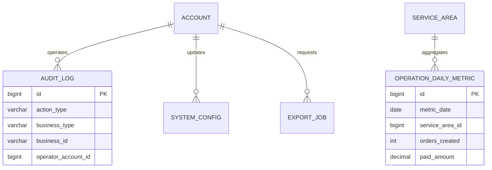

# 运营、统计与审计模块详细设计

## 1. 模块定位

运营、统计与审计模块为自营家政公司提供运营工作台、订单和派单监控、异常处理入口、经营统计、系统配置、敏感数据导出和审计日志。

核心原则：

> 运营模块负责聚合和编排，不复制其他模块的业务规则，也不直接修改其他模块的数据表。

## 2. 已确定的业务决策

1. 采用单公司自营模式，不按商家维度统计。
2. 首版支持一个公司下的多个服务区域。
3. 运营人员按服务区域划分数据范围。
4. 所有业务操作调用对应模块公开命令。
5. 统计使用按日聚合读模型，不实时全量扫描核心表。
6. 审计日志只追加，不修改、不删除。
7. 敏感数据导出必须异步、可审计并设置过期时间。
8. 系统配置不保存密码、Token 和支付密钥。
9. 高风险操作审计失败时，业务操作不能成功。
10. 运营页面不直接暴露完整客户隐私。

## 3. 模块边界

### 3.1 本模块负责

- 运营工作台。
- 订单、派单和履约监控。
- 人工异常入口。
- 经营统计和日报读模型。
- 系统配置。
- 审计日志。
- 敏感数据导出任务。

### 3.2 本模块不负责

- 复制订单状态机。
- 直接改派。
- 直接执行退款。
- 直接修改人员资格。
- 直接修改售后责任。
- 保存业务事实表副本。

## 4. 角色与权限

### 4.1 运营人员

- 查看授权区域工作台和订单监控。
- 进入对应业务模块处理异常。
- 有权限时审批退款和售后。
- 发起数据导出。

### 4.2 系统管理员

- 管理权限和系统配置。
- 查看全部审计日志。
- 处理导出审批和失败任务。
- 不直接绕过业务模块修改数据。

### 4.3 财务或客服角色

首版不单独拆角色，由运营人员兼任。权限点仍然分开：

```text
payment:refund:approve
aftersale:ticket:manage
dispatch:assignment:manage
report:export
audit:read
config:manage
```

## 5. 运营工作台

首页展示：

```text
今日下单量
今日待支付
今日待分配
今日待接单
今日服务中
今日异常订单
待人工派单
待处理退款
待处理投诉
证书即将过期人员
```

运营点击操作后跳转对应模块：

```text
改派 -> dispatch-assignment
取消订单 -> booking-order
退款审批 -> payment-refund
售后处理 -> service-quality-aftersales
人员暂停 -> workforce-qualification
```

运营模块不能在 Controller 中直接写其他模块表。

## 6. 数据范围

运营人员数据范围来自账号模块：

```text
account_area_scope
```

查询规则：

- `OPERATOR` 只能查询授权服务区域。
- 没有任何服务区域时看不到业务数据。
- `ADMIN` 可查看全部区域。
- 跨区域汇总需要额外权限。

## 7. 核心统计指标

### 7.1 订单指标

```text
订单创建数
支付订单数
完成订单数
取消订单数
改期订单数
支付金额
退款金额
平均订单金额
取消率
完成率
```

### 7.2 派单指标

```text
自动派单成功率
人工派单数
拒单数
接单超时数
平均接单时长
改派次数
```

### 7.3 履约指标

```text
准时出发率
准时签到率
平均服务时长
完成申请数
客户确认数
自动确认数
异常率
投诉率
返工率
```

### 7.4 人员指标

```text
可用时段数
已占用时段数
时段利用率
人均完成订单数
平均评分
拒单率
迟到率
```

指标必须记录统计日期、区域和计算口径。

## 8. 日报读模型

`operation_daily_metric` 按日期和服务区域聚合。

服务区域：

```text
service_area_id > 0：区域指标
service_area_id = 0：全公司指标
```

更新方式：

```text
定时任务读取前一天业务数据
-> 聚合订单、支付、派单、履约和售后
-> UPSERT operation_daily_metric
-> 记录计算时间和版本
```

历史指标可以重算，但统计口径版本必须保留。

## 9. 审计日志

### 9.1 必须审计的操作

```text
管理员登录
角色和数据范围变更
人员证书审核
人员暂停和离职
手工改派
强制取消订单
查看完整联系方式
退款审批
售后责任认定
系统配置修改
敏感数据导出
```

### 9.2 审计内容

- 操作账号和角色。
- 操作类型。
- 业务类型和业务 ID。
- 操作前摘要。
- 操作后摘要。
- 操作原因。
- traceId、IP 和 User-Agent。
- 操作时间。

### 9.3 审计原则

- `audit_log` 只追加，不更新、不删除。
- 审计内容不保存密码、Token 和支付凭证。
- 业务 ID 使用字符串保存，兼容订单号、工单号和人员编号。
- 高风险操作的审计写入与业务事务保持一致。
- 审计日志查询受权限控制。

## 10. 系统配置

建议配置：

```text
payment_timeout_minutes
assignment_accept_timeout_minutes
auto_confirm_hours
reschedule_cutoff_hours
free_cancel_hours
late_cancel_fee_rate
max_orders_per_worker_day
certificate_expiry_notice_days
address_limit_per_customer
max_upload_size_bytes
```

规则：

- 配置值类型明确。
- 修改配置增加版本号。
- 修改前后值写入审计。
- 敏感配置不进入此表。
- 业务模块读取配置时使用配置服务，不直接查表。

## 11. 数据导出

导出流程：

```text
发起导出
-> 校验权限和数据范围
-> 创建 export_job
-> 异步生成文件
-> 上传私有文件存储
-> 记录行数和文件 ID
-> 下载短期签名 URL
-> 到期清理
```

规则：

- 大范围导出需要异步执行。
- 导出任务保留查询条件和操作人。
- 文件私有存储，禁止公开 URL。
- 文件过期后自动清理。
- 导出失败记录错误，不生成空文件冒充成功。

## 12. 领域模型



## 13. 数据库规范

- MySQL 8.0，InnoDB，`utf8mb4`。
- 主键使用 `BIGINT UNSIGNED` 自增。
- 时间使用 `DATETIME(3)`。
- 金额使用 `DECIMAL(14,2)`。
- 审计日志只追加。
- 日报指标是读模型，不替代业务事实。
- 导出任务文件使用私有文件模块。
- 系统配置只保存非敏感参数。

表清单：

| 表名 | 用途 |
| --- | --- |
| `system_config` | 非敏感系统配置 |
| `audit_log` | 敏感操作审计 |
| `operation_daily_metric` | 按日区域经营指标 |
| `export_job` | 数据导出任务 |

## 14. MySQL 表结构

### 14.1 系统配置表

```sql
CREATE TABLE system_config (
    id BIGINT UNSIGNED NOT NULL AUTO_INCREMENT,
    config_key VARCHAR(128) NOT NULL,
    config_name VARCHAR(128) NOT NULL,
    config_group VARCHAR(64) NOT NULL DEFAULT 'GENERAL',
    value_type VARCHAR(16) NOT NULL,
    value_json JSON NOT NULL,
    description VARCHAR(500) NULL,
    status VARCHAR(16) NOT NULL DEFAULT 'ACTIVE',
    version BIGINT UNSIGNED NOT NULL DEFAULT 0,
    created_by_account_id BIGINT UNSIGNED NULL,
    updated_by_account_id BIGINT UNSIGNED NULL,
    created_at DATETIME(3) NOT NULL DEFAULT CURRENT_TIMESTAMP(3),
    updated_at DATETIME(3) NOT NULL DEFAULT CURRENT_TIMESTAMP(3)
        ON UPDATE CURRENT_TIMESTAMP(3),
    PRIMARY KEY (id),
    UNIQUE KEY uk_system_config_key (config_key),
    KEY idx_system_config_group (config_group, status),
    CONSTRAINT fk_system_config_updater
        FOREIGN KEY (updated_by_account_id) REFERENCES account (id)
        ON UPDATE RESTRICT ON DELETE RESTRICT,
    CONSTRAINT chk_system_config_type
        CHECK (value_type IN ('STRING', 'INTEGER', 'DECIMAL', 'BOOLEAN', 'JSON')),
    CONSTRAINT chk_system_config_status
        CHECK (status IN ('ACTIVE', 'DISABLED'))
) ENGINE=InnoDB DEFAULT CHARSET=utf8mb4 COLLATE=utf8mb4_0900_ai_ci
  COMMENT='非敏感系统配置';
```

不允许把数据库密码、JWT 密钥、支付密钥和 MinIO Secret 存入此表。

### 14.2 审计日志表

```sql
CREATE TABLE audit_log (
    id BIGINT UNSIGNED NOT NULL AUTO_INCREMENT,
    trace_id VARCHAR(64) NULL,
    operator_account_id BIGINT UNSIGNED NULL,
    operator_role VARCHAR(24) NULL,
    action_type VARCHAR(64) NOT NULL,
    business_type VARCHAR(64) NOT NULL,
    business_id VARCHAR(64) NULL,
    before_json JSON NULL,
    after_json JSON NULL,
    reason VARCHAR(1000) NULL,
    ip_address VARCHAR(45) NULL,
    user_agent VARCHAR(512) NULL,
    created_at DATETIME(3) NOT NULL DEFAULT CURRENT_TIMESTAMP(3),
    PRIMARY KEY (id),
    KEY idx_audit_log_operator
        (operator_account_id, created_at),
    KEY idx_audit_log_business
        (business_type, business_id, created_at),
    KEY idx_audit_log_action
        (action_type, created_at),
    CONSTRAINT fk_audit_log_operator
        FOREIGN KEY (operator_account_id) REFERENCES account (id)
        ON UPDATE RESTRICT ON DELETE RESTRICT
) ENGINE=InnoDB DEFAULT CHARSET=utf8mb4 COLLATE=utf8mb4_0900_ai_ci
  COMMENT='敏感操作审计日志';
```

业务层不得为审计日志提供更新和删除接口。

### 14.3 运营日报指标表

```sql
CREATE TABLE operation_daily_metric (
    id BIGINT UNSIGNED NOT NULL AUTO_INCREMENT,
    metric_date DATE NOT NULL,
    service_area_id BIGINT UNSIGNED NOT NULL DEFAULT 0 COMMENT '0表示全公司',
    orders_created INT UNSIGNED NOT NULL DEFAULT 0,
    orders_paid INT UNSIGNED NOT NULL DEFAULT 0,
    orders_completed INT UNSIGNED NOT NULL DEFAULT 0,
    orders_canceled INT UNSIGNED NOT NULL DEFAULT 0,
    orders_rescheduled INT UNSIGNED NOT NULL DEFAULT 0,
    paid_amount DECIMAL(14,2) NOT NULL DEFAULT 0.00,
    refund_amount DECIMAL(14,2) NOT NULL DEFAULT 0.00,
    auto_assignment_success INT UNSIGNED NOT NULL DEFAULT 0,
    assignment_rejected INT UNSIGNED NOT NULL DEFAULT 0,
    assignment_timeout INT UNSIGNED NOT NULL DEFAULT 0,
    manual_assignment_count INT UNSIGNED NOT NULL DEFAULT 0,
    worker_slot_total INT UNSIGNED NOT NULL DEFAULT 0,
    worker_slot_booked INT UNSIGNED NOT NULL DEFAULT 0,
    complaint_count INT UNSIGNED NOT NULL DEFAULT 0,
    rework_count INT UNSIGNED NOT NULL DEFAULT 0,
    late_count INT UNSIGNED NOT NULL DEFAULT 0,
    metric_version INT UNSIGNED NOT NULL DEFAULT 1,
    created_by_account_id BIGINT UNSIGNED NULL,
    updated_by_account_id BIGINT UNSIGNED NULL,
    version BIGINT UNSIGNED NOT NULL DEFAULT 0,
    calculated_at DATETIME(3) NOT NULL DEFAULT CURRENT_TIMESTAMP(3),
    created_at DATETIME(3) NOT NULL DEFAULT CURRENT_TIMESTAMP(3),
    updated_at DATETIME(3) NOT NULL DEFAULT CURRENT_TIMESTAMP(3)
        ON UPDATE CURRENT_TIMESTAMP(3),
    PRIMARY KEY (id),
    UNIQUE KEY uk_operation_daily_metric
        (metric_date, service_area_id),
    KEY idx_operation_daily_metric_area
        (service_area_id, metric_date),
    CONSTRAINT chk_operation_daily_metric_area
        CHECK (service_area_id >= 0),
    CONSTRAINT chk_operation_daily_metric_amount
        CHECK (paid_amount >= 0 AND refund_amount >= 0)
) ENGINE=InnoDB DEFAULT CHARSET=utf8mb4 COLLATE=utf8mb4_0900_ai_ci
  COMMENT='按日区域经营指标';
```

### 14.4 数据导出任务表

```sql
CREATE TABLE export_job (
    id BIGINT UNSIGNED NOT NULL AUTO_INCREMENT,
    export_no VARCHAR(32) NOT NULL,
    export_type VARCHAR(32) NOT NULL,
    query_json JSON NOT NULL,
    status VARCHAR(16) NOT NULL DEFAULT 'PENDING',
    requested_by_account_id BIGINT UNSIGNED NOT NULL,
    file_id BIGINT UNSIGNED NULL,
    row_count INT UNSIGNED NULL,
    error_message VARCHAR(500) NULL,
    expires_at DATETIME(3) NULL,
    started_at DATETIME(3) NULL,
    finished_at DATETIME(3) NULL,
    created_by_account_id BIGINT UNSIGNED NULL,
    updated_by_account_id BIGINT UNSIGNED NULL,
    version BIGINT UNSIGNED NOT NULL DEFAULT 0,
    created_at DATETIME(3) NOT NULL DEFAULT CURRENT_TIMESTAMP(3),
    updated_at DATETIME(3) NOT NULL DEFAULT CURRENT_TIMESTAMP(3)
        ON UPDATE CURRENT_TIMESTAMP(3),
    PRIMARY KEY (id),
    UNIQUE KEY uk_export_job_no (export_no),
    KEY idx_export_job_requester
        (requested_by_account_id, created_at),
    KEY idx_export_job_status
        (status, created_at),
    CONSTRAINT fk_export_job_requester
        FOREIGN KEY (requested_by_account_id) REFERENCES account (id)
        ON UPDATE RESTRICT ON DELETE RESTRICT,
    CONSTRAINT chk_export_job_type
        CHECK (export_type IN ('ORDERS', 'WORKERS', 'PAYMENTS', 'AFTER_SALES', 'AUDIT')),
    CONSTRAINT chk_export_job_status
        CHECK (status IN ('PENDING', 'PROCESSING', 'SUCCESS', 'FAILED', 'EXPIRED', 'CANCELED'))
) ENGINE=InnoDB DEFAULT CHARSET=utf8mb4 COLLATE=utf8mb4_0900_ai_ci
  COMMENT='数据导出任务';
```

## 15. 索引与约束

关键唯一约束：

```text
system_config.config_key
operation_daily_metric(metric_date, service_area_id)
export_job.export_no
```

审计日志不设置业务唯一键，每次操作都追加一条记录。

高频索引：

```text
审计按操作人查询
审计按业务对象查询
审计按动作类型查询
指标按区域和日期查询
导出按申请人和状态查询
```

## 16. 事务与并发

| 用例 | 事务范围 |
| --- | --- |
| 修改配置 | 更新配置、增加版本、写审计 |
| 手工改派 | 调用派单命令，派单模块写业务事务和审计 |
| 退款审批 | 调用支付命令，支付模块更新退款和审计 |
| 生成日报 | 聚合业务数据后 UPSERT 指标 |
| 创建导出 | 校验权限后创建任务 |

规则：

- 运营模块不跨模块直接更新表。
- 高风险操作和审计在同一业务事务内提交。
- 日报任务可重复执行，使用唯一键 UPSERT。
- 大数据导出分批处理，失败可重试。

## 17. 接口设计

### 17.1 运营工作台

```text
GET /api/v1/operator/dashboard/summary
GET /api/v1/operator/dashboard/alerts
GET /api/v1/operator/orders/monitor
GET /api/v1/operator/dispatch/monitor
GET /api/v1/operator/fulfillment/monitor
```

### 17.2 报表

```text
GET /api/v1/operator/reports/orders
GET /api/v1/operator/reports/payments
GET /api/v1/operator/reports/workers
GET /api/v1/operator/reports/after-sales
GET /api/v1/operator/reports/daily
```

### 17.3 配置和审计

```text
GET /api/v1/admin/system-configs
PUT /api/v1/admin/system-configs/{configKey}
GET /api/v1/admin/audit-logs
GET /api/v1/admin/audit-logs/{id}
```

### 17.4 数据导出

```text
POST /api/v1/operator/exports
GET  /api/v1/operator/exports
GET  /api/v1/operator/exports/{exportNo}
POST /api/v1/operator/exports/{exportNo}/download-url
POST /api/v1/operator/exports/{exportNo}/cancel
```

## 18. 与其他模块协作

### 18.1 订单

- 查询订单监控。
- 取消和改期调用订单命令。

### 18.2 派单

- 查询待派单和人工任务。
- 手工改派调用派单命令。

### 18.3 支付和售后

- 查询支付、退款和售后。
- 审批操作调用对应模块命令。

### 18.4 人员和排班

- 查询人员资格和时段利用率。
- 人员停用调用人员模块命令。

### 18.5 文件

- 导出文件通过私有文件模块生成和下载。

## 19. 错误码

```text
DASHBOARD_DATA_FORBIDDEN
REPORT_RANGE_INVALID
REPORT_EXPORT_NOT_ALLOWED
EXPORT_JOB_NOT_FOUND
EXPORT_JOB_FAILED
EXPORT_JOB_EXPIRED
EXPORT_FILE_NOT_READY
AUDIT_LOG_NOT_FOUND
AUDIT_LOG_FORBIDDEN
SYSTEM_CONFIG_NOT_FOUND
SYSTEM_CONFIG_TYPE_INVALID
SYSTEM_CONFIG_VERSION_CONFLICT
OPERATION_NOT_ALLOWED
```

## 20. 测试清单

### 20.1 单元测试

- 指标统计口径。
- 区域权限过滤。
- 配置类型和版本。
- 审计摘要脱敏。
- 导出状态转换。
- 日报幂等重算。

### 20.2 集成测试

- 运营人员只能查看授权区域。
- 人工改派失败不会产生审计成功记录。
- 退款审批成功后写审计。
- 审计日志不能被修改和删除。
- 日报任务重复执行结果一致。
- 导出文件只能由申请人或授权人下载。
- 导出文件到期不可下载。
- 配置更新立即刷新读取缓存。
- 通知和日志不包含完整敏感信息。

### 20.3 安全测试

- 运营人员不能越权访问全公司统计。
- 导出大范围数据需要额外权限。
- 审计日志不包含密码、Token 和支付凭证。
- 后端不信任前端传入的运营区域。

## 21. MVP 与后续扩展

### 21.1 MVP 范围

- 运营工作台。
- 订单、派单和履约监控。
- 人工异常入口。
- 基础订单、支付、人员和售后统计。
- 日报读模型。
- 系统配置。
- 审计日志。
- 私有数据导出。

### 21.2 后续扩展

- 经营趋势预测。
- 人员需求预测。
- 区域热力图。
- 自动告警。
- 多门店层级。
- 导出审批流。
- 定时经营报表。
- 外部 BI 或数据仓库。

## 22. 实现顺序

```text
system_config
-> audit_log
-> 运营查询接口
-> operation_daily_metric
-> 日报聚合任务
-> export_job
-> 私有文件下载
-> 权限、审计和测试
```

## 23. 仍需确认的问题

1. 首版是否只有公司总部和多个服务区域，没有门店层级。
2. 运营人员是否只能负责固定区域。
3. 日报是否需要按小时统计。
4. 导出是否需要管理员审批。
