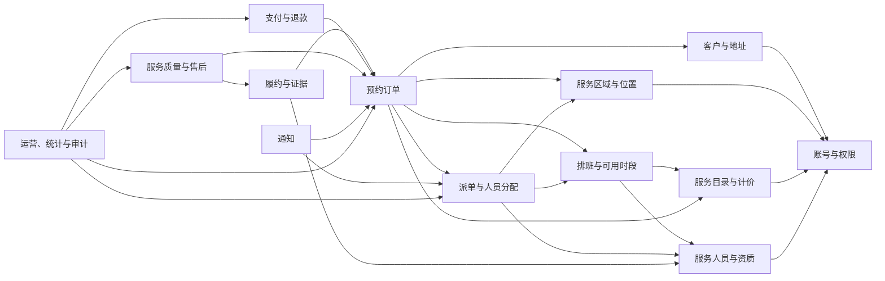

# 单公司自营家政服务系统业务模块设计

## 1. 适用范围

本目录用于细化“单公司自营家政服务预约与运营系统”的业务模块。

当前业务口径固定如下：

```text
一家家政公司运营一个统一品牌
公司自行发布服务、定价、接单、派单和承担售后
服务人员由本公司全职人员和兼职人员组成
不做家政公司入驻
不做个人服务者独立开店
不做平台佣金、商家分账和多商家数据隔离
首版不做开放抢单池
```

如果本目录与早期“多商家平台”相关描述不一致，以本目录的单公司自营口径为准。

## 2. 角色边界

| 角色 | 说明 | 主要使用端 |
| --- | --- | --- |
| 消费者 `CUSTOMER` | 浏览服务、预约、支付、查看履约、确认完成和评价 | 消费者端 |
| 服务人员 `WORKER` | 全职或兼职人员，维护档期并执行被分配的订单 | 服务人员端 |
| 运营人员 `OPERATOR` | 服务配置、人员审核、排班、派单、订单监控和售后 | 运营管理端 |
| 系统管理员 `ADMIN` | 账号、权限、系统配置和审计 | 管理端 |

服务人员不参与自由抢单。系统根据人员能力、服务区域和档期进行分配，人员确认接单；运营人员可以人工改派。

## 3. 模块清单

### 3.1 核心业务模块

| 编号 | 模块 | 文档 | 核心职责 | MVP |
| --- | --- | --- | --- | --- |
| 01 | 账号与权限 | [01-identity-access.md](./01-identity-access.md) | 登录、账号状态、角色、接口权限和数据范围 | 必须 |
| 02 | 客户与地址 | [02-customer-address.md](./02-customer-address.md) | 客户档案、常用地址、地址快照和隐私 | 必须 |
| 03 | 服务区域与位置 | [03-service-area-location.md](./03-service-area-location.md) | 服务区域、地址覆盖判断和区域配置 | 必须 |
| 04 | 服务目录与计价 | [04-service-catalog-pricing.md](./04-service-catalog-pricing.md) | 服务分类、服务项目、加项、价格规则和服务标准 | 必须 |
| 05 | 服务人员与资质 | [05-workforce-qualification.md](./05-workforce-qualification.md) | 全职/兼职档案、技能、证书、健康证明和服务区域 | 必须 |
| 06 | 排班与可用时段 | [06-scheduling-availability.md](./06-scheduling-availability.md) | 排班、请假、可用时段、时段锁定和释放 | 必须 |
| 07 | 预约订单 | [07-booking-order.md](./07-booking-order.md) | 报价、下单、订单状态机、取消和改期 | 必须 |
| 08 | 派单与人员分配 | [08-dispatch-assignment.md](./08-dispatch-assignment.md) | 候选人筛选、自动分配、接单、拒单和改派 | 必须 |
| 09 | 履约与证据 | [09-fulfillment-evidence.md](./09-fulfillment-evidence.md) | 签到、开始服务、检查项、照片、异常和完成申请 | 必须 |
| 10 | 支付与退款 | [10-payment-refund.md](./10-payment-refund.md) | 模拟支付、支付流水、取消退款和退款记录 | 必须 |
| 11 | 服务质量与售后 | [11-service-quality-aftersales.md](./11-service-quality-aftersales.md) | 评价、投诉、售后工单、返工和质量指标 | 必须 |

### 3.2 支撑模块

| 编号 | 模块 | 文档 | 核心职责 | MVP |
| --- | --- | --- | --- | --- |
| 12 | 通知 | [12-notification.md](./12-notification.md) | 站内消息、订单提醒、通知任务和失败重试 | 基础版必须 |
| 13 | 运营、统计与审计 | [13-operations-reporting-audit.md](./13-operations-reporting-audit.md) | 运营看板、异常处理、统计口径和审计日志 | 基础版必须 |

## 4. 模块关系



依赖原则：

1. `booking-order` 是交易和预约主聚合，但不直接修改其他模块的业务表。
2. `dispatch-assignment` 只负责人员分配过程，订单主状态仍由订单应用服务更新。
3. `payment-refund` 只负责支付和退款事实，不能直接把订单改成已完成。
4. `fulfillment-evidence` 记录履约过程，通过订单命令申请完成或提交异常。
5. 其他模块不能直接修改 `booking_order.order_status`。
6. 运营模块只调用各模块公开的查询和命令，不把业务规则复制到 Controller。

## 5. 统一业务约束

### 5.1 服务商品

- 服务目录由公司统一维护，服务项目不归属于任何入驻商家。
- 一个订单对应一个主服务项目，附加服务和耗材作为订单明细。
- 首版支持固定价、面积阶梯、时长、数量和加项计价，不做通用规则引擎。
- 下单时保存服务名称、单价、规则和服务标准快照。

### 5.2 人员供给

- 服务人员只有全职和兼职两种用工类型，不区分入驻商家。
- 人员必须处于可用状态，并满足技能、证书、服务区域和档期条件。
- 排班、订单分配和履约记录都必须关联具体服务人员。
- 首版不开放自由抢单，使用系统分配、人员确认和运营改派。

### 5.3 预约时段

- 消费者选择日期和标准服务时间窗，不直接选择某个服务人员的时段。
- 系统在提交订单时匹配人员并锁定该人员的时间窗。
- 同一人员的同一时间窗只能存在一个有效占用。
- 用户可预约性表示“至少存在一个满足条件的可用人员时间窗”。

### 5.4 状态分离

以下状态必须独立维护：

```text
订单主状态
人员分配状态
支付状态
退款状态
售后状态
评价状态
```

不能用同一个 `status` 字段同时表达订单、支付和售后。

### 5.5 数据权限

- 消费者只能访问自己的客户档案、地址、订单、支付和售后数据。
- 服务人员只能访问自己的档案、排班、本人被分配的订单和履约资料。
- 运营人员按区域或业务权限访问订单，敏感操作必须审计。
- 完整手机号、门牌、证件和履约照片不得出现在普通日志和公开消息中。

### 5.6 审计字段

审计字段用于记录数据的创建、最后修改和乐观锁版本，不能替代完整业务操作日志。

普通可变业务表统一使用：

```sql
created_at DATETIME(3) NOT NULL DEFAULT CURRENT_TIMESTAMP(3),
created_by_account_id BIGINT UNSIGNED NULL,
updated_at DATETIME(3) NOT NULL DEFAULT CURRENT_TIMESTAMP(3)
    ON UPDATE CURRENT_TIMESTAMP(3),
updated_by_account_id BIGINT UNSIGNED NULL,
version BIGINT UNSIGNED NOT NULL DEFAULT 0
```

规则：

- `created_at` 和 `updated_at` 由数据库维护。
- `created_by_account_id` 和 `updated_by_account_id` 保存账号 ID，不保存姓名。
- 系统任务无人操作时人员字段可以为空，同时通过 `operation_source` 或审计日志记录 `SYSTEM`。
- 日志、支付回调、证据、状态历史等追加表只保存创建时间或业务事件时间，不增加 `updated_at`。
- 历史不可变表可以使用 `operator_account_id`、`reported_by_account_id` 等更准确的业务字段。
- `version` 用于乐观锁，只在需要并发更新的表中使用。
- `created_by` 和 `updated_by` 只代表最后一次操作，完整历史必须查询状态日志或 `audit_log`。
- 人员姓名字段不得复制到审计字段中，展示时通过账号或人员模块查询。

## 6. 首版主链路

```text
消费者选择服务与地址
-> 查询可预约日期和时间窗
-> 系统报价
-> 提交订单并匹配人员、锁定时段
-> 消费者支付
-> 人员确认接单
-> 人员签到并开始服务
-> 填写检查项、上传证据并申请完成
-> 消费者确认
-> 消费者评价
```

异常链路：

```text
支付超时 -> 取消订单 -> 释放时段
人员拒单或超时 -> 平台改派 -> 订单主状态不变
人员请假 -> 释放原时段 -> 改派或与用户协商改期
服务异常 -> 记录异常 -> 运营处理 -> 返工、退款或投诉
```

## 7. 全链路状态

订单、时段、派单、支付和履约必须按以下矩阵联动：

| 阶段 | 订单 | 人员时段 | 派单任务 | 分配记录 | 支付 | 履约 |
| --- | --- | --- | --- | --- | --- | --- |
| 提交订单 | `PENDING_PAYMENT` | `HELD` | `WAITING_PAYMENT` | `WAITING_PAYMENT` | 未创建 | 未创建 |
| 发起支付 | `PENDING_PAYMENT` | `HELD` | `WAITING_PAYMENT` | `WAITING_PAYMENT` | `CREATED` 或 `PAYING` | 未创建 |
| 支付成功 | `CONFIRMED` | `BOOKED` | `PENDING_ACCEPT` | `PENDING_ACCEPT` | `SUCCESS` | 未创建 |
| 人员接受 | `CONFIRMED` | `BOOKED` | `ACCEPTED` | `ACCEPTED` | `SUCCESS` | `PENDING` |
| 人员拒绝或超时 | `CONFIRMED` | 原时段释放 | `REASSIGNING` | `REJECTED` 或 `EXPIRED` | `SUCCESS` | 未创建 |
| 人员出发 | `EN_ROUTE` | `BOOKED` | `ACCEPTED` | `ACCEPTED` | `SUCCESS` | `EN_ROUTE` |
| 人员签到 | `EN_ROUTE` | `BOOKED` | `ACCEPTED` | `ACCEPTED` | `SUCCESS` | `CHECKED_IN` |
| 开始服务 | `IN_SERVICE` | `BOOKED` | `ACCEPTED` | `ACCEPTED` | `SUCCESS` | `IN_SERVICE` |
| 申请完成 | `PENDING_CONFIRM` | `BOOKED` | `ACCEPTED` | `ACCEPTED` | `SUCCESS` | `PENDING_CONFIRM` |
| 客户确认 | `COMPLETED` | `BOOKED` 或后续关闭 | `ACCEPTED` | `ACCEPTED` | `SUCCESS` | `COMPLETED` |
| 待支付取消 | `CANCELED` | `AVAILABLE` 或 `CLOSED` | `CANCELED` | `CANCELED` | `CLOSED` | 未创建 |
| 已支付取消 | `CANCELED` | `AVAILABLE` 或 `CLOSED` | `CANCELED` | `CANCELED` | `REFUNDING` 或 `REFUNDED` | 未完成 |
| 完成后退款或返工 | 保持 `COMPLETED` | 不变 | 不变 | 不变 | 按退款状态 | 追加售后记录 |

自动派单失败时：

```text
订单保持 CONFIRMED
派单任务进入 MANUAL_REQUIRED
运营人员必须继续改派或与客户协商改期
```

## 8. 模块文档统一结构

当前 13 个模块均已补充以下内容：

1. 模块目标与边界。
2. 使用角色和用例。
3. 核心实体与关系。
4. 关键状态和业务规则。
5. MySQL 表结构、唯一约束、索引和检查约束。
6. 事务和并发处理。
7. 对外命令与查询。
8. 与其他模块的协作。
9. 数据权限和审计要求。
10. MVP 范围与后续扩展。
11. 待确认问题。

## 9. 后续实现顺序

具体施工步骤、Flyway 迁移批次和验收门槛见 [07-业务模块实施施工总说明.md](../07-业务模块实施施工总说明.md)。

代码实现建议按以下批次进行：

```text
批次一：identity、customer、location
批次二：catalog、workforce、scheduling
批次三：booking、dispatch
批次四：payment、fulfillment
批次五：servicequality、notification、operations
```

每批完成后执行模块内单元测试和必要的跨模块集成测试，不能等全部业务写完后再补测试。

## 10. 技术支撑表

以下表由技术基础阶段统一管理，不在各业务模块重复定义：

| 表名 | 归属 | 用途 |
| --- | --- | --- |
| `event_outbox` | 技术基础 | 可靠异步事件 |
| `consumer_message` | 技术基础 | 消息消费幂等 |
| `idempotency_record` | 技术基础 | 接口幂等 |
| `file_object` | 文件基础 | 私有文件元数据 |
| `audit_log` | 运营审计 | 敏感操作审计，表结构见 13 模块 |
| `system_config` | 运营配置 | 非敏感系统配置，表结构见 13 模块 |

业务模块只引用这些表的公开服务或业务 ID，不直接跨模块修改其数据。
